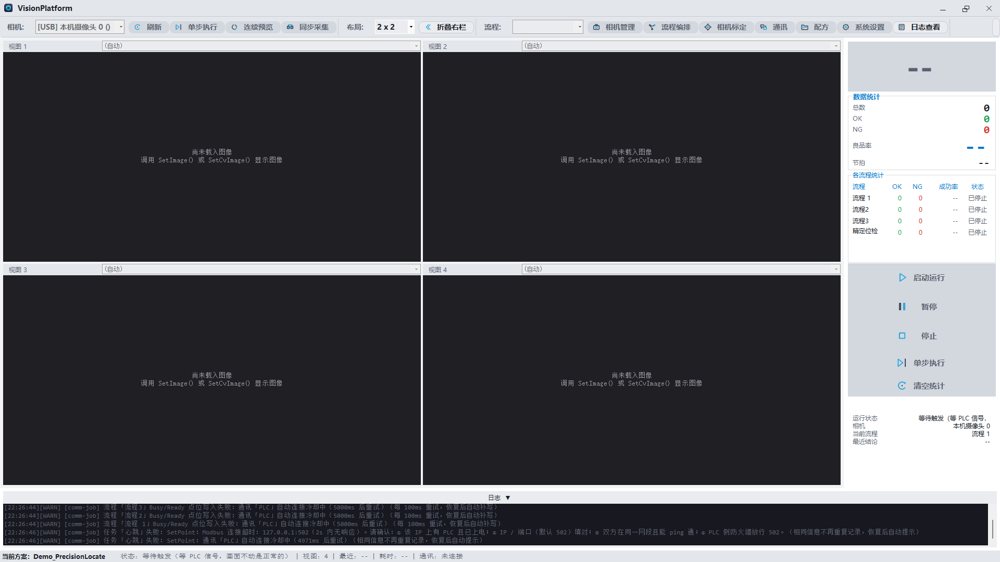
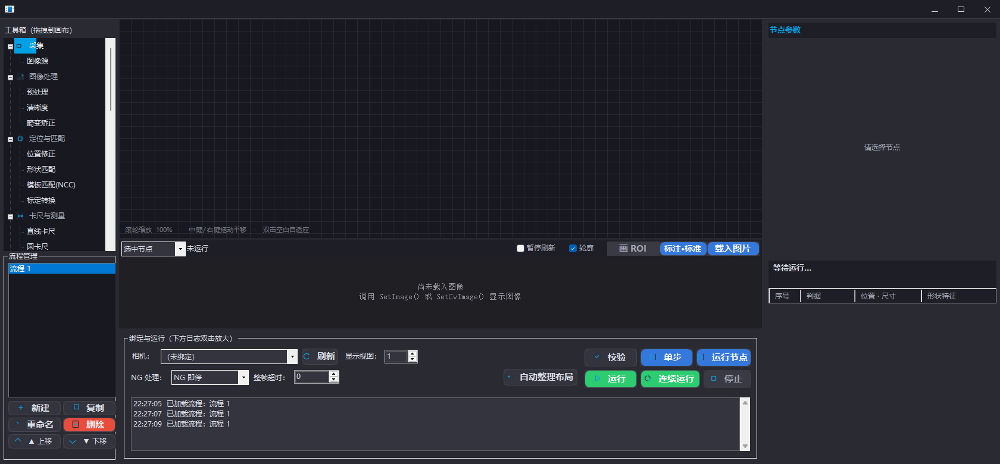

# VisionSystem — 工业机器视觉软件

<!-- VERSION_BLOCK_START -->
> **当前版本：1.0.14.8**
<!-- VERSION_BLOCK_END -->

> 更新记录见 [CHANGELOG.md](CHANGELOG.md)。

一套完整的工业视觉检测软件：用 **C++ / OpenCV** 编写视觉算法，用 **C# / WinForms (.NET Framework 4.8)** 编写软件界面，通过 P/Invoke 调用 C++ 算法 DLL。整套代码包含在一个解决方案 `VisionSystem.sln` 内，共 7 个项目。

- 目标框架：**.NET Framework 4.8**
- 算法引擎：**C++ / OpenCV 4.5.5**
- 开发工具：**Visual Studio 2022 Community**（`D:\Program Files\Microsoft Visual Studio\2022\Community`）
- 平台：**全部 x64**（算法库为 x64，主程序 `PlatformTarget=x64`）
- 第三方依赖：**零 NuGet 包**（JSON 用 `DataContractJsonSerializer`，Modbus/TCP 自行实现），外部 DLL 统一收纳在 `ThirdParty/`

---

## 界面预览

### 主运行界面



四视图实时画面 + 右栏数据统计（总数 / OK / NG / 良品率 / 节拍、各流程 OK/NG/成功率/状态）+ 运行控制（启动运行 / 暂停 / 停止 / 单步 / 清空统计）。
底部状态栏：**当前方案**（加粗）、运行状态、视图数、最近结论、耗时、通讯状态，以及按**配方实际使用的相机**生成的连接标签（绿 = 已连接、红 = 未连接）。

### 流程编辑器



- **左栏**：模块工具箱（按采集 / 图像处理 / 定位与匹配 / 卡尺与测量 / 分割与拟合 / 识别 / 深度学习 / 3D / 输出分类）与流程管理（列表可滚动，50+ 流程也够用）
- **中间**：节点画布，支持拖拽建节点、连线、绘制 ROI、自动整理布局、缩放与网格吸附
- **右栏**：当前节点参数（声明式表单）与「输出结果」表格（序号 / 判据 / 位置·尺寸 / 形状特征，一行一个目标，点行可高亮对应图形）
- **底部**：「绑定与运行」区——相机绑定、NG 处理策略、校验 / 单步 / 运行节点、自动整理布局、运行 / 连续运行 / 停止

> 截图取自深色主题与示例方案 `Demo_PrecisionLocate`（未接相机时视图显示"尚未载入图像"属正常）。

---

## 整体软件架构

四层结构，自底向上：

```
┌─ 算法层    VisionAlgo.Native  (C++/OpenCV) ── 预处理 / 匹配 / 测量 / 检测 / OCR / 条码 / 相机采集
│           导出为 x64 DLL，按 va_ 前缀 C 接口暴露
├─ P/Invoke 边界  VisionPlatform/Native/VisionAlgo.cs、NativeCamera.cs
│           （界面与算法之间唯一的接触面：结构体一一映射、零拷贝传入、输出由 C# 分配）
├─ 契约层    VisionPlatform.Framework ── 模块契约 / 注册表 / 动态加载 / 公共数据类型（无 WinForms）
├─ 模块层    VisionPlatform.Modules   ── 31 个流程模块的端子 / 默认参数 / 参数表 / 界面声明（运行时加载）
├─ 业务层    VisionPlatform           ── 配置 / 相机 / 流程执行 / 通讯 / 配方 / 检测引擎
└─ 表现层    VisionPlatform/UI + VisionPlatform.UI.Controls + VisionSystem.Controls
            窗体、可复用主题与参数列表控件、图像/点云显示控件库
```

**核心约束**：界面不直接碰算法，算法不认识界面；节点差异由模块包**声明**（端子 / 参数表 / 界面提示），
宿主 UI 不按节点类型写分支。依赖方向 `Modules → Framework ← UI.Controls ← 宿主`，详见
[VisionPlatform 解耦重构](docs/架构/VisionPlatform解耦重构.md)。

**多流程并行**：`FlowRunManager` 为每条流程维护一个 `FlowRunSlot`（独立线程 + 独立原生算法上下文 `va::Context`），「全部启动」并行跑所有流程；相机按 `CameraLease` 独占（默认严格独占，避免并发取帧打崩厂商 SDK），同相机取帧由 `CameraGrabGate` 串行化。

**一次检测的数据流**：相机 `GrabOne()`（或读取点云/图片文件夹等本地源）→ `FlowRunner` 按节点链执行
（图像源 / 点云源 → 各算法节点 → 汇总判定）→ 结果以灰度图 + 几何图形叠加回显到 `ImageViewer`
（点云自动切 3D 模式，X/Y/Z 坐标轴 + 三维旋转），并刷新 OK/NG 统计。

**运行闸门与触发式运行**：`CommRuntime` 是通讯唯一闸门 —— 主界面「运行」才 `Activate()`，
暂停/停止 `Suspend()`；**非运行态不连接 / 不心跳 / 不轮询 / 不写状态位**。
产线默认**触发式运行**：外部触发走 `FlowRunManager.Trigger(flow)` 单发一轮（执行中重复触发丢弃、不排队），
连续模式才按帧率循环。多流程分区：第 i 条流程 = `基址 + i × 步长`，触发侧与发送侧步长必须一致。

### 模块职责

| 层 | 项目 / 目录 | 职责 |
|---|---|---|
| 算法层 | `VisionAlgo.Native` | C++ / OpenCV：预处理、Blob、清晰度、圆/直线拟合、模板/形状匹配、目标检测、OCR、条码、本机相机采集 |
| P/Invoke 边界 | `VisionPlatform/Native/VisionAlgo.cs`、`Native/NativeCamera.cs` | 唯一接触 C++ 处；结构体映射、零拷贝传入、相机帧经 `VA_Image`（BGR，`stride` 如实传递） |
| 契约层 | `VisionPlatform.Framework` | `IFlowNodeModule` / `IFlowModulePackage`、`FlowModuleRegistry`、`ModuleLoader`、公共数据类型（`FlowNodeType` / `ParamItem` / 参数表 / 端子） |
| 模块层 | `VisionPlatform.Modules` | 31 个流程模块的清单、默认参数、参数表、端子、界面提示；**与宿主同目录输出**，由宿主反射加载（`Modules\` 子目录为兼容老部署的备选路径） |
| 业务层 | `VisionPlatform/Core` | Logger（SQLite 日志库）/ AppPaths / Json / OpResult / AppSettings（AppConfig 三段式 + ConfigStore）/ ImageStore / PerfProbe |
|  | `VisionPlatform/Camera` | 相机接口与**本机摄像头 `LocalCamera`** / 模拟 `SimCamera` / 海康 `HikCamera`（占位）/ CameraManager |
|  | `VisionPlatform/Flow` | 流程模型、单链执行器 `FlowRunner`、并行管理器 `FlowRunManager`（触发式 `Trigger` / 连续双模式）、结果通道 `FlowOutputChannel`、节点复制粘贴 `FlowPasteService`、图片/点云文件夹游标 |
|  | `VisionPlatform/Communication` | TCP 客户端/服务端、`ModbusTcpClient`（MBAP+PDU 自实现）；**运行闸门 `CommRuntime`**、常驻任务引擎 `CommJobEngine`（心跳 / Ready-Busy / 结果推送 / 外部触发 `EdgeLoop`）、点位映射 `CommPointMapper`、消息模板 `CommTemplate`、发送队列 `CommSendQueue`、协议插件框架 `CommProtocolRegistry` |
|  | `VisionPlatform/Recipe` | 配方 `Recipe` / `RecipeStore`（**保存配方 = 保存整个工程**）、工程包导入导出 `ProjectBundle`（破坏性导入前自动备份）、示例方案 `SampleProject` |
|  | `VisionPlatform/Vision` | 检测配置、`InspectionEngine` |
| 显示层 | `VisionSystem.Controls` | 图像显示（2D/3D 合用：`ImageViewer` + `PointCloud/GlPointView` OpenGL 点云）、几何图形、OpenCV 互操作 |
| 通用界面层 | `VisionPlatform.UI.Controls` | `UiTheme` / `UiStyle`、按钮 / 表格 / 树 / 标题栏、声明式参数列表 `ParamListControl`、数值框统一策略 `NumericInputPolicy` |
| 表现层 | `VisionPlatform/UI` | 登录、主运行界面、流程编排、通讯（含自动化任务 / 动作编辑器）、OCR 字符训练、系统设置及各功能窗体 |

---

## 已实现功能

- **登录 / 启动加载**：`LoginForm` + `SplashForm`
- **相机管理**：统一相机接口 `ICamera`；**本机摄像头 `LocalCamera`**（USB / 笔记本内置，OpenCV `VideoCapture` 接入，**零第三方依赖**，支持实时预览）；模拟相机 `SimCamera` 跑通全流程；海康 `HikCamera` 为占位实现（见尚未完善）
- **主运行界面 `MainForm`**：布局可调的多显示视图（1x1 / 1x2 / 2x1 / 2x2 / 3x2 / 3x3，最多 9 个），每个视图可单独绑定相机；单帧 / 同步采集；**多流程循环运行**（全部启动 / 暂停 / 停止）；数据统计（总数 / OK / NG / 良率 / 节拍）；各流程统计表（含每条流程实时状态：运行中 / 已中止 / 已停止 等）；日志区支持 `全部 / 结果 / 仅异常 / 实拍 / 模拟` 过滤（只影响显示，文件与日志库仍记录全部）
- **流程编排 `FlowForm`**（VisionMaster 风格）：多流程（增删改切）、工具箱拖拽生成节点、节点间有向连线（DAG：一个输出可接多个下游、多路汇聚按拓扑序串行执行）、每流程绑定相机与显示视图、运行回显；运行状态日志保留最近 200 条（双击可放大/复制）；另保留 `AlgoForm` 作为离线单图算法调试工作台
- **通讯**：TCP 客户端/服务端、`ModbusTcpClient`（自行实现 MBAP+PDU，支持 0x01/03/05/06/10 及多数据类型）；
  **运行闸门 `CommRuntime`**（非运行态不连接 / 不心跳 / 不轮询 / 不写状态位）、点位表 / 消息模板 /
  常驻任务引擎（心跳、Ready-Busy、结果推送、外部触发 `PointEdge`、跨流程汇总）与协议插件框架；
  多流程分区（第 i 条流程 = 基址 + i×步长，触发与发送两侧步长必须一致）
- **触发式运行（产线默认）**：外部触发 `FlowRunManager.Trigger` 单发一轮 —— 执行中重复触发**丢弃不排队**
  （过期画面的结果不回传 PLC）；连续模式才按帧率循环；软件打开默认运行模式
- **配方 = 工程包**：一个方案目录 = `recipe.json + comm.json + flows.json + 模板 + 方案说明 + _backup`；
  `RecipeStore.Save` 同时写通讯与工程文件；**工程包导入是破坏性操作**，导入前自动备份（保留 5 份）；
  示例方案用真实类型构造生成（`SmokeUi --create-sample`），绝不手写 JSON
- **节点复制粘贴**：进程级剪贴板跨流程粘贴，Id 重生成、目标流程内改名去重、模板/OCR 模型资产目录复制；
  画布支持多选（Ctrl+点击）、框选整组对齐落点、Ctrl+C/V / Del
- **OCR 字符训练**：`OcrCharTrainForm` + `OcrTrainSession` —— 逐字符截图训练、模板库管理、
  训练快照存证；一个字符一张模板（文件名即标签）
- **数值框统一策略 `NumericInputPolicy`**：滚轮永不改值（进程级 `IMessageFilter` + 控件双层拦截）、
  上下步长按 `DecimalPlaces` 0/1/≥2 → 1/0.1/0.01（不按存储类型）、显式类型 `SetValueType`
- **3D 点云**（1.0.9.x 新增）：读取点云节点（PLY / PCD / 16bit 深度图按内参反投影）；
  `ImageViewer` **2D/3D 合用** —— 点云自动切 3D 模式，左键旋转 / 滚轮缩放 / 双击复位；
  **X/Y/Z 坐标轴**（X 红 / Y 绿 / Z 蓝，标签实时跟随）；OpenGL 零依赖（opengl32 P/Invoke 自建 wgl 上下文）
  且带**质量闸门** —— 无显卡驱动时自动降级内置逐点光栅渲染（HUD 标「软件渲染」），无 GPU 也能正常出图
- **异常检测（1.0.14.0 新增）**：只用 OK 样本建模型（PaDiM 在软件内训练，EfficientAD 走 IR 推理），
  参数面板顶部有模型状态卡片（挂的是哪个模型 / 目录在哪 / 一键刷新）、「样本 / 训练…」窗体支持
  **多图同屏标注**（缩略图墙 + 双击循环标 OK/NG + 框 ROI）+ 训练 + 回验混淆统计；
  判定用 **0~1 的良品得分（越高越好，0.5 恒等于模型自带阈值即及格线，得分低于它判 NG）**，
  得分 / 缺陷数 / 面积占比直接输出到结果区与 `Score` 端口
- **配方**：`Recipe` + `RecipeStore`，JSON 存取、当前配方切换自动同步参数
- **系统设置**：图片保存路径 / 格式（PNG/JPEG/BMP/TIFF）/ 保留天数（自动清理）/ 检测后自动保存与仅存 NG / 循环运行前是否要求通讯已连接
- **配置持久化**：系统 / 算法 / 界面 / 流程 四类参数落到 `<程序目录>\Config\appconfig.json`（如 `bin\x64\Release\Config\appconfig.json`），重启自动加载；
  老版本放在程序根目录的 `appconfig.json` 首次启动会自动迁移进来（升级只换二进制、保留 `Config\` 即可保住配置）
- **图像显示控件库 `VisionSystem.Controls`**：双缓冲、大图流畅缩放平移、几何图形（圆/矩形/旋转矩形/圆环）编辑、HUD 坐标与像素值、与 OpenCV `Mat` 零拷贝互通

---

## 已实现算法清单

工具箱共 **31 个流程模块**（由 `VisionPlatform.Modules` 动态加载），按分类如下。
每个模块的端子、参数表、默认值都在模块包内声明，新增模块不需要改宿主界面。

### 采集
- **图像源 ImageSource**：流程绑定相机 / 本地图片 / 图片文件夹轮播；支持 ROI 裁剪、旋转、镜像。
  曝光、增益、触发模式、触发源、触发延时已可配置并随流程保存（当前仅保存，不下发相机）。

### 图像处理
- **预处理 Preprocess**：灰度、高斯模糊、二值化、反相、形态学（开 / 闭）。
- **清晰度 Sharpness**：清晰度评分，用于对焦 / 运动模糊判定。
- **畸变矫正 DistortionCorrect**：按相机内参（畸变矫正记录）去畸变。

### 定位与匹配
- **位置修正 PositionCorrect**：由匹配位姿或手动示教得到 dX / dY / dAngle / dScale，修正后续节点坐标。
- **形状匹配 ShapeMatch**：边缘形状模板，支持角度 / 缩放搜索、金字塔、搜索 ROI、多目标、亚像素。
- **模板匹配 TemplateMatch**：NCC 灰度归一化匹配，支持角度 / 缩放搜索（金字塔由粗到细）、多目标与亚像素；分数在去旋转 padding 后重算，与角度无关可比阈值。
- **标定转换 CalibTransform**：像素坐标 → 机械坐标（N 点标定 / 旋转中心），支持距离与角度换算。

### 卡尺与测量
- **直线卡尺 LineCaliper**：投影找边 → 直线拟合 → 直线度 RMS。
- **圆卡尺 CircleCaliper**：径向投影找边 → 圆拟合 → 圆度 RMS。
- **交点卡尺 LineIntersect**：两组扫描线（或上游两条直线）求延长线交点。
- **边缘对查找 EdgePair**：沿法向一维取样，按极性配对测线宽（线宽 / 对数 / 中心）。
- **点点测量 PointPointMeasure**：两点距离、方向角、ΔX / ΔY、中点。
- **点直线测量 PointLineMeasure**：点到直线垂距、垂足、线角。
- **线线测量 LineLineMeasure**：两直线夹角、交点、平行间距。

### 分割与拟合
- **Blob 分析 Blob**：二值化 / 极性 / 面积 / 尺寸 / 圆度筛选，输出数量、区域中心、目标列表。
- **圆拟合 FitCircle**：由轮廓点最小二乘拟合圆。
- **直线拟合 FitLine**：由轮廓点拟合直线。

### 识别
- **字符识别 Ocr**：传统 OCR，字符分割 + 模板匹配（一个字符一张模板，文件名即标签）；
  支持旋转 ROI 与位置跟随。
- **条码/二维码 BarcodeRead**：zxing-cpp 识别，**不需要模板**，一次可识别多个码；
  支持一维（Code128/39/93/Codabar/EAN/UPC/ITF/DataBar）与二维（QR/MicroQR/DataMatrix/Aztec/
  PDF417/MaxiCode），输出文本 + 码制 + 四角点/旋转框；可限定码制、方向、反色与纯码模式。

### 深度学习（OpenVINO）
- **目标识别 ObjectDetect**：YOLO 目标检测（类别 / 分数 / 检测框）。
- **目标语义分割 DlSeg**：YOLO 分割，输出框 + 掩膜面积。
- **目标姿态估计 DlPose**：YOLO 姿态，输出框 + 关键点。
- **目标深度估计 DlDepth**：单目深度图（0~1 归一化）。
- **OCR(深度学习) OcrDl**：PaddleOCR 两阶段（DB 文本检测 + CRNN 识别）。
- **异常检测 AnomalyDetect**：无监督缺陷检测（PaDiM 原生训练；EfficientAD 与可选特征提取器走 OpenVINO）。
  只用 OK 样本建模型，输出**热图 + 最大分 / 面积占比 / 缺陷数 / 最大缺陷框 / 最大分点位**；
  模型固定放 `Models\Anomaly\<模型名>\`，参数面板下拉选模型（**没有文件对话框**），
  支持检测区域 ROI（随位置修正移动）。训练入口在参数面板的「训练 / 标注样本…」：
  多图同屏、逐张标 OK/NG、框 ROI、混淆统计。方案背景见
  [docs/算法/无监督缺陷检测技术方案.md](docs/算法/无监督缺陷检测技术方案.md)，
  模型目录 / 训练步骤 / EfficientAD 导出见 [docs/算法/异常检测-模型目录与训练.md](docs/算法/异常检测-模型目录与训练.md)。

### 3D 视觉
- **读取点云 PointCloudSource**：PLY（ascii / binary_little_endian）、PCD（ascii / binary，含 RGB 解包）、
  16bit 深度图按内参反投影（X=(u-Cx)·Z/Fx，GDI+ 会压 8bit 所以走内置 PNG 解析）三选一，
  另支持点云文件夹自然序轮播；输出 `点云` + `点数`；只含点云的流程不需要相机、不报「缺少图像源」。
  显示见「图像显示控件库」（2D/3D 合用查看器 + 坐标轴 + GL 质量闸门）。

### 输出与通信
- **结果输出 ResultOutput**：汇总整链 OK / NG 与摘要，流程终点。
- **发送数据 SendData**：按名称绑定通讯，目标 TCP 发文本、目标 Modbus 写寄存器（必须配 `DataMode=ModbusWrite`
  + 寄存器地址）；**坐标/角度回传用 `MbMap` 批量写**（`OkNg:20:UInt16; PosX:30:Int32; ...`），
  多流程分区按流程序号 × 步长自动偏移。
- **接收数据 ReceiveData**：读最近一条 TCP 文本或 Modbus 保持寄存器。
- **脚本 Script**：C# 脚本读取全部上游输出并计算，结果写回摘要 / 端口。

> 历史枚举 `ImageFilter` / `ColorExtractor` 仍保留在 `FlowNodeType` 中（旧配置兼容），
> 但**不在工具箱**；新流程请分别用「预处理」「Blob 分析」替代。

---

## 尚未完善 / 已知限制

**P0 — 需补充环境才能完成**
- **海康相机 `HikCamera` 为占位实现**：已完整实现 `ICamera` 契约与 SDK 探测逻辑，但未安装 MVS SDK，真实取流未接（源码以 `// TODO(SDK):` 标注）。可用模拟相机 `SIM-0` 跑通全链路。
- **3D 相机实时采集未接**：点云目前从文件 / 深度图 / 文件夹读取（显示与节点链路已完整），
  3D 相机实时取流等用户提供型号 / SDK 后接入。

**P1 — 功能不完整**
- **登录为内置账号表**，生产环境应换数据库 / LDAP / 域认证；**未做权限细分**（操作员/管理员角色未与界面功能绑定）。
- **相机仅支持软触发**，无硬触发 / IO 接口，外部触发信号接不进来。
- **配方不含相机参数**：`Recipe` 只有 `CameraId`，曝光、增益、触发模式等未纳入。
- **检测结果统计未落盘**：图像存证（保存路径 / 格式 / 保留天数 / 自动保存 / 仅存 NG）已完成，但 OK/NG **统计结果本身**仍未持久化（无数据库或 CSV 报表）。
- **异常检测的 EfficientAD 只做推理**：学生网络需要反向传播训练，本库不含训练器；
  要用心 `docs/算法/异常检测-模型目录与训练.md` 的导出流程（PyTorch → ONNX → ovc），
  目前**只有 PaDiM 那条路是真机验证过的**，EfficientAD 的加载/融合分支待有 IR 后补回归。
- **异常检测样本少时阈值偏松**：阈值由 k 折留出实测分数定（`×1.5` 余量），给 5 张 OK 图的模型
  一定比给 50 张的更保守；现场建议 ≥ 20 张，30~50 张最稳。
- **通讯自动化需先配置任务**：默认不启用任何通讯任务；需在「通讯 → 点位/任务…」配置点位、消息与任务后，
  心跳 / Ready-Busy / 结果推送 / 跨流程汇总才会运行。用法见 [通讯架构重构方案](docs/架构/通讯架构重构方案.md)；
  OPC UA 驱动待外部 SDK（放到 `ThirdParty/Communication` 后构建自动复制）。

**P2 — 工程与运行限制**
- **单流程内串行、多流程并行**：单条流程已支持有向无环图（扇出 / 汇聚），节点按拓扑序**串行**执行，同一帧内各分支不并发；条件分支（按判定择路）与流程内并行分支属后续扩展。「全部启动」以独立线程并行调度多条流程，每条流程有独立的算法上下文。详见 [流程拓扑与并发](docs/架构/流程拓扑与并发.md)。
- **本机摄像头枚举为探测式**（OpenCV 无跨平台枚举 API，逐个尝试打开 0..7）：刷新列表有数百毫秒开销，且拿不到设备友好名（统一显示「本机摄像头 n」）。
- C++ 侧 `VideoCapture::read` **阻塞读且无超时**：设备假死时停止采集后可能短时无法再次启动（关闭相机重开即可恢复）。
- **端到端运行验证尚未自动化执行**：自动化已覆盖原生链路与构建，界面交互需人工确认（无相机硬件时可用 `SIM-0` + 本地图片跑通）。
- 登录使用硬编码账号；部分较新算法节点的参数面板可能仍需打磨。

详细内容见 [遗留问题.md](docs/遗留问题.md)。

---

## 目录结构

```
VisionSystem/                              唯一解决方案根目录
├── VisionSystem.sln                       单一解决方案（7 个项目 + Solution Items）
├── build.bat                              一键构建（含代理变量清理）
├── version.bat                            版本号工具（真源：src/SharedVersion.cs）
├── assets/                                软件图标源资源（app.ico 嵌入 exe；png/svg 为设计源，不复制到 bin）
│   └── icons/                             app.ico（exe 图标真源）/ SVG 设计源 / PNG 各尺寸
├── README.md                              本文件
├── ThirdParty/                            所有外部依赖，按用途分次级目录
│   ├── OpenCV/                            OpenCV 4.5.5（include / lib/x64 已入库，bin/x64 需自备）
│   ├── OpenVino2025.4.1/                  OpenVINO CPU 推理运行时
│   ├── SQLite/                            日志库原生 DLL
│   ├── ZXing/                             zxing-cpp 源码（lib/ 为现场构建产物，不入库）
│   ├── Communication/                     通讯协议第三方依赖占位（OPC UA SDK 放这里）
│   └── HikVision/                         海康 MVS SDK（当前为空）
├── bin/x64/{Debug,Release}/               构建产物：自家 DLL（含模块包）平铺 + thirdparty\ 子目录
│   └── thirdparty/{opencv,openvino,sqlite}/  外部原生 DLL（启动时自动加入 DLL 搜索路径）
├── tools/                                 开发工具，按类别分目录（version / comm / barcode / model / research …，见 tools/README.md）
├── docs/                                  文档（入口：docs/README.md 知识图谱）
│   ├── README.md                          知识图谱：概念图 / 唯一权威出处 / 文档地图
│   ├── 平台架构.md                        架构、分层、模块职责（改造前快照）
│   ├── 架构/                              解耦重构 / 通讯架构重构方案 / 性能优化 / 流程拓扑与并发
│   ├── 算法/                              算法更新记录 / 无监督缺陷检测技术方案 /
│   │                                      3D 检测算法与难点 / 异常检测-模型目录与训练
│   ├── 案例/                              通讯配置完整案例（含 TCP 模拟器与示例 JSON）
│   ├── API参考.md                         控件库完整 API 清单（待更新）
│   ├── 遗留问题.md                        已知问题、TODO、占位实现（待更新）
│   ├── 需求/增量需求总览.md                5 次增量 PRD 合并
│   ├── 架构/增量架构设计.md                6 份架构设计合并 + 公共约定唯一出处
│   ├── 参考资料/                          参考资料汇编 + 使用说明
│   └── 图表/                              6 份 Mermaid 类图 / 时序图
└── src/
    ├── SharedVersion.cs                   版本号唯一真源（链接进全部 C# 项目）
    ├── VisionAlgo.Native/                 【C++ / OpenCV】算法 DLL
    │   ├── include/
    │   │   ├── vision_algo.h              聚合头
    │   │   └── algo/                      算法头文件（preprocess / blob / fit / match / shape /
    │   │                                  measure / detect / ocr / ocrdl / dl / barcode / camera /
    │   │                                  anomaly）
    │   ├── src/
    │   │   ├── vision_algo.cpp            导出层：句柄校验 + 转发
    │   │   └── algo/                      算法实现
    │   ├── Common/                        公共：导出宏/错误码/类型/生命周期/内部工具
    │   └── VisionAlgo.Native.vcxproj
    ├── VisionSystem.Controls/              【C#】显示控件库（图像 + 点云）
    │   ├── ImageViewer.cs                 核心控件（SetImage 回 2D / SetPointCloud 进 3D）
    │   ├── PointCloud/                    PointCloudData / PointCloudFileReader（PLY/PCD/16bit PNG）/
    │   │                                  GlPointView（OpenGL 点云 + 坐标轴 + 内置渲染兜底）
    │   ├── Geometry/                      IGeometryShape / ShapeHandle / 各形状 / ShapeCollection
    │   ├── Interop/                       CvInterop（OpenCV 数据互操作）
    │   └── Rendering/                     Viewport（坐标变换）/ RenderOptions
    ├── VisionPlatform.Framework/          【C#】契约层：模块契约 / FlowNodeType / 端子 / 参数表 / 分类 /
    │                                      动态选项来源 ParamOptionSources / 异常检测模型目录约定
    ├── VisionPlatform.Modules/            【C#】模块层：31 个模块的 BuiltIn 清单 / 默认值 / 端子 / 参数表
    ├── VisionPlatform.UI.Controls/        【C#】通用界面层：UiTheme / UiStyle / UiTree / UiGrid /
    │                                      ParamListControl / NumericInputPolicy / 数值框与树主题
    ├── SmokeUi/                           回归测试台（1172 项用例 + --create-sample / 探针；不入 sln，
    │                                      用 _build_smoke.bat 构建）
    └── VisionPlatform/                     【C#】工业视觉主程序
        ├── Program.cs
        ├── Core/                          Logger（SQLite）/ AppPaths / Json / OpResult /
        │                                 AppSettings（AppConfig 三段式 + ConfigStore）/ ImageStore / PerfProbe
        ├── Native/                        VisionAlgo（P/Invoke 封装）/ NativeCamera / NativeAnomaly
        ├── Camera/                        ICamera / LocalCamera / SimCamera / HikCamera / CameraManager
        ├── Communication/                 TcpClientSession / TcpServerSession / ModbusTcpClient /
        │                                 CommRuntime（运行闸门）/ CommJobEngine / CommHub / CommPointMapper /
        │                                 CommTemplate / CommSendQueue / CommProtocolRegistry / CommState
        ├── Flow/                          FlowRunner / FlowRunManager（触发式 Trigger）/ FlowValidator /
        │                                 FlowPasteService / ProjectBundle 相关 / ImageFolderSource /
        │                                 NodeOutputSchema / NodeResultText / OCR 训练会话
        ├── Recipe/                        Recipe / RecipeStore / ProjectBundle（工程包）/ SampleProject
        ├── Vision/                        InspectionConfig / InspectionResult / InspectionEngine
        ├── Models/                        User
        └── UI/                            MainForm / FlowForm / FlowCanvasControl / FlowPreviewPanel /
                                           CommForm / CommAutomationForm / CommActionEditorForm /
                                           AnomalyTrainForm / AnomalyStatusCard /
                                           OcrCharTrainForm / ScriptEditorForm / RecipeForm /
                                           SettingsForm / LoginForm / SplashForm 等
```

> **说明**：项目分层与依赖方向 —— `VisionAlgo.Native`（算法）→ `VisionPlatform.Framework`（契约）←
> `VisionPlatform.Modules`（模块包）/ `VisionPlatform.UI.Controls`（通用控件）← `VisionPlatform`（宿主）；
> 模块包对 Framework 的 ProjectReference 必须 `Private=false`，否则 LoadFrom 后类型标识不一致、模块静默不注册。
> 所有窗体均采用 **Designer 模式**，拆分为 `XxxForm.cs`（业务逻辑）与 `XxxForm.Designer.cs`（布局）。
> C++ 项目通过 `.vcxproj.filters` 维护解决方案资源管理器中的文件夹层级。

---

## 快速开始

### 1. 环境要求
- Windows + **Visual Studio 2022**（含"使用 C++ 的桌面开发"与".NET 桌面开发"工作负载）
- 已安装 OpenCV 4.5.5 的 x64 运行时（用于准备 `ThirdParty/OpenCV/bin/x64` 下的 DLL）

### 2. 准备 OpenCV 运行时 DLL
仓库已包含 OpenCV 的头文件与导入库（`ThirdParty/OpenCV/include`、`ThirdParty/OpenCV/lib/x64`），但运行时 DLL（约 61MB / 122MB）超过 GitHub 单文件 100MB 上限，未入库。构建前请先放入：

```bat
set OPENCV=D:\Users\admin\Downloads\opencv\build
xcopy /Y "%OPENCV%\x64\vc15\bin\opencv_world455.dll"   ThirdParty\OpenCV\bin\x64\
xcopy /Y "%OPENCV%\x64\vc15\bin\opencv_world455d.dll"  ThirdParty\OpenCV\bin\x64\
:: 构建时按配置只复制对应版本（Debug→455d / Release→455）到 bin\x64\<配置>\thirdparty\opencv\
```

（只跑 Release 时只需 `opencv_world455.dll`；调试需要 `455d.dll`。）

> `ThirdParty/` 按用途分目录：`OpenCV/`（4.5.5 头文件 + 导入库）、`OpenVino2025.4.1/runtime/`（CPU 推理运行时）、
> `SQLite/`（日志库原生 DLL）、`ZXing/`（条码库 zxing-cpp 源码，`lib/` 为现场构建产物）、
> `Communication/`（通讯协议第三方依赖占位，如 OPC UA SDK）、`HikVision/`（海康 MVS SDK，当前为空）。
> 工程统一用 `$(ProjectDir)..\..\ThirdParty\...` 相对路径引用，不依赖系统 PATH；未安装 MVS SDK 时
> 海康相机为占位实现，可用模拟相机 `SIM-0` 跑通全流程。

### 3. 构建
双击根目录的 `build.bat`，或在命令行执行：

```bat
build.bat            :: 编译 Debug   | x64
build.bat Release    :: 编译 Release | x64
```

构建成功后产物位于：
- `bin\x64\{配置}\VisionPlatform.exe` + `VisionAlgo.Native.dll` + 自家托管 DLL（**模块包 `VisionPlatform.Modules.dll` 与宿主同目录**）
- `bin\x64\{配置}\thirdparty\{opencv,openvino,sqlite}\` —— 外部原生 DLL（OpenCV / OpenVINO+TBB / SQLite）

> 外部 DLL 只在 `thirdparty\` 子目录里放，根目录保持干净；程序启动第一行把各子目录加入进程 DLL 搜索路径
> （`Core/NativeDllPath.cs`，改进程 PATH 而非 `AddDllDirectory`，兼容 Win7 工控机）。
> 老部署（第三方 DLL 与 exe 平铺、模块在 `Modules\` 子目录）仍然可运行，无需回滚。

回归测试台 `SmokeUi` 不在解决方案内，改完代码用它验证（1172 项 UI / 软件层用例）：

```bat
_build_smoke.bat Debug     :: 或 Release；先构建 SmokeUi
:: 必须先把根产物拷进 SmokeUi 输出目录，否则会报"找不到 va_ocr_recognize_ex 入口点"（假失败）
:: _build_smoke.bat 已自动把 bin\x64\<配置>\*.dll 与 thirdparty\ 复制到 SmokeUi/SmokeAlgo 输出目录
src\SmokeUi\bin\Debug\SmokeUi.exe        :: 全量回归；--create-sample 生成示例方案
```

### 4. 运行
直接运行 `bin\x64\Debug\VisionPlatform.exe`（模块包 `VisionPlatform.Modules.dll` 与 exe 同目录，外部 DLL 在 `thirdparty\` 下），或在 VS2022 中将 `VisionPlatform` 设为启动项目后按 F5。无相机硬件时可用模拟相机 `SIM-0` 跑通完整流程。

### 4.1 发布到现场电脑（便携包）

**不要**把 `bin\x64\Release` 整个拷给现场 —— 里面混着开发机的 `appconfig.json`、日志、配方与 `*.pdb/exp/lib`，
而且缺 VC++ 运行库。用发布脚本产出一个干净的便携目录：

```bat
publish.bat                          :: 输出 dist\VisionPlatform
publish.bat D:\Pkg                   :: 指定目标目录
publish.bat D:\Pkg --with-models     :: 连深度学习模型（models\，约 137 MB）一起带上
```

发布包内容：`exe + 自家 DLL + thirdparty\{opencv,openvino,sqlite,vcruntime}` + 空数据目录
（`Recipes` / `Templates` / `Images` / `Logs` / `Calibrations` / `OCRModel`）+ `DEPLOY.txt` 部署说明。
VC++ 2015–2022 运行库（`msvcp140` / `vcruntime140` / `vcruntime140_1` / `vcomp140` / `concrt140`）
已按 app-local 方式放在 `thirdparty\vcruntime\`，**目标机无需安装 Redist**。

目标机要求：**Windows 10 x64 及以上**（.NET Framework 4.8 已内置）、目录**可写**（别放 Program Files）。
首次启动自动生成 `Config\appconfig.json` 与日志库；相机绑定与配方需在目标机重新配置 / 导入工程包。
升级已有现场：只替换 `exe + DLL + thirdparty\`，保留 `Config\` / `Recipes\` / `Templates\` 即可。

### 5. 打开解决方案
双击 `VisionSystem.sln`（**唯一解决方案**）即可在 VS2022 中开发全部七个项目。

### 6. 性能与帧率

- 循环运行**默认不限制帧率**（旧版写死 30fps 已解除）；需要控制 CPU / 日志量时，
  在 `<程序目录>\Config\appconfig.json`（如 `bin\x64\Release\Config\appconfig.json`）的 `Ui.MaxFlowFps` 填 `30` / `60`（`0` = 不限）。
- 日志改为后台批量写文件，每帧不再有 6~7ms 的同步磁盘开销。
- 并行生产运行不再为每个节点克隆整幅画面；只有流程预览才保留原图/节点帧。
- 详细的实测数据、瓶颈定位方法与后续优化清单见 [性能优化](docs/架构/性能优化.md)。

### 7. 通讯点位与任务

1. 打开「通讯」界面，点左下角 **「点位/任务…」**；
2. **点位**：把 PLC 地址映射成名称，例如 `Line1.Ready` → `HR:100`（Bool）、`Line1.Busy` → `HR:101`；
3. **消息**：配置结果/心跳模板，支持 `{Flow1.Passed}`、`{Line1.Yield:F1}`、`{Time}`；
4. **任务**：配置心跳（Timer）、结果推送（ResultGroup，可等流程1+流程2 同批）、触发启动（PointEdge）；
5. **流程信号**：为每条流程绑定 Busy / Ready / Fault 点位，多相机多流程各一行。

新增行已带默认值；端点 / 点位 / 消息 / 流程 / 触发模式均为下拉，任务「流程」列可双击多选，
「动作」列双击打开动作编辑器（下拉选点位、消息、流程，不再手写格式串）。

任务动作格式：`SetPoint:Line1.Busy=true;SendMessage:ResultLine1;WaitPoint:Line1.Ack=true@500;Sleep:1000;StartFlow:F1`。

#### 仅检测流程的结果回传（`WriteResult` 动作）

流程里**不放**「发送数据」节点也能把结论回 PLC：给该流程配一条 **结果推送（ResultGroup）** 任务，
动作用 `WriteResult`：

| 字段 | 值 | 说明 |
|---|---|---|
| 目标（Target） | `PLC` | 通讯名（Modbus 端点） |
| 值（Value） | `OkNg:20:UInt16; OkCount:22:Int32; NgCount:24:Int32; PosX:30:Int32; PosY:32:Int32; PosA:34:Float32` | 「名:地址:类型」映射，与「发送数据」的 MbMap 同构 |

- 有真值的名字只有：`OkNg`/`Passed`（= 本轮判定）、`OkCount`、`NgCount`、`Total`、`ElapsedMs`、`Fps`；
- **其余名字一律写 0** —— 流程没有角度/位置输出时不会让 PLC 残留上一轮的旧坐标；
- 类型支持 `Int16 / UInt16 / Int32 / UInt32 / Float32 / Float64`（32/64 位按 ABCD 字序占 2/4 个寄存器）。

> 点位名支持 `端点.点位`（如 `PLC.Heartbeat`）与裸名（`Heartbeat`）两种写法，动作失败会写 WARN 日志。

### 8. 版本管理

版本号的**唯一真源**是 `src/SharedVersion.cs`：它通过
`<Compile Include="..\SharedVersion.cs"><Link>Properties\SharedVersion.cs</Link></Compile>`
链接进全部 5 个 C# 项目（宿主 / 显示控件 / Framework / Modules / UI.Controls），改一次即全部生效。

```bat
version.bat            :: 查看当前版本
version.bat 1.0.0.1    :: 设置版本（同步 AssemblyVersion / AssemblyFileVersion /
                       :: AssemblyInformationalVersion，并更新本文件顶部的「当前版本」）
```

改完重新执行 `build.bat`。`Application.ProductVersion`、资源管理器里的「文件版本」、
以及 `bin\x64\<配置>\VisionPlatform.exe` 的属性都会显示新版本。
`src/VisionPlatform/Properties/AssemblyInfo.cs` 等文件**不再**各自写版本号，避免漏改。

#### 发版三步（分支 → Tag → Release）

版本号变了就是一次「发版」，三步缺一不可（只改文档时跳过 Tag/Release）：

```bash
# ① 升版本 + 写 CHANGELOG，提交并推分支
version.bat 1.0.14.4
#   手动补 CHANGELOG.md 顶部条目（改了什么、为什么、现场影响）
git add -A && git commit -m "release: 1.0.14.4（一句话说明）"
git push

# ② 打 annotated tag 并推送（tag 名 = v + 四段版本号，与 SharedVersion.cs 一致）
git tag -a v1.0.14.4 -m "1.0.14.4：主要变更摘要"
git push origin v1.0.14.4

# ③ 建 GitHub Release
#    ⚠️ 仓库首页 About 右侧显示的是 **Release**，不是 Tag —— 只推 tag 首页不会变
gh release create v1.0.14.4 --title "v1.0.14.4" --notes-file CHANGELOG.md --latest
#    没装 gh：网页 Releases → Draft a new release → 选该 tag → 粘贴 CHANGELOG 对应条目
```

**约定**

| 情况 | 是否升版本 | 是否打 Tag / Release |
|---|---|---|
| 功能 / 修复 / 结构调整 | 升（见下方规则） | 是 |
| 只改文档、注释、README 截图 | 否 | 否（只 `git push`） |
| Tag 打错位置 | — | 删旧重打：`git push origin :refs/tags/vX` + `git tag -d vX`，再重打 |
| 旧版本 Tag | 保留 | 现场反馈"某版本的问题"时要能 `git switch v1.0.13.2` 复现，删了只剩 CHANGELOG 文字 |

**版本号怎么升**（四段 `a.b.c.d`）

- `a`（大版本）：不兼容改动 / 大重构（老配方或工程包不能直接沿用）
- `b`（小版本）：一批新功能
- `c`：单个功能或一组修复
- `d`（最后一位）：小改动、单点修复、UI 微调 —— **现场最常用**

---

## 文档索引

- [知识图谱 docs/README.md](docs/README.md) —— **先看这里**：概念关系图、「概念 → 唯一权威出处」表、旧文档→新章节映射、图表索引
- [增量需求总览.md](docs/需求/增量需求总览.md) —— 5 次增量 PRD 合并：目标、需求编号总表、验收口径
- [增量架构设计.md](docs/架构/增量架构设计.md) —— 6 份架构设计合并：关键决策、接口要点、落地红线；§7 是跨增量公共约定的唯一出处
- [CHANGELOG.md](CHANGELOG.md) —— 版本更新记录（新增 / 修复 / 性能 / 升级提示）
- [算法更新记录.md](docs/算法/算法更新记录.md) —— 原生算法层的接口与实现变更记录
- [无监督缺陷检测技术方案.md](docs/算法/无监督缺陷检测技术方案.md) —— 模型选型（PaDiM / EfficientAD / PatchCore）、部署与推理加速、参考资料
- [异常检测-模型目录与训练.md](docs/算法/异常检测-模型目录与训练.md) —— 固定目录与 `padim.bin` 布局、界面训练步骤、阈值来历、EfficientAD 导出、现场排障
- [3D检测算法与难点.md](docs/算法/3D检测算法与难点.md) —— 3D 检测算法清单与难点、商用软件做法、胶路/焊锡/划痕场景取舍
- [通讯架构重构方案.md](docs/架构/通讯架构重构方案.md) —— 点位/消息/任务模型、心跳与 Ready/Busy、TCP/Modbus/OPC UA 扩展方案
- [通讯配置完整案例](docs/案例/通讯配置完整案例.md) —— 双相机双流程、心跳/Ready-Busy/组合结果，含示例 JSON 与 TCP 模拟器
- [性能优化.md](docs/架构/性能优化.md) —— 软件层开销实测、限帧/日志/帧拷贝优化、与 Halcon/Cognex 的差距分析
- [VisionPlatform解耦重构.md](docs/架构/VisionPlatform解耦重构.md) —— 本次解耦改造：耦合点分析、目标架构、前后对比、逐文件修改记录、扩展指南
- [参考资料汇编.md](docs/参考资料/参考资料汇编.md) —— 形状匹配论文/开源资料 + VisionPro 界面参考图实测
- [使用说明.md](docs/参考资料/使用说明.md) —— 操作方式、集成到现有项目、OpenCV 对接、常见问题
- [平台架构.md](docs/平台架构.md) —— 分层架构、模块职责、C++↔C# 调用规范（**待更新：架构复用率改造**）
- [API参考.md](docs/API参考.md) —— 控件库全部公开属性、方法、事件（**待更新**）
- [遗留问题.md](docs/遗留问题.md) —— 已知问题、占位实现（如海康相机 SDK）、后续 TODO（**待更新**）
- [快速开始 → 准备 OpenCV 运行时 DLL](#2-准备-opencv-运行时-dll) —— 第三方依赖准备与引用方式
