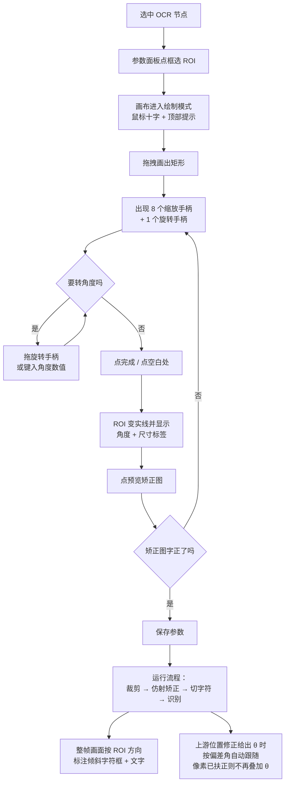

# PRD：模板制作能力与 OCR 带方向 ROI

| 项目 | 内容 |
|---|---|
| 产品名称 | VisionSystem（Windows 桌面机器视觉软件） |
| 文档类型 | 简单 PRD（不含竞品分析 / 市场调研） |
| 涉及模块 | 流程编排 - 匹配类节点（形状匹配 / NCC 匹配）、OCR 节点 |
| 目标版本 | 下一迭代（P0 项一次交付） |
| 关联文档 | `docs/架构-模板制作与OCR旋转ROI.md`：角度命名（`RoiAngle` / `RefAngle` / `dAngle`）与合成规则以该文 §1.3 为准，FR-10 验收口径以该文 §1.5 为准（与本 PRD 一致）。 |

**原始需求复述（用户原话）**

> 1，形状匹配，NCC 匹配无法制作模板，点击 ROI 后无反应，增加创建模板的功能；
> 2，OCR 识别无法框选 ROI，ROI 需要带有方向属性，然后仿射变换 ROI 区域为标准图片，再切割字符，再识别，注意显示字符时按照 ROI 方向标注。

**已确认的产品决策（作为约束，不再作为待确认项）**

1. 模板必须落盘持久化：重启软件、切换配方、开机自动加载后模板仍可用，不需要重做。
2. 旋转 ROI 用画布直接拖拽（含旋转手柄），不是"先画矩形再另填角度"。
3. OCR 的 ROI 角度跟随上游「位置修正」节点自动旋转。

**术语约定（全文适用）**

- **流程** = 流程编排界面里的一条节点链条，配置存放在 `appconfig.json` 的流程段。
- **配方** = 一组检测参数（检测配置）。**流程与节点不在配方里。**

因此本文凡涉及"模板存放在哪、跟着什么走"的地方，一律指**流程**。切换配方不改变流程，模板自然仍就绪；切换或新建流程才切换模板集合。原需求中的"切换配方后模板仍可用"在本模型下成立。

---

## 1. 产品目标

1. **让"做模板"成为一件用户能看见、能确认、能长期复用的事**：现在的模板制作是不可见的（点按钮没反应、成功与否无反馈）且不持久的（只活在内存里，重启即失，必须靠跑一次流程"隐式示教"），产线每次换型开机都要重做一遍，这是纯粹的无效工时。
2. **让 OCR 能只认该认的那块区域，并且认得正**：现在 OCR 只能识别整帧、ROI 永远是轴对齐的矩形，工件一旦在视野里转了一个角度，字符就跟着歪，切分和识别准确率直接掉下来。
3. **补上"旋转矩形"这个系统级缺失的输入能力**：让带方向的矩形从"只能显示"变成"可以作为参数输入"，后续其他节点（Blob、缺陷检测）都能复用。

---

## 2. 目标用户与使用场景

**目标用户：产线工程师（兼调机 / 换型职责）**，不是软件开发者。特点是：懂工艺、懂工件，不读代码；调机时间窗口短（通常十几分钟到半小时）；出错时只能靠界面反馈判断。

**核心使用场景**

- **场景 A｜新品试做（首次配流程）**：工程师搭一条「图像源 → 形状匹配定位 → OCR 读码 → 结果输出」的流程。第一步就得给匹配节点做模板，做完才能往下调。做完模板后他要能立刻判断"这个模板做得好不好"（特征点覆盖是否完整、会不会误匹配），而不是靠跑一遍看结果猜。
- **场景 B｜每天开机 / 换型**：产线开机，或换型到另一个产品（可能只是换配方，也可能换成一条新流程）。期望直接点运行就能跑，模板自动就绪；现在必须无意义地手动跑一次流程做隐式示教。
- **场景 C｜工件在视野里有旋转**：来料在托盘里被摆歪了（常见 ±10° 以内，个别工位到 ±30°）。匹配节点能算出这个角度，但下游 OCR 拿不到方向，仍然按正着切字符，结果读错或读不出。
- **场景 D｜局部读码（一行字在画面某一角）**：整帧识别容易把画面里其他相似纹理、边框、印字误当字符。需要只框住那一行字。

---

## 3. 用户故事

1. 作为产线工程师，我希望在匹配节点的参数面板上点一个明确可见的按钮就能进入模板制作，以便不用去翻菜单或找隐藏入口就能开始干活。
2. 作为产线工程师，我希望做完模板后界面上能直接看到"模板已就绪"的状态和特征点预览，以便判断模板质量，而不是靠跑流程猜。
3. 作为产线工程师，我希望模板保存后重启软件、切换流程、开机都能自动加载，以便不用每天重做模板。
4. 作为产线工程师，我希望 NCC 匹配也能像形状匹配一样做模板，以便选择算法时不被工具能力限制。
5. 作为产线工程师，我希望能在图像上直接画一个带角度的矩形 ROI 并拖旋转手柄转它，以便对歪着摆放的工件框选。
6. 作为产线工程师，我希望 OCR 只识别我框住的那块区域，并且系统自动把这个歪的区域摆正后再切割识别，以便提高识别率并避开画面其他干扰。
7. 作为产线工程师，我希望上游匹配/位置修正算出的角度能自动带给下游 OCR 的 ROI，以便工件转多少度 ROI 就跟着转多少度，不用每换一个角度重画一次。
8. 作为产线工程师，我希望识别结果显示在整帧画面上时字符框是跟着 ROI 方向倾斜的，以便一眼看出框和字对得上，而不是框正着、字歪着。

---

## 4. 需求池

> 优先级：**P0 = 必须做**（不做等于需求未交付）、**P1 = 应该做**（严重影响可用性）、**P2 = 可选**。
> 缺陷（DEF）与新增功能（FR）分列，便于排期与回归。

### 4.1 缺陷修复（现有承诺未兑现的部分）

| 编号 | 需求描述 | 优先级 | 验收标准（可测） |
|---|---|---|---|
| **DEF-01** | 「画 ROI」按钮点击无响应。按钮存在、可见、处理器有实现，但点击事件订阅丢失。属于接线缺陷，非设计问题。 | P0 | 在形状匹配节点参数面板连续点击「画 ROI」3 次，3 次都进入 ROI 绘制模式（鼠标变十字、画布出现"请在图像上拖拽绘制 ROI"提示），无一次静默无响应；同一按钮在 NCC 匹配节点参数面板同样有效。 |
| **DEF-02** | 模板创建后无任何可见反馈：只有参数数字变化，无特征点预览、无模型信息、无成功/失败提示，用户无法判断模板是否做好。 | P0 | 点击「训练」后，无论成功或失败，界面必出现以下之一：成功 → 左图叠加特征点/边缘模型轮廓 + 显示"目标特征点数 / ROI 尺寸 / 耗时"；失败 → 红色文字给出具体原因（ROI 过小 / 区域内无有效特征 / 参数冲突 / 训练超时）。不存在"点了没变化"的中间态。 |
| **DEF-03** | 无有效模板时匹配节点静默返回 0 结果、不报错，用户只会看到"匹配不到"。 | P1 | 节点处于"无模板"状态时运行流程，节点输出卡片与日志中均出现明确文字「未配置模板，请先创建模板」，而不是静默 0 结果；流程其余节点仍正常执行不中断。 |
| **DEF-04** | 字符坐标从裁剪图映射回整帧只用"加 ROI 左上角偏移"这一简单加法，ROI 一带角度即错（实测 400×100 的 ROI 转 5°，角落字符偏差约 18 px）。 | P0 | 用合成图标定：400×100 ROI 旋转 5°，字符位于 ROI 四角时，标注框中心映射到整帧的误差 ≤ 2 px（现状约 18 px）；旋转 0° / ±15° / ±30° 各测一组，全部 ≤ 2 px。 |

### 4.2 新增功能

| 编号 | 需求描述 | 优先级 | 验收标准（可测） |
|---|---|---|---|
| **FR-01** | 匹配节点（形状匹配 + NCC）拥有统一的「模板制作」界面：含取图、画 ROI、训练参数、训练、保存、以及模型预览区。入口在节点参数面板上以显式按钮呈现，不使用隐藏菜单项。 | P0 | 从流程画布选中形状匹配节点 → 参数面板出现「创建模板」按钮 → 点击后 2 秒内弹出模板制作界面，界面内可见「绘制 ROI」「训练」「保存模板」三个动作与一块模型预览区；NCC 节点同样路径可达。不存在"必须改配置文件或读文档才能找到入口"的情况。 |
| **FR-02** | 模板落盘持久化：把模板图与训练参数写入磁盘（按流程 Id + 节点 Id 存放，见 Q2），不再是内存字典 + 原生单槽句柄。 | P0 | 制作并保存模板 → 关闭软件进程 → 重新启动 → 打开同一流程 → **不运行任何流程**直接对同一张图执行匹配，返回的分数与位置与保存时一致（分数差 ≤ 0.01，位置差 ≤ 1 px）。 |
| **FR-03** | 模板自动加载：软件启动、切换流程、开机自动加载后，匹配节点自动处于"模板已就绪"状态，无需隐式示教。 | P0 | ① 重启后自动加载；② 从流程 A 切到流程 B 再切回 A，两条流程的模板各自就绪且不互相串用（A 的模板不会被 B 覆盖、也不会被 B 的模板顶掉）；③ 加载失败时节点状态显示"模板加载失败：<原因>"而不是显示就绪。 |
| **FR-04** | NCC 匹配支持制作模板（现状唯一能做模板的「形状匹配调试」窗体只支持形状匹配，且入口被隐藏）。 | P0 | 在 NCC 匹配节点上完成一次完整模板制作 → 保存 → 重启 → 该节点匹配成功且分数与制作时一致；过程中不出现"该算法不支持模板"之类的阻断提示。 |
| **FR-05** | 节点参数面板显示模板状态卡片：模板是否就绪、模板图缩略图、ROI 尺寸、角度搜索范围、创建时间，并提供「重新制作」「删除模板」动作。 | P1 | 参数面板上无需打开子窗口即可读到模板状态；点「删除模板」后状态变为"未配置模板"，再次运行流程出现 DEF-03 的提示。 |
| **FR-06** | OCR 节点新增 ROI 参数（位置、尺寸、角度），使 OCR 不再永远识别整帧。 | P0 | 旧的 OCR 节点配置（不含 ROI 字段）加载后行为与升级前完全一致（识别整帧），区域显示为"整帧"；新配置的 ROI 参数可正常保存并在重启/切换流程后原样回读。**回归断言（「逐像素一致」只属于这里）**：轴对齐 ROI（角度为 0）且无坐标变换时，OCR 的输入灰度图必须与升级前**逐像素一致** —— 因为新实现刻意保留了升级前的整数裁剪路径，两个版本执行的是**同一段代码**，所以这条能成立（与 6.1 同一条，不要混用到 FR-10 (b)）。 |
| **FR-07** | 画布上可直接拖拽创建**带角度的矩形 ROI**，包含 8 个缩放手柄 + 1 个旋转手柄；角度值可实时显示并允许键盘精确输入。 | P0 | 在图像上拖出一个矩形 → 拖动旋转手柄 → 角度实时变化并在 ROI 旁显示数值（如 `12.4°`）→ 松手后角度保持；可在任意角度（-180°~180°）停下并保存；保存后重新打开，角度与尺寸误差 ≤ 0.5° / 1 px。 |
| **FR-08** | 按 ROI 角度做仿射矫正：把旋转 ROI 内的图像变换为标准正向图（ROI 宽 × 高，无黑边残留区域），再在矫正图上切割字符。 | P0 | 提供「预览矫正图」：对一张文字整体旋转 25° 的图，按 25° 框 ROI，输出的矫正图中文字基线水平偏差 ≤ 1°、尺寸严格等于 ROI 的宽×高；将矫正图与同一内容的正向图做 NCC，相关系数 ≥ 0.95。 |
| **FR-09** | OCR 结果按 ROI 方向标注：在整帧画面上绘制的字符框应沿 ROI 方向倾斜，并带文字/序号标签；坐标回映射使用旋转变换而非简单加法。 | P0 | 运行后整帧画面上字符框与文字方向一致（肉眼可见倾斜，符合 ROI 角度）；标签（识别文字或序号）可正常显示；坐标精度满足 DEF-04 的 ≤2 px 标准。 |
| **FR-10** | OCR 的 ROI 角度跟随上游「位置修正」节点自动旋转：工件在视野里转多少度，ROI 就跟着转多少度，不需要人工改。**注意本系统有两条路径**：上游做**像素级扶正**时图像已被真正转正、位姿被重置，此时**不得再叠加 θ**（叠加等于转两遍）。角度命名与合成规则以架构文档 §1.3 为准：`RoiAngle`（操作员画的角度）参与、`RefAngle`（基准位姿角度）**不参与**、只叠加 `dAngle`（= θ，相对基准的偏差角）。 | P0 | 三条并列断言，缺一不算通过。**(a) 无像素级修正时**（上游无位姿输出 / 位置修正节点被跳过 / 角度跟随 `FollowPose` 关闭 / `EnableAngle=0`）：生效 ROI 角度 = `RoiAngle + θ`，误差 ≤ 0.5°。**(b) 有像素级修正时**（`WarpToReference` 已执行、位姿已 Reset）：生效 ROI 角度 = 配置角度 `RoiAngle`（θ 视作 0，误差 ≤ 0.05°），并须**同时**满足以下四条，作为「ROI 跟着工件转」的证明：**b-1 识别文本**与 θ=0 的静态情形**严格相等**（`string.Equals`，含空串情形）；**b-2 字符框中心偏差 ≤1.5 px、宽高偏差 ≤1.5 px**（在同一个「修正后工作帧」坐标系下比较）；**b-3 平均置信度差 ≤0.05**；**b-4 矫正图尺寸严格等于** ROI 的宽 × 高。**(c) 两种情形都要求**：日志能区分角度来源（`Configured` / `Followed(θ=xx°)` / `Warped`）；连续 10 帧每帧都从「`RoiAngle` + 当帧 θ」重算、不累加，因此无漂移。**另见注 1、注 2、注 3 三条口径（表后）。** |
| **FR-11** | 模板训练参数可调：角度搜索范围、缩放搜索范围、最小匹配分数、金字塔层级。 | P1 | 参数可保存并在重新打开时原样回读；把角度范围从 ±10° 改为 ±30° 后，对 25° 旋转的目标匹配成功（未改前应失败），证明参数真实生效。 |
| **FR-12** | ROI 在整体画面上的常显轮廓：节点选中时叠加显示 ROI 轮廓 + 角度/尺寸标签，未选中时半透明或隐藏。 | P1 | 选中 OCR 节点后画布上可见 ROI 轮廓与角度标签；切到别的节点后该轮廓隐藏，不干扰观察。 |
| **FR-13** | 支持多个 OCR 区域（一行文字的多个框 / 多个读取区）。 | P2 | 可添加第 2 个 ROI 并各自独立配置角度与参数，识别结果按区域分组输出。 |
| **FR-14** | 模板文件可人工迁移：允许把模板复制到另一台同版本机器上直接使用。 | P2 | 把模板目录（按流程/节点存放，见 Q2）整体拷到另一台同版本机器的对应位置，打开同一流程后模板状态为就绪，无需重做。 |

> **FR-10 的三条验收备注（必读）**
>
> **注 1｜(b) 为什么用"内容等价"而不是"像素级逐点比对"。** 两条路径的**采样算子根本不同**：路径 A（θ=0 静态）走的是升级前的整数裁剪，**零插值**、直接取整像素；路径 B（工件转 θ 后被像素级扶正）图像先经一次高质量双线性重采样、再取整像素。同一块内容经过"无插值"和"重采样后取整"两种算子，像素值必然不同 —— 要求两者像素级完全相同，**在数学上不可能成立，这不是容差大小的问题**。所以 (b) 的判据落在"同一块**内容**"上：文本相等（业务意义最强，直接对应"读对了没有"）+ 框位与宽高差 ≤1.5 px + 置信度差 ≤0.05 + 尺寸严格相等。
>
> **注 2｜必须带一条反面用例（negative control）。** 故意把 θ 叠加两次（`φ = RoiAngle + 2θ`）后跑同一组断言，(a) 的 ≤0.5° 与 b-2 的 ≤1.5 px **必须失败**。否则无法证明这些断言真的在校验行为，而不是恒真。1.5 px 的判据区分度极高：真出"叠加两次"的 bug 时，错位是 θ 量级（5° × 400 px ≈ 35 px），与判据差 20 倍以上，不存在模糊通过。
>
> **注 3｜不要和 DEF-04 的「≤2 px」合并成一个指标 —— 两者度量的对象不同。** DEF-04 的 ≤2 px 是**坐标映射精度**：在 0° / ±5° / ±15° / ±30° 四个角度下、ROI 四角字符框映射回整帧时的位置误差（度量"回映射算得对不对"）。b-2 的 ≤1.5 px 是**像素扶正路径的端到端一致性**：把"工件转 θ 后扶正"与"工件在标称位姿"两种情形相比，比较对象是同一个"修正后工作帧"坐标系里的字符框（度量"整条链有没有把角度算重或算漏"）。两者不能互相替代，也不能取更严的那个了事。

---

## 5. 界面交互设计

### 5.1 交互一：创建模板（匹配节点）

**关键问题**：现状是"点了没反应 + 做完了看不出来 + 重启就没了"。所以这条流程的设计重点不在功能多少，而在**每一步都有可见的状态变化**，并在最后给出一个用户能自己判断的结论。

**入口**：流程画布选中匹配节点 → 右侧参数面板顶部固定出现「模板：未配置」状态卡片 + 「创建模板」按钮（不隐藏、不放在菜单里）。

**模板制作界面元素**

| 区域 | 元素 | 作用 |
|---|---|---|
| 左侧图像区 | 图像显示 + ROI 叠加层 + 特征点/模型轮廓叠加层 | 画 ROI、看训练结果 |
| 左上工具条 | 「载入图片」/「抓取当前帧」/「绘制 ROI」 | 没图时先取一张图；已有 ROI 时可重画 |
| 右侧参数区 | 角度搜索范围、缩放搜索范围、最小分数、金字塔层级 | 训练参数 |
| 右侧动作区 | 「训练」「保存模板」「取消」 | 训练与落盘分离：先看效果，满意再保存 |
| 底部信息区 | 特征点数量、模型尺寸、ROI 角度、耗时、结果文字（成功绿 / 失败红 + 原因） | **用户判断"做好了没有"的主要依据** |

**"怎么知道模板做好了"——三层确认，缺一不可**

1. **训练后立刻**：图像上出现特征点（或边缘模型轮廓）叠加，底部信息区变为绿色「训练成功：特征点 428 个，用时 63 ms」。
2. **保存后**：参数面板状态卡片由「未配置」变为「模板已就绪」，并显示模板缩略图、ROI 尺寸与角度、创建时间。「保存模板」按钮变灰，直到参数再次被修改。
3. **重启 / 切换流程后**：状态卡片仍显示「模板已就绪」+ 缩略图。这是"落盘成功"的唯一可信证据，也是验收主路径。

若任一步失败，界面必须给出**可行动的中文原因**（如「ROI 区域内有效特征过少（<8 个），请扩大 ROI 或降低最小分数」），而不是只显示一个错误码。

```mermaid
flowchart TD
    A[画布选中匹配节点] --> B[参数面板点<br/>创建模板]
    B --> C[模板制作弹窗]
    C --> D{有图像吗}
    D -->|无| E[载入图片 / 抓取当前帧]
    E --> D
    D -->|有| F[点绘制 ROI 并在图上拖框]
    F --> G[设置训练参数<br/>角度范围 / 缩放 / 最小分数]
    G --> H[点训练]
    H -->|失败| I[红字给出具体原因<br/>ROI 过小 / 无特征 / 参数冲突]
    I --> G
    H -->|成功| J[图像叠加特征点<br/>底部显示特征点数 / 尺寸 / 耗时]
    J --> K{质量满意吗}
    K -->|否| G
    K -->|是| L[点保存模板]
    L --> M[写入模板文件并回读校验]
    M -->|校验失败| N[红字提示保存失败原因]
    M -->|校验通过|     O[参数面板状态<br/>模板已就绪 + 缩略图 + 角度 + 时间]
    O --> P[重启 / 切换流程后<br/>状态仍为已就绪]
```

### 5.2 交互二：OCR 旋转 ROI

**入口**：流程画布选中 OCR 节点 → 参数面板「ROI」分组，含「框选 ROI」按钮 + 位置/尺寸/角度三个数值框 + 「预览矫正图」按钮 + 「角度跟随位置修正」勾选项。

**画布操作（怎么画 / 怎么转 / 怎么确认）**

1. **画**：点「框选 ROI」→ 画布进入绘制模式（鼠标十字、顶部提示条"在图像上拖拽绘制 ROI，右键取消"）→ 按住左键拖出一个矩形 → 松手即生成。
2. **转**：矩形生成后立刻出现 8 个缩放手柄（边、角）+ 1 个旋转手柄（顶部中央，圆点 + 引线）。拖动旋转手柄，矩形绕中心实时旋转，旁边浮动显示角度值 `12.4°`；按住 Shift 吸附到 15° 整数倍（便于摆正到"大致某个角度"）。也可直接在参数面板角度框里键入精确值。
3. **改**：拖任一手柄可继续缩放/旋转；拖矩形内部可整体平移；Delete 清除 ROI。
4. **确认**：松开鼠标后再点一次「框选 ROI」（按钮变为「完成」）或点画面空白处，ROI 轮廓由虚线变实线（强调色）并显示 `角度 12.4° / 尺寸 400×100` 标签，表示已写入参数。此时参数面板的三个数值同步更新。
5. **验**：点「预览矫正图」弹出小窗显示仿射矫正后的正向图（ROI 宽×高），用户在这里直接看到"字是正的、切得对不对"，不满意回去重画。

**结果显示形态**

- 整帧画面上，每个识别出的字符/字符串绘制**沿 ROI 方向倾斜的框**（不是轴对齐矩形），框旁标注识别文字或序号。
- 参数面板提供两个开关，**默认值写死**：「显示合并字符串框」= **开启**、「显示逐字符框」= **关闭**（一行 30 个字符全标文字会很乱）。老配置里原本显式开启逐字符框的，升级后保持开启，不受新默认值影响。
- 识别失败时（如宽高比异常、字符粘连）该区域框变为警示色并在结果里给出原因，不要静默丢弃。



---

## 6. 非功能需求

### 6.1 兼容性（硬约束，验收必测）

- **老流程配置必须能直接跑**：升级前的流程配置/配方里不存在任何新增字段，加载后必须正常工作，且**不得要求用户重新配置或重新制作已有模板**。缺失字段一律取"无 ROI / 关闭跟随"的等价语义，绝不允许因字段缺失抛异常或把节点置为失效。
- **老行为不得劣化**：未配置 ROI 的 OCR 节点输出必须与升级前逐像素一致（仍是整帧识别）；**轴对齐 ROI（`RoiAngle=0`）且上游无坐标变换时，OCR 节点实际输入算法的灰度图也必须与升级前逐像素一致** —— 新实现刻意保留老的整数裁剪路径，两版本执行的是同一段代码，所以这条能成立、也必须成立；轴对齐 ROI（仅 X/Y/宽/高）必须仍然可用，角度默认 0。
  - 说明：这条是**兼容性回归断言**，与 FR-10 (b) 是两件事 —— 后者比的是"内容等价"，因为扶正路径必然经过重采样，逐像素不可达（见 4.2 表后备注注 1）。
- **配置保存不得丢字段**：旧版本软件读新配置后另存，不得抹掉新增字段（前向兼容受版本能力限制，但至少不能静默清空）。
- **模板缺失不能阻断流程**：某节点模板文件丢失/损坏时，该节点给出明确提示，流程其余节点继续执行，不允许整条流程崩掉。

### 6.2 性能

| 项 | 目标值 |
|---|---|
| ROI 裁剪 + 仿射矫正（400×100 区域 / 500 万像素原图） | ≤ 5 ms / 帧 |
| OCR 节点整体耗时相对"整帧识别" | 不劣于整帧（ROI 变小后应更快，不得因矫正引入明显回退） |
| 模板训练（典型 200×200 目标） | ≤ 300 ms；**必须在后台线程执行，UI 不得冻结** |
| 单模板文件体积 | ≤ 2 MB |
| 启动时加载全部模板（20 个以内） | ≤ 1 s，且不阻塞主界面显示 |
| 连续运行 8 小时 | 内存无持续增长（模板图/图像句柄正确释放，含反复重做模板的场景） |

> **关于"模板不需要重训"的准确表述（写清楚，避免验收时被当成新 bug）**：**单节点流程确实是"训练一次、后续不重训"** —— 执行器每个窗体只构造一次，模型缓存跨帧、跨运行常驻。**但同一条流程放了 2 个及以上形状匹配节点时，会每帧重训**（原生只有一个模型槽位），表现为掉帧，详见 6.4。
>
> 补充说明：升级前的版本在"上游挂了位置修正节点"的流程上其实**做不到**"训练一次" —— 当时训练签名含 `ApplyRoi()` 的输出，偏差小到不触发 warp 时映射后的 ROI 每帧可能有 ±1px 抖动，导致签名每帧变化、每帧重训。**该抖动已在本次改造中消除**（训练签名收敛为"训练参数 + 模板戳"），属于本次顺带修掉的已知缺陷，**不需要单独报缺陷单**。因此若在**旧版本**上观察到"每次都要重训"，那是旧版已知缺陷，不是本条指标写错。

### 6.3 可诊断性

- 所有失败路径必须给出**中文 + 可定位**的信息：节点名、流程名、模板文件路径、具体原因。禁止只弹"操作失败"、禁止只写日志不提示界面。
- **训练超时门限 = 3000 毫秒**：从发起训练开始计时，超过 3000 ms 即判定为「训练超时」并中止，界面给出「训练超时（超过 3000 ms），请缩小 ROI 或降低金字塔层级后重试」。不允许无限等待，也不允许界面在此期间无响应。
- 模板相关的三类失败必须能区分：**文件不存在** / **文件损坏或版本不兼容** / **模板参数与当前节点设置不匹配**。三种在界面上提示文案不同。
- OCR 的 ROI 生效情况应可在日志/节点结果中查到（本次实际使用的 ROI 位置、尺寸、角度，以及角度来源是"手工配置"还是"跟随位置修正 θ=xx°"），便于现场排查"为什么 ROI 没跟着转"。
- 日志需包含：模板保存/加载的时间戳与路径；训练输入参数与结果分数；矫正后图像尺寸。

### 6.4 已知限制

- **一条流程里只建议放一个形状匹配节点。** 如果同一条流程里放了**多个形状匹配节点**，因为算法库当前只有一个形状模型槽位，每帧都要为每个节点重新训练一次模型（每次约 60~300 毫秒），表现就是画面卡顿、掉帧、检测节拍变慢。系统会在**流程校验时给出警告**（只警告，不阻止运行）。建议一条流程只放一个形状匹配节点；工艺上确实需要多个的，请拆成多条流程。彻底解决需要单独排期改造算法库。
- 这条限制**不影响做模板这件事**：模板照常可以保存、重启后照常自动加载，只是运行时每帧要重训一次。**单节点流程本身是"训练一次、后续不重训"**（执行器每个窗体只构造一次、模型缓存常驻），不受影响。
- 根治办法是改造原生算法库做**模型池**，已单列为 P1 独立需求，不在本 PRD 交付范围。本期用"**流程校验期警告 + 运行摘要里显示重训耗时**"把这个限制显式化，让用户看得见、而不是靠猜。

---

## 7. 待确认问题

| # | 问题 | 我的建议倾向 |
|---|---|---|
| Q1 | 模板制作界面是**独立弹窗**还是**内嵌在参数面板**？现状有一个「形状匹配调试」独立窗体（且只支持形状匹配、入口被隐藏）。 | 建议**模态弹窗**（从参数面板按钮进入），内容与节点强绑定；把旧的「形状匹配调试」保留为可见的"算法离线调试"入口，两个入口职责分开（调试 = 试参数，模板制作 = 定稿落盘）。 |
| Q2 | 模板存放在哪里、跟着什么走？（原答案"随配方目录存放"的**前提不成立**：配方里只装检测参数 `InspectionConfig`，流程与节点在 `appconfig.json` 的流程段，"配方目录"在实现里没有落点） | **架构已定：按「流程 Id + 节点 Id」存放** → `%AppData%\VisionPlatform\Templates\<流程Id>\<节点Id>\`。效果覆盖并强于原意：换配方时流程不变，模板自动仍就绪；换流程时彼此隔离、不串用；整个目录可拷到另一台机器直接迁移。 |
| Q3 | 模板文件是否要求可人工拷贝迁移到另一台机器（FR-14 的优先级）？ | 建议做成**纯文件、无机器绑定**，成本低且现场排障友好；但优先级可放 P2。 |
| Q4 | ROI 的坐标怎么表示、绕哪一点旋转？三个角度（操作员画的角度 / 基准位姿的角度 / 相对基准的偏差角）如何分工？（原倾向"ROI 定义在模板本地坐标系"**被否决**：数据模型里不存在"模板原点"，凭空引入会让所有旧配置的绝对坐标语义断裂） | **架构已定：ROI = 基准帧绝对坐标（左上角 + 宽高）+ 绕 ROI 自身中心旋转的角度**。旋转中心取**自身中心**而非左上角，否则用户每拖一次旋转手柄 ROI 就会整体平移。角度分工（命名见架构 §1.3）：`RoiAngle` 操作员画的角度**参与合算**；`RefAngle` 基准位姿的角度**不参与**（已隐含在"这个 ROI 是在基准帧上画的"这件事里）；只叠加 `dAngle`（= θ，相对基准的偏差角）。合成式 `φ = normalize(RoiAngle + θ)`，像素已扶正时 θ 取 0。 |
| Q5 | 一期 OCR 是否只支持**单 ROI**？ | 建议 P0 只做单 ROI（能满足"框一行字"的绝大多数场景），多 ROI 放到 P2，但参数结构上预留列表形态以免二期破坏兼容性。 |
| Q6 | 旋转手柄的角度吸附规则？ | 建议**默认自由角度（0.1° 精度）+ 按住 Shift 吸附 15°**，同时角度框可直接键入精确值。 |
| Q7 | 「位置修正」的 θ 是**绝对角**还是**相对基准的偏差角**？θ 为 0 时是否等于工件在标称位置？ | 按 Q4 结论**定为"相对基准的偏差角"**（即 `FlowRunTransform.DAngle`），θ=0 ⇔ 工件完全在标称位置，此时生效 ROI 角度 = `RoiAngle`（**严格相等**，不是约等于）。另注意：若位置修正开启了**像素级对齐**（`WarpToReference` 已执行、位姿被 Reset），此时 θ 视作 0，**不得再叠加**（见 FR-10 (b)）—— 叠加等于转两遍。 |
| Q8 | 第 6.2 节性能指标的具体数值是否接受？ | 建议先按表中数值作为验收线；若架构师评估矫正链路开销更大，仅允许调整绝对值，**不允许取消"UI 不得冻结"与"8 小时内存不增长"两条**。 |
| Q9 | 字符框标注文字过多时如何处理重叠（一行字 30 个字符全标文字会很乱）？ | **架构已接受，按原建议执行**，并把默认值写死：「显示合并字符串框」= **开启**、「显示逐字符框」= **关闭**；老配置里原本显式开启的逐字符框**保持开启**，不受新默认值影响（见 5.2）。标签过长截断，全文在结果表里查看。 |

---

## 8. 修订记录

**本文档当前为 v3。** 8.1~8.6 是**第一轮修订**的记录（依据架构师设计结论，三处冲突）；**8.7 是第二轮修订**（FR-10 (b) 判据口径定稿，经架构复核）。两轮都只做增量修订，章节编号与需求编号（DEF-01~04、FR-01~14、Q1~Q9）全部保持不变，便于 QA 与开发对齐既有条目。

**用词纪律（v3 起生效）**：「逐像素一致」一词**只允许出现在 FR-06 与 6.1 的兼容性回归断言中**，指"新老两版执行同一段整数裁剪代码、结果必须完全一致"。FR-10 及其验收口径一律用「内容等价四条」，不得再出现该词；8.7 中出现的仅是对**被废止旧口径的引述**，不是要求。

### 8.1 FR-10 验收标准重写（第一轮修订；原表述几何上不成立，必改）

| | 内容 |
|---|---|
| 原表述 | 上游位置修正输出角度 θ 时，生效 ROI 角度 = 模板角度 + θ（误差 ≤0.5°） |
| 为什么错 | 本系统的「位置修正」节点若开启**像素级对齐**，会真的把图像旋转扶正（内部 `WarpToReference`），之后位姿状态被重置。像素已经被转正，此时再叠加 θ 就是**转两遍**。所以"生效角度 = 配置角度 + θ"在这条路径上必然不成立 —— 这不是实现缺陷，是因为系统里存在两条性质不同的路径。 |
| 改为 | 三条并列断言，(a) 无像素级修正时：生效角度 = 配置角度 + θ，误差 ≤0.5°；(b) 有像素级修正时：生效角度 = 配置角度（θ 视作 0），且须证明"ROI 跟着工件转"；(c) 两种情形都要求日志可区分角度来源、连续 10 帧每帧重算不累加、无漂移。<br>**⚠ 第一轮给 (b) 选的具体判据形式经复核不成立，已在第二轮整体替换，见 8.7。本行保留原样以便回溯"为什么改了两次"。** |
| 连带改动 | FR-10 需求描述补上"两条路径"的说明；「模板角度」全部改称「配置角度」；5.2 的流程图节点由"ROI 角度自动 = 模板角度 + θ"改为"按偏差角自动跟随，像素已扶正则不再叠加 θ"。 |

### 8.2 Q2 答案重写（原答案前提是错的）

| | 内容 |
|---|---|
| 原答案 | 模板随**配方目录**存放；换配方即换整套模板。 |
| 为什么错 | 本系统的「配方」（`Recipe`）里只装检测配置（`InspectionConfig`），**流程与节点根本不在配方里**，而在 `appconfig.json` 的流程段。所以"随配方目录存放"在实现里**没有落点**。 |
| 改为 | 按 `流程Id + 节点Id` 存放：`%AppData%\VisionPlatform\Templates\<流程Id>\<节点Id>\`。效果**覆盖并强于**原意：换配方时流程不变，模板自动仍就绪；换流程时彼此隔离不串用；整个目录可整体拷到另一台机器直接迁移。 |

### 8.3 Q4 答案重写（原倾向被否决）

| | 内容 |
|---|---|
| 原倾向 | ROI 定义在**模板本地坐标系**（相对"模板原点"的偏移 + 尺寸 + 角度）。 |
| 为什么被否决 | 数据模型里**不存在"模板原点"这个概念**：匹配模板的 ROI 与 OCR 的 ROI 是两套彼此独立的绝对坐标。凭空引入"相对模板原点的偏移"会让所有旧配置的绝对坐标语义断裂。 |
| 改为 | ROI = **基准帧绝对坐标（左上角 + 宽高）+ 绕 ROI 自身中心旋转的角度**。旋转中心取**自身中心**而非左上角，否则用户每拖一次旋转手柄 ROI 会整体平移。三个角度的职责：操作员画的角度**参与合算**；基准位姿的角度**不参与**（已隐含在"这个 ROI 是在基准帧上画的"这件事里）；只叠加**相对基准的偏差角**。 |
| 连带改动 | Q7 同步按此定调（θ 为"相对基准的偏差角"，且像素已扶正时视作 0 不再叠加）。 |

### 8.4 术语统一：「配方」→「流程」

新增文首**术语约定**，明确「流程」= 流程编排的一条节点链条（存 `appconfig.json` 流程段）、「配方」= 一组检测参数（流程与节点不在配方里）。凡本意指流程处一律改为「流程」，共替换 **17 处**：

- 术语替换 **15 处**：用户故事 3；FR-02（描述 1 + 验收 1）；FR-03（描述 1 + 验收 3）；FR-06 验收 1；FR-14 验收 2；5.1 三层确认第 3 条 1；5.1 流程图 1 个节点；6.3 日志字段 1；Q2 答案 2；场景 B 1。
- 角度表述替换 **2 处**：「模板角度」→「配置角度」（FR-10、5.2 流程图）。

**有意保留不改的 4 处**：① 文首「已确认的产品决策」第 1 条仍写"切换配方"—— 那是用户原话，且在新模型下该结论依然成立，故不动；②③ 术语约定与新 Q2 中作为**反例**引用的"配方目录"；④ 6.1 兼容性条款里"流程配置/配方"并列处，配方指检测参数，用法正确。

### 8.5 其余三条补充

| 位置 | 补充内容 |
|---|---|
| 5.2 结果显示形态 + Q9 | 写明默认值：「显示合并字符串框」= **开启**、「显示逐字符框」= **关闭**；老配置里原本显式开启的逐字符框**保持开启**，不受新默认值影响。 |
| 新增 6.4 已知限制 | 「同一条流程里如果有**多个形状匹配节点**，由于算法库当前只有一个形状模型槽位，每帧需要为每个节点重新训练一次（每次约 60~300 毫秒），会表现为掉帧；系统会在流程校验时给出警告。建议一条流程只放一个形状匹配节点，彻底解决需单独排期改造算法库。」并注明该限制不影响模板的保存与自动加载。 |
| 6.3 可诊断性 | 新增「**训练超时门限 = 3000 毫秒**」，超时即判定训练超时并中止、给出可操作提示，不允许无限等待或界面无响应。 |

### 8.6 未受影响

第 1、2、3 节（产品目标 / 用户 / 用户故事，仅第 3 节第 3 条做了术语替换）、4.1 全部缺陷项（DEF-01~04）、FR-01/04/05/07/08/09/11/12/13、5.1 的界面元素与三层确认机制、6.1 兼容性条款、6.2 性能指标、Q1/Q3/Q5/Q6/Q8 —— 均未改动。

> 以上是 **第一轮修订相对 v1** 的清单。**第二轮又对 6.1、6.2、FR-06 做了增补**，见 8.7。

### 8.7 第二轮修订：FR-10 (b) 的判据改为「内容等价四条」

> 本节出现的「逐像素一致」字样**仅用于引述被废止的第一轮口径**，不是验收要求。该词自 v3 起只属于 FR-06 / 6.1 的兼容性回归断言。

**触发**：架构师复核指出，第一轮给 (b) 写的「逐像素一致」是硬断言，工程师无论如何都实现不了，会在验收时卡死。这与第一轮要解决的问题同源（v1 的口径在像素扶正路径上不成立），属于同一处的第二刀 —— 所以 FR-10 的验收标准改过两次，第一轮的表述已被第二轮整体替换。

**为什么必须废止 —— 不是容差大小的问题，是采样算子根本不同**

| | 路径 A（θ=0 静态） | 路径 B（工件转 θ 后扶正） |
|---|---|---|
| 输入帧 | `F0`（工件在标称位姿） | `WarpToReference(Fθ)`，经 GDI+ `HighQualityBilinear` 重采样 |
| ROI 采样 | `RoiAngle=0` 且无变换 → 走老 `CropTemplate` **整数裁剪、零插值** | 同 A（此时 φ=0） |
| 灰度转换 | `ToGrayBitmap` | `ToGrayBitmap`（输入已被插值过） |

同一块内容经过"无插值"（直接取整像素）与"重采样后取整"两种算子，像素值必然不同；即使把路径 A 也改成仿射变换，只要 θ≠0，`WarpToReference` 那一步插值就消不掉。**逐像素一致在数学上不可能成立，这不是容差问题。**

**改了什么**

| 项 | 内容 |
|---|---|
| 原（第一轮）表述 | (b) …输出的矫正图与字符框必须与 θ=0 的静态图**逐像素一致** |
| 改为（第二轮） | (b) 生效 ROI 角度 = 配置角度 `RoiAngle`（θ 视作 0，误差 ≤0.05°），并须**同时**满足内容等价四条：b-1 识别文本严格相等（含空串）/ b-2 字符框中心与宽高偏差 ≤1.5 px / b-3 平均置信度差 ≤0.05 / b-4 矫正图尺寸严格等于 ROI 的宽×高 |

**为什么是这四个判据（留档，便于以后有人质疑数值）**

| 判据 | 为什么这样定 |
|---|---|
| **b-1 文本严格相等** | 业务意义最强的断言，直接对应现场关心的"到底读对了没有"；不需要任何容差，也不存在解释空间。 |
| **b-2 ≤1.5 px** | 区分度足够高：真出现「θ 叠加两次」这类 bug 时，错位是 θ 量级（5° × 400 px ≈ 35 px），与判据差 20 倍以上，**不存在模糊通过**。而正常误差只来自两项 —— 重采样（≤0.5 px）+ 字符统计的整像素化（≤0.5 px），合计约 1 px，1.5 px 留有**一倍余量**，不会误杀。 |
| **b-3 ≤0.05** | 覆盖双线性重采样对归一化模板匹配分数的影响（灰度被插值后，相关分数会小幅波动）。 |
| **b-4 尺寸严格相等** | 专门防「矫正悄悄缩放」这类静默错误 —— 归一化或缩放类 bug 往往不改变识别结果，但会让框位系统性偏移，只靠 b-2 可能掩盖。 |

**「逐像素一致」的适用范围收敛到 FR-06（性质完全不同的事）**

- 收敛结论：该词只用于**老配置兼容性回归** —— 轴对齐 ROI（角度为 0）且无坐标变换时，OCR 的输入灰度图必须与升级前一致，因为新实现**刻意保留**了升级前的整数裁剪路径，两个版本执行的是**同一段代码**，所以这条能成立、也必须成立。已同时写在 **6.1 兼容性**与 **FR-06 验收标准**里。
- 为什么必须分开：混在一起会导致两种后果 —— 要么 FR-10 永远验收不过（要求了不可达的东西），要么工程师误以为"既然逐像素不可达，那老路径的兼容性也可以放弃"。这两件事一件是"必须一模一样"，一件是"必然不一样但要内容相同"，方向相反。

**落到 PRD 的具体位置**

1. **FR-10 验收 (b)** 整段替换为 b-1~b-4 四条内容等价断言；(a)(c) 同步采用架构 §1.5 的精确措辞（`FollowPose` 关闭 / `EnableAngle=0`；日志三种来源 `Configured` / `Followed(θ=xx°)` / `Warped`）。
2. **4.2 表后三条验收备注**：注 1 = (b) 为什么用"内容等价"而不是像素级逐点比对（采样算子不同）；注 2 = 必须带**反面用例**（`φ = RoiAngle + 2θ` 时断言必须失败，否则无法证明断言在校验行为而非恒真）；注 3 = **b-2 的 ≤1.5 px 与 DEF-04 的 ≤2 px 不是同一个指标**（前者是像素扶正路径的端到端一致性，后者是坐标映射精度，度量对象不同，不可合并、也不可取更严者了事）。
3. **6.1 兼容性 + FR-06 验收**同步写明「逐像素一致」的成立条件与成立原因（同一段整数裁剪代码），把该词钉在它唯一正确的归属上。
4. **6.2 性能**表下新增说明：单节点流程确实是"训练一次、后续不重训"（执行器每个窗体只构造一次、模型缓存常驻），只有同流程 ≥2 个形状匹配节点才每帧重训；**6.4** 补「根治需原生模型池改造，已列 P1 独立需求，本期用校验期警告 + 运行摘要显示重训耗时显式化」。
5. **文首新增「关联文档」行**：指向 `docs/架构-模板制作与OCR旋转ROI.md`，声明角度命名与合成规则以该文 §1.3 为准、FR-10 验收口径以 §1.5 为准。
6. **修订记录开头新增「用词纪律」**：明确「逐像素一致」只允许出现在 FR-06 / 6.1，防止后续被人重新贴回 FR-10。
7. **Q4 / Q7** 补角度命名（`RoiAngle` / `RefAngle` / `dAngle` / `FlowRunTransform.DAngle`）与合成式 `φ = normalize(RoiAngle + θ)`，避免 PRD 与架构文档两套叫法。

**未受影响**：DEF-01~04、FR-01~05、FR-07~09、FR-11~14、第 1 / 2 / 3 / 5 节、6.3、Q1 / Q2 / Q3 / Q5 / Q6 / Q8 / Q9 —— 均未改动。

### 8.8 第二轮修订补记

第二轮收尾：**§6.2 增补一句事实澄清** —— 升级前版本在"上游挂位置修正节点"的流程上，因训练签名含 `ApplyRoi()` 输出、ROI 每帧可能 ±1px 抖动而实际每帧重训；该抖动已由本次改造消除，属顺带修掉的已知缺陷、**非本期新增需求项**，故补此句以免 QA 以旧版行为质疑新版指标。
