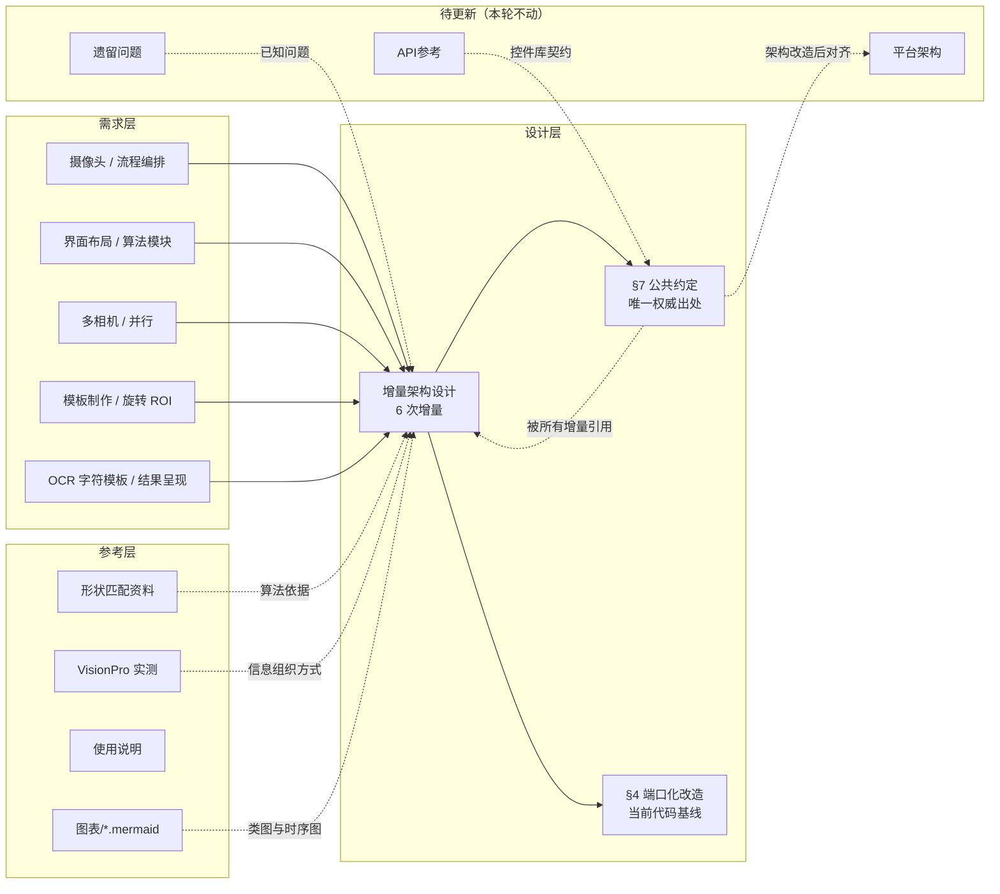

# docs 知识图谱

> **入口文档**。本目录 2026-11-07 做过一次整理：删掉过程性/长期未更新的内容，
> 把同一目的的文件合并成 3 份，并按用途分文件夹。
> 读文档前先看这里，能直接跳到某个知识点的**唯一权威出处**。

## 0. 阅读约定

1. **唯一权威出处**：一个知识点只在一处完整书写，其他地方一律写「见《X》§Y」，不复述。
   当前唯一权威出处是 [增量架构设计 §7 跨增量公共约定](架构/增量架构设计.md#arch-common)。
2. **需求编号**以 [增量需求总览 §6 需求编号总表](需求/增量需求总览.md#req-index) 为准。
3. **三份文档暂不更新**：`API参考.md`、`平台架构.md`、`遗留问题.md` 保持原样，
   等软件架构复用率改造完成后再统一修订；本轮整理没有改动它们的内容。
4. 引用代码位置写「**文件名 + 方法名**」，不写行号（每轮改动都会漂移）。
5. 原 14 份文件已从目录移除；需要查历史细节时，从 git 历史取回，**不要**把过程性内容再抄回来。

## 1. 概念关系图



## 2. 概念 → 唯一权威出处

| 概念 / 知识点 | 唯一权威出处 | 相关位置（只引用，不复述） |
|---|---|---|
| 需求编号、目标、验收口径 | [增量需求总览 §6](需求/增量需求总览.md#req-index) | 各增量章节 §1~§5 |
| 端子模型 `FlowPortSchema` / `FlowPortDef.Accepts` | [增量架构设计 §7](架构/增量架构设计.md#arch-common) | [§4 端口化改造](架构/增量架构设计.md#arch-4) |
| 几何值 `FlowGeometryValue` / `FlowGeometryMath`、点↔位姿例外 | [增量架构设计 §7](架构/增量架构设计.md#arch-common) | [§4](架构/增量架构设计.md#arch-4) |
| 标定转换契约 `canCoord` / `√\|det A\|` / `MmPerPx` | [增量架构设计 §7](架构/增量架构设计.md#arch-common) | [§5](架构/增量架构设计.md#arch-5) |
| 坐标系与角度约定、像素↔屏幕像素换算 | [增量架构设计 §7](架构/增量架构设计.md#arch-common) | [§5](架构/增量架构设计.md#arch-5) |
| 文案唯一出口 `NodeResultText` | [增量架构设计 §7](架构/增量架构设计.md#arch-common) | [§6](架构/增量架构设计.md#arch-6) |
| 叠加层标签 `ShapeLabelRenderer` / `AuxShapes` 通道 | [增量架构设计 §7](架构/增量架构设计.md#arch-common) | [§6](架构/增量架构设计.md#arch-6) |
| `Warn` 只影响显示、永不等于 Ng | [增量架构设计 §7](架构/增量架构设计.md#arch-common) | [§6](架构/增量架构设计.md#arch-6) |
| OCR「一个模板 = 一个字符」 | [增量架构设计 §7](架构/增量架构设计.md#arch-common) | [§6](架构/增量架构设计.md#arch-6) |
| 主题 `UiTheme` 三条铁律 / 自绘控件规则 | [增量架构设计 §7](架构/增量架构设计.md#arch-common) | [§2](架构/增量架构设计.md#arch-2) |
| 权限 `AppContext.HasFullAccess` | [增量架构设计 §7](架构/增量架构设计.md#arch-common) | [§2](架构/增量架构设计.md#arch-2) |
| 日志库 `LogDb` / `sqlite3_initialize()` | [增量架构设计 §7](架构/增量架构设计.md#arch-common) | [§3](架构/增量架构设计.md#arch-3) |
| 配置反序列化缺失字段归一化 | [增量架构设计 §7](架构/增量架构设计.md#arch-common) | [§3](架构/增量架构设计.md#arch-3) |
| 图像源文件夹轮播（Peek / Next 同键） | [增量架构设计 §7](架构/增量架构设计.md#arch-common) | [§2](架构/增量架构设计.md#arch-2) |
| 控件库零第三方依赖 / OpenCV `IntPtr + stride` | [增量架构设计 §7](架构/增量架构设计.md#arch-common) | [§1](架构/增量架构设计.md#arch-1) |
| 形状匹配算法（方向图查表 / 精确细层 / 门限） | [参考资料汇编 §1](参考资料/参考资料汇编.md#ref-shape) | [架构 §2](架构/增量架构设计.md#arch-2)、§7 |
| 形状匹配实现踩坑（`kDirBins` / `cv::phase` / `kFastPathMinWork`） | [参考资料汇编 §1.7 工程附注](参考资料/参考资料汇编.md#ref-shape)（原始出处：`algo_shape.cpp` 与 `遗留问题.md`） | §7 只引用，不复述 |
| VisionPro 参考图实测（测量 / OCR / 推断） | [参考资料汇编 §2](参考资料/参考资料汇编.md#ref-visionpro) | [架构 §4](架构/增量架构设计.md#arch-4) |
| 控件操作、集成、OpenCV 对接 | [使用说明](参考资料/使用说明.md) | [平台架构](平台架构.md) |
| 控件库公开 API 清单 | [API参考](API参考.md)（待更新） | [使用说明](参考资料/使用说明.md) |
| 分层架构、模块职责、P/Invoke 规范 | [平台架构](平台架构.md)（待更新） | [增量架构设计 §7](架构/增量架构设计.md#arch-common) |
| 已知问题、占位实现、TODO | [遗留问题](遗留问题.md)（待更新） | 各增量章节的「落地红线」 |

## 3. 文档地图：旧文件名 → 新位置

整理后共删除 13 份源文件、移动 1 份，内容并入 3 份合并稿。**所有源文件都是 git 已跟踪的**，
需要原文时用 `git show <commit>:<旧路径>` 取回。

| 旧文件 | 新位置 / 章节 |
|---|---|
| `PRD-摄像头与流程编排.md` | [增量需求总览 §1](需求/增量需求总览.md#req-1) |
| `PRD-界面布局与算法模块.md` | [增量需求总览 §2](需求/增量需求总览.md#req-2) |
| `PRD-多相机多产品与并行.md` | [增量需求总览 §3](需求/增量需求总览.md#req-3) |
| `PRD-模板制作与OCR旋转ROI.md` | [增量需求总览 §4](需求/增量需求总览.md#req-4) |
| `PRD-增量-OCR字符模板与结果呈现.md` | [增量需求总览 §5](需求/增量需求总览.md#req-5) |
| `架构-摄像头与流程编排.md` | [增量架构设计 §1](架构/增量架构设计.md#arch-1) |
| `架构-界面布局与算法模块.md` | [增量架构设计 §2](架构/增量架构设计.md#arch-2) |
| `架构-多相机多产品与并行.md` | [增量架构设计 §3](架构/增量架构设计.md#arch-3) |
| `架构-流程端口化改造.md` | [增量架构设计 §4](架构/增量架构设计.md#arch-4) |
| `架构-模板制作与OCR旋转ROI.md` | [增量架构设计 §5](架构/增量架构设计.md#arch-5) |
| `架构-增量-OCR字符模板与结果呈现.md` | [增量架构设计 §6](架构/增量架构设计.md#arch-6) |
| `形状匹配参考资料.md` | [参考资料汇编 §1](参考资料/参考资料汇编.md#ref-shape) |
| `参考图-VisionPro界面实测.md` | [参考资料汇编 §2](参考资料/参考资料汇编.md#ref-visionpro) |
| `使用说明.md` | `参考资料/使用说明.md`（仅移动，未改写） |
| `class-diagram*.mermaid` / `sequence-diagram*.mermaid` | `图表/`（仅移动，未改写） |

## 4. 图表索引

| 文件 | 内容 | 对应章节 |
|---|---|---|
| [class-diagram.mermaid](图表/class-diagram.mermaid) | 基础类图 | [架构 §1](架构/增量架构设计.md#arch-1) |
| [class-diagram-界面与算法.mermaid](图表/class-diagram-界面与算法.mermaid) | 界面与算法类图 | [架构 §2](架构/增量架构设计.md#arch-2) |
| [class-diagram-多相机并行.mermaid](图表/class-diagram-多相机并行.mermaid) | 多相机并行类图 | [架构 §3](架构/增量架构设计.md#arch-3) |
| [sequence-diagram.mermaid](图表/sequence-diagram.mermaid) | 基础时序图 | [架构 §1](架构/增量架构设计.md#arch-1) |
| [sequence-diagram-界面与算法.mermaid](图表/sequence-diagram-界面与算法.mermaid) | 界面与算法时序图 | [架构 §2](架构/增量架构设计.md#arch-2) |
| [sequence-diagram-多相机并行.mermaid](图表/sequence-diagram-多相机并行.mermaid) | 多相机并行时序图 | [架构 §3](架构/增量架构设计.md#arch-3) |

## 5. 目录结构

```
docs/
├── README.md                    本文件：知识图谱、权威出处、文档地图
├── API参考.md                   【待更新】控件库公开 API
├── 平台架构.md                  【待更新】分层架构与模块职责
├── 遗留问题.md                  【待更新】已知问题与 TODO
├── 需求/
│   └── 增量需求总览.md          5 次增量 PRD 合并
├── 架构/
│   └── 增量架构设计.md          6 份架构设计合并；§7 公共约定唯一出处
├── 参考资料/
│   ├── 参考资料汇编.md          形状匹配资料 + VisionPro 参考图实测
│   └── 使用说明.md              操作 / 集成 / OpenCV 对接
└── 图表/                        6 份 Mermaid 类图与时序图
```

## 6. 维护约定

- 新增知识点先在本文件 §2 登记「概念 → 唯一权威出处」，再写正文；**重复知识点只写引用**。
- 跨增量通用的规则一律写进 [增量架构设计 §7](架构/增量架构设计.md#arch-common)，
  增量章节里只写「见 §7.x」，避免同一规则出现多个版本。
- 需求变更改《增量需求总览》对应章节 + §6 总表，不要在架构文档里另立一套需求编号。
- 架构复用率改造完成后，同步更新 `平台架构.md` / `API参考.md` / `遗留问题.md`，
  并回头校准 §7 公共约定与新的代码结构是否一致。
- 文档引用代码位置写「文件名 + 方法名」，不写行号。
- 事实类内容区分「实测 / 测量 / 推断」，推断不许写成需求。

## 7. 已知待修的旧引用（本轮按要求不动这三份文档）

| 位置 | 问题 | 处理建议 |
|---|---|---|
| `平台架构.md` 开头 | 「操作步骤见 `使用说明.md`」 | 路径已改为 `参考资料/使用说明.md`，待该文档更新时一并修 |
| `遗留问题.md` 验证方式段 | 引用 `docs/测试报告-摄像头与流程编排.md` | 该文件早已不在仓库，待文档更新时删除或改指向本图谱 |
| 根 `README.md` 文档索引 | 原「测试报告」死链 | 本轮已删除 |
