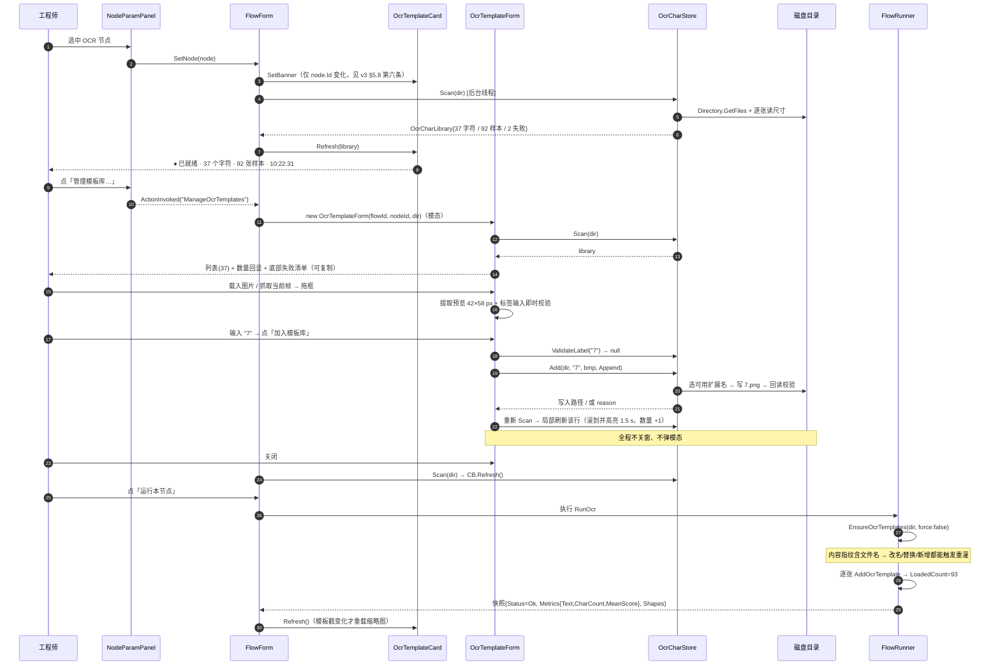
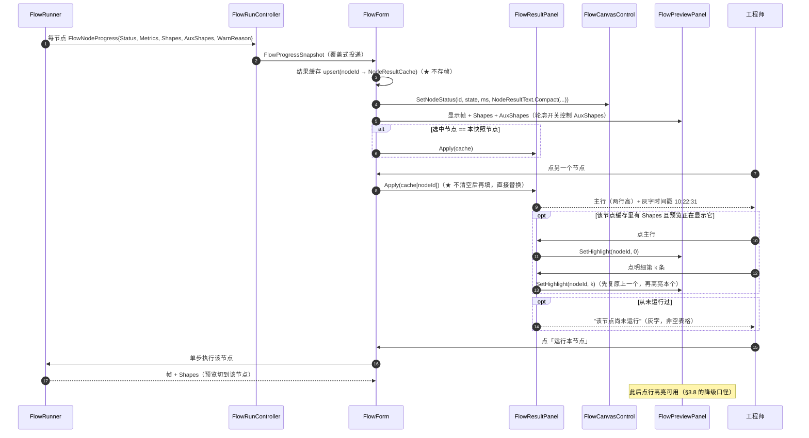
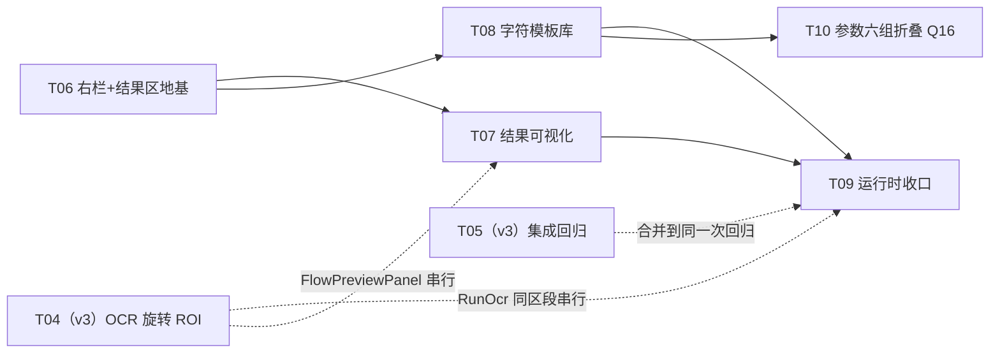

# 增量架构：OCR 字符模板制作 与 结果呈现可读性

> 对应 PRD：`docs/PRD-增量-OCR字符模板与结果呈现.md`（**v1**），编号 `OCR-T01~T09` / `UI-R01~R11` / `Q10~Q20`。
> 前序文档：`docs/架构-模板制作与OCR旋转ROI.md`（v3 配套，**rev7**）。本文**不重复**其 DEF-01~04 / FR-01~14 / T01~T05 的设计，只描述增量。
>
> **唯一真源划分**：字体模板的**磁盘命名规则**以本文 §2.4 / §4.1 为准；结果呈现的**主判据文案**以本文 §3.3（`NodeResultText`）为准；与 T04 的**改动边界**以本文 §1.1 为准。若两处不一致，先改本文再回改 PRD。
>
> **施工前置**：§7 的任务包 + §10 红线。凡标 **★** 的条目是"漏了就返工/返工也测不出来"的。

> **文档修订记录**
> - **rev8（T10 兜底 + 与 PRD v1.7 对齐）**：① **T10 加兜底分支**：若 T08 因故未交付，本包自行完成 `AddGroupRow` 抽取（先抽方法再做折叠）——目的是让 T10 **不依赖 T08 的交付状态**，T08 若返工折叠不必陪着等。② **T10 验收 ⑤ 补失败形态说明**（写进验收正文而非只在红线）：该 bug 的表现是"界面上参数还在、存进配置的是空的/旧的"，用户当场无感、**第二天开机才发现**——**反馈周期是一天不是一秒**，只能靠断言提前抓。③ §8.1 补 C5-d 说明：空态无主行可点 → 清高亮挂"选中该节点"事件；PRD v1.7 已把它写进需求格，并保留"往返一致会掩盖半失效"作为判据的辩护理由（**删了它，下次简化验收就会把判据改回去**）。④ 与 PRD v1.7 全面对齐：`UI-R08` 补"概览不在结果区实现"的禁止项、`UI-R06` NG 可辨识为独立验收②、C5 适用范围（点开过/运行本节点才全通过，从未点开不判失败）、折叠态不持久化。⑤ **新增 §0.A「与 PRD 的对齐索引」前置核对页**（rev8 加）：把本文每一处"由 PRD 定案回写"的口径与它对齐的 PRD 编号/版本列成表，并标注"谁是真源"（三态 `int`、Q10 多样本两行是**本文为权威**，因为那是架构裁定而非需求）；配套 PRD 侧的 `⟶架构 <节号>` 标记，形成**双向核对**——把"漏通知"变成可检测状态；同时补 §8.1 C5-e 的"不判失败**但必须**给状态栏提示（放宽≠可以无反应）"。
> - **rev7（主理人撤回"Q16 并进 T08" + 对齐 PRD v1.4）**：① **Q16 恢复为独立 T10 小包**（主理人理由：T08 已很重 = 8 文件 + 6 步 + 10 红线，折叠混进去出问题分不清是 `Folder` 还是折叠引起）；T08 只做近零成本铺垫（`Group` 行渲染收进 `AddGroupRow`，**不做折叠**），依赖图/矩阵/§7.3/映射表同步。② **T10 新增验收 ⑤「参数不丢」**：折叠某组 → 改别的组 → 保存 → 重开 → **被折叠组的值一字不变**（专测"折叠时延迟创建控件导致 `LoadValues` 读不到/写回失效"）；并在红线里写死"控件必须构造期全部建好并登记 `_inputs`"。③ **T08 红线新增 ⑪ + Q10 验收加严**：`Add` 的同标签追加**禁止覆盖已有样本**（`A.png` 在 → 写 `A.bmp`），第 6 份被拒时**磁盘零改动**；验收改为"用哈希比对 `A.png` 字节未变"+"被拒后文件数/名/字节三样不变"。④ **C5-d 对齐 PRD v1.4**：空态下结果区没有主行可点，所以**清除高亮必须挂在"选中该节点"事件上**，而不是等用户点主行；判据加"从有高亮切到未运行节点后立即无高亮"。⑤ 核实 PRD v1.4 与本文已无残留冲突（反向定位已由 PM 正式关闭）。
> - **rev6（主理人三项定案收口）**：① **R8 定案 = 单节点视图**，并补**全链概览的分工**（画布卡片承担全链概览 `UI-R06`/T07、结果区承担当前节点细节），附"为什么不全塞进结果区"（180 px 只放 4 行 vs 画布一屏看全，用滚动换概览不划算），并写明给 T07 的提示"不要因为结果区只有一行就顺手加全链列表"；同时核实 **PRD v1.3 已由 PM 改好**（§4.2 示意图 → 单节点 + 空态、`UI-R02` 写死"不做所有节点常驻列表"、新增验收"任意节点主行数量恒为 1"），本文与 PRD 无残留冲突。② **Q16 六组折叠并回 T08**（主理人改主意，采纳我"同一渲染分支别分两次改"的理由）：T08 施工顺序 f) 改为「`Folder` 渲染 + 六组折叠**一次改完**」，删除原 T10 小包、依赖图/矩阵/映射表同步。③ §3.8 的 400 ms 节流保持在**正文**（不在附注），并保留工程师实测三组数（往返 0.000000 / 取整 ≤0.5 / 上限 2）作为自验证口径。
> - **rev5（主理人三项定案）**：① **结果区粒度定案 = 跟随选中节点**（§10 R8 从"待裁"改为"已定案"），并列出 **PRD 4.2 示意图与 `UI-R02` 措辞必须同步改**的具体改动；T06 验收加"★ 单节点视图口径，验收时不要数 5 个节点是否 5 行"。② **Q16 折叠从 T08 移出，独立成 T10 小包**（主理人单派，T08 之后）：T08 只加 `Folder` 渲染，但**必须把 `Group` 行渲染收进单一方法**给 T10 铺路；T10 红线四条（只改一个方法 / 折叠态不持久化 / **控件必须在构造期建好并登记 `_inputs`，不能"展开时才创建"** / 不动任何 `DisabledReason`）。③ **施工顺序改为 T06 ✅ → T08 → T10 → T04 → T07 → T09**：主理人定"没有字符模板，T04 的旋转 ROI 做得再好也识别不出任何东西"，先交付"能识别"。④ §3.9 补一句通用判据（缺失须表现为非 `false` 默认 → 必须三态 `int`）。
> - **rev4（T06 交付后同步，三处推翻原文）**：① **§3.9 + §4.5：默认值非 `false` 的布尔偏好必须用三态 `int`**——`DataContractJsonSerializer` 把缺失 `bool` 读成 `false`，导致"字段缺失"与"显式选 false"不可区分：端子区会**默认展开**（需求是收起）、`FlowShowRoiOutline` 会**默认隐藏**（升级后轮廓突然消失）。已把 `FlowPortsState`（0/1/2）写进契约并给出归一化表，`FlowShowRoiOutline` 明确要求 T07 **直接上 `int`**、不要先做 bool；判据：**默认值是不是 `false`，不是就必须三态**。② **§3.8 补 D8 的例外条款**：允许每节点一张 1/4 缩略帧（`NodeResultCache.Thumbnail` + `ThumbDivisor`），**只服务历史回看高亮**、不参与计算、不持久化、覆盖/换流程先 `Dispose`；并写明"删掉它 = C5 在连续运行下退化"以防被当死代码清理；换算统一走 `ThumbGeometry.ToThumb*`（÷4、**保留浮点不预先取整**、禁 `(int)` 截断、禁反算），**新增 400 ms 重建节流**（不节流每周期 5 次 5MP→1/4 会顶破 16 ms 预算）。③ **Q16 六组折叠从 T06 移到 T08**：T08 本就要改 `NodeParamPanel`（`Folder` 渲染），**同一渲染分支分两次改最容易互相覆盖**；T06 交付时 `NodeParamPanel` 一行未动。④ **新增 §10 R8：结果区粒度（单节点视图 vs 多节点列表）待主理人裁决**，附两边的证据与代价，并把 C5-d 措辞中立化（两种粒度下都成立）。⑤ §9 补 T06 实测数据（切节点 55 ms / 60 目标）与缩略帧节流。
> - **rev3（主理人拍板四条 + 三条补充）**：① §3.8 **改为"做 1/4 缩略帧"**，并写死三段：换算只允许 `p_thumb = round(p_full / ThumbScale)`（`AwayFromZero`、禁止反算/禁止在缩略图上命中测试）、缩略帧**只服务历史回看高亮**（不参与检测、不持久化）、按需生成（点开才登记 `CaptureNodeId`，避免每周期 5 次缩放吃掉 16ms）；新增 **C5-e（框位误差 ≤2 缩略像素）/ C5-f（不参与计算 + 换流程释放）** 两条断言。② **新增 §1.3 置灰参数的启用归属表**（五处：`RoiPick`/`RoiPreview`/`RoiAngle`/`FollowPose` → T04 启用；`ShowStringBox` → T07 启用；`RoiX/Y/W/H` **保持可用不置灰**），防"T04 做完了但按钮还是灰的"。③ **指纹 bug 从 T09 挪到 T08**（与"改名/删除/迁移"同包交付），并给出验收①的精确口径：改名 `A→B` 后**不重启软件直接运行，识别标签必须是 B**。④ **`Warn` 不变量写死**（§2.6）：只影响显示、任何路径不得当 `Ng`、唯一让位点 `FlowRunner.cs:209`，且探针要断言"最终快照是 Warn"而不是"RunOcr 里设过"。⑤ **C 条修正**：默认 180 不进验收，但"可拖 120~380 + 跨重启记忆"**必须进验收**（可测契约不能被一起排除）。
> - **rev2（对齐 PRD v1.1/v1.2）**：① C5 从一段描述**拆成 C5-a~d 四条独立断言**（§8.1），并补"现网无反向定位"的**证据与结论**（`FlowResultPanel` 只有单向 `ShapeSelected`，全库无反向接口 → 本期不新增、C5 只覆盖 a~d）；② 新增 **§8.2 PRD S1~S6 落点表**（每处静默 → 提示位置 + 文案 + 任务），并把 PRD 的统一原则写成硬约束「可交互控件要么有可见效果、要么明确告知不可用」，落地方式直接复用 T01 已交付的 `DisabledReason` 机制；③ **S3 硬红线**落到数据层：新增 `Brief()` 四态表（§4.2），`AllFailed` 时严禁"为空"字样，并给字符串探针；④ **迁移加固**：C2/C3 改写为"**迁移 = 复制，永不等于移动**；只读源目录；源目录文件数/文件名/文件大小三者不变；原件仍在为独立必测项"，并把"禁止在窗体里直接 `File.Copy/Delete`"写进 T08 红线；⑤ 新增 **§3.11 D11**（GDI+ PNG 解码不保真 → 字符库读写两端都要按元数据归一化）与 **§3.12 D12**（OCR 的"回写"= 目录改动的唯一真源是节点参数）；⑥ §4.1 补存储格式/体积/失败分类判定顺序，§7 各任务验收同步补 S1~S6 与 C5-a~d。
> - rev1（首版）：Q10 裁定 + 现状纠偏 6 条 + D1~D10 + T06~T09。

---

## 0.A 与 PRD 的对齐索引（前置核对页，rev8 加）

> **为什么放在 §0 之前**：它的用途是"核对先看这里"——PRD 出新版时先扫这张表，再决定要不要读 §0 与正文。
> **为什么需要它**：本文多处口径由 PRD 定案后回写（结果区粒度、C5 判据、S1~S6、迁移措辞、三态配置…）。PRD 每动一处，**本文就会滞后一版**。
> **双向机制**：PRD 侧的变更记录用 `⟶架构 <节号>` 标记；本文侧用这张表反查。**任一侧漏了通知，另一侧仍能发现。**

| 本文位置 | 对齐对象（PRD 编号 / 版本） | 最后核对 |
|---|---|---|
| §8.1 C5-a~d / §10 R8 | §5.1.1 四条断言、Q14 定案、结果区单节点视图 | **v1.7**（判据改为"立即无高亮"） |
| §8.1 C5-d（空态无主行） | C5-d 需求格 + 验收（清高亮挂"选中该节点"） | **v1.7** |
| §8.1 C5-e/f、§10 R1 | C5 适用范围（点开过/运行本节点才全通过；未点开**不判失败但必须有提示**） | **v1.5 / v1.8** |
| §10 R8 分工 + 因果链 + 边界表 | §4.2 分工表、"视觉编码"因果句、状态可辨识 vs 数值细节 | **v1.8** |
| §8.2 S1~S6 | §5.6「不再静默」清单 | v1.1（未再变） |
| §8 表 C2 / C3、T08 红线 | 迁移 = 复制永不等于移动；源目录三样不变 | v1.1（未再变） |
| §2.4 / §4.1 标签与多样本 | Q10 裁定 + `OCR-T06` 命名同构 | v1.1（本文裁定为权威） |
| §3.9 / §4.5 三态 `int` | C6（缺失取代码内默认值） | v1.1 + **本文 rev4 推导**（PRD 未明写 `bool` 三态） |
| §10 R8 反向定位 | §5.1.1 末尾（已正式关闭） | **v1.4**（PM 关闭条件分支） |
| T10 折叠不持久化 | `UI-R01` 持久化边界（只两个字段持久化） | **v1.8** |

**核对方式**：PRD 出新版时，只 diff 带 `⟶架构` 标记的变更行，按标记的节号对照上表；**若标记指向的节号在本文找不到对应内容，说明本文滞后 → 改本文**。

### 0.A.1 条款写法约定（本文自身遵守，rev9 加）

| # | 约定 | 为什么 |
|---|---|---|
| 1 | **禁止型约束必须跟"为什么不能"** | 只写"不许"是呼吁，写清后果才是约束。例：不许合并老路径 → 否则 FR-06 逐像素一致立刻失效 |
| 2 | **放宽型约束必须跟"那它必须做什么"** | ★ 放宽型天然比禁止型危险：它给了实现者"什么都不做"的解释空间，而**什么都不做恰好是最省事的选择**。凡是写了"不判失败 / 允许跳过 / 可降级"的，都要能立刻答出"但它必须做 X"，答不出就是漏洞 |
| 3 | **由两方各写一半的条款必须合进同一句** | 分开时两个半句都能被单方面读松（只看前半 = 可以不响应；只看后半 = 响应与否另说） |
| 4 | **合句防误读，退化说明防删除** | 有人重构时删掉后半句，前半句照样成立。所以要写明"删掉它会退化成什么" |

**本文自查（放宽型条款逐条对过，都已具备"必须做"的一半）**

| 放宽的地方 | 它必须做什么 |
|---|---|
| `Warn` 只影响显示、不阻断流程 | **必须**给黄色状态 + 文案（§2.6 / §3.6），否则"只黄不红"变成"什么都不显示" |
| 位置修正无位姿 → `Skipped`（不判 NG） | **必须**把跳过原因写进摘要（v3 既有口径），否则用户以为修过了 |
| 缩略帧未就绪时点行**不判失败** | **必须**给状态栏可行动提示（§8.1 C5-e），否则退回"点了没效果" |
| 迁移部分失败时**不删已复制的** | **必须**报"已复制 N / 失败 M"并可重试（§8 C3） |
| 模板读取失败**不判 NG**（跳过该文件） | **必须**逐个列出文件名 + 原因并计入失败计数（§8.2 S2），否则就是静默吞掉 |

> **这张表的正式用法是"门禁"，不是"历史记录"**：
> **新增任何「不判失败 / 允许跳过 / 可降级 / 不显示 / 只提示」型条款之前，先照此表问一遍"那它必须做什么"——答不出来就说明这是个漏洞，先补"必须做"的一半再写条款。**
> 判据的由来：**放宽型条款给了实现者"什么都不做"的解释空间，而"什么都不做"永远是最省事的选择**。所以不写"必须做什么"，下游默认就会实现成不做。
>
> **复查时点**：T07（轮廓开关、标签详细度）与 T09（摘要四态、迁移失败）还会新增放宽型条款 → **这两包收口时按本表全文再跑一遍**，比事后追补便宜。

## 0 结论摘要

| 事项 | 结论 |
|---|---|
| **需求 1 的性质** | 不是"界面不好看"，是**功能缺失 + 三处静默**：目录为空静默跑成 OK、坏图静默跳过、切换节点静默清空结果。本期补"看得见的入口 + 看得见的失败"。 |
| **原生算法库** | **零改动**。`va_ocr_add_template` 已支持同标签多样本（`MatchAgainstTemplates` 对全部模板取 argmax，`labels[]` 为平行数组）；`va_ocr_template_count` 已够用。本期不需要新导出。 |
| **Q10 裁定** | **允许同标签多样本**，但机制只能是**同名不同扩展名（≤ 6 份）**——因为"文件名去扩展名即标签"这条加载规则是 C1/C4 的硬约束，任何 `A_001.png` 式后缀都会破坏它。详见 §2.4。 |
| **Q12 的真正难点** | `FlowModuleInfo.CreateDefaultParams()` 同时承担「新节点初始值」和「升级时缺键补齐值」两种语义。直接把默认值改成用户目录会**让极老配置在升级瞬间丢掉模板目录**（C1 违规）。本期把两者**拆成两个入口**（§3.2）。 |
| **UI-R11** | **已由 T01 交付**（`NodeParamField.DisabledReason` + 面板禁用渲染 + Schema 第 4 参）。**不立任务**，只留一条 T04 收尾动作（§2.1）。 |
| **结果区改版** | 弃用 `DataGridView`（无法做两行高可变行），改为 **`FlowLayoutPanel` + 每节点一个 `FlowResultRow` 控件**。不用 Graphics 自绘 → 无需进 `UiStyle` 三份白名单（§3.4）。 |
| **"主判据"从哪来** | **不能从图形反推**。新增结构化 `FlowNodeMetrics`，由各 `RunXxx` 在已有数值处顺手填；文案由 `NodeResultText` 一处生成、五处使用（§3.3）。 |
| **ROI 轮廓污染结果区** | 不止 Blob——`Filter`（606 行）与 `Measure`（1911 行）也塞。改为**辅助图形通道 `AuxShapes`**，一并解决三家（§3.5）。 |
| **空库状态** | `FlowNodeStatus` 现在**没有 `Warn`**，且 `StepNext` 会把 `Running` 一律改写成 `Ok/Ng`。要落地 Q19 必须加枚举值 + 加一条降级通道（§2.6 / §3.6）。 |
| **缩略帧（已定案）** | 连续运行**不缓存原帧**（5MP×5=100MB 会顶破 8h 红线），改为**每节点 1/4 缩略帧**（≈1.25MB），**按需生成**（点开该节点才登记抓帧）。只服务历史回看高亮；换算单向 `round(p/4)`；C5-e 断言框位误差 ≤2 缩略像素（§3.8 / §8.1）。 |
| **置灰参数的启用归属** | 五处必须在功能落地的同一包里解除：`RoiPick`/`RoiPreview`/`RoiAngle`/`FollowPose` → **T04**；`ShowStringBox` → **T07**。`RoiX/Y/W/H` **保持可用**（轴对齐裁剪本来就在工作），**不许一起灰**（§1.3）。 |
| **指纹 bug 归属** | 从 T09 **挪到 T08**——它与"改名/删除/迁移"是同一个功能面，必须同包交付；验收口径：改名 `A→B` 后**不重启软件直接运行，识别标签必须是 B**。 |
| **结果区粒度（已定案）** | **跟随选中节点：一次只显示"当前节点一行 + 该节点目标明细"**，不是全链常驻列表。全链概览由**画布节点卡片**（`UI-R06`/T07）承担，两块各司其职 —— 见 §10 R8。PRD v1.3 已同步（示意图与 `UI-R02` 均已改）。 |
| **任务分解** | **T06~T09 四个包 + T10 独立小包**（Q16 参数六组折叠），合计 25 个文件（新增 7 / 修改 18）。主线：**T06 ✅ → T08 → T10 → T04 → T07 → T09**；排序理由见 §7.3。 |
| **C5 的四条断言** | 拆成 C5-a~d（§8.1），**高亮数恒为 1 由 `ImageViewer.SelectShape()` 的唯一出口结构性保证**（它会把其余图形全部 `IsSelected=false`）；红线：禁止绕过它直接设 `IsSelected`。 |
| **反向定位（画布 → 结果行）** | **现网无此功能**：`FlowResultPanel` 只有单向 `ShapeSelected`，全库无反向接口、`GetSelectedShape()` 无调用者。→ 本期**不新增**（不借改版扩大范围），C5 只覆盖 a~d。 |
| **「不再静默」S1~S6** | 六处全部给出"提示位置 + 文案 + 任务"（§8.2）。其中 **S3（全失败被说成"目录为空"）** 的根因是数据层只返回一个 `int`，修法是把 `FileCount` 与 `LoadedCount` 分开（§4.2 四态表 + 字符串探针）。 |
| **OCR 的"回写"** | 不是字符数（派生值不落盘），而是 **`TemplateDir`**：管理窗体改目录必须立即写回节点参数 + `SaveFlows()`，不可写则**不写回**并恢复原值（§3.12）。 |
| **字符模板存 PNG 的坑** | 与 T03 同源：GDI+ 存 8bpp 索引 PNG、解码回来是 `Format32bppArgb`。**不归一化就判不出身份灰度**；归一化必须落在**读取侧**（手工放进目录的图走不到入库归一化）（§3.11）。 |

---

## 1 与在施需求（T03/T04/T05）的边界

### 1.1 边界表（★ 两边都改同一处是本期最大返工源）

| 相邻项 | 归**本文** | 归 **T04**（v3） | 依据 |
|---|---|---|---|
| `ShowStringBox`（"显示合并字符串框"） | ✅ **接通它**（数据现成，只差绘制与开关读取） | — | 主理人裁定：只依赖已存在的字符框数据 |
| `ShowBoxes`（逐字符框） | ✅ 保持默认关；补一条"老配置显式 1 仍生效"的回归 | — | PRD Q15 |
| 区域框（OCR 作用区域） | ✅ 新增"区域框默认开" | — | PRD R07② |
| **OCR 旋转 ROI 的矫正与回映射** | ❌ 一律不碰 | ✅ 全归 T04（`RoiAngle` / 原生矫正 / `OcrRotatedBox`） | v3 §5.4.1 已定版（rev5） |
| `RoiPick` / `RoiPreview` 的**置灰 + tooltip** | ❌ **T01 已交付**（见 §2.1） | ✅ T04 交付后把第 4 参去掉（改回 3 参重载） | 这条只差"去掉 disabledReason"一行 |
| 参数区**分组折叠**（Q16） | ✅ **一次做到位**，六组（模板 / 分割 / 识别 / ROI / 方向跟随 / 结果显示） | T04 只往里**填空**，不再重排 | PRD 5.6 |
| 结果区容器与高度 | ✅ 全归本文（`FlowForm` 右栏 / `FlowResultPanel`） | T04 不改这两处 | 见 §7.5 |
| `FlowPreviewPanel.cs` | ✅ 只加"轮廓开关 + 三处文案统一" | ✅ T04 大改（预览矫正图） | **串行**：T04 先、T07 后 |
| `FlowRunner.RunOcr` | ✅ 只加字符串框/区域框/Warn/加载结果结构化 | ✅ T04 改 ROI 分支与回映射 | **串行**：T04 先、T08 后；且**不同区段**（③ 模板段 vs ⑤ 绘制段） |
| OCR 字符框的**数据与显示开关**（PRD 5.6） | ✅ 本文定义 | — | 框的"语义/几何"归 T04 |

> **一句话口径**：**T04 决定"框画在哪"，本文决定"画什么、画不画、旁边写什么"**。任何一处改动同时落在两者上，先停下来问主理人。

### 1.2 已交付状态核实（决定了本期要不要重复造）

| 已交付 | 事实 | 对本设计的影响 |
|---|---|---|
| **T01** | `NodeParamKind.Action` + `ActionInvoked` + `SetBanner` + `NodeParamField.DisabledReason` + 两条 `W` 警告 | `UI-R11` 已完成；OCR 面板可直接用 `SetBanner` 挂卡片 |
| **T01** | Schema 的 `Action(key,label,hint,disabledReason)` **第 4 参重载已存在**，且面板 `act.Enabled=false` + tooltip 已实现（`NodeParamPanel.cs:463~471`） | ★ 本文不再设计"置灰机制" |
| **T02** | `RotatedRectShape.Label` + 9 手柄 + `ShapeCommitted` | ★ **匹配/NCC/Blob 的标签渲染已有落点**——`Label` 字段现成，只需在 `FlowShapes` 工厂里填（§3.3） |
| **T03** | `TemplateStore` / `TemplateTrainer` / `TemplateForm` / `TemplateStatusCard`（`CardHeight = 108`、`Bind(flowId,nodeId,algorithm,roi)` / `Refresh()` / `Clear()`） | ★ OCR 卡片**不继承、不复用**它（数据源完全不同），但**视觉常量对齐**（§3.7） |

### 1.3 ★ 置灰参数的**启用归属表**（漏了会出现"T04 做完了但按钮还是灰的"）

`UI-R11` 的置灰机制（T01 交付）现在覆盖的不止两个按钮，而是**五个**参数/按钮。每个都必须在**功能落地的同一个包里**把 `DisabledReason` 去掉，否则现场表现为"功能明明做了、但这个控件永远点不动"。

| 参数 / 按钮 | 现状 | 启用时机 | **谁的收尾动作** | 去掉方式 |
|---|---|---|---|---|
| `RoiPick`（框选 ROI） | 置灰 + tooltip | **T04 交付** | **T04** | `Action(key,label,hint,disabledReason)` → 改回 3 参重载 |
| `RoiPreview`（预览矫正图） | 置灰 + tooltip | **T04 交付** | **T04** | 同上 |
| `RoiAngle`（旋转角度） | 置灰 + tooltip | **T04 交付** | **T04** | 清空 `DisabledReason`（保留键与默认值） |
| `FollowPose`（角度跟随） | 置灰 + tooltip | **T04 交付** | **T04** | 同上 |
| `ShowStringBox`（合并字符串框） | ✅ **T07 已接通并解除置灰** | — | T07（已交付） | 已删 `DisabledReason`；`RunOcr` 第 ⑦ 段按本开关产出 `OcrStringBox` 到 `AuxShapes` |
| `ShowRegionBox`（区域框） | ✅ **T07 已接通并解除置灰** | — | T07（已交付） | 同上，第 ⑥ 段产出 `OcrRegionBox` |
| `RoiX / RoiY / RoiW / RoiH` | **保持可用** ← ★ 它们是真生效的（轴对齐裁剪已在工作） | 不置灰、**不归任何待启用项** | — | 不动 |

三条执行口径：

1. **置灰只是"未实现"的临时标记，不是"可选"**。功能落地的包里**必须**同步去掉，提交说明里写一句"解除 X 的置灰"。T06/T08 的验收清单一律带一句"本次未误解除他人置灰"（防止顺手全清）。
2. **`RoiX/Y/W/H` 不许跟着一起灰**。它们在 T04 之前就生效（`ResolveRoi` 已能用），置灰会直接砍掉现网可用的功能。
3. 本文**不新增**置灰项。若某控件做不到"有可见效果"，按 §8.2 末段的原则走同一个 `DisabledReason` 机制，并在本表补一行。

---

## 2 现状核实与纠偏（★ 六条与简报不同或更严重的事实）

> 以下每条都给出代码位置，均可当场复核。**它们直接改变了任务内容**，不是补充说明。

### 2.1 UI-R11 已经做完了，不该再立任务

`NodeParamSchema.cs:249~272` 有两个 `Action()` 重载，第 4 参 `disabledReason` 落到 `NodeParamField.DisabledReason`；`NodeParamPanel.cs:463~471` 在渲染时 `act.Enabled = false` 并 `toolTip.SetToolTip(act, f.DisabledReason)`；`Ocr()` 里 `RoiPick` / `RoiPreview` **已经传了第 4 参**。

**结论**：`UI-R11` 在 T01 已闭合，本期**只需验收**（截图：两按钮灰、悬停有说明）。剩余唯一动作在 T04：交付时把第 4 参去掉（改回 3 参重载）即可恢复可用。**这条写进 T04 的收尾清单，不进本期任务包。**

### 2.2 模板重载指纹漏了"文件名"，改名不生效（真 bug，不是新功能）

`FlowRunner.cs:1143~1149`：

```csharp
string fingerprint = dir + "|" + files.Count + "|" + stamp;   // stamp = 最新 mtime
```

Windows 下**重命名保留 `LastWriteTime`**。于是 `A.png → B.png`：目录不变、文件数不变、max mtime 不变 → **指纹不变 → 不重载 → 运行时仍用旧标签 `A`**。

- 这直接违反 `OCR-T06` 验收①（"手工改名成 `B` 后重开管理界面显示标签为 `B`"）——管理界面自己扫目录没问题，但**节点运行时不认**，用户会看到"界面里是 B、识别出来还是 A"。
- 现在没人报，是因为**改名这个动作在界面上根本不存在**；本期加了"入库/删除/迁移"，改名与替换会变日常操作，这个洞一定会被踩。

**修法**（写进 T08）：指纹改为**逐文件内容标识的累积哈希**：

```
fingerprint = FNV1a( dir | 每个文件: name.ToLowerInvariant() + "|" + length + "|" + mtimeTicks )
```

`files` 已按文件名排序（`ListOcrTemplateFiles`），累积顺序稳定，结果可复现。200 张模板约 200 次字符串拼接+哈希，<0.1ms，**不影响 FR-06/C1 的"识别文本严格相等"**（它只决定"要不要重灌"，重灌后模板集与顺序完全相同）。

### 2.3 ★ 一个函数、两种默认值语义：C1 与 Q12 直接冲突（本期最容易被写错的点）

`FlowModuleInfo.CreateDefaultParams()` 被**两处**调用：

1. **新建节点** → 新节点应得"用户目录"（Q12）；
2. **`FlowSettings.UpgradeToCurrent` 缺键补齐** → 老节点应得"升级前的行为"（C1/C2）。

两者是同一个函数。若把 `TemplateDir` 默认值改成 `%AppData%\VisionPlatform\OcrChars`：

- 老配置里 `TemplateDir` 键**已存在**（"OCRModel"）→ 不受影响 ✓；
- 但**更老的配置**（`TemplateDir` 还不存在的年代）升级时会被填成用户目录 → 那些节点**指向一个空目录 → 模板全部丢失 → 识别退化为"仅分割"** ✗ **直接违反 C1**。

**裁定**（§3.2）：**`CreateDefaultParams()` 的 `TemplateDir` 保持 `"OCRModel"` 一字不改**；新增第三个入口 `FlowModuleInfo.CreateNewParams()`（仅新建节点用），内部先调 `CreateDefaultParams()` 再把 `TemplateDir` 覆盖为 `AppPaths.OcrCharsDir`。`UpgradeToCurrent` 继续走 `CreateDefaultParams()`。

> 这条与 v3 里"`Kind=Action` 不进 `CreateDefaultParams`"是同一类教训：**同一个函数被两种语义复用，就一定会在其中一种上出错**。以后凡是"默认值"，先问一句"这是新对象初值还是老对象补值"。

### 2.4 ★ Q10 的真正约束：文件名即标签 ⇒ 多样本只能靠"同名不同扩展名"

原生侧**支持**同标签多样本，这点无争议（`algo_ocr.cpp:270~300`：`templates[]` 与 `labels[]` 平行数组，循环取 argmax；同标签任意一份胜出，标签都一样）。真正卡住的是**磁盘命名规则**：

- `EnsureOcrTemplates` 用 `Path.GetFileNameWithoutExtension(f)` 当标签（`FlowRunner.cs:1170`）；
- 所以 `A_001.png` 的标签是 **`A_001`**，不是 `A`。

要在**不改解析规则**（C1/C4 的硬约束）的前提下支持多样本，只剩一条路：

> **同一字符的多份样本 = 同一文件名、不同扩展名**（`A.png` + `A.bmp` + `A.tif`）。扩展名白名单共 6 个（`bmp/png/jpg/jpeg/tif/tiff`），受 Windows "大小写不敏感"限制，**每字符上限 6 份**。

代价与取舍：

| 方案 | 破 C1/C4？ | 多样本 | 评价 |
|---|---|---|---|
| **同名不同扩展名（采纳）** | 否 | ✓ 上限 6 | 规则零改动；资源管理器里 `A.png`/`A.bmp` 一眼就是同一字符的两份 |
| `A_001.png` 后缀归组 | **是**（老目录里恰有 `A_001.png` 会被改标签） | ✓ 无上限 | ✗ 否决 |
| 一个标签一个文件（拒绝多样本） | 否 | ✗ | 不符现场需求（污损/字体差异） |
| 引入"索引文件"映射"文件→标签" | 否（但**并行真源**） | ✓ 无上限 | ✗ 否决：与"文件名即标签"形成两套真源，手工拷贝到别的机器就失效（C4 会挂） |

配套约束（写进 T08 校验器）：

- **标签字节上限 7**：`VA_OCR_LABEL_BYTES = 8`，`va_ocr_add_template` 会把 label **静默截断**到 7 字节（`va_ocr.h:33`）。中文 3 字节/字 ⇒ **最多 2 个汉字**。若不校验，`华东区` 与 `华北区` 会被截成同一个标签而**静默合并**（比覆盖更难查）。→ `Encoding.UTF8.GetByteCount(label) <= 7`，否则拒绝并提示"标签过长（最多 2 个汉字或 7 个英文字符）"。
- **非法字符**：`\ / : * ? " < > |`、结尾空格或点、空串 → 拒绝（`OCR-T06` 验收②）。
- **不静默覆盖**：`A.png` 已存在时，先比内容字节；相同 → "已存在相同样本，未重复添加"；不同 → 依次找下一个可用扩展名；6 个都占满 → "该字符已有 6 份样本，请先删除旧样本"。

### 2.5 空库/坏图的静默，比 PRD 描述的更彻底

- `EnsureOcrTemplates` 读失败 `continue`（`1175`），最终 `added` 可能 < `files.Count`，但**返回值只有一个 int** → 上层无法区分"目录空"与"全读失败"；
- `Directory.CreateDirectory` 成功后**静默**（`1137`）→ 用户以为"目录自动建好了"，其实里面什么都没有；
- `RunOcr` 的摘要判断用 `hasTemplate = tpl.Value > 0`（`859`），非 0 才不加"模板目录为空"→ **全读失败时 `Value=0`，摘要写"模板目录为空"**，与"4 个文件均读取失败"完全不同的两件事被合并成一句话（`OCR-T04` 验收③正好卡这条）。

**修法**：`EnsureOcrTemplates` 返回结构化结果（§4.2），摘要与界面各取所需。

### 2.6 ★ `FlowNodeStatus` 没有 `Warn`，而且会被 `StepNext` 抹掉

`FlowNodeStatus` 只有 `Pending/Running/Ok/Ng/Skipped`（`FlowRunContext.cs:12`）。而 `FlowRunner.cs:209`：

```csharp
if (p.Status == FlowNodeStatus.Running) p.Status = ok ? FlowNodeStatus.Ok : FlowNodeStatus.Ng;
```

`RunOcr` 里无论设成什么都在这之后被改写成 `Ok/Ng`。所以 Q19 的 WARN 需要三处改动，缺一不可：

1. `FlowNodeStatus` **末尾追加** `Warn`；
2. `FlowNodeProgress` 新增 `WarnReason`（string），由 `RunOcr` 填；`StepNext` 改成 `ok ? (string.IsNullOrEmpty(p.WarnReason) ? Ok : Warn) : Ng`；
3. 显示层三处补分支：`FlowResultPanel.StatusText`、`FlowCanvasControl.ToRunState/BorderColor/DrawRunOverlay`、`FlowNodeRunState` **末尾追加** `Warn`（黄色 `UiTheme.ColorWarn`）。

**不变量（★ 主理人要求写死）**：

1. **`Warn` 只影响显示，不阻断流程**——`RunResultOutput`（`FlowRunner.cs:2299~2319`）只把 `Ng` 计入失败清单，`FlowRunController` 的链尾结论只看 `res.Passed`，二者都不认 `Warn`。
2. **任何代码路径都不得把 `Warn` 当作 `Ng` 处理**。这句话是给未来的自己看的：`Warn` 是新增值，所有既有的"不是 Ok 就当失败"式写法（`status != Ok`、`status == Ng ? ... : ...` 的反面）都会**静默地**把 WARN 判成失败，而这类代码不会报错、只会在现场表现为"明明识别出来了却判 NG"。
3. **让位点只有一个**：`FlowRunner.cs:209` 的

   ```csharp
   if (p.Status == FlowNodeStatus.Running) p.Status = ok ? Ok : Ng;
   ```

   必须改成

   ```csharp
   if (p.Status == FlowNodeStatus.Running)
       p.Status = ok ? (string.IsNullOrEmpty(p.WarnReason) ? Ok : Warn) : Ng;
   ```

   并且 —— **此后任何"覆盖 `p.Status` 的新代码都必须先查 `WarnReason`"**。这是整个机制的唯一缺口：`StepNext` 之后若还有别处写 `p.Status`，Warn 会被再次抹掉（这就是 §2.6 开头那条"设什么都没用"的成因）。探针建议：`RunOcr` 在空模板库下跑一次，断言最终快照 `Status == Warn`（而不是只断言"`RunOcr` 里设过 Warn"）。

### 2.7 ROI 轮廓污染结果区的不止 Blob

`p.Shapes.AddRange(FlowShapes.RoiOutline(roi))` 出现在三处：

| 行 | 节点 |
|---|---|
| `FlowRunner.cs:606` | 滤波（Filter） |
| `FlowRunner.cs:688` | Blob |
| `FlowRunner.cs:1911` | 目标识别（Detect） |

PRD 只写了 Blob。**按 Blob 单点修会漏掉另外两家**，且下一个节点类型又会重犯。→ 采用 §3.5 的**通用辅助通道**。

---

## 3 关键设计决策

### 3.1 D1：OCR 模板库 = "目录 + 只读扫描结果 + 显式写操作"，不引入数据库/索引文件

**选型**：`OcrCharStore`（无状态静态工具）+ `OcrCharLibrary`（扫描快照，只读）。

理由：
1. 兼容性最高——手工放的文件、界面放的文件、别的机器拷来的目录，三者完全等价（C4 天然满足）；
2. 不引入第二真源（见 §2.4 的否决项）；
3. 扫描 200 张图 = 一次 `Directory.GetFiles` + 每张一次 `new Bitmap` 的**尺寸读取**，`≤ 800ms` 绰绰有余；缩略图**懒加载**（只对可见行取图）。

代价：`N 张样本`/`修改时间`/`失败清单` 都是"扫描时算的"，不缓存 → 每次开窗重扫一次。可接受（开窗一次）。

### 3.2 D2：把"新节点默认值"从 `CreateDefaultParams()` 拆出来（★ 见 §2.3）

```csharp
// FlowModule.cs 增量
public static FlowModuleInfo Find(FlowNodeType t);          // 已有
public Dictionary<string,string> CreateDefaultParams();      // 已有：缺键补齐 / 兼容性基线，一字不改
public Dictionary<string,string> CreateNewParams();          // 新增：仅"新建节点"用
```

`CreateNewParams()` 实现口径：`var p = CreateDefaultParams(); if (Type == Ocr) p["TemplateDir"] = AppPaths.OcrCharsDir; return p;`

调用点唯一：`FlowForm` 新建节点的入口（拖动/双击工具箱落节点处）。**若将来别的类型也要"新节点用不同默认"，只改这一个方法。**

### 3.3 D3：主判据由**数据**提供，文案由**一处**生成（★ 让"三处不一致"从结构上不可能）

问题：`FlowProgressSnapshot` 只有 `Summary` 字符串，而摘要文案是各 `RunXxx` 自己拼的（格式各异，且是给日志看的）。要靠它反推"最高分 0.93"只能正则扒字符串。

**选型**：

1. 新增 `FlowNodeMetrics`（§4.3），字段全部是可空语义（`int = -1` / `double.NaN` / `string = null`），由各 `RunXxx` 在**已有变量处**顺手填（不需要额外计算，都是现成值）。
2. 新增 `NodeResultText`（静态工具，**唯一**文案生成点）：

```csharp
public static string Primary(FlowNodeType type, FlowNodeMetrics m);  // 结果区主行第二行
public static string Compact(FlowNodeType type, FlowNodeMetrics m);  // 画布卡片摘要（更短）
public static string StatusLine(FlowNodeStatus st, string warnReason); // 状态徽标文本
```

3. 五处使用同一函数：结果区主行、画布卡片、预览覆盖层、预览顶条、状态栏。

**代价**：要给约 8 个 `RunXxx` 各加 3~8 行填字段。**收益**：`UI-R09`（三处一致）与 `UI-R03`（两处可见）从"靠人核对"变成"结构上只能一样"。

### 3.4 D4：结果区用 `FlowLayoutPanel` + 行控件，弃用 `DataGridView`（★ 别自绘）

| 方案 | 两行高主行 | 展开明细 | 无横向滚动 | 主题接入 | 评价 |
|---|---|---|---|---|---|
| `DataGridView`（现状） | ✗ 行高统一，做不到"主行 36 / 明细 22" | 勉强（子行） | ✗ 7 列必挤 | ✓ 自动 | ✗ 否决 |
| **`FlowLayoutPanel` + `FlowResultRow` 控件（采纳）** | ✓ | ✓ 插入/移除控件 | ✓ 竖向布局 | ✓ 内部用 `Label`，被 `UiStyle` 自动遍历 | ✓ |
| 全自绘（如图纸布控件） | ✓ | ✓ | ✓ | ✗ 要进 `UiStyle` **三份**白名单（`UiStyle.IsSelfDrawn` / `Lang` 第二份 / `UiThemeManager.ReapplySelfDrawn`） | ✗ 否决 |

**关键**：`FlowResultRow` 内部**只用 `Label` 与 `Panel`**，不重写 `OnPaint` → **不需要进白名单**（这是本项目最容易踩的坑：自绘控件漏一份白名单就表现为"切主题后不换色"）。

**行结构**（288 px 内容宽，两行）：

```
▾ 3  字符识别(OCR)                            ● OK       ← 行1：箭头16 + 序号18 + 名称(填充) + 徽标52
    "ABC-1234" · 8 字符 · 置信 0.94 · 18 ms              ← 行2：单行，AutoEllipsis
```

展开时在其下方插入 N 个 `FlowResultDetailRow`（22 px，键值成对横排：`#1  0.93  412,208  86×64`）。**明细不加列**，靠行内顺序固定 + `AutoEllipsis`。

### 3.5 D5：辅助图形单独一条通道 `AuxShapes`（★ 一次解决三家，且不动几何库）

否决项与理由：

| 方案 | 问题 |
|---|---|
| 给 `IGeometryShape` 加 `IsAuxiliary` | 接口变更 → 7 个实现类全改（v3 里"给接口加 `Label`"已被否过一次，同一理由） |
| 靠 `Name == "RoiOutline"` 过滤 | 字符串判据；新增节点忘了设 `Name` 就漏；且 `Name` 已被用作别的语义 |
| 只改 `FlowResultPanel` 过滤线条类型 | ✗ 更糟：结果区会"猜"什么是目标 | 

**选型**：`FlowNodeProgress.AuxShapes` / `FlowProgressSnapshot.AuxShapes`（新列表），`FlowRunner` 三处 `p.Shapes.AddRange(RoiOutline(...))` 改成 `p.AuxShapes.AddRange(...)`。

- **结果区**只读 `Shapes` → 条数严格等于目标数（`UI-R05` 验收：12 个 Blob 就是 12 条）；
- **预览**画 `Shapes` + `AuxShapes`，`AuxShapes` 受"轮廓"开关控制（`UI-R05`②）；
- **索引不变**：`Shapes` 内部顺序不变 → `SetHighlight(nodeId, shapeIndex)` 语义不变（C5 不破）。

### 3.6 D6：OCR 空库 → `Warn`，且必须"只黄不红"（★ 见 §2.6）

`RunOcr` 填 `p.WarnReason = "模板库为空，仅分割未识别"`，`StepNext` 据此产出 `Warn`。显示层黄色 + 文案。`Passed` 判定不变。

**为什么不能只改文案**：`Ok` 的语义是"检测通过"。把"根本没识别"标成 `Ok`，现场会直接误判良品——这是**风险**，不是提示偏好（PRD Q19 理由）。

### 3.7 D7：OCR 状态卡片**新建** `OcrTemplateCard`，但视觉常量与 T03 卡片对齐

不复用 `TemplateStatusCard`：它的 `Bind(flowId, nodeId, algorithm, expectedRoi)` 直连 `TemplateStore`（匹配类资产 = 单文件 PNG + 元数据），OCR 是"目录 + N 文件 + 失败清单"，强行合并会造出万能接口。

代价与约束：**视觉必须同构**——`CardHeight = 108`、缩略图 48×48、状态徽标用 `UiTheme.StyleBadge`。加一条探针：`Assert(OcrTemplateCard.CardHeight == TemplateStatusCard.CardHeight)`，防两套视觉漂移。

### 3.8 D8：结果缓存**不缓存原帧**，改为**每节点一张 1/4 缩略帧**（主理人已定案：做）

`UI-R08` 要"切回去还能看到结果"。若每节点缓存一帧 5MP **原图**（≈20MB），5 节点 = 100MB，**8 小时内存红线必挂**（PRD 5.3 末行）。

**选型**：`NodeResultCache { Metrics, Status, WarnReason, ElapsedMs, RunAt, Shapes, Thumbnail, ThumbDivisor }`

| 字段 | 说明 |
|---|---|
| `Shapes` | **原始图像坐标**下的结果图形（不缩放、不换算） |
| `Thumbnail` | 1/4 缩略帧（`Bitmap`，`24bppRgb`，≈1.25MB/节点），**仅当本节点命中了"回看抓帧"时才生成**（见下） |
| `ThumbDivisor` | = `ThumbGeometry.Divisor`（`4`）。写成字段而不是硬编码，将来若要 1/2 或 1/8 只改一处 |

> **★ 这是 D8 唯一允许的"缓存帧"例外（rev4 补）**
> 本设计的原始口径是"结果缓存不缓存任何帧"（省内存）。主理人拍板后**明确开了这一个例外**：允许每节点一张 **1/4 缩略帧**，且**只**用于历史回看高亮。
> **后来者注意**：如果你在代码里看到 `NodeResultCache.Thumbnail`，那不是谁违反了"不缓存帧"，而是这个例外。**删掉它 = C5 在连续运行下退化成"只能提示、不能高亮"**，那是需求回退，不是清理死代码。判断依据看下一条的三个硬约束——只要这三条还在被遵守，这个字段就是合法的。

**缩略帧的三条硬约束（★ 主理人明确要求，写死）**

1. **只服务"历史回看高亮"**：`Thumbnail` **绝不参与任何检测计算**（不做匹配、不进算法库、不当训练帧），**也绝不进 `TemplateStore` 或任何持久化**（它是一次运行的临时产物，`RunAt` 之后随时可弃）。
2. **生成时机**：只有在"用户点开了某个历史节点、而该节点没有帧"时，才把该节点登记为 `session.CaptureNodeId`；下次运行经过它时按 1/4 降采样克隆一张（**且受 400ms 节流**，见下）。**没被点开过的节点不产生缩略帧**（否则 5 节点常驻 6MB 没必要）。
3. **`Shapes` 始终是原图坐标**：高亮坐标**不做预缩放**，缩放只发生在"往缩略图上画"的那一刻。

**★ 坐标换算方向与取整规则（必须有这条，否则会出现"框偏了一点、但看起来像摆放问题"的静默错误）**

```
正向（原图 → 缩略图，唯一的换算方向）：  p_thumb = p_full / ThumbGeometry.Divisor   // ÷4，**不预先取整**
反向（仅调试/断言用，禁止出现在业务路径）：p_full = p_thumb * Divisor
```

- **只在绘制侧换算一次**，`SetHighlight(nodeId, shapeIndex)` 的入参与 `Shapes` 一律**保持原图坐标**；
- **不预先取整**：`ThumbGeometry.ToThumb/ToThumbPoint/ToThumbRect` 保留浮点（`ThumbGeometry.Divisor = 4`），只在最终 `DrawRectangle/DrawLine` 落笔时由 GDI+ 取整。**禁止用 `(int)` 截断**——截断是单向的，会让所有框系统性偏左上 ≤1 缩略像素，看起来像"摆放问题"而不是"换算问题"；
- **反向换算一律禁止进入业务路径**：不得先算缩略坐标再乘回去，也不得在缩略图上做命中测试。命中/选中逻辑仍走 `ImageViewer` 的原图坐标系。
- **旋转矩形缩放后角度不变**（只缩中心与宽高），这是"框看起来歪了"的另一个常见误判来源。

**★ 缩略帧重建必须节流（rev4 补，T06 实现为每节点每 400ms 最多一次）**

连续运行时每个周期都会经过所有节点；若每次都降采样，5 次 5MP→1/4 ≈ 5~15ms/周期**直接吃掉 16ms 刷新预算**。因此：

- 重建条件 = "该节点被点开过（登记了 `CaptureNodeId`）" **且** "距上次重建 ≥ 400ms"；
- 覆盖时**先 `Dispose` 旧 `Thumbnail` 再赋值**（换流程 / 重跑覆盖同一条路径）；
- 400ms 是"人眼不觉得卡"与"内存/CPU 可承受"的折中，**不是随手写的数**——改成 0（不节流）就等于把 C5 的便利换成每次运行的掉帧。

**C5 前置条件因此消失**：有缩略帧 → 切回历史节点也能高亮（§8.1）；缩略帧尚未生成的那一次（从未点开过该节点，或刚点开不满一个重建周期）→ 结果行可读、可点，高亮请求给状态栏提示"正在获取该节点图像"。

> 1 帧 5MP 的 1/4 降采样 ≈ 1.25MB（`24bppRgb`）；实际窗内节点通常 ≤ 8 个 → 峰值 ≤ 10MB，且随窗口换流程释放。相对"每节点存原帧"的 100MB，这是唯一能同时满足 C5 全场景与 8h 内存的做法。

### 3.9 D9：结果区高度等 UI 偏好存**96-DPI 逻辑值**，显示时按 DPI 换算

`UiSettings` 新增 `FlowResultPanelHeight`（默认 180，范围 120~380，存**逻辑像素**）、`FlowPortsState`、`FlowLabelDetail`、`FlowShowRoiOutline`。

显示时：`实际px = 逻辑值 × (DeviceDpi / 96)`。理由：150% DPI 下若直接存物理像素，重启换显示器就会"结果区突然变一半高"（PRD 5.5 明确风险）。`ConfigStore.Load` 里做**归一化**（0 或越界 → 默认值），不要钳到边界（v3 里 `MaxParallelFlows` 的教训：缺失被钳成 1 等于关掉并行）。

**★ 三态开关必须用 `int`，不能用 `bool`（rev4 补，T06 实测踩到）**

`DataContractJsonSerializer` 对**缺失的 `bool` 一律反序列化成 `false`**。于是"字段缺失"与"用户显式选了 `false`"**无法区分**：

- 端子区需求是**默认收起**（`true`）；写成 `bool FlowPortsCollapsed` 后，老配置缺这个字段 → 读成 `false` → 表现为**默认展开**，与需求正好相反，而且**没有任何报错**；
- `FlowShowRoiOutline` 默认 `true`（轮廓可见）同理：老配置缺字段 → `false` → 升级后用户发现"ROI 轮廓突然不见了"，会当成功能坏了。

**所以凡是"默认非 false"的布尔偏好，一律用三态 `int`**：

| 字段 | 取值 | 归一化 |
|---|---|---|
| `FlowPortsState` | `0` = 未设置 / `1` = 收起 / `2` = 展开 | `0` 与非法值 → `1`（收起） |
| `FlowShowRoiOutline` | `0` = 未设置 / `1` = 隐藏 / `2` = 显示 | `0` 与非法值 → `2`（显示） |

这与"归一化而不是钳制"是同一套思路：**缺失必须补默认值，只有显式越界值才夹到边界**——只是 `bool` 装不下"未设置"这一态。

> 默认值为 `false` 的布尔偏好（例如将来的"逐字符框"开关）仍可用 `bool`：缺失读成 `false` 恰好等于默认值。
> **通用判据（rev5 定，适用于全项目）**：**凡是"缺失必须表现为某个非 `false` 默认"的 `bool` 配置项，一律用三态 `int`，不用 `bool`。** 这与 v3 的「缺失 vs 显式 0 必须区分」、以及 `MaxParallelFlows` 那次「缺失被钳成默认值等于悄悄关掉功能」是同一条原则，只是落到了更细的粒度上。

### 3.10 D10：所有"扫描/加载"都返回**结构化结果**，禁止再返回裸 int

`EnsureOcrTemplates` 返回 `OcrTemplateLoadResult`（§4.2），字段：`Dir / LoadedCount / FileCount / Failures[] / ScannedAt / Stamp`。派生只读属性 `IsEmpty`（`FileCount == 0`）、`AllFailed`（`FileCount > 0 && LoadedCount == 0`）。

**理由**：现在的一个 int 已经逼得摘要必须"猜"（§2.5 第 3 条）。这类"信息在源头被丢弃、在下游被迫猜测"的设计，是本期三处静默的共同成因。

### 3.11 D11：字符模板存 PNG，但**解码不保真**——入库与加载两端都要按元数据归一化

T03 施工时实测到的 GDI+ 行为（已写入 v3 文档 §5.2 第 2 条）：**8bpp 索引图 `Save(path, ImageFormat.Png)` 后，`new Bitmap(stream)` 解回来是 `Format32bppArgb`，不是 `Format8bppIndexed`**。

对字符库的影响：

- **不丢灰度**（R=G=B=原索引值，按 Rec.601 转回即原值），所以**不影响识别正确性**；
- 但"存的是身份灰度"这个契约在**读回来那一刻**就不成立了 → 若入库时或运行时对读回的图做 `IsIdentityGray` 判断，会恒 false。

**口径（两端对称，缺一不可）**：

| 端 | 做法 |
|---|---|
| **写**（入库） | 统一存 **8bpp 身份灰度的原始灰度图**（不做预二值化、不缩放）。原生 `va_ocr_add_template` 内部会走**与识别完全相同**的二值化 + 归一化，预二值化会让它二次二值化 → 劣化 |
| **读**（入库回读校验 / `OcrCharStore` 取缩略图 / `EnsureOcrTemplates`） | 读回后**一律转成身份灰度**（`VisionAlgo.CreateGrayBitmap` + `ConvertToIdentityGray`），再交给任何判断或算法库。**禁止**直接用 `Image.FromFile` 的结果当"灰度图" |

**为什么不能"入库时转一次就完"**：手工放进目录的图（用户从截图工具存出来的 24bpp PNG）走的是**加载路径**，没有机会经过入库的归一化。所以**归一化必须落在读取侧**，写入侧只是保证"我们写出去的尽量标准"。

### 3.12 D12：OCR 的"唯一真源"是节点参数，不是管理窗体——改目录必须回写

T03 的教训（保存模板后必须把 ROI 写回节点，否则刚做完的模板当场失效）在 OCR 侧的对应物是**模板目录**：

- 参数面板与管理窗体**都能改目录**。若管理窗体只改自己内部的字段、不写回 `node.Params["TemplateDir"]` → 用户"在库里点了浏览、选好了目录、加了一批字符"，回到主界面一运行**还是读老目录** → 表现为"我加的字符不生效"。
- **口径**：`TemplateDir` 的唯一真源是**节点参数**。管理窗体顶部改目录时：
  1. 立即写 `node.Set("TemplateDir", 相对化后的值)`；
  2. `FlowForm.SaveFlows()`；
  3. 参数面板的文本框同步刷新（由 `SetNode` 回填，注意 v3 §5.8 第六条的"banner 不重建"约束）；
  4. 若目录不可写 → **不写回**，并把输入框恢复成原值 + 提示原因（避免"看起来改了、其实没生效"）。

**什么不需要回写**：字符种类数、样本数、失败数——这些是**扫描派生值**，唯一的家是"扫描结果"（`OcrCharLibrary`）与卡片显示，**不得**写进节点参数（写进去就会与磁盘分叉，且旧版本读不懂）。

---

## 4 数据结构与接口

### 4.1 字符库（`Flow/OcrCharStore.cs`，新增）

```csharp
namespace VisionPlatform.Flow
{
    /// <summary>一张模板文件在磁盘上的形态（扫描结果，只读）。</summary>
    public sealed class OcrCharFile
    {
        public string Path;          // 绝对路径
        public string Label;         // = 文件名去扩展名（唯一真源，见 §2.4）
        public string Ext;           // 小写，含点
        public long   Length;
        public DateTime LastWrite;
        public int    PixelW, PixelH;   // 尺寸读不到时为 0（同时进 Failure）
    }

    /// <summary>按标签归组后的一项（UI 一行）。</summary>
    public sealed class OcrCharEntry
    {
        public string Label;
        public List<OcrCharFile> Files = new List<OcrCharFile>();   // 多样本：同标签、不同扩展名
        public int    SampleCount { get { return Files.Count; } }
        public DateTime LastWrite { get; }        // = Files 里最大值
        public string PrimaryPath { get; }        // 缩略图取第一份（按扩展名白名单顺序）
    }

    public enum OcrCharFailureKind { NotImage, Empty, UnsupportedExt, TooLarge, AccessDenied }

    public sealed class OcrCharFailure
    {
        public string FileName;                  // 只存文件名，界面显示 + 可复制
        public OcrCharFailureKind Kind;
        public string Reason;                    // 中文可行动：不是有效图像 / 0 字节 / 扩展名不支持 / 超过 256 KB
    }

    /// <summary>一次目录扫描的完整结果。★ 所有失败都必须出现在 Failures 里，禁止静默。</summary>
    public sealed class OcrCharLibrary
    {
        public string Dir;
        public List<OcrCharEntry> Entries;       // 按 Label 排序（Ordinal）
        public List<OcrCharFailure> Failures;
        public int  FileCount;                   // 合法扩展名的文件总数
        public DateTime ScannedAt;

        public int  LabelCount { get; }          // 字符种类
        public int  SampleCount { get; }         // 样本总数（= Σ SampleCount）
        public bool IsEmpty  { get { return FileCount == 0; } }
        public bool AllFailed{ get { return FileCount > 0 && Entries.Count == 0; } }
        public int  CountOf(string label);       // 该标签已有几份样本（入库前查重用）
    }

    public static class OcrCharStore
    {
        /// <summary>扫描目录。thumb 不在这里取（懒加载），只读尺寸。</summary>
        public static OcrCharLibrary Scan(string dir);

        /// <summary>加入一份样本。返回实际写入路径；失败返回 null + reason。</summary>
        /// <param name="onExists">标签已存在时的处理：Append（默认，找下一个扩展名）/ Replace（覆盖主样本）/ Abort。</param>
        public static string Add(string dir, string label, Bitmap sample,
                                 OcrCharAddMode onExists, out string reason);

        /// <summary>删除某标签的全部样本（或单个文件：传 filePath）。</summary>
        public static bool Delete(string dir, string label, out string reason);
        public static bool DeleteFile(string filePath, out string reason);

        /// <summary>清空目录内全部合法模板文件（保留目录本身；不递归）。</summary>
        public static int  ClearAll(string dir, out string reason);

        /// <summary>标签校验（§2.4 三条：非空 / 非法字符 / UTF-8 ≤ 7 字节）。返回 null = 合法。</summary>
        public static string ValidateLabel(string label);

        /// <summary>迁移：复制全部合法文件到目标目录，逐个校验；默认不删原件。</summary>
        public static OcrCharMigrateResult Migrate(string fromDir, string toDir, bool deleteSource);
    }

    public sealed class OcrCharMigrateResult
    {
        public int Copied, Failed, Skipped;
        public List<OcrCharFailure> Problems;
    }
}
```

**写盘规则（★ 与 §2.4 一致，实现时逐条对照）**

1. 目标文件名 = `label + ext`；扩展名优先顺序 `.png → .bmp → .tif → .tiff → .jpg → .jpeg`；
2. 若 `label.png` 已存在：**先比内容**（同尺寸 + 逐像素或 SHA256）→ 相同则返回"已存在相同样本"，不写；
3. `Append` 模式：依次找第一个不存在的扩展名；6 个都在 → 返回失败"该字符已有 6 份样本"；
4. `Replace` 模式：覆盖 `label.png`（若不存在则按 2. 规则找位置）；
5. 落盘后**立即回读一张**（`new Bitmap` + 尺寸）验证可读，失败则删除刚写的文件并报错（防"写成功但读不出"）。

**存储格式与体积约束（★ 与 D11 配套）**

| 项 | 约定 | 理由 |
|---|---|---|
| 格式 | **PNG 无损**，8bpp 身份灰度 | 与 v3 模板资产同一口径；JPEG 会有损、破坏"同一张图两次入库得到同一模板" |
| 内容 | **原始灰度 ROI，不预二值化、不缩放** | 原生 `AddOcrTemplate` 内部会做与识别完全相同的二值化+归一化；预二值化 = 二次二值化 → 劣化 |
| 尺寸 | 宽高 **≥ 3 px**，且 **≤ 512×512**；否则拒绝并提示 | 过小无法归一化到 16×24；过大必然是框错了 |
| 体积 | **≤ 256 KB**（PRD 5.3）→ 超过按"尺寸异常"提示 | 256 KB 的 PNG 灰度图已远超单字符必要精度 |
| 读回 | 一律转身份灰度（D11） | GDI+ 解码不保真 |
| 文件名 | `label + ".png"`（追加时按 §2.4 的扩展名序列） | 文件名即标签 |

**失败分类（`OcrCharFailureKind` 的判定顺序，先命中先记）**

1. `Empty`：`Length == 0` → "0 字节"
2. `UnsupportedExt`：扩展名不在 6 个白名单内 → "扩展名不支持（只支持 bmp/png/jpg/jpeg/tif/tiff）"
3. `TooLarge`：`Length > 256 KB` → "文件超过 256 KB"
4. `NotImage`：`new Bitmap` 抛异常 → "不是有效图像"
5. `AccessDenied`：`UnauthorizedAccessException` / 文件被独占 → "文件被占用或无读权限"

> ★ **判定顺序不能乱**：`x.bmp` 若是 0 字节，先命中 `Empty`（"0 字节"）而不是 `NotImage`（"不是有效图像"）——前者用户一看就知道怎么回事，后者会让人去查图片内容。这正是 PRD S2 文案示例里 `"x2.tif：0 字节"` 的由来。

### 4.2 运行时加载结果（`Flow/OcrTemplateLoadResult`，新增；`FlowRunner` 修改）

```csharp
public sealed class OcrTemplateLoadResult
{
    public string Dir;                     // 解析后的绝对路径（界面要显示它）
    public int  FileCount;                 // 合法扩展名文件数
    public int  LoadedCount;               // 成功灌入原生的份数（含同标签多样本）
    public List<OcrCharFailure> Failures;  // 读失败的逐个列出
    public DateTime ScannedAt;
    public string Stamp;                   // 内容指纹（§2.2 修法）

    public bool IsEmpty   { get { return FileCount == 0; } }
    public bool AllFailed { get { return FileCount > 0 && LoadedCount == 0; } }
    public string Brief();                 // "37 个字符模板" / "目录为空" / "4 个文件均读取失败" / "35 个已加载，2 个读取失败"
}

// FlowRunner
private OcrTemplateLoadResult _ocrTplCache;         // 替代 _ocrTemplateDir + _ocrTemplateFingerprint
private OcrTemplateLoadResult EnsureOcrTemplates(string dir, bool force);
```

`RunOcr` 第 ③ 步改为：

```csharp
OcrTemplateLoadResult tpl = EnsureOcrTemplates(dir, false);
bool hasTemplate = tpl.LoadedCount > 0;
if (tpl.IsEmpty)      p.WarnReason = "模板库为空，仅分割未识别";
else if (tpl.AllFailed) p.WarnReason = "模板均读取失败，仅分割未识别";
else if (tpl.Failures.Count > 0) p.WarnReason = tpl.Failures.Count + " 个模板读取失败";
```

**★ `Brief()` 四态表 —— PRD S3 的硬红线落在这里（"读不出来"绝不能被说成"没有"）**

| 状态 | 判定（数据层） | `Brief()` 文案 | **禁止出现**的字样 |
|---|---|---|---|
| **空库** | `FileCount == 0` | `模板目录为空（0 个）` | — |
| **全失败** | `FileCount > 0 && LoadedCount == 0` | **`37 个文件均读取失败`** + 附失败原因汇总 | **严禁**"为空" / "0 个" / "目录为空" |
| **部分失败** | `LoadedCount > 0 && Failures.Count > 0` | `35 个已加载，2 个读取失败` | — |
| **正常** | `LoadedCount > 0 && Failures.Count == 0` | `37 个字符模板` | — |

**为什么必须在数据层区分、而不是在文案层判断**：`FileCount`（磁盘上有几个合法扩展名文件）与 `LoadedCount`（真正灌进原生的份数）是**两个不同的量**。现状只有一个 `int`，所以全失败时 `Value == 0`，下游只能得出"空"——这不是文案写错了，是**信息在源头就丢了**（D10）。加一条探针断言：`AllFailed` 时 `Brief()` 的返回值**不得包含 "空" 字**（字符串断言，防回归）。

### 4.3 结果呈现（`Flow/FlowNodeMetrics.cs` + `Flow/NodeResultText.cs`，新增）

```csharp
/// <summary>节点主判据的<strong>结构化</strong>取值。全部"不适用"用 -1 / NaN / null，禁止用 0 冒充。</summary>
public sealed class FlowNodeMetrics
{
    public int    TargetCount = -1;          // 形状匹配 / NCC / Blob / Detect
    public double TopScore    = double.NaN;  // 匹配最高分
    public double TopCx = double.NaN, TopCy = double.NaN;
    public double NccScore    = double.NaN;
    public double AngleDeg    = double.NaN;  // NCC / 位置修正 / OCR ROI

    public string Text        = null;        // OCR 识别文本
    public int    CharCount   = -1;
    public double MeanScore   = double.NaN;  // OCR 平均置信度
    public bool   TextOnly    = false;       // 仅分割（无模板库）

    public double MaxArea         = double.NaN;   // Blob
    public double MaxCircularity  = double.NaN;
}

public static class NodeResultText
{
    /// <summary>结果区主行第二行（含耗时）。唯一真源，五处共用。</summary>
    public static string Primary(FlowNodeType type, FlowNodeMetrics m, int elapsedMs);
    /// <summary>画布卡片摘要（更短，<see cref="FlowCanvasControl"/> 150 px 宽）。</summary>
    public static string Compact(FlowNodeType type, FlowNodeMetrics m);
    /// <summary>状态徽标文本：OK / NG / 跳过 / 运行中 / WARN / 未运行。</summary>
    public static string Badge(FlowNodeStatus st);
}
```

**文案规范（`UI-R03` 固定，禁止各写一套）**

| 类型 | `Primary`（结果区，可长） | `Compact`（画布卡片，≤ 22 字符） |
|---|---|---|
| 形状匹配 | `3 个 · 最高 0.93 · (412,208) · 41 ms` | `3 个 · 0.93` |
| 模板匹配(NCC) | `0.96 · 角度 12.4° · 1 个 · 18 ms` | `0.96 · 12.4°` |
| OCR | `"ABC-1234" · 8 字符 · 置信 0.94 · 18 ms` | `"ABC-1234" · 8 字` |
| OCR（仅分割） | `"???" 8 字符 · 模板库为空 · 18 ms` | `仅分割 8 字符` |
| Blob | `12 个 · 最大面积 1842 px² · 圆度 0.86 · 12 ms` | `12 个 · 1842 px²` |
| 其它 | 回落 `Summary`（已有一行） | 回落 `""`（不显示摘要行） |

### 4.4 结果缓存（`UI/NodeResultCache.cs`，新增）

```csharp
/// <summary>一个节点的"最近一次运行结果"。★ 不持 Bitmap（§3.8）。</summary>
public sealed class NodeResultCache
{
    public string FlowId, NodeId, NodeName;
    public int Index, Total;
    public FlowNodeStatus Status;
    public string WarnReason;
    public int ElapsedMs;
    public DateTime RunAt;                  // 界面显示 HH:mm:ss
    public FlowNodeMetrics Metrics;
    public List<IGeometryShape> Shapes;     // 结果图形（**原图坐标**）；上限 500（超出截断 + 标注"仅显示前 500 条"）
    public string Summary;                  // 日志同源

    public Bitmap Thumbnail;                // 1/4 缩略帧（D8 唯一例外）；null = 尚未生成（§3.8）
    public int    ThumbDivisor = ThumbGeometry.Divisor;   // = 4，唯一换算依据
}
```

管理：`FlowForm` 持 `Dictionary<string, NodeResultCache>`，**换流程清空、重跑流程按节点覆盖、切节点只读**。

### 4.5 画布与配置增量

```csharp
// FlowCanvasTypes.cs
public enum FlowNodeRunState { Waiting, Running, Ok, Failed, Warn }   // ★ 末尾追加

public sealed class FlowNodeRunInfo
{
    public FlowNodeRunState State = FlowNodeRunState.Waiting;
    public int ElapsedMs = -1;
    public string Summary;              // 新增：卡片摘要行文本（NodeResultText.Compact 产出）
}

// FlowCanvasControl.cs
public void SetNodeStatus(string nodeId, FlowNodeRunState state, int elapsedMs, string summary = null);
private const int SummaryH = 16;        // 卡片底部摘要行高（无摘要时不占）

// AppSettings.UiSettings 增量（★ 存 96-DPI 逻辑值，§3.9）
[DataMember] public int  FlowResultPanelHeight;   // 默认 180，范围 120~380（逻辑像素）
[DataMember] public int  FlowPortsState;          // ★ 三态：0=未设置 / 1=收起 / 2=展开（默认收起=1）
[DataMember] public string FlowLabelDetail;       // "Brief"/"Standard"/"Detail"，默认 "Standard"
[DataMember] public int  FlowShowRoiOutline;      // ★ 三态：0=未设置 / 1=隐藏 / 2=显示（默认显示=2）
// 常量：DefaultResultPanelHeight = 180；PortsStateCollapsed = 1；PortsStateExpanded = 2
```

`ConfigStore.Load` 归一化（**归一化，不钳制**，§3.9 末句）：

| 字段 | 规则 |
|---|---|
| `FlowResultPanelHeight` | `<= 0` → 180；`< 120` → 120；`> 380` → 380 |
| `FlowPortsState` | `== 2` → 2；**其余（含 0 与非法值）→ 1** |
| `FlowShowRoiOutline` | `== 1` → 1；**其余（含 0 与非法值）→ 2** |
| `FlowLabelDetail` | 不在三值内 → `"Standard"` |

> ⚠️ 代码现状（T06 已交付）：`FlowPortsState` 已是 `int` 三态 ✓；`FlowResultPanelHeight` 已是 `int` ✓；**`FlowLabelDetail` 与 `FlowShowRoiOutline` 尚未落地**——T07 动手时**直接上 `int` 三态**（`FlowShowRoiOutline` 默认 `2`），**不要先做成 `bool` 再改**（那会让已经用过的配置留下一个读成 `false` 的字段）。

### 4.6 参数层增量

```csharp
// NodeParamKind —— ★ 末尾追加（向前兼容）
public enum NodeParamKind { Int, Double, Bool, Text, Enum, File, Action, Group, Note,
                            Folder }   // 新增：TextBox + 「浏览…」(FolderBrowserDialog) + 「打开」

// NodeParamSchema.Ocr() 增量（只列新增/变更，其余保持 T01 现状）
Group("模板")
  Folder("TemplateDir", "模板目录", "OCRModel", "相对程序基目录的文件夹名；留空按 OCRModel 处理")
  Note  ("每个字符一份灰度图，文件名即标签（A.png、7.png，支持中文如 中.png）；"
       + "同一字符的多份样本用同一文件名、不同扩展名（A.png + A.bmp），每字符最多 6 份。")
  Action("ManageOcrTemplates", "管理模板库…", "打开字符模板库：查看/框选入库/删除/迁移")
  Action("OcrRescanTemplates", "重新扫描",   "模板目录被外部改动后强制重扫并刷新状态卡")
Group("结果显示")
  Bool("ShowRegionBox", "显示区域框(OCR 作用区域)", "1")
  Bool("ShowStringBox", "显示合并字符串框", "1", "按 ROI 方向倾斜 + 区域序号")
  Bool("ShowBoxes",     "显示逐字符框",     "0", "默认关（老配置为显式 1，不受影响）")

// FlowModule.CreateDefaultParams() —— TemplateDir 保持 "OCRModel"（★ §3.2）
// FlowModule.CreateNewParams()   —— 仅新建：TemplateDir = AppPaths.OcrCharsDir
```

### 4.7 接口签名汇总

| 文件 | 变化 |
|---|---|
| `Flow/FlowRunContext.cs` | `FlowNodeProgress` + `AuxShapes` / `WarnReason`；`FlowNodeStatus` + `Warn` |
| `Flow/FlowRunController.cs` | 快照搬运 `AuxShapes` / `Metrics` / `WarnReason` |
| `Flow/FlowRunner.cs` | `EnsureOcrTemplates(dir, force)` → `OcrTemplateLoadResult`；三处 `RoiOutline` → `AuxShapes`；各 `RunXxx` 填 `Metrics`；`RunOcr` 加区域框/合并串框/Warn |
| `Flow/FlowShapes.cs` | `MatchBox/NccBox/BlobRect` 增加 `label` 形参；新增 `OcrRegionBox` / `OcrStringBox` |
| `Flow/NodeParamSchema.cs` | `NodeParamKind.Folder`；`Ocr()` 增 `ShowRegionBox` + 两个 Action；`Folder()` 工厂 |
| `Flow/FlowModule.cs` | `CreateNewParams()` |
| `Core/AppPaths.cs` | `OcrCharsDir`（`%AppData%\VisionPlatform\OcrChars`）+ 纳入 `Ensure()` |
| `Core/AppSettings.cs` | `UiSettings` 四项 + 归一化 |
| `UI/FlowResultPanel.cs` | **重写**：`FlowLayoutPanel` + 行控件；对外契约 `Apply/ApplyVerdict/Clear/ApplyTheme/ShapeSelected` 不变 |
| `UI/FlowResultRow.cs`（新） | 主行 + 明细行两个控件 |
| `UI/FlowForm.cs` | 右栏重构（分隔条 + 端子收起）、结果缓存、`CreateNewParams`、OCR 卡片挂载、动作转发、三处文案统一 |
| `UI/FlowCanvasControl.cs` | `SetNodeStatus(..., summary)`、`Warn` 色与文案、卡片摘要行（`SummaryH`） |
| `UI/FlowCanvasTypes.cs` | `FlowNodeRunState.Warn`、`FlowNodeRunInfo.Summary` |
| `UI/FlowPreviewPanel.cs` | 轮廓开关（`AuxShapes` 显隐）、三处文案统一取值、标签详细度 |
| `UI/NodeParamPanel.cs` | `Folder` 渲染；`Group` 行升级为**可折叠组头**（复用 `OnAdvancedHeaderClick` 的 ▲/▼ 范式） |
| `UI/OcrTemplateForm.cs`（新） | 字符模板库窗体（§5.1） |
| `UI/OcrTemplateCard.cs`（新） | 状态卡片（§3.7） |
| `Flow/OcrCharStore.cs`（新） | 见 §4.1 |
| `Flow/FlowNodeMetrics.cs` / `Flow/NodeResultText.cs` / `UI/NodeResultCache.cs`（新） | 见 §4.3 / §4.4 |

---

## 5 界面调用流程

### 5.1 链路 ①：打开字符模板库 → 框选入库 → 落盘 → 重扫 → 节点重跑生效



### 5.2 链路 ②：一次运行 → 结果缓存 → 切节点回填 → 点行高亮



---

## 6 文件清单

> 动作：**新增** / **修改**。分组按任务包。

### 6.1 T06 右栏与结果区地基

| 相对路径 | 动作 | 职责 |
|---|---|---|
| `src/VisionPlatform/UI/FlowForm.cs` | 修改 | 右栏结构（分隔条 + 端子收起 + 记忆）、结果缓存、结果区接线 |
| `src/VisionPlatform/UI/FlowResultPanel.cs` | **重写** | `FlowLayoutPanel` 容器；对外契约不变 |
| `src/VisionPlatform/UI/FlowResultRow.cs` | 新增 | 主行 / 明细行两个 UserControl（内部只用 Label） |
| `src/VisionPlatform/UI/NodeResultCache.cs` | 新增 | 结果缓存 + `ThumbGeometry`（§3.8 / §4.4） |
| `src/VisionPlatform/Flow/FlowRunContext.cs` | 修改 | `AuxShapes` / `WarnReason` / `FlowNodeStatus.Warn` |
| `src/VisionPlatform/Flow/FlowRunController.cs` | 修改 | 快照搬运四个新字段 |
| `src/VisionPlatform/Core/AppSettings.cs` | 修改 | `UiSettings` 四项 + 归一化 |

### 6.2 T07 结果可视化

| 相对路径 | 动作 | 职责 |
|---|---|---|
| `src/VisionPlatform/Flow/FlowNodeMetrics.cs` | 新增 | 主判据结构（§4.3） |
| `src/VisionPlatform/Flow/NodeResultText.cs` | 新增 | 五处共用的文案生成 |
| `src/VisionPlatform/Flow/FlowRunner.cs` | 修改 | 各 `RunXxx` 填 `Metrics`；三处 `RoiOutline`→`AuxShapes`；OCR 区域框/合并串框；`Warn` |
| `src/VisionPlatform/Flow/FlowShapes.cs` | 修改 | `MatchBox/NccBox/BlobRect` 带 `label`；新增 `OcrRegionBox` / `OcrStringBox` |
| `src/VisionPlatform/UI/FlowCanvasTypes.cs` | 修改 | `FlowNodeRunState.Warn`、`FlowNodeRunInfo.Summary` |
| `src/VisionPlatform/UI/FlowCanvasControl.cs` | 修改 | 摘要行、`Warn` 色、`SetNodeStatus` 扩参 |
| `src/VisionPlatform/UI/FlowPreviewPanel.cs` | 修改 | 轮廓开关、标签详细度、三处文案统一 |

### 6.3 T08 字符模板库

| 相对路径 | 动作 | 职责 |
|---|---|---|
| `src/VisionPlatform/Flow/OcrCharStore.cs` | 新增 | 扫描 / 入库 / 删除 / 清空 / 标签校验 / 迁移（§4.1） |
| `src/VisionPlatform/UI/OcrTemplateForm.cs` | 新增 | 字符模板库窗体（§5.1 的 UI） |
| `src/VisionPlatform/UI/OcrTemplateCard.cs` | 新增 | 节点状态卡片（§3.7） |
| `src/VisionPlatform/Flow/NodeParamSchema.cs` | 修改 | `NodeParamKind.Folder` + `Folder()`；`Ocr()` 加 `ShowRegionBox` / 两个 Action |
| `src/VisionPlatform/UI/NodeParamPanel.cs` | 修改 | ① `Folder` 渲染；② **只做铺垫**：把 `Group` 行渲染收进单一方法 `AddGroupRow`（Q16 折叠归 T10，本次**不做**）。两者都不改 `Build` 的容器结构 |
| `src/VisionPlatform/Flow/FlowModule.cs` | 修改 | `CreateNewParams()`；`Ocr` 分支补 `ShowRegionBox="1"` |
| `src/VisionPlatform/Core/AppPaths.cs` | 修改 | `OcrCharsDir` + `Ensure()` |
| `src/VisionPlatform/Flow/FlowRunner.cs` | 修改 | **模板重载指纹改为逐文件 `name + length + mtimeTicks` 的累积哈希**（§2.2 的 bug，与"改名/删除/迁移"同包交付——否则功能上线即踩坑） |
| `src/VisionPlatform/UI/FlowForm.cs` | 修改 | OCR 卡片挂载、`ManageOcrTemplates` / `OcrRescanTemplates` 动作转发 |
| `src/VisionPlatform/VisionPlatform.csproj` | 修改 | 5 个新 `.cs` 进 `<Compile Include>` |

### 6.4 T09 运行时与兼容收口

| 相对路径 | 动作 | 职责 |
|---|---|---|
| `src/VisionPlatform/Flow/OcrTemplateLoadResult.cs` | 新增 | 结构化加载结果（§4.2） |
| `src/VisionPlatform/Flow/FlowRunner.cs` | 修改 | `EnsureOcrTemplates` 返回结构化 + 摘要四态（**指纹已在 T08 改完，此处只动返回类型与文案**） |
| `src/VisionPlatform/UI/OcrTemplateForm.cs` | 修改 | 「迁移到默认目录…」落地 + 失败计数 |
| `src/SmokeAlgo/BenchOcrChars.cs` | 新增（本地探针） | 扫描/入库/多样本/标签校验/迁移/C1 回归断言 |
| `src/SmokeAlgo/Program.cs` | 修改 | 挂新基准 |

> `.csproj` 一次性由 T08 收口（T06/T07 的新文件也在 T08 的 csproj 提交里统一加——避免三次改同一个 `<ItemGroup>` 造成合并冲突）。**这是有意的跨包动作，不是遗漏。**

---

## 7 任务包（续 T06 起）

> 每个包的 a→b→c 为施工顺序，**每一步都能 `build.bat Debug` 通过**。
> 主干依赖：`T06 → T07 → T08 → T09`；与 v3 的 `T04` 之间见 §7.5。

### T06 右栏重构与结果区地基（UI-R01 / R02 / R08 / R10）—— ✅ 已交付（464 项全绿）

| 项 | 内容 |
|---|---|
| **涉及文件** | §6.1 的 8 个文件 |
| **依赖** | 无（T02 已改过的 `FlowForm.cs` 已落地，无并发） |
| **施工顺序** | a) `UiSettings` 四项 + 归一化 + `FlowForm` 读取（纯配置，可编译）→ b) 右栏结构：`TableLayoutPanel`/`SplitContainer` + 端子区收起 + 参数区弹性（**先不动结果区**，此时结果区仍是老表）→ c) `FlowResultRow` + `FlowResultPanel` 重写 + `NodeResultCache` + 切节点回填 + C5-a~d → d) `FlowRunContext/FlowRunController` 的 `AuxShapes` 通道（数据面，界面不消费，先打通）→ e) **1/4 缩略帧**（`session.CaptureNodeId` 登记 + 400ms 节流降采样 + `ThumbGeometry` 单向换算 + 覆盖/换流程 `Dispose`），落地 C5-e/C5-f |
| **说明（rev4 调整）** | `NodeParamPanel` 的**六组折叠（Q16）已从本包移出、并入 T08**——理由：T08 本来就要改 `NodeParamPanel`（加 `Folder` 渲染），**同一个渲染分支改两次最容易互相覆盖**（工程师明确提示过这个风险）。T06 交付时 `NodeParamPanel` 一行未动 |
| **验收** | **UI-R01**（参数区可视 ≥300 px 且占 ≥45%；**结果区可拖范围严格 120~380（拖到两端要停住，不得越界）**；**结果区高度与端子区展开状态跨重启被记忆（误差 ≤2 px）** —— 这两条是**可测契约，必测**；默认值 180 只是手感参数，**不进验收**；折叠后参数区变大；最小窗口下参数区出滚动条）· **UI-R02（★ 单节点视图口径，rev5 定）**（288 px 无横向滚动、字段完整；**结果区一次只显示"当前选中节点"一行（两行高）+ 该节点目标明细**，不是"本次运行的每个节点各一行"——验收时**不要**去数"5 个节点是否 5 行"（见 §10 R8 定案）；展开可见该节点全部目标的分数/角度/X/Y/宽/高；**1 个目标与 60 个目标**两种条数下布局不破）· **UI-R08 / S6**（5 个节点各自回填 + 时间戳；未运行节点显示"该节点尚未运行"；重跑刷新；切流程清空；**不出现空白表格**）· **UI-R10**（放大/恢复，误差 ≤2 px）· **C5-a ~ C5-d 四条逐条测，缺一不算通过** + **C5-e / C5-f（缩略帧）**（§8.1 给判据；高亮数 == 1 是硬指标；缩略帧上的框位误差 ≤2 缩略像素）· **C6**（老配置启动正常，新增字段以默认值落盘） |
| **红线** | ① **不动 `FlowForm.Designer.cs`**（该工程有"VS 重序列化丢事件订阅"的事故史，DEF-01 就是这么来的）：右栏新结构**全部在 `FlowForm.cs` 代码构建**，`Designer` 里的 `lblParams/lblPorts/treePorts` 在构造期 `Controls.Remove` 后重新装进新容器；② `FlowResultRow` **不得重写 `OnPaint`**（否则要同步三份 `UiStyle` 白名单）；③ 切节点**不得**先 `Clear()` 再填（视觉跳动，PRD 5.2 明令）；④ 结果行缓存每节点 `Shapes` 截断到 500；⑤ 高度存逻辑值、显示按 DPI 换算（§3.9）；⑥ **缩略帧只服务回看高亮**：不参与任何检测计算、不进 `TemplateStore`/持久化、换流程必须 `Dispose`（内存探针：反复切 10 次流程 `Bitmap` 实例数不增长）；⑦ **坐标换算只有一个方向**：`Shapes` 恒为原图坐标，换算只走 `ThumbGeometry.ToThumb*`（`Divisor = 4`，**÷4 且保留浮点、不预先取整**），落笔取整交给 GDI+；**禁止 `(int)` 截断**（单向偏移会让所有框偏左上）、**禁止反算**、**禁止在缩略图上做命中测试**；旋转矩形缩放后**角度不变**；⑧ **高亮的唯一出口是 `ImageViewer.SelectShape()`**（`ImageViewer.cs:563~581`，它会把其余图形全部 `IsSelected=false`）——**禁止绕过它直接设 `shape.IsSelected = true`**，这是"越点越多 / 残留叠加"的唯一成因（见 §8.1 C5-c）。今后任何人加"多选高亮"就等于破 C5-b/C5-c |

### T07 结果可视化（UI-R03 / R04 / R05 / R06 / R07 / R09）—— ✅ 已交付（SmokeUi 566 项全绿）

| 项 | 内容 |
|---|---|
| **涉及文件** | §6.2 的 7 个文件 |
| **依赖** | T06（需要 `AuxShapes` 通道、`Metrics` 落点、卡片摘要行） |
| **施工顺序** | a) `FlowNodeMetrics` + `NodeResultText`（纯结构 + 纯函数，可单测）→ b) `FlowShapes` 三个工厂加 `label` + 两个 OCR 框工厂 → c) `FlowRunner` 填 `Metrics` + 三处轮廓改 `AuxShapes` → d) `RunOcr` 区域框 / 合并串框 / `Warn` → e) `FlowCanvasTypes` + `FlowCanvasControl`（摘要行 + Warn 色）→ f) `FlowPreviewPanel`（轮廓开关 + 详细度 + 三处文案统一） |
| **验收** | **UI-R03**（六类节点各跑一次：结果区第二行与画布叠加**两处**都有定义值；匹配分/NCC 分/Blob 面积圆度在三处都不再缺）· **UI-R04**（3 目标 3 标签、数值与结果区差 ≤0.001；切"简"只剩序号；20 目标不严重重叠）· **UI-R05**（12 Blob → 结果区 12 条、**无 4 条边线**；画布 12 框带面积/圆度；关轮廓后边线消失、目标框保留）· **UI-R06**（5 卡片都有摘要；未运行显示"未运行"不是 0；最小间距省略号）· **UI-R07**（勾/取消合并串框当场变化；新节点默认区域框+串框、无字符框；老配置显式字符框仍显示；全关后结果区仍有文本与字符数）· **UI-R09**（三处逐字一致）· **OCR 空库 → 黄 WARN 且流程继续**（Q19） |
| **红线** | ① `Warn` **只影响显示**：`RunResultOutput`（`FlowRunner.cs:2299~2319`）只查 `Ng`，**任何代码路径都不得把 `Warn` 当作 `Ng` 处理**（"`status != Ok` 就当失败"这类写法必须逐处改掉）；② **`Warn` 的唯一让位点是 `FlowRunner.cs:209`**，此后任何覆盖 `p.Status` 的代码都必须先查 `WarnReason`，否则 Warn 会被静默抹掉（探针断言"最终快照 Status == Warn"，不是断言"RunOcr 里设过"）；③ 三处文案**只能**调 `NodeResultText`，禁止就地拼字符串；④ `Shapes` 顺序不得因 `AuxShapes` 拆分而改变（否则 C5 的 `shapeIndex` 全错位）；⑤ 标签详细度是**全局**偏好，不按节点存（Q17）；⑥ `OcrStringBox` 的几何在 T04 之前只能是轴对齐（旋转版本归 T04），**此处不得自行实现旋转框**；⑦ **启用 `ShowStringBox` 时必须同时去掉它在 Schema 里的 `DisabledReason`**（见 §1.3 的启用归属表） |

### T08 字符模板库（OCR-T01 / T02 / T03 / T05 / T06 + Q10 / Q12 / Q20）—— ✅ 已交付

| 项 | 内容 |
|---|---|
| **涉及文件** | §6.3 的 8 个文件 |
| **依赖** | T06（参数面板 `Folder` 渲染与组头）；与 T04 **无文件重叠**，可并行（见 §7.5） |
| **施工顺序** | a) `AppPaths.OcrCharsDir` + `OcrCharStore`（只做 `Scan/ValidateLabel/Add/Delete/ClearAll`，控制台手测；**此时不碰界面**）→ b) **指纹改造**（§2.2：逐文件 `name + length + mtimeTicks` 累积哈希；单独一步、可独立验，见下方验收①）→ c) `NodeParamKind.Folder` + `Folder()` 工厂 + `Ocr()` 加三行（**只动 Schema**）→ d) `OcrTemplateCard` + 挂 banner + 扫描回显 → e) `OcrTemplateForm`（列表 + 提取预览 + 入库 + 删除 + 清空 + 失败清单）→ f) `NodeParamPanel` **只加 `Folder` 渲染**，并把 `Group` 行渲染**收进单一方法 `AddGroupRow`**（给 T10 铺路，**不做折叠**）→ g) `FlowForm` 动作转发 + `CreateNewParams()` + csproj 收口 |
| **说明（rev7 定）** | **Q16 六组折叠独立成 T10**（主理人定：T08 已经很重 = 8 文件 + 6 步 + 10 红线，折叠是独立一件事，混进去出问题时分不清是 `Folder` 还是折叠引起的）。T08 只做一项**近零成本**的预留：把 `Group` 行渲染集中到 `AddGroupRow` 一个方法里，T10 只改它 |
| **红线（面板部分）** | ① `Group` 行渲染**必须集中到 `AddGroupRow`**，不得散落在 `Build` 里（否则 T10 要动整个 `Build`，覆盖 T06/T08 的布局修复）；② **不动任何 `DisabledReason`**（置灰归属见 §1.3）；③ `Folder` 渲染必须走 `CreateInput` 的显式分支，**不能落到 `default` 兜成 `NumericUpDown`**（`File` 的先例说明这是既有坑），探针断言返回类型是含 TextBox + 2 按钮的 `Panel` |
| **验收** | **OCR-T01**（2 次点击可达；1 s 内出数量；条目数与合法图片数一致；删一条 → 列表 −1 且磁盘文件消失；清空需确认且取消无变化）· **OCR-T02**（载入 → 框选 → 输 `7` → 入库；列表 +1、缩略图与选区一致；重启仍在；全程不开资源管理器）· **OCR-T03**（选 5 张图目录 → 数量 5；只读目录 → "不可写…请另选或迁移"；不存在路径 → "目录不存在"+「创建目录」；**空目录不再静默建**）· **OCR-T05 / C2**（老配置升级后读 12 个模板、文本严格相等、文件清单不变、`TemplateDir` 逐字未变；**迁移 = 复制**：执行后目标 12 个 **且原件仍在（独立必测项，不得与"删原件"合并）**、**源目录文件数/文件名/文件大小三者均不变**；勾删除并二次确认后原件才消失、目标仍 12）· **OCR-T06 / 指纹 bug（验收①，本包必测）**（界面新增 `A` → 手工改名 `B` → 重开界面显示 B，**且不重启软件直接点「运行本节点」，识别出的标签必须是 `B`**（指纹含文件名才成立）；另一条同源验证：把 `A.png` 内容换掉但保持大小写与 mtime 不变不可能，故只测改名与增删两种；非法字符被拒且未落盘；已存在标签出现可见提示）· **S1/S2/S4/S5**（空库警示文案含"仅做分割"；0 字节 `x.bmp` 在失败清单里显示"0 字节"；重复标签提示"已存在 3 张样本"；非法字符红字 + 按钮置灰、未落盘）· **Q10（★ 追加分支必测，rev7 加；rev9 加"重扫零失败"）**（同标签追加 → 显示"2 张"，且**磁盘上 `A.png` 与 `A.bmp` 同时存在、`A.png` 字节未变**（用哈希比对，不能只看数量）；第 7 份被拒并提示，**被拒后目录内文件数/文件名/字节三样均不变**；**★ 被拒后立刻点「重新扫描」，失败清单必须仍为 0 项**——残留的半成品会成为下次扫描的"读取失败"，把写失败伪装成读失败（S2），这条是"零残留"最直接的可观测证明，比快照更容易执行）· **Q20**（卡片显示"37 个字符 · 92 张样本"） |
| **红线** | ① **禁止改文件名解析规则**（多样本只能靠扩展名，§2.4）；② 标签 UTF-8 字节 ≤ 7，否则拒绝（native 会静默截断）；③ `CreateDefaultParams()` 的 `TemplateDir` **一个字都不许改**（C1）；④ 写盘后必须回读校验；⑤ 扫描/入库**不得**在 UI 线程同步执行（≤800 ms 不冻结、≤200 ms 可操作）；⑥ 缩略图懒加载，且换列表先 `Dispose` 旧图；⑦ **入库/删除/迁移一律走 `OcrCharStore`**，禁止在窗体里直接 `File.Copy`/`File.Delete`（否则 C2/C3 的"源目录零改动"无法保证）；⑧ 管理窗体改目录**必须回写节点参数**（§3.12），不可写时**不写回**并恢复原值；⑨ **指纹改造必须与"改名/删除/迁移"同包交付**——功能上线而指纹没改，等于"界面显示改了、运行还用旧标签"，是本包最容易漏的一条（验收①专测它）；⑩ **灰度归一化必须落在读取侧，不能只落在写入侧**：`OcrCharStore` 取缩略图、`EnsureOcrTemplates` 读模板，**读回后一律转身份灰度再交出去**。理由独立成句——**手工放进目录的图走的是加载路径，压根不经过入库归一化**，只修写入侧等于只修了一半（§3.11）；⑪ **`Add` 的"同标签追加"分支禁止覆盖已有样本**：标签已存在时必须**找下一个未用扩展名**（`A.png` 在 → 写 `A.bmp`），**任何情况下不得改写/删除已存在的文件**；**第 6 份被拒时磁盘必须零改动**（校验、失败提示都不能留下半成品文件）。这条写错的后果是**用户的旧样本静默丢失**，而界面上只看到"加了一张" |

### T09 运行时与兼容收口（OCR-T04 运行时 + C1~C7 + 性能/内存）—— ✅ 已交付（8h 长跑与 C4 跨机未在本机复现，见遗留问题）

| 项 | 内容 |
|---|---|
| **涉及文件** | §6.4 的 5 个文件 |
| **依赖** | T08（数据结构）+ **T04 已交付**（`RunOcr` 同一区段不并发） |
| **施工顺序** | a) `OcrTemplateLoadResult` + `EnsureOcrTemplates` 返回结构化（**指纹已在 T08 改完，此处只动返回类型**）→ b) 摘要四态（空 / 全失败 / 部分失败 / 正常）+ `Warn` 联动 → c) `OcrTemplateForm` 的迁移动作接 `OcrCharStore.Migrate` → d) `BenchOcrChars`（本地探针）+ C1 回归 → e) 8h 内存与性能自检 |
| **验收** | **OCR-T04 / S1 · S2 · S3**（空目录：警示文案含"仅做分割"、结果区状态 `WARN` 非 OK；3 合法 + 1 个 0 字节 `x.bmp` → 底部列出文件名与原因且 3 张可用；只有 4 个 `.txt` → **"4 个文件均读取失败"，且全文不得出现"为空/0 个/目录为空"**）· **C1**（老配置：文本严格相等 + 文件清单逐字一致）· **C2**（三次核对：清单/文件数/`TemplateDir` 未被改；**迁移后源目录文件数、文件名、文件大小三者均不变**）· **C3**（只读目标 → 原件完好 + "已复制 N 失败 M" + 修权限后重试成功；**校验失败的文件即使勾了删除也不删**）· **C4**（整体拷到另一台机器识别一致）· **C7**（旧版本另存后新版本打开，新增字段不静默变空）· 性能表逐项（开窗 ≤800 ms、入库 ≤200 ms、切节点 ≤100 ms、单节点 ≤60 条刷新 ≤16 ms）· 8h 内存无持续增长 · **探针断言：`AllFailed` 时 `Brief()` 不含"空"字**（§4.2） |
| **红线** | ① 失败必须**逐个列出**，禁止只给计数；② `LoadedCount` 与 `FileCount` 不等时**禁止**说"目录为空"；③ 迁移失败时**已复制的不删、原件不动**；④ 新 `.cs` 手工进 csproj；⑤ **不得在本包再改指纹**（T08 已交付，重复改会让 T08 的验收① 失效，也让"改名生效"这条无法归因） |

### T10 参数区六组折叠（Q16，独立小包）—— ✅ 已交付

> 主理人定案：**Q16 独立成包**（原打算并进 T08，后撤回）。理由：T08 已经很重（8 文件 + 6 步 + 10 红线），折叠是独立的一件事，**混进去出问题时分不清是 `Folder` 还是折叠引起的**。T08 已做近零成本铺垫（`Group` 行渲染收进 `AddGroupRow`），本包只改那一个方法。
> 文件数只有 1 个，低于"每包 ≥3 文件"的粒度线——**这是主理人明确授权的独立小包**，不是拆分失误。

| 项 | 内容 |
|---|---|
| **涉及文件** | `src/VisionPlatform/UI/NodeParamPanel.cs`（**只改 `AddGroupRow`**） |
| **依赖** | T08（`Folder` 渲染 + `AddGroupRow` 铺垫已就位）。**兜底分支（rev8 加）：若 T08 因故未交付，本包自行完成 `AddGroupRow` 抽取——先抽方法、再做折叠。** 目的是让 T10 **不依赖 T08 的交付状态**：折叠可以独立先上，不必陪着 T08 等（T08 若因字符库交互返工，折叠不该被拖住） |
| **施工顺序** | a) 确认 `AddGroupRow` 已存在；**若不存在则先抽取**（把 `Group` 行渲染从 `Build` 里摘出来）→ b) `AddGroupRow` → 可折叠组头（复用 `OnAdvancedHeaderClick` 的 ▲/▼ 范式，默认展开）→ c) 组内字段装进独立 `TableLayoutPanel`（**不重排 `Build` 的容器结构**）→ d) 确认 `Advanced` 既有折叠与新分组折叠**互不干扰** |
| **验收（五条，第 ⑤ 条最要紧）** | ① 六个组（模板 / 分割参数 / 识别参数 / ROI / 方向跟随 / 结果显示）各自可折叠；② 折叠后参数区可视高度变大且**无控件残影/重叠**；③ **默认展开**（不出现"参数找不到"）；④ `Advanced`（高级参数）那条既有折叠**行为不变**；⑤ **★ 参数不丢**：把某组折叠起来 → 改**别的组**的参数 → 保存 → 重开节点 → **被折叠那组的参数值一字不变**（证明折叠没有让那些控件"没被创建/没被加载"）。<br>**为什么这条必须存在（失败形态很毒）**：这个 bug 的表现是——**界面上参数还在（上一次的显示值），但存进配置的是空的/旧的**。用户当场看不出任何异常，**第二天开机才发现参数变了**，那时已经不知道是哪次操作导致的。**反馈周期是一天，不是一秒**，所以只能靠断言提前抓，不能靠现场发现。 |
| **红线** | ① **只改 `AddGroupRow`**，不重排 `Build` 的整体容器结构（T06/T08 刚交付，重排极易覆盖它们的布局修复）；② **控件必须在构造期全部建好并登记 `_inputs`，禁止"展开时才创建"** —— 折叠时延迟创建会让 `LoadValues` 读不到、写回也失效，**参数会静默丢失**（验收 ⑤ 专测这条）；③ 折叠态**不持久化**（少一个三态字段就少一个 `bool` 坑；"每次打开全展开"比"记错了导致参数看起来消失"安全）；④ **不动任何 `DisabledReason`**（置灰归属见 §1.3） |


### 7.1 依赖图



> **T08 排在 T04 之前（rev5 定）**：主理人的理由是"**没有字符模板，T04 的旋转 ROI 做得再好也识别不出任何东西**"——先交付"能识别"这个最基础的能力。代价是 `RoiPick`/`RoiPreview` 的置灰会多挂一段时间（它们归 T04 解除，见 §1.3），这是**有意接受**的。

### 7.2 与 T04 的并行/串行矩阵

| 包 | 与 T04 的关系 | 说明 |
|---|---|---|
| **T06** | **串行（T06 先）** —— ✅ 已交付 | 都要改 `FlowForm.cs` |
| **T07** | **串行（T04 先）** | 都要改 `FlowPreviewPanel.cs`；T04 是大改（预览矫正图），T07 只加开关/文案。让大改先落地，小改后接 |
| **T08** | **串行（T08 先，rev5 改）** | 主理人定：**没有字符模板，T04 的旋转 ROI 做得再好也识别不出任何东西** → 先交付"能识别"。代价：`RoiPick`/`RoiPreview` 置灰多挂一段时间（有意接受）。文件集与 T04 几乎不相交，纯按交付价值排序 |
| **T09** | **串行（T04 后）** | 都要改 `FlowRunner.RunOcr`。**强制规则**：T09 只改 ③ 模板段与摘要段，T04 只改 ①/⑤ ROI 与回映射段 |
| **T10** | **无冲突（T08 后）** | 只改 `NodeParamPanel.AddGroupRow`；T04 不碰参数面板渲染分支 |

### 7.3 施工顺序总表（给主理人排期用）

```
T06 ✅（已交付 464 项全绿）
  ↓
T08 ✅（字符模板库，含 AddGroupRow 铺垫）
  ↓
T07 ✅（结果可视化：标签 / OCR 区域与串框 / 卡片摘要 / Warn / 三处文案统一）
  ↓
T09 ✅（运行期结构化加载 + 四态文案 + 迁移）
  ↓
T10 ✅（六组折叠，只改 AddGroupRow）
  ↓
T04（v3）──→ T05（v3 回归）＋ 本期回归合并成一次
```

> **实交说明（2026-10-26）**：T07 在 T04 之前落地。排列原先写的是"T04 交付后接 `FlowPreviewPanel`"，
> 实际施工时 T04 仍未启动，而"看不清结果"是用户当前最痛的一条，因此改为**先做 T07 的显示层**。
> 代价与规避：T07 只加"开关 + 文案 + 标签"，`OcrStringBox` 的几何**保持轴对齐**（旋转串框仍归 T04），
> 因此 T04 落地时只需把该工厂的几何换成按 ROI 角度绘制，不冲突。
>
> **回归基线**：SmokeUi 566 项全绿（Debug 与 Release 各跑一次）、SmokeAlgo 134 项全绿。
> 新增断言集中在 `TestResultPresentation()`（指标/标签/辅助通道/Warn/四态文案）与
> `TestParamGroupFold()`（六组折叠 + 折叠后参数不丢）。

### 7.4 验收编号 → 任务映射

| 编号 | 主责任务 |
|---|---|
| UI-R01 / R02 / R08 / R10 | T06 |
| UI-R03 / R04 / R05 / R06 / R07 / R09 | T07 |
| UI-R11 | **T01 已交付**（本期只验收） |
| OCR-T01 / T02 / T03 / T05 / T06 | T08 |
| OCR-T04（界面侧） | T08 |
| OCR-T04（运行时语义） | T09 |
| C1 / C2 / C3 / C4 / C7 | T09 |
| C5-a / C5-b / C5-c / C5-d / C5-e / C5-f | T06（行 → 高亮出口、单选中保证、1/4 缩略帧与单向换算） |
| §2.2 指纹 bug（OCR-T06 验收①） | **T08**（与改名/删除/迁移同包） |
| S1 / S6 | T08（卡片与窗体）+ T07（Warn）+ T09（`Brief()`）/ T06（结果区空态） |
| S2 / S3 | T08（失败清单 UI）+ **T09（分类判定顺序与 `Brief()` 四态）** |
| S4 / S5 | T08（标签校验与重复提示） |
| C6 | T06 |
| 性能 5.3 / 内存 8h | T08（开窗/入库）+ T09（全量）+ T06（切节点） |
| Q10 / Q12 / Q20 | T08 |
| Q11 / Q13 / Q14 / Q15 / Q16 / Q17 / Q18 / Q19 | 已拍板，分别落在 T08 / T06 / T06 / T07 / **T10（独立小包）** / T07 / **顺延（Q18）** / T07 |
| OCR-T07 / T08 / T09（P1/P2） | **不在本四包**；T07 依赖 v3 T03 的字符框交互，见 §10 |

---

## 8 兼容性 C1~C7 的落实机制（逐条）

| # | 约束 | 本文的落实机制 | 风险点 |
|---|---|---|---|
| **C1** | 老 OCR 配置零改动可跑 | ① 目录解析 `Path.Combine(BaseDirectory, dirName)` **不动**（绝对路径本来就原样返回，`RunOcr:851`）；② 扩展名白名单 6 个**不动**；③ `GetFileNameWithoutExtension` 即标签**不动**；④ `CreateDefaultParams()` 的 `TemplateDir` **不动**（§3.2）；⑤ 指纹改造只影响"要不要重灌"，重灌后模板集与**顺序**完全相同（`ListOcrTemplateFiles` 已排序）→ 识别文本严格相等 | 指纹计算若引入**非确定性**（如遍历顺序不稳定）会让每次重灌 → 性能抖动但不改结果；用排序后的列表累积即可 |
| **C2** | 手工放好的模板不失效（本次最硬的一条） | ① **绝不自动迁移、自动删除、自动重命名**——`OcrCharStore.Add/Delete/ClearAll` 只在用户显式点击时被调用；② **「迁移」只允许读源目录**：`Migrate` 的实现里**不出现任何对源目录的写/删/改名调用**（`File.Copy` 单向 + `File.SetLastWriteTime` 都不许碰源）；③ 卡片与窗体顶部始终显示**解析后的绝对路径**；④ 任何代码路径**不得**因为"新默认目录已接管"而跳过或忽略老 `TemplateDir`——解析只有一个入口（`Path.Combine(BaseDirectory, TemplateDir)`），**没有第二套解析逻辑，也没有"新目录优先"的判断** | 若未来加"打开时自动迁移"或"检测到新目录就切过去"，C2 立刻破 → 红线 |
| **C3** | 迁移显式且可逆（**迁移 = 复制，永不等于移动**） | `OcrCharStore.Migrate`：只读源 → 逐个 `File.Copy` → 复制后**回读校验**（能打开 + 尺寸 > 0 + 字节数一致）→ 汇总 `Copied/Skipped/Failed`；`deleteSource` **默认 false**；删除原件需**二次确认**且只删"已成功复制并校验通过"的那些；中途失败**保留已复制部分、原目录零改动**，界面报"已复制 N / 失败 M"并可重试 | 目标同名文件已存在 → 计入 `Skipped` + 界面展示，**不覆盖**；`deleteSource=true` 时若某个文件校验失败，该文件**不删**（宁留不丢） | 
| **C4** | 命名规则同构 | 写盘规则只做"`label + ext`"这一件事，与手工放置完全等价；不做索引文件、不建子目录、不递归 | 大小写：`A.PNG` 与 `A.png` 是同一文件 → 扩展名一律小写保存 |
| **C5** | 结果区不破"点行高亮"（**拆成 C5-a~d 四条独立断言，缺一不算通过**） | 见下方 §8.1 四条断言表 | **缩略帧（1/4）已定案要做**（§3.8）→ C5 四条在"切回历史节点"场景同样成立；唯一例外是该节点从未被点开过（`Thumb == null`）→ 给状态栏提示；登记在 §10 R1（已定案，不再待确认） |
| **C6** | 布局改动不引入配置不兼容 | 新增字段全部在 `UiSettings`，`ConfigStore.Load` 归一化（0/越界 → 默认），**不钳制**；老配置缺字段 → 构造函数默认值 | ★ `DataContractJsonSerializer` 的 `int` 缺失 = 0 → 必须用"0 视为未设置"而非"0 是合法高度"（120 才是下界，天然可区分） |
| **C7** | 前向兼容底线 | 与 v3 6.1 同一条；新增字段都在 `appconfig.json` 的 `Ui` 节点下，旧版本读后另存会丢（`DataContractJsonSerializer` 不解约未知字段）→ **无法在代码侧根治**，只能在 PRD 层接受并记录 | 这是既有机制的限制，本期不引入新类型的破坏 |

### 8.1 C5 的断言（PRD §5.1.1 的 a~d 四条 + 缩略帧的 e/f 两条，逐条给实现手段）

| 断言 | 实现手段（★ 关键在一个"唯一出口"） | 探针怎么断言 |
|---|---|---|
| **C5-a** 收起态点主行 → 只高亮第 1 个 | `FlowResultRow` 主行点击 → `ShapeSelected(nodeId, Shapes.Count > 0 ? 0 : -1)` | `_hlIndex == 0` 且 `viewer.Shapes.Count(s => s.IsSelected) == 1` |
| **C5-b** 展开后点明细第 2 条 → 第 1 个必须复原 | 明细行点击 → `ShapeSelected(nodeId, k)`；**不允许**任何"追加高亮"实现 | 连点主行再点明细 #2 → 选中集合恒为 `{#2}` |
| **C5-c** 连点 #3 → #2 → #1，每次恒为 1 个 | ★ **所有高亮必须走唯一出口 `ImageViewer.SelectShape()`**：它内部会对**全部**图形 `IsSelected = ReferenceEquals(s, shape)`（`ImageViewer.cs:563~581`）→ **结构上不可能"两个同时选中"**。**红线：禁止绕过它直接设 `shape.IsSelected = true`**（这正是"越点越多"的唯一成因） | 三次点击后每次 `IsSelected` 计数 == 1，且序号 3/2/1 |
| **C5-d** 点无结果节点 → 清除全部高亮、不报错 | 选中一个"尚未运行/结果为空"的节点（**与结果区粒度无关**）。**注意空态下可能没有主行可点**（PRD v1.4：结果区显示空态"该节点尚未运行"，无主行）→ 因此**清除动作必须挂在"选中该节点"这一事件上，而不是等用户点主行**；有主行时点主行同样清（`ShapeSelected(nodeId, -1)`）。已显示其它节点的高亮必须同时撤销 | 选中集合为空；异常计数 0；日志无 Error；**从"有高亮"切到"某未运行节点"后立即无高亮**；再切回有结果的节点并点主行，与 C5-a 一致 |

**缩略帧场景的两条附加断言（主理人要求，§3.8）**

| 断言 | 操作 | 判据 |
|---|---|---|
| **C5-e** | 点开一个历史节点（连续运行中，**这是唯一动作，不需要先点『运行本节点』**）→ 等**一个运行周期 + 400ms 节流窗口**→ 点主行/明细 | **按原图坐标计算的框，画在缩略图上的位置误差 ≤ 2 缩略像素**（= 原图 8px，容忍取整、不允许整体偏移）。换算只走 `ThumbGeometry.ToThumb*`（÷4、**保留浮点不预先取整**）；**等待期内点行不判失败，但必须给状态栏可行动提示** —— 「不判失败」**不等于**「可以无反应」；**删掉后半句就会退化成本次要治的"点了没效果"**（合句防误读，退化说明防删除）。一个周期后必须成立 |
| **C5-f** | 观察缩略帧的用途与生命周期 | 缩略帧**不参与任何检测计算**、**不出现在 `TemplateStore`/任何持久化里**、覆盖/换流程时**先 `Dispose` 再赋值**（内存断言：反复切 10 次流程，`Bitmap` 实例数不增长）；**重建受 400ms 节流**（去掉节流 = 每周期 5 次 5MP→1/4，吃掉 16ms 预算） |

> **为什么 C5-e 不设"先点运行本节点"的前置条件**：缩略帧是**按需生成**的（点开该节点即登记 `session.CaptureNodeId`），而连续运行每周期都会经过每个节点，所以**点开之后最多一个周期**就能拿到帧。这属于"等一拍"，不是"必须重跑"。若验收要求"点了立刻就有"，那就只能每周期给每个节点都降采样一次（5 次 5MP→1/4 ≈ 5~15ms/周期），会顶破 16ms 刷新预算 —— 这是明确不接受的做法。

**关于"点画布结果框反向定位结果行"：现网无此功能，本期不新增。**

**C5-d 的补充说明（rev8，PRD v1.7 已同步）**：空态下结果区**没有主行可点**（PRD §4.2 的空态示意），所以"清高亮"**不能**靠"点主行"触发——它必须挂在**选中该节点**这一事件上。PRD v1.7 已把这一点写进 **C5-d 的需求格（不只是验收格）**，并保留了一句"为什么不能留旧判据"：

> "往返一次后一致"会掩盖"没清但也没报错"这种半失效 —— 用户切到未运行节点、图上还亮着上一个节点的框，**往返回来又正常了，验收全程绿灯**。

这句要留着：它是这条判据的唯一辩护理由，删掉它，下次"简化验收"就会第一时间把判据改回"往返一致"。

证据（可复核）：`FlowResultPanel` 对外只有 **一个** `ShapeSelected` 事件（`FlowResultPanel.cs:52`），方向是**行 → 图**（`FlowForm.OnResultShapeSelected` → `flowPreview.SetHighlight`）；全库不存在 `SelectRowByShape` / `HighlightRow` 之类的反向接口，`ImageViewer.GetSelectedShape()` 虽有但**无任何调用者**把它连到结果区。

因此：① 本设计**不实现**反向定位（不借改版扩大范围）；② `C5` 只覆盖 a~d 四条；③ 将来若要加，需主理人另开编号，并且**必须自动展开对应明细**（否则"定位到节点行但看不到是哪个目标"等于没定位）。

### 8.2 PRD §5.6「不再静默」S1~S6 的落点（逐处指到位置 + 文案 + 任务）

| # | 场景 | 提示位置（本文落点） | 文案 | 任务 |
|---|---|---|---|---|
| **S1** | 模板库为空 | ① `OcrTemplateCard` 警示态（黄）；② 结果区该节点 `Warn` 徽标；③ `OcrTemplateForm` 顶部 | 「字符模板库为空，当前仅做字符分割、不输出文本。点『管理模板库…』添加字符」/ 状态徽标文案「模板库为空，仅分割未识别」 | T08（卡片/窗体）+ T07（Warn）+ T09（`Brief()`） |
| **S2** | 单张图读取失败 | `OcrTemplateForm` 底部失败清单 + 顶部计数「已加载 37 个 · **2 个读取失败**」+「复制诊断信息」 | 「bad_1.bmp：不是有效图像」/「x2.tif：0 字节」——**原因按 §4.1 的判定顺序产出** | T08（清单）+ T09（分类与文案统一） |
| **S3** | **全部失败** | 同上两处 | ★ **「37 个文件均读取失败」，严禁出现"为空/0 个/目录为空"** —— 由 `OcrTemplateLoadResult.Brief()` 四态表保证（§4.2），并加字符串探针 | T09 |
| **S4** | 标签重复 | 标签框旁即时提示 + 入库前确认 | 「已存在 3 张样本，将追加为第 4 张」（Q10 结论）；第 7 份 →「该字符已有 6 份样本，请先删除旧样本」 | T08 |
| **S5** | 标签非法 | 标签框旁红字 + 「加入模板库」置灰 | 「标签不能包含 `\ / : * ? " < > |`」/「标签过长（最多 2 个汉字或 7 个英文字符）」 | T08 |
| **S6** | 切节点结果被清空 | 结果区行内 | 有缓存 → 直接显示 + 灰字 `10:22:31`；无缓存 → 「该节点尚未运行」。**不得**出现空白表格 | T06 |

> **统一设计原则（PRD §5.6 末句，本文当作硬约束执行）**：**界面上存在的可交互控件，要么有可见效果，要么明确告知不可用。**
> 落地检查方式：`UI-R11` 的置灰机制（T01 已交付的 `DisabledReason`）就是这条原则的现成实现——本期任何新增按钮若做不到"有可见效果"，必须走同一个机制置灰 + tooltip，**不允许**"能点、点了没反应"。

---

## 9 性能与内存的实现手段

| 目标 | 手段 |
|---|---|
| 开窗扫描 ≤ 800 ms / 不冻结 | `Scan` 在 `Task.Run` 里跑；只读尺寸（`Image.FromFile` 拿 `Width/Height` 后立即 `Dispose`）；缩略图在行首次可见时异步取（`VirtualMode` 式懒加载），取一张 `Dispose` 一张旧图 |
| 入库 ≤ 200 ms | 写 PNG（无损）+ 回读一次尺寸校验；**不做**全量重扫——写入后就地更新 `OcrCharLibrary`（列表插入 + 计数 +1），下次开窗才全扫 |
| 切节点回填 ≤ 100 ms | 回填只读 `NodeResultCache`（纯内存）+ 重建行控件（≤ 节点数 × (1 + 目标数)）。**不扫描目录、不读模板**（卡片 `Refresh` 由模板戳判脏，见 v3 §5.8 第六条）。**T06 实测 55 ms / 60 个目标，达标** |
| 结果区刷新 ≤ 16 ms | 只在**快照到达**时重建（覆盖式投递，天然限频）；同一节点同一次运行内不重复重建行（比对 `_shownNodeId`）。**T06 实测达标** |
| 缩略帧重建 | **每节点每 400 ms 最多一次**（÷4 降采样 5MP ≈ 1~3 ms/次）。**不节流 = 每周期 5 次 ≈ 5~15 ms，直接顶破 16 ms 刷新预算**；这条是缩略帧能存在的前提，不是可选优化 |
| 8h 内存不增 | ① 结果缓存**每节点 1 份**、`Shapes` 截断 500；② **原帧不缓存**，只保留每节点 1 张 1/4 缩略帧（≈1.25 MB，§3.8 的唯一例外）且覆盖/换流程先 `Dispose`；③ 卡片缩略图换节点才重载（模板戳判脏）；④ 结果行控件复用（只改文本，不反复 new）；⑤ 每帧 `AuxShapes` 与 `Shapes` 由 `FlowRunner` 新建、快照拷贝后旧列表由 GC 回收（与现状同，未新增泄漏面） |
| 150% DPI | 右栏全部用 `Dock`/`TableLayoutPanel` 百分比；**唯一绝对高度**是"结果区高度"，存逻辑值 × DPI/96（§3.9）；结果行用 `AutoSize=false` + 固定 `RowH`（主行 36 / 明细 22，按 DPI 换算）；摘要 `AutoEllipsis` 保证不折行错位 |

---

## 10 风险与待明确

**R1｜C5 在"从未点开过的节点"上仍需要一次重跑（§3.8）——已定案：做 1/4 缩略帧，其余降级**

主理人已拍板"做 1/4 缩略帧"，因此 C5 的连续运行场景**已覆盖**。剩余的唯一缺口是：某节点**从未被点开过**（`Thumb == null`）时点它的行 → 给状态栏提示"正在获取该节点图像，请重跑一次或点『运行本节点』"，此时高亮不生效。

为什么不能"一上来就给每个节点都生成缩略帧"：连续运行时若每帧给每个节点都降采样一帧，等于把每周期多做 5 次缩放（5MP→1/4），直接吃掉 16ms 预算。**所以缩略帧必须按需生成（点开才登记），这是性能取舍，不是偷懒。**

**风险残留（写在这里防止被当成 bug 报）**：`Thumb` 是降采样图，高亮框在缩略图上必然有 ≤1 缩略像素的取整误差——§8.1 的 C5-e 用"≤2 缩略像素"把它钉住，**不许**因为"看起来偏了一点"就去改换算方向（那会让另一侧偏得更多）。

**R2｜OCR-T07（从运行结果一键入库）顺延**
依赖 v3 T03 的字符框交互。本四包不含它。若 T03 按期交付，可在 T07 之后追加一个包（编号由主理人定）；否则顺延，不做半成品。

**R3｜OCR-T08（批量入库）/ T09（健康检查）为 P2**
本四包不含。`OcrCharStore` 的 `Add` 已支持多次调用，未来做批量只是循环 + 多行表单；健康检查所需字段（`PixelW/PixelH`）已在 `OcrCharFile` 里备好。

**R4｜`FlowResultPanel` 重写是破坏性改动**
对外契约（`Apply/ApplyVerdict/Clear/ApplyTheme/ShapeSelected`）保留，但内部行模型全换。**回归重点**：① 链尾结论徽标；② 切流程 `Clear`；③ 点行高亮（C5）；④ 主题热切换（`ApplyTheme` 不再有 `DataGridView`，要改成遍历行控件重套色）。**若发现回归面过大，降级路径**：保留 `DataGridView` 但把列压到 3 列（节点/主判据/耗时）+ 明细用第二张表 —— 可读性差于主方案，但风险低（PRD Q14 允许作为降级）。

**R5｜`Warn` 是新增枚举值**
`FlowNodeStatus` 与 `FlowNodeRunState` 都是**运行时枚举、不落盘**（已核实：二者都不在 `DataContract` 类型里），因此"末尾追加"无序列化风险。但全库 `switch` 要逐一补分支（`StatusText` / `ToRunState` / `BorderColor` / `DrawRunOverlay` / 两处 `== Ok` 判断），漏一处表现为"状态显示为未执行"。

**R6｜参数分组折叠会影响既有节点的观感**
六组全部可折叠、**默认展开**（避免"参数找不到"）。折叠状态**不持久化**（PRD 只要求结果区与端子区记忆）。若用户抱怨"每次都要重新展开"，再加法（成本低）。

**R7｜`Folder` 是新增 `NodeParamKind`**
与 `File` 同构，只换对话框。**唯一注意**：`NodeParamPanel.CreateInput` 的 `switch` 若用 `default` 兜到 `NumericUpDown`，漏加分支会**静默变成数字框**（`File` 的先例说明这是既有风险）。加一条探针：`CreateInput(Folder 字段)` 的返回类型必须是 `Panel`（含 TextBox + 2 按钮）。

**R8｜结果区的粒度 —— 已定案：跟随选中节点（单节点视图），不是全链常驻列表（rev5 定，rev6 补齐分工）**

**定案**：结果区**一次只显示"当前选中节点"的一行 + 该节点的目标明细**；不是"本次运行的所有节点各一行常驻"。

依据（主理人三条）：

1. `UI-R08` 要求"切回某节点立即回填" —— 这本来就是"跟随选中"模型才需要的语义；全链常驻就不存在"切回回填"这回事；
2. `C5-d`（点一个无结果节点）= 选中一个没跑过的节点，在跟随模型下自洽；
3. 288 px 宽放 5 个节点的常驻列表，每行还要塞状态 + 主判据 + 耗时，会重新变成"挤"——那正是本次要解决的问题本身。

**PRD 已同步（rev6 核实）**：PM 在 **v1.3** 里已把 §4.2 的"三行节点堆叠"示意图改成「单节点 + 空态示意」（原图是 PRD 自己画错），并在 `UI-R02` 写死"当前选中节点占一行 + 明细可展开 / **不做所有节点常驻列表**"，另加验收"选中 5 个节点中任意一个，结果区主行数量恒为 1"。→ **本文与 PRD 一致，不再有待同步项。**

### ★ 全链概览的分工（rev6 补，写在结果区之前先看这一段）

"看不到全链状态"这个担心是成立的，但**解法不在结果区**：

| 谁 | 承担什么 | 归属 |
|---|---|---|
| **画布节点卡片** | **全链概览**：每张卡片下方一行结果摘要（`3 个 · 最高 0.93` / `"ABC-1234" · 8 字符`），未运行显示"未运行"（不是 `0`），**NG 时摘要行变色 + 卡片红边** | **T07 / `UI-R06`** |
| **结果区** | **当前节点的细节**：主行两行高 + 目标级明细 + 时间戳 | T06（已交付） |

**为什么不全塞进结果区**：行数 = 执行节点数（通常 ≤ 10），180 px 只放得下约 4 行、其余要滚动；而画布上 10 个节点是**一屏看全**的。**用滚动换概览，不划算。**

> **写给 T07 的提示**：做到 `UI-R06` 时不要因为"结果区只有一行"就顺手在结果区加一条全链列表——那是把画布已经承担好的职责重复一遍，而且会把 180 px 挤回老问题。**"哪个节点 NG"看画布，"这个节点出了什么"看结果区**，两块各司其职。
>
> **为什么这句必须写"不要"，而不是只写"概览在画布上"**：**只写"在哪"是描述，写"所以不要在哪做"才是约束**。描述拦不住人——下一个人读到"概览在画布上"仍然可以认为"结果区再列一份更保险"；只有把禁止项写出来，他才会意识到这是个**已经被排除的方案**，而不是一个"还没做的好主意"。

**因果链（PRD v1.6 已据此把 `UI-R06` 验收② 定为核心项，两边措辞一致）**

> 结果区只显示当前节点，**并不意味着丢掉全链状态** —— 它被搬到了画布卡片上，**所以搬去的地方必须有视觉编码（NG 红边 + 摘要行变色，与 OK / 未运行三态截图可辨）**，这就是 `UI-R06` 验收② 成为核心项的直接依据。

**但要精确划一下"丢/没丢"的边界**（否则下一轮会有人拿"那我看不到别节点的分数"再问一遍）：

| 维度 | 结果区（单节点） | 画布卡片（全链） | 结论 |
|---|---|---|---|
| **状态可辨识性**（哪个节点 NG / 没跑 / 跑过） | 仅当前节点 | **全部节点，一屏看全** | **没丢**，且必须在画布上靠色彩一眼可辨 |
| **数值细节**（分数 / 面积 / 字符数 / 坐标） | 当前节点完整 | 仅 `NodeResultText.Compact` 一句（150 px 宽放不下更多） | **只保留了"能判断要不要点进去"的量级**；看完需要点一下卡片（成本 ≈ 0） |

所以准确的说法是：**丢掉的是"全链数值细节"，没丢的是"全链状态可辨识性"**；后者正是 `UI-R06` 验收②的判据（"只看①不看② = 本条未通过"，因为会出现"五个摘要都正常显示、但没一个标红"）。

**C5-a~f 六条不受影响**：它们只约束"行 → 高亮"这条链，与"显示几行"无关。§8.1 的 C5-d 措辞写的是"选中一个尚未运行/结果为空的节点（与结果区粒度无关）"——**这条措辞是有意保留的，不要因为定了单节点视图就把它改窄**（将来若真做全链列表，它不用重写）。

**已定案（主理人拍板，不再讨论）**

| # | 事项 | 结论 | 落点 |
|---|---|---|---|
| A | 1/4 缩略帧 | **做**。附加要求：① 换算方向与取整规则写死（统一 `ThumbGeometry.ToThumb*`：÷4、**保留浮点不预先取整**、禁 `(int)` 截断、禁反算）；② C5-e 断言"缩略帧上框位误差 ≤2 缩略像素"；③ 只服务回看高亮，不参与检测、不持久化、换流程 `Dispose`；④ **每节点 400ms 重建节流** | §3.8、§8.1 C5-e/f、T06 红线 ⑥⑦ |
| B | Q18（OCR-T07 一键入库） | **顺延**，不做半成品 | 不进本四包 |
| C | 结果区高度 | 默认值 180 **不进验收**（手感参数）；但**"可拖范围 120~380 且用户选择被记忆"必须进验收**（可测契约） | T06 验收 |
| D | `Warn` 文案与语义 | 「模板库为空，仅分割未识别」（黄）；**只影响显示、任何路径不得当 `Ng`**、唯一让位点 `FlowRunner.cs:209` | §2.6、T07 红线 ①② |
| E | `OCR-T08`/`OCR-T09`（批量入库、健康检查） | **本期不做**（P2），字段已在 `OcrCharFile` 预留 | §4.1 |
| F | 五处置灰参数的启用归属 | `RoiPick`/`RoiPreview`/`RoiAngle`/`FollowPose` → **T04 启用**；`ShowStringBox` → **T07 接通时启用**；`RoiX/Y/W/H` **保持可用、不置灰** | §1.3 |

**仍待产品/主理人回一句的（只剩 1 条，不阻塞施工）**

| # | 事项 | 我的建议 |
|---|---|---|
| G | 结果区默认 180 在 637 px 右栏下的实际观感 | 先按 180 落地，实测后允许 ±40 微调（**微调不改验收口径**：120~380 与"记忆"两条不动） |

---

## 附录 A 代码定位索引（工程师查证用）

| 位置 | 说明 |
|---|---|
| `Flow/FlowRunner.cs` · `EnsureOcrTemplates`（1131~1186） | 目录解析 / 指纹 / 静默跳过，本期主战场 |
| `Flow/FlowRunner.cs` · `RunOcr` ③（849~859） | 模板加载与 `hasTemplate`，四态摘要入口 |
| `Flow/FlowRunner.cs` · `RunOcr` ⑤（874~888） | 逐字符框：`ShowBoxes` 控制；**此处加区域框/合并串框** |
| `Flow/FlowRunner.cs` · 606 / 688 / 1911 | 三处 `RoiOutline` → `AuxShapes` |
| `Flow/FlowRunner.cs` · `StepNext` 209 | `Running → Ok/Ng` 的唯一改写点，`Warn` 在此降级 |
| `Flow/FlowRunner.cs` · 2306 | `Passed` 判定只看 `Ng`（`Warn` 不参与的保证） |
| `Flow/FlowRunContext.cs` · `FlowNodeStatus`（12） / `FlowNodeProgress`（152） | 枚举与进度结构 |
| `Flow/FlowRunController.cs` · `PublishNode`（625） / `PublishChainEnd`（648） | 快照搬运，四个新字段在此透传 |
| `UI/FlowResultPanel.cs` · 全文 365 行 | 重写对象；`Apply`（185）/ `RaiseShapeSelected`（310）是契约点 |
| `UI/FlowForm.cs` · 116~120 | `resultPanel` 代码创建（`Dock.Bottom` / `Height=220`）——右栏重构的落点 |
| `UI/FlowForm.cs` · `FeedResultPanel`（1791） | 快照 → 结果区；缓存 upsert 加在这里 |
| `UI/FlowForm.cs` · `OnResultShapeSelected`（1809） | → `flowPreview.SetHighlight`，C5 的链尾 |
| `UI/FlowPreviewPanel.cs` · `SetHighlight`（934） / `ReapplyHighlight`（912） | 高亮按"节点 Id + 序号"，且要求当前显示的是该节点图形 |
| `UI/FlowCanvasControl.cs` · `SetNodeStatus`（361） / `BorderColor`（1136） / `DrawRunOverlay`（1149） | 卡片状态、配色、耗时文本 |
| `UI/FlowCanvasControl.cs` · `NodeHeight`（432） / `NodeW=150`（28） | 卡片尺寸；摘要行加在这里 |
| `Flow/NodeParamSchema.cs` · `Action(key,label,hint,disabledReason)`（264） | ★ UI-R11 已实现，本期不重复做 |
| `Flow/NodeParamSchema.cs` · `Ocr()` | 新行插入点（模板组 / 结果显示组） |
| `Flow/FlowModule.cs` · Ocr 分支 | `CreateDefaultParams` 保持 `TemplateDir="OCRModel"`；新增 `CreateNewParams` |
| `UI/NodeParamPanel.cs` · `Build`（192）/ `NewAdvancedHeader`（260）/ `OnAdvancedHeaderClick` | 分组折叠直接复用 ▲/▼ 范式 |
| `UI/NodeParamPanel.cs` · 463~471 | `DisabledReason` 渲染（UI-R11 已交付证据） |
| `Core/AppPaths.cs` · 47 | `TemplateDir` 已存在（T03 落地证据）；`OcrCharsDir` 加在其后 |
| `Core/AppSettings.cs` · `UiSettings`（182） | 四个新偏好的落点与归一化位置 |
