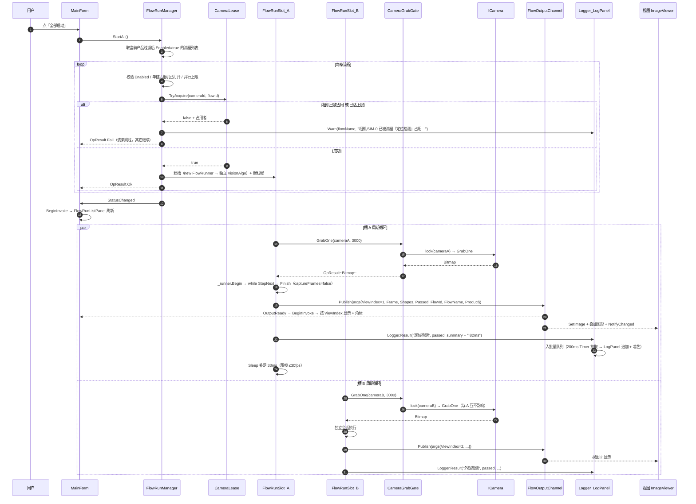
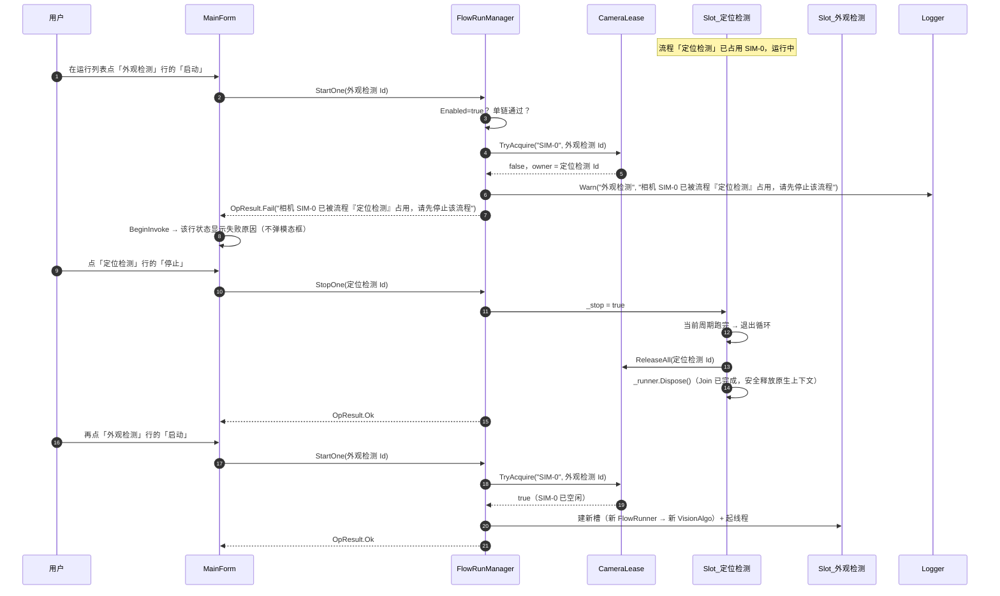
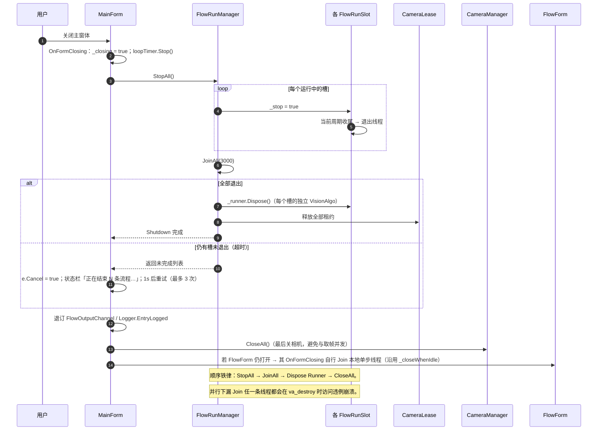
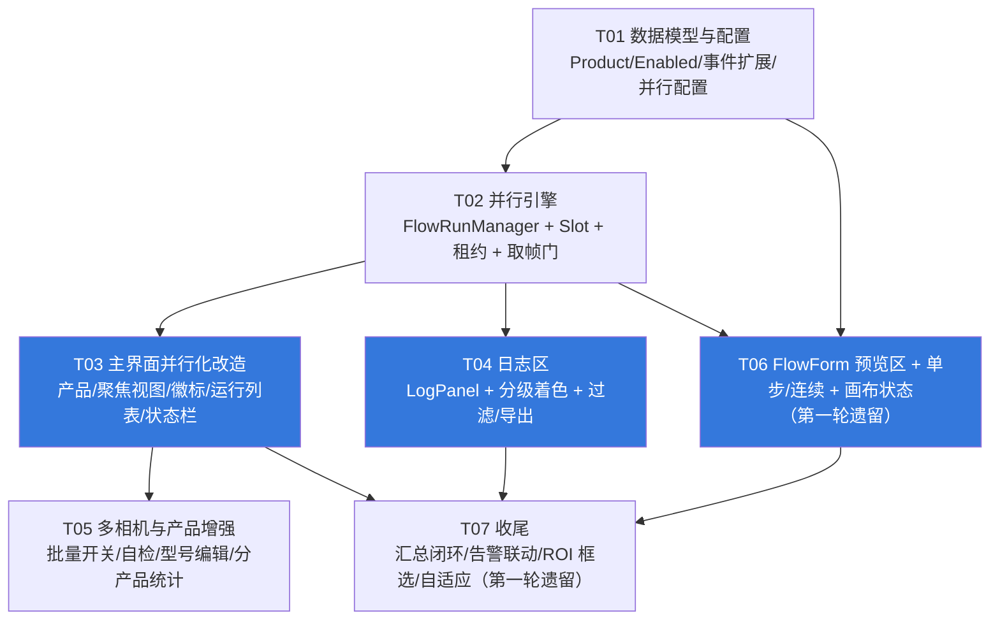

# 增量架构设计（第二轮）：多相机 · 多产品 · 流程并行 · 日志与流程名显示

| 项 | 内容 |
| --- | --- |
| 文档名称 | 增量架构设计 + 任务分解（第二轮）：多相机 · 多产品 · 流程并行 · 日志与流程名显示 |
| 版本 | v1.0（第二轮增量） |
| 日期 | 2026-10-10 |
| 作者 | 高见远（架构师） |
| 输入 | `docs/PRD-多相机多产品与并行.md`（v1.0，34 条需求）、`docs/架构-界面布局与算法模块.md`（**第一轮，继续有效**）、`docs/PRD-界面布局与算法模块.md` |
| 变更类型 | **增量**。第一轮架构的分层、坐标、序列化、线程与 Bitmap 约定**全部继续有效**；本文只描述本轮（及第一轮未落地项）的变更 |
| 语言 | 简体中文 |
| 交付范围 | 本轮 P0 全部 15 条 + P1 主体；P2（`FR-PAR-10` / `FR-MC-07` / `FR-MP-07` / `FR-UI2-10`）不排期 |

---

## 0. 现状勘察（**与 team-lead 简报有差异，以本节为准**）

我在落笔前重新读了一遍源码。team-lead 简报称「T03 未实现」，但**实际已落地**。为避免工程师重复施工，先把真实状态钉死：

| 第一轮任务 | 简报 | **实际（源码复核）** | 证据 |
| --- | --- | --- | --- |
| T01 原生卡尺 + P/Invoke | 已实现 | ✅ 已实现 | `include/algo/va_caliper.h` 已存在；`va_error.h` 已有 `VA_ERR_NO_EDGE` |
| T02 `UiTheme` + 几何图形 | 已实现 | ✅ 已实现 | `UI/UiTheme.cs`（19.5 KB，含 `StyleBadge/StyleViewBadge/StyleStatValue/LogMaxLines` 等）；csproj 已登记 `LineSegmentShape`/`PointMarkerShape` |
| T04 执行内核 + `RunTransform` + 图形 | 已实现 | ✅ 已实现 | `Flow/FlowRunContext.cs`（`FlowRunTransform`/`FlowNodeProgress`/`FlowRunSession`）、`FlowRunner.cs`（1478 行，`Begin/StepNext/Finish/Run` + `NeedsCamera`）、`FlowShapes.cs` |
| T05 参数面板体系 | 已实现 | ✅ 已实现 | `Flow/NodeParamSchema.cs`（24 KB）+ `UI/NodeParamPanel.cs(.Designer.cs)`；`ShapeMatchNodePanel.cs` **已删除并注销 csproj**（首轮 B1 已采纳推荐方案） |
| **T03 主界面 HMI** | ❌ 未实现 | ⚠️ **已实现大部分** | `MainForm.Designer.cs` 已有 `panelVerdict`/`lblVerdict`/`panelRunCtrl`/`panelRunState`/`lblConsecutiveNg`/`btnGrabOnce`/`btnFoldLog`，右栏已 300；`MainForm.cs` 已有 `ApplyTheme` 注释段、`UpdateStats`（良率告警着色）、`SetVerdict`（三态 + 连续 NG）、`UpdateRunButtons`（三态互斥）、`OnLogDrawItem`（日志着色）、`OnFoldLog`、`OnToggleRightPanel`、`_badges`（视图角标） |
| **T06 预览区 + 单步/单帧/连续 + 画布状态** | ❌ 未实现 | ✅ **确实未实现** | 无 `FlowPreviewPanel.cs`、无 `FlowRunController.cs`；`FlowForm.Designer.cs` 无 `splitMain`/`flowPreview`/`btnStep`，`panelRight` 仍 280；`FlowCanvasControl` 无 `SetNodeStatus` |
| **T07 收尾（汇总闭环 / 良率告警联动 / ROI 框选 / 自适应）** | ❌ 未实现 | ✅ **确实未实现** | `FlowOutputEventArgs` 仍只有 5 个字段；无 ROI 框选回填 |

### 0.1 因此，本轮的真实工作量

**T03 的剩余部分（不是从零做）**：
1. 日志：现状是**按字符串匹配着色**（`line.IndexOf("[ERROR]")`）+ 上限 500 → 需升级为**结构化 `LogEntry`**（含级别与流程名）+ 行含流程名 + 过滤/导出 + 上限 2000（`FR-UI2-01/04/05/06/07`）；
2. 右栏区块④：现状是 `tableRunState` 的**静态四行**（运行状态/相机/当前流程/最近结论）→ 改为**流程运行状态列表**（`FR-UI2-09`）；
3. 工具栏新增 `产品` 下拉；状态栏新增 `产品` / `并行 n/m` 字段；徽标改为**聚焦视图**语义；视图标题条补流程名与 `[运行中]`（`FR-MP-02/03`、`FR-UI2-02/03`、`C-3`）。

**本轮全新**：并行引擎（`FlowRunManager` + 槽位状态机）、相机租约与取帧串行化、`FlowDefinition.Product/Enabled`、事件字段扩展、产品过滤、分产品统计。

**第一轮遗留需并入**：T06（`FlowForm` 预览区 + 单步/单帧/连续 + 画布节点状态）、T07（结果汇总闭环 / 良率告警联动 / ROI 框选 / 布局自适应）。

---

# Part A：系统设计

## 1. 实现方案与关键决策

### 1.1 本轮四个技术难点

| 难点 | 本质 | 本轮解法 |
| --- | --- | --- |
| ① N 条流程同时跑，且互不串扰 | 资源隔离 + 生命周期管理 | **流程维度 1:1:1:1 隔离**：1 流程 = 1 `FlowRunner`（→1 原生 `VisionAlgo` 上下文）= 1 线程 = 1 会话；会话每周期重建 |
| ② 同一相机被多流程/视图预览同时取帧 | 共享资源的**运行期互斥** | `CameraLease`（运行期独占租约，冲突拒绝启动）+ `CameraGrabGate`（per-camera 取帧串行化门） |
| ③ 并行下界面要能分辨"这是哪条流程" | 可观测性 | 事件带 `FlowId/FlowName/Product`；日志结构化；右栏流程运行列表；视图标题条带流程名 + `[运行中]` |
| ④ 高频并行结果 + 日志会淹没 UI 线程 | 投递限流 | 结果**覆盖式**投递（`Interlocked.Exchange`）已有先例；**日志改为批量队列 + 200 ms 拉取**，禁止逐条 `BeginInvoke` |

### 1.2 关键决策与「为什么不用另一个方案」

**决策 1：并行只做实例隔离，不动单链拓扑（`C-1` 不推翻）。**
- 已落地的 `FlowRunner.Begin/StepNext/Finish` 会话内核本身是**无状态驱动**的：会话对象 `FlowRunSession` 由调用方持有并传入，`FlowRunner` 只保有 `_algo` 与 `_autoRefs`。因此「并行」= 在**外层**给每条流程配一个 `FlowRunner` 实例 + 一个线程 + 一个会话，**`TryBuildChain` 与单链校验文案一行不改**。
- ✅ 这正是 PRD §3.3 假设 E 的结论，且与 `C-1` 完全一致。
- ❌ 不采用方案②（单流程内分支并行）：需重写拓扑解析、定义分支同步点、重新定义 `RunTransform` 作用域（分支各自修正还是共享？），与既有单链约束直接冲突，登记为 `FR-PAR-10`（P2）。

**决策 2：`FlowRunner` 实例与流程严格 1:1，绝不复用。**
- 为什么不能「一个 `FlowRunner` + 多线程并发 `Begin/StepNext`」：
  1. `_autoRefs`（位置修正 `RefSource=Auto` 的基准缓存，按节点 Id 存在执行器内存里）会**跨流程串号**——A 流程示教的基准会被 B 流程读到；
  2. `VisionAlgo` 持有的原生句柄（`va_create`/`va_destroy`）**不是线程安全的**（模板状态、lastError 缓冲都在句柄里）；
  3. 一条流程致命错误时要能单独 `Dispose` 它的上下文，共享实例做不到。
- 代价：N 条流程 = N 个原生 Context（N ≤ 8，内存与句柄开销可接受）。

**决策 3：相机占用用独立的 `CameraLease` 注册表，不改造 `CameraManager`。**
- `CameraManager` 现状：`Open(id)` 命中已打开实例时**返回同一个 `ICamera` 实例并设为 `Current`**——这是既有行为，改它有回归风险（主界面 `Current` 语义、`CameraForm`、`SyncGrabCore` 都依赖）。
- 做法：`CameraLease` 是**纯粹的运行期登记表**（`cameraId → flowId`），只在 `FlowRunManager.StartOne/StopOne` 时增删。`CameraManager` 一行不改。
- ✅ 满足 `FR-MC-03`（配置层允许多对一引用，运行期独占）。

**决策 4：取帧串行化用 `CameraGrabGate`，不在每个 `ICamera` 实现里加锁。**
- `ICamera` 有 3 个实现（`SimCamera`/`LocalCamera`/`HikCamera`），逐个加锁要改 3 处且语义难统一。
- 做法：`CameraGrabGate.GrabOne(camera, timeoutMs)` 按 `camera.Info.Id` 取一把锁，锁内调用 `camera.GrabOne()`；锁等待超过 500 ms 记一条 WARN（对应 `FR-MC-04`「最坏退化为取帧变慢并 WARN」）。
- **所有取帧点统一走 Gate**：流程取帧、视图预览取帧（`MainForm.SyncGrabCore`/`OnGrabOnce`）、`FlowForm` 单步取帧。
- ❌ 不用 `lock(camera)`：锁对象外泄，且无法做超时告警。

**决策 5：产品 = `FlowDefinition.Product` 标签字段，不新建实体、不动 `RecipeStore`。**
- PRD Q15 已拍板。落实：`FlowDefinition` 加 `Product`（`""`=通用）+ `Enabled`；产品下拉的选项由 `FlowModule.CollectProducts(flows)` 从现有流程**聚合去重**，不维护独立的产品表。
- `Recipe.Product` **保持不变、不与新字段同步**（避免出现两个"当前产品"真值源）。
- 过滤只影响**显示与 `StartAll` 的作用域**，绝不删数据（切到 A 只是不显示 B 的流程）。

**决策 6：统计分产品用内存字典，不持久化。**
- `Dictionary<string, ProductStats>`（key 为 Product，`""` 表示通用）。切换产品**不清零**是天然的——因为各产品独立累计。
- 不持久化：PRD 未要求"重启后仍保留分产品统计"，持久化会让统计与"本次开机"脱钩；列为待明确 D6。

**决策 7：徽标 = 聚焦视图的结论（`C-3`），视图角标不变。**
- 新增 `_focusViewIndex`（默认 0 = V1）。单击任一视图 → 切换聚焦 → 徽标 + 统计口径 + 右栏「当前流程」同步切到该视图对应的流程。
- 「视图 → 流程」映射：`ConfigStore.Current.Flows.Flows` 中找 `ViewIndex == i+1` 的流程；多条时**优先取正在运行的**，其次取第一条。
- 各视图右下角角标（已实现 `_badges`）仍各自显示自己的结论 → **角标看全局、徽标看聚焦**，两者不冲突。

**决策 8：日志改造走「新增事件」而非「修改既有事件」。**
- `Logger.Logged`（`EventHandler<string>`）已被 `MainForm.OnLogged` 订阅，改签名会打断既有链路。
- 做法：**保留 `Logged`**（继续推格式化文本，供文件写入与其它订阅者），**新增 `event EventHandler<LogEntry> EntryLogged`** 推结构化条目。`MainForm` 改为订阅 `EntryLogged`。
- ✅ 零回归。

**决策 9：日志 UI 独立成 `LogPanel` UserControl，不继续往 `MainForm.cs` 里堆。**
- `MainForm.cs` 已 1180+ 行；日志要加过滤/导出/上限/自绘，再堆进去会失控。
- `LogPanel` 自带：流程下拉 / 级别下拉 / 清空 / 导出 / 折叠按钮 + 自绘 `ListBox` + 内部缓存 `List<LogEntry>`（上限 2000）。
- **限流**：`LogPanel` 内部挂 200 ms `Timer`，从批量队列（`Interlocked.Exchange`）取走新条目一次性 `AddRange`；禁止每条 `BeginInvoke`。

**决策 10：并行下 `FlowForm` 的"连续运行"改走 `FlowRunManager`，单步仍走本地会话。**
- PRD `C-8`：预览区作用于**"当前查看的流程"**。若 `FlowForm` 自己再起一条连续运行线程，会与 `FlowRunManager` 里同一流程的槽位**抢相机、抢结论**，出现两条链路跑同一流程。
- 做法：
  - `FlowForm` 底部「连续运行」→ `FlowRunManager.StartOne(flowId)`（受租约与并行上限约束）；
  - `FlowForm` 底部「单步」「运行（单帧）」→ 本地 `FlowRunController` + 独立会话（**不申请相机租约**，只走 `CameraGrabGate`；属调试短时行为）；
  - 预览区同时显示两类来源：本地单步进度，以及订阅 `FlowOutputChannel` 按当前 `FlowId` 过滤到的周期结果。

**决策 11：关窗收尾顺序严格固定（`C10`，并行下风险更高）。**
- `MainForm.OnFormClosing`：`FlowRunManager.StopAll()` → `JoinAll(3000)` → `FlowRunManager.Shutdown()`（Dispose 全部 `FlowRunner`）→ 再 `CameraManager.CloseAll()`。
- 首轮踩坑「释放原生算法上下文前必须 Join 运行线程」在并行下变成 **N 条线程**，漏一条就访问违例。
- `FlowForm.OnFormClosing` 沿用既有 `_closeWhenIdle` + `e.Cancel` 机制（单步线程）。

---

## 2. 文件清单

> 相对路径均相对仓库根 `VisionSystem/`。
> **铁律（沿用第一轮 §6）**：C# 新增 `.cs` 必须登记 `src/VisionPlatform/VisionPlatform.csproj`（传统非 SDK 工程不自动包含）；Form 加 `<SubType>Form</SubType>`、UserControl 加 `<SubType>UserControl</SubType>`、Designer 加 `<DependentUpon>Xxx.cs</DependentUpon>`。
> **本轮 C++ 侧零新增**（卡尺已在第一轮落地），因此**无需动 `.vcxproj` / `.vcxproj.filters`**。

### 2.1 新增（10 个）

| # | 相对路径 | 一句话职责 |
| --- | --- | --- |
| 1 | `src/VisionPlatform/Flow/FlowRunManager.cs` | **并行引擎**：`FlowId → FlowRunSlot` 映射；`StartAll/PauseAll/StopAll/StartOne/StopOne/PauseOne/Shutdown`；并行上限校验；状态快照与 `StatusChanged` 事件；关窗 `JoinAll` |
| 2 | `src/VisionPlatform/Flow/FlowRunSlot.cs` | **单流程执行槽**：状态机（`Idle/Starting/Running/Paused/Stopping/Faulted`）、专属 `FlowRunner` + `Thread`、周期循环与限帧 ≤30 fps、相机租约申请/释放、单槽统计与最近结论 |
| 3 | `src/VisionPlatform/Camera/CameraLease.cs` | **相机运行期租约注册表**（`cameraId → flowId`）：`TryAcquire/Release/ReleaseAll/OwnerOf/IsOccupied`（`FR-MC-03`） |
| 4 | `src/VisionPlatform/Camera/CameraGrabGate.cs` | **取帧串行化门**：按 cameraId 加锁的 `GrabOne(camera, timeoutMs)`，等待超时记 WARN（`FR-MC-04`） |
| 5 | `src/VisionPlatform/Core/LogEntry.cs` | 日志条目模型：`LogLevel`（`Info/Warn/Error/ResultOk/ResultNg`）+ `Time/FlowName/Message` + `Format()` 产出 `[HH:mm:ss][级别][流程名] 内容` |
| 6 | `src/VisionPlatform/UI/LogPanel.cs` | 日志区 UserControl：自绘分级着色、流程/级别下拉过滤、清空、导出 txt/csv、折叠、2000 行滚动上限、200 ms 批量拉取 |
| 7 | `src/VisionPlatform/UI/LogPanel.Designer.cs` | `LogPanel` 布局（顶条控件 + 自绘 `ListBox`） |
| 8 | `src/VisionPlatform/UI/FlowRunListPanel.cs` | 右栏区块④「流程运行状态列表」UserControl：每流程一行（流程名│相机│状态│最近结论│耗时│累计 OK/NG）+ 该行 `启动`/`停止` 纯文字按钮 + 底部「当前产品」（`FR-UI2-09`/`FR-PAR-07`） |
| 9 | `src/VisionPlatform/UI/FlowPreviewPanel.cs` | **（第一轮 T06 遗留）**`FlowForm` 预览区：顶条（显示模式/节点名/`n/m`/耗时/暂停刷新）+ `ImageViewer` + 左上角 OK/NG 文本覆盖 + 33 ms 覆盖式拉取 |
| 10 | `src/VisionPlatform/Flow/FlowRunController.cs` | **（第一轮 T06 遗留）**`FlowForm` 本地执行控制：单步 / 单帧（不申请相机租约，只走取帧门）、覆盖式投递到预览、限帧 |

### 2.2 修改（16 个）

| # | 相对路径 | 改动要点 |
| --- | --- | --- |
| 11 | `src/VisionPlatform/Flow/FlowModels.cs` | `FlowDefinition` 新增 `Product`/`Enabled`（`[DataMember]`）+ `CreateEmpty`/`Clone` 同步；`FlowSettings.CurrentSchemaVersion` 2 → 3；`UpgradeToCurrent` 内为旧流程补 `Product=""`/`Enabled=true` |
| 12 | `src/VisionPlatform/Flow/FlowModule.cs` | 新增 `static List<string> CollectProducts(List<FlowDefinition>)`（去重 + 排序，`""` 排最后）+ `static List<FlowDefinition> FilterByProduct(..., string product)` |
| 13 | `src/VisionPlatform/Flow/FlowOutputChannel.cs` | `FlowOutputEventArgs` **追加** `FlowId`/`FlowName`/`Product`（旧字段不动）；`Publish`/订阅/退订加 `lock`（`C10`） |
| 14 | `src/VisionPlatform/Flow/FlowRunner.cs` | `Run()` 构造 `FlowOutputEventArgs` 时带 `FlowId/FlowName/Product`；`Finish()` 后由调用方发布（槽位负责） |
| 15 | `src/VisionPlatform/Core/Logger.cs` | **保留** `Logged`；新增 `event EventHandler<LogEntry> EntryLogged`；新增带 `flowName` 的 `Info/Warn/Error` 重载与 `Result(flowName, passed, message)`；文件写入同步携带流程名 |
| 16 | `src/VisionPlatform/Core/AppSettings.cs` | `UiSettings` 新增 `CurrentProduct`（默认 `""`=全部）、`MaxParallelFlows`（默认 4，范围 1~8）；`SystemSettings` 新增 `AllowCameraShare`（默认 false，P2 预留）；`Clone()` 同步；`ConfigStore.Load()` 补三条默认值 |
| 17 | `src/VisionPlatform/UI/UiTheme.cs` | `LogMaxLines` 500 → **2000**；新增 `LogLevelColor(LogLevel)`、`StyleLogRow`、流程运行列表行高/行色常量；其余既有常量不动 |
| 18 | `src/VisionPlatform/UI/MainForm.cs` | ①工具栏产品下拉 + 产品过滤；②聚焦视图（`_focusViewIndex`，单击切换）与徽标语义改造；③右栏④由静态四行改为 `FlowRunListPanel`；④日志区替换为 `LogPanel`；⑤状态栏新增 `产品` / `并行 n/m` 字段；⑥视图标题条 `相机名 · 流程名 [运行中]`；⑦`OnFormClosing` 加入 `FlowRunManager.StopAll → JoinAll → Shutdown`；⑧分产品统计（P1） |
| 19 | `src/VisionPlatform/UI/MainForm.Designer.cs` | 工具栏新增 `tsLabelProduct`/`tsComboProduct`；`panelRunState` 内 `tableRunState` 移除，改为 `flowRunList`；`panelBottom` 内 `listLog` 移除，改为 `logPanel`；视图单元格接线 Click 切聚焦 |
| 20 | `src/VisionPlatform/UI/FlowForm.cs` | ①`SplitContainer` 拆分布局 + `FlowPreviewPanel` 接入；②「单步」「运行（单帧）」走本地 `FlowRunController`，「连续运行」走 `FlowRunManager.StartOne`；③产品筛选下拉 + 流程列表显示 `[运行中]`/产品/相机（`FR-UI2-08`）；④绑定区新增"产品型号"编辑框（`FR-MP-04`）；⑤相机被占用/未打开的中文提示（`FR-MC-03/06`）；⑥`OnFormClosing` Join 本地单步线程 |
| 21 | `src/VisionPlatform/UI/FlowForm.Designer.cs` | 新增 `splitMain`（Horizontal，默认 60/40）、`flowPreview`、`btnStep`、产品下拉 `cmbProduct`、产品型号框 `txtProduct`；`panelRight` 280 → 300；`MinimumSize` → 1280×800 |
| 22 | `src/VisionPlatform/UI/FlowCanvasControl.cs` | **（第一轮 T06 遗留）**新增 `SetNodeStatus(nodeId, status, elapsedMs)`、`HighlightRunning(nodeId)`、`ClearStatus()`；`DrawNode` 按状态画边框（灰/蓝/绿/红）+ 节点下方 `xx ms` 纯文本 + 失败标记 |
| 23 | `src/VisionPlatform/UI/CameraForm.cs` | `FR-MC-05`：批量「全部打开 / 全部关闭」+「已打开 n / 共 m」计数 |
| 24 | `src/VisionPlatform/UI/CameraForm.Designer.cs` | 新增 `btnOpenAll`/`btnCloseAll`/`lblOpenedCount` |
| 25 | `src/VisionPlatform/UI/SettingsForm.cs` + `.Designer.cs` | 新增「最大并行流程数」（1~8）与「允许相机共享」（P2 预留，默认关）输入项 |
| 26 | `src/VisionPlatform/VisionPlatform.csproj` | 登记 10 个新增 `.cs`；`LogPanel.cs`/`FlowRunListPanel.cs`/`FlowPreviewPanel.cs` 加 `<SubType>UserControl</SubType>`；`LogPanel.Designer.cs` 加 `<DependentUpon>LogPanel.cs</DependentUpon>` |

**合计：新增 10 + 修改 16 = 26 处；C++ 侧 0 处。**

---

## 3. 数据结构与接口设计

### 3.1 流程模型扩展（`FlowModels.cs`）

```csharp
[DataContract]
public sealed class FlowDefinition
{
    ... 既有字段（Id / Name / CameraId / ViewIndex / Nodes / Links）不动 ...

    /// <summary>产品型号标签；"" = 通用/未分类。旧配置缺字段时按 "" 补齐。</summary>
    [DataMember]
    public string Product { get; set; }

    /// <summary>是否启用（不启用的流程不出现在 StartAll 的作用域里）；默认 true。</summary>
    [DataMember]
    public bool Enabled { get; set; }
}

public sealed class FlowSettings
{
    public const int CurrentSchemaVersion = 3;   // 2 → 3：新增 FlowDefinition.Product / Enabled
    // UpgradeToCurrent 内追加：
    //   if (flow.Product == null) { flow.Product = ""; changed = true; }
    //   （Enabled 是值类型，反序列化缺失时本身即 false → 需显式置 true：）
    //   注意：见 §7 共享知识 33（bool 新字段的兼容陷阱）
}
```

> ⚠️ **bool 新字段的兼容陷阱**（写进共享知识 33）：`DataContractJsonSerializer` 遇到 JSON 里缺失的 `bool` 字段会留 **默认值 `false`**，而不是"未设置"。若直接加 `[DataMember] public bool Enabled`，旧配置加载后所有流程都会被判为"未启用"→ 全部跑不起来。
> **处置**：用 `bool?` 可空字段或在 `UpgradeToCurrent`/`ConfigStore.Load()` 里**显式置 true**。本设计选后者（`FlowSettings.UpgradeToCurrent` 已存在且幂等），并在 `ConfigStore.Load()` 里对 `SchemaVersion < 3` 的配置统一补 `Enabled = true`。

**产品聚合与过滤（`FlowModule.cs`）**
```csharp
public static List<string> CollectProducts(List<FlowDefinition> flows);
    // 去重 + 排序（Ordinal）；"" 不进入列表（由调用方以「全部」与「通用」区分）
public static List<FlowDefinition> FilterByProduct(List<FlowDefinition> flows, string product);
    // product 为 null 或 "" 时原样返回全部
```

### 3.2 结果事件扩展（`FlowOutputChannel.cs`）

```csharp
public sealed class FlowOutputEventArgs : EventArgs
{
    // ---- 既有 5 个字段一字不动（MainForm 已订阅，零回归）----
    public int ViewIndex { get; set; }
    public Bitmap Frame { get; set; }              // 所有权移交订阅者
    public List<IGeometryShape> Shapes { get; set; }
    public bool Passed { get; set; }
    public string Summary { get; set; }
    public string CameraName { get; set; }

    // ---- 本轮追加（FR-PAR-04 / C-7）----
    public string FlowId { get; set; }             // "" = 未指明（兼容旧发布方）
    public string FlowName { get; set; }
    public string Product { get; set; }
}

public static class FlowOutputChannel
{
    private static readonly object Sync = new object();     // 新增（C10）
    public static event EventHandler<FlowOutputEventArgs> OutputReady;   // 订阅/退订加锁
    public static bool Publish(FlowOutputEventArgs e);                   // 发布加锁
}
```

### 3.3 相机租约与取帧门

```csharp
/// <summary>相机运行期租约登记表（cameraId → 占用它的 flowId）。纯运行期，不持久化。</summary>
public static class CameraLease
{
    public static bool TryAcquire(string cameraId, string flowId, out string ownerFlowId);
        // cameraId 为空（本地图片模式）→ 直接返回 true，不占租约
        // 已占用且 owner != flowId → false，ownerFlowId 返回占用者
    public static void Release(string cameraId, string flowId);
    public static void ReleaseAll(string flowId);
    public static string OwnerOf(string cameraId);      // null = 空闲
    public static bool IsOccupied(string cameraId);
    public static IReadOnlyDictionary<string, string> Snapshot();
}

/// <summary>取帧串行化门：按 cameraId 加锁，禁止并发调用同一原生句柄（FR-MC-04）。</summary>
public static class CameraGrabGate
{
    public static OpResult<Bitmap> GrabOne(ICamera camera, int timeoutMs = 3000);
        // 内部：lock (GateFor(camera.Info.Id)) { camera.GrabOne(timeoutMs) }
        // 锁等待 > 500 ms → Logger.Warn(flowName?, "相机 X 取帧等待 N ms，可能存在并发取帧")
}
```

### 3.4 并行引擎：`FlowRunManager` + `FlowRunSlot`

```csharp
/// <summary>单条流程的运行状态。</summary>
public enum FlowSlotStatus
{
    Idle,       // 未运行
    Starting,   // 正在申请租约 / 起线程
    Running,    // 运行中
    Paused,     // 已暂停（P1：PauseAll/PauseOne）
    Stopping,   // 停止中（等待线程退出）
    Faulted     // 因致命错误中止（取帧失败 / 异常）
}

/// <summary>一条流程的执行槽：独占一个 FlowRunner（因而独占一个 VisionAlgo 原生上下文）与一个线程。</summary>
public sealed class FlowRunSlot
{
    public string FlowId   { get; }
    public string FlowName { get; }
    public string Product  { get; }
    public string CameraId { get; }
    public int    ViewIndex{ get; }

    public FlowSlotStatus Status     { get; }   // 读取走内部锁
    public bool?  LastVerdict        { get; }   // 最近一次结论（null = 尚未出结论）
    public int    LastElapsedMs      { get; }
    public string LastSummary        { get; }
    public int    OkCount            { get; }
    public int    NgCount            { get; }
    public double Fps                { get; }
    public string ErrorMessage       { get; }   // Faulted 时有效

    // 内部：FlowRunner _runner; Thread _thread; volatile bool _stop; volatile bool _pause;
    // 周期循环：Begin → while(StepNext) → Finish → 发布 FlowOutputEventArgs → 租约保持 → 限帧 Sleep → 下一周期
    // 致命错误：只把自己置 Faulted + 释放租约 + 退线程，不影响其它槽
}

/// <summary>流程运行管理器（静态，全生命周期 = 应用级）。</summary>
public static class FlowRunManager
{
    /// <summary>槽位状态变化（供界面刷新）。在 UI 线程之外触发，订阅方需自行 BeginInvoke。</summary>
    public static event EventHandler StatusChanged;

    public static int MaxParallelFlows { get; }        // 取自 ConfigStore.Current.Ui.MaxParallelFlows（默认 4，钳制 1~8）
    public static int RunningCount { get; }            // Status ∈ {Starting, Running, Paused} 的槽数
    public static IList<FlowRunSlot> Snapshot();       // 线程安全快照（复制列表）
    public static FlowRunSlot Get(string flowId);      // 不存在返回 null

    public static OpResult StartOne(string flowId);    // 校验 Enabled / 单链 / 相机可用 / 租约 / 并行上限
    public static OpResult StopOne(string flowId);     // 置 _stop → Join(2000) → 释放租约 + Dispose Runner
    public static OpResult PauseOne(string flowId);    // P1
    public static OpResult StartAll();                 // 对「当前产品过滤后 & Enabled=true」的流程逐条 StartOne；部分失败不回滚，返回汇总原因
    public static void PauseAll();
    public static void StopAll();                      // 逐槽 StopOne（并行 Join）
    public static void Shutdown();                     // StopAll + JoinAll(3000) + Dispose 全部 Runner + 清空槽表
}
```

**`StartOne` 的校验顺序**（任一失败返回中文原因，不启动）：

| 序 | 校验 | 失败文案示例 |
| --- | --- | --- |
| 1 | 流程存在且 `Enabled=true` | 「流程『尺寸测量』已停用，请在流程编排中启用后再启动」 |
| 2 | 单链拓扑（`FlowRunner.Validate`） | 沿用既有文案 |
| 3 | 相机：`NeedsCamera(flow)` 为真时相机必须已打开 | 「相机 USB-0 未打开，是否现在打开？」（`FR-MC-06`，P1 提供一键打开） |
| 4 | **相机租约** `CameraLease.TryAcquire` | 「相机 SIM-0 已被流程『定位检测』占用，请先停止该流程」 |
| 5 | **并行上限** `RunningCount >= MaxParallelFlows` | 「已达最大并行数 4，请先停止其它流程」（超限**拒绝**，不排队） |
| 6 | 该流程无正在运行的槽 | 「流程『外观检测』已在运行中」 |

**槽位线程循环（伪代码）**
```
void Loop():
    while (!_stop):
        if (_pause) { Sleep(50); continue; }
        sw = Stopwatch.StartNew()
        try:
            camera = CameraManager 取已打开实例（null 表示本地图片模式）
            session = _runner.Begin(flow, camera, captureFrames: false)   // FR-PAR-09：连续运行不逐节点存帧
            while (!session.IsDone && !_stop) _runner.StepNext(session)
            result = _runner.Finish(session)
            if (result.Success):
                args = new FlowOutputEventArgs { ViewIndex, Frame = session.Current, Shapes, Passed, Summary,
                                                 CameraName, FlowId, FlowName, Product }
                _runner 触发 OutputReady → 槽位转发 FlowOutputChannel.Publish(args)
                统计 OkCount/NgCount++；Logger.Result(FlowName, Passed, Summary + " " + ElapsedMs + "ms")
            else:
                Faulted：Logger.Error(FlowName, result.Message)；释放租约；break
            session.Dispose()      // 未交出的帧在此释放
        catch (ex):
            Logger.Error(FlowName, "流程执行异常：" + ex.Message)；释放租约；Status = Faulted；break
        finally:
            // 限帧 ≤30 fps
            int wait = 33 - (int)sw.ElapsedMilliseconds; if (wait > 0) Sleep(wait)
    Status = Idle; 释放租约
```

### 3.5 日志模型与控件

```csharp
public enum LogLevel { Info, Warn, Error, ResultOk, ResultNg }

public sealed class LogEntry
{
    public DateTime Time { get; set; }
    public LogLevel Level { get; set; }
    public string FlowName { get; set; }     // "" = 全局/无流程归属
    public string Message { get; set; }

    public string LevelText { get; }         // INFO / WARN / ERROR / RESULT
    public string Format();                  // "[HH:mm:ss][RESULT][定位检测] NG  Blob：1 个，期望 2~2  91ms"
}

public static class Logger
{
    // ---- 既有（保留，不动）----
    public static event EventHandler<string> Logged;
    public static void Info(string message);
    public static void Warn(string message);
    public static void Error(string message);
    public static void Error(string message, Exception ex);

    // ---- 本轮新增 ----
    public static event EventHandler<LogEntry> EntryLogged;
    public static void Info(string flowName, string message);
    public static void Warn(string flowName, string message);
    public static void Error(string flowName, string message);
    public static void Result(string flowName, bool passed, string message);   // → ResultOk / ResultNg
}

public sealed class LogPanel : UserControl
{
    public int MaxLines { get; }                 // = UiTheme.LogMaxLines（2000）
    public void Append(LogEntry entry);          // 线程安全；入批量队列
    public void SetFilter(string flowName, LogLevelFilter level);   // 只影响显示，不清空缓存
    public void Clear();
    public bool ExportToFile(string path);       // 依据扩展名输出 .txt / .csv
    public event EventHandler CollapsedChanged;
}
```

**分级着色映射**（`UiTheme.LogLevelColor`）

| 级别 | 颜色 | 语义色 |
| --- | --- | --- |
| `Info` | `#A0A6B2` | 次文本色 |
| `Warn` | `#F39C12` | 橙 |
| `Error` | `#E74C3C` | 红 |
| `ResultOk` | `#2ECC71` | 绿 |
| `ResultNg` | `#E74C3C` | 红 |

### 3.6 分产品统计（P1，`FR-MP-05/06`）

```csharp
public sealed class ProductStats
{
    public int Total; public int Ok; public int Ng;
    public double YieldPercent { get { return Total > 0 ? Ok * 100.0 / Total : double.NaN; } }
}

// MainForm 内（内存，不持久化）
private readonly Dictionary<string, ProductStats> _statsByProduct = new Dictionary<string, ProductStats>();
// key：Product 字符串；"" → 界面显示「通用」
// 汇总口径（"全部"）：各产品之和的 OK/(OK+NG)
```

### 3.7 类图（完整版见 `docs/class-diagram-多相机并行.mermaid`）

```mermaid
classDiagram
    class FlowDefinition {
        +string Id
        +string Name
        +string CameraId
        +int ViewIndex
        +List~FlowNode~ Nodes
        +List~FlowLink~ Links
        +string Product
        +bool Enabled
        +Clone() FlowDefinition
    }
    class FlowModule {
        <<static>>
        +All List~FlowModuleInfo~
        +CollectProducts(List~FlowDefinition~) List~string~
        +FilterByProduct(List~FlowDefinition~, string) List~FlowDefinition~
    }

    class FlowRunManager {
        <<static>>
        +MaxParallelFlows int
        +RunningCount int
        +Snapshot() IList~FlowRunSlot~
        +Get(string) FlowRunSlot
        +StartOne(string) OpResult
        +StopOne(string) OpResult
        +PauseOne(string) OpResult
        +StartAll() OpResult
        +PauseAll() void
        +StopAll() void
        +Shutdown() void
        +event StatusChanged
    }
    class FlowRunSlot {
        +string FlowId
        +string FlowName
        +string Product
        +string CameraId
        +FlowSlotStatus Status
        +bool? LastVerdict
        +int LastElapsedMs
        +int OkCount
        +int NgCount
        +double Fps
        +string ErrorMessage
        -FlowRunner _runner
        -Thread _thread
        -bool _stop
        -bool _pause
        -Loop() void
    }
    class FlowSlotStatus {
        <<enum>>
        Idle
        Starting
        Running
        Paused
        Stopping
        Faulted
    }
    class FlowRunner {
        +Begin(FlowDefinition, ICamera, bool) FlowRunSession
        +StepNext(FlowRunSession) FlowNodeProgress
        +Finish(FlowRunSession) FlowRunResult
        +Run(FlowDefinition, ICamera) FlowRunResult
        +event OutputReady
    }
    class FlowRunSession {
        +FlowDefinition Flow
        +ICamera Camera
        +int Cursor
        +Bitmap Current
        +FlowRunTransform Transform
        +bool CaptureFrames
        +IsDone bool
    }

    class CameraLease {
        <<static>>
        +TryAcquire(string, string, out string) bool
        +Release(string, string) void
        +ReleaseAll(string) void
        +OwnerOf(string) string
        +IsOccupied(string) bool
    }
    class CameraGrabGate {
        <<static>>
        +GrabOne(ICamera, int) OpResult~Bitmap~
    }

    class FlowOutputEventArgs {
        +int ViewIndex
        +Bitmap Frame
        +bool Passed
        +string Summary
        +string CameraName
        +string FlowId
        +string FlowName
        +string Product
    }
    class FlowOutputChannel {
        <<static>>
        +Publish(FlowOutputEventArgs) bool
        +event OutputReady
    }

    class LogLevel {
        <<enum>>
        Info
        Warn
        Error
        ResultOk
        ResultNg
    }
    class LogEntry {
        +DateTime Time
        +LogLevel Level
        +string FlowName
        +string Message
        +LevelText string
        +Format() string
    }
    class Logger {
        <<static>>
        +Info(string) void
        +Warn(string) void
        +Error(string) void
        +Info(string, string) void
        +Result(string, bool, string) void
        +event Logged
        +event EntryLogged
    }
    class LogPanel {
        +Append(LogEntry) void
        +SetFilter(string, LogLevelFilter) void
        +Clear() void
        +ExportToFile(string) bool
    }

    class FlowRunListPanel {
        +Bind(IList~FlowRunSlot~, string product) void
        +event StartClicked
        +event StopClicked
    }
    class FlowPreviewPanel {
        +SetProgress(FlowNodeProgress) void
        +SetDisplayMode(PreviewMode) void
        +SetVerdict(bool?) void
    }
    class FlowRunController {
        +RunOnce() void
        +StepOnce() void
        +TakePending() FlowNodeProgress
        +Join(int) bool
    }
    class FlowCanvasControl {
        +SetNodeStatus(string, FlowNodeStatus, int) void
        +HighlightRunning(string) void
        +ClearStatus() void
    }
    class MainForm {
        -int _focusViewIndex
        -Dictionary~string, ProductStats~ _statsByProduct
        +ApplyProductFilter() void
        +SetFocusView(int) void
        +UpdateStatsByProduct() void
        +OnFlowOutput(object, FlowOutputEventArgs) void
    }
    class UiSettings {
        +int LayoutIndex
        +List~string~ ViewBindings
        +bool LogCollapsed
        +string CurrentProduct
        +int MaxParallelFlows
    }
    class ProductStats {
        +int Total
        +int Ok
        +int Ng
        +YieldPercent double
    }

    FlowRunManager "*" *-- "1" FlowRunSlot : 每条流程一个槽
    FlowRunSlot --> FlowRunner : 独占(1:1)
    FlowRunSlot --> FlowRunSession : 每周期新建
    FlowRunSlot ..> CameraLease : 申请/释放租约
    FlowRunSlot ..> CameraGrabGate : 取帧
    FlowRunSlot ..> FlowOutputChannel : 发布结果
    FlowRunSlot ..> Logger : RESULT 行
    FlowRunner ..> FlowOutputEventArgs : 构造
    FlowOutputChannel ..> FlowOutputEventArgs : 传递
    FlowOutputChannel --> MainForm : OutputReady
    FlowDefinition ..> FlowModule : 产品聚合/过滤
    FlowRunManager ..> FlowDefinition : 读取 Product/Enabled
    MainForm --> FlowRunListPanel
    MainForm --> LogPanel
    MainForm --> ProductStats
    MainForm ..> UiSettings
    LogPanel --> LogEntry
    LogEntry --> LogLevel
    Logger ..> LogEntry : 产生
    Logger --> LogPanel : EntryLogged
    FlowRunListPanel ..> FlowRunSlot : 展示
    FlowPreviewPanel ..> FlowRunController : 拉取 pending
    FlowRunController --> FlowRunner
    FlowRunController --> FlowCanvasControl
```

---

## 4. 程序调用流程（时序图）

> 完整 Mermaid 见 `docs/sequence-diagram-多相机并行.mermaid`。

### 4.1 启动全部 → N 条流程并行取帧执行 → 结果分发 + 日志



### 4.2 单流程启停 / 相机占用冲突拒绝



### 4.3 关窗：先停全部 + Join 再释放原生上下文



---

# Part B：任务分解

## 5. 所需依赖包

**无任何新增第三方依赖**（硬约束 `C1`）。全部基于既有：

```
- .NET Framework 4.8 自带：System, System.Drawing, System.Windows.Forms,
  System.Runtime.Serialization（DataContractJsonSerializer）
  · 并行：System.Threading.Thread / Monitor / Interlocked（BCL 自带，不引入 TPL 之外的任何库）
  · 日志：自绘 ListBox + File.AppendAllText，不引入 log4net / NLog / Serilog
  · UI：SplitContainer / TableLayoutPanel / Timer 均属 System.Windows.Forms
- OpenCV 4.5.5（已就位）—— 仅 C++ 侧，本轮不新增 C++ 代码
- 既有工程引用：VisionSystem.Controls（自研，零第三方）
```

**验收检查项**：`VisionPlatform.csproj` 无新增 `PackageReference` / `<Reference>`；diff 无新增二进制资源；所有按钮、状态标记（`[运行中]`/`[已停止]`）为**纯文字**。

## 6. 共享知识（跨文件约定 / 项目铁律）

> 第 1~13 条见第一轮架构 §6，第 14~25 条见第一轮 §6 的本期新增部分，**全部继续有效**（坐标、序列化、工程登记、Bitmap 所有权、Stride、覆盖式投递、Join 后 Dispose 等）。
> 以下 26~ 为本轮新增/修订。

**修订（覆盖第一轮对应条）**

- **24′（取代第一轮 24）日志**：`listLog` 的原生 `DrawItem` 字符串匹配着色**已被 `LogPanel` 取代**；日志条目一律走 `LogEntry`，级别由 `LogLevel` 枚举决定（不再靠 `IndexOf("NG")` 猜）；上限由 500 改为 **2000**（`UiTheme.LogMaxLines`）。

**新增 26~**

26. **并行隔离（`C9`）**：严格 **1 流程 = 1 `FlowRunSlot` = 1 `FlowRunner` = 1 原生 `VisionAlgo` 上下文 = 1 线程 = 1 `FlowRunSession`**。**禁止**跨流程共享会话、共享 `FlowRunTransform`、共享工作帧 `Bitmap`。违反的直接后果：位置修正 Auto 基准串号、原生句柄并发访问崩溃、帧被两处 `Dispose`。

27. **相机租约**：任何会持续取帧的**运行行为**必须先 `CameraLease.TryAcquire` 成功再启动，停止时 `ReleaseAll(flowId)`。租约只在运行期存在，**不持久化**；`cameraId` 为空（本地图片模式）不占租约。`FlowForm` 的单步/单帧属调试短时行为，**不申请租约**。

28. **取帧必须走 `CameraGrabGate`**：流程取帧、视图预览取帧（`SyncGrabCore`/`OnGrabOnce`）、`FlowForm` 单步取帧三处统一调用；**禁止**直接 `camera.GrabOne()`。等待锁超过 500 ms 记 WARN（不抛异常）。

29. **UI 线程纪律（`C10`）**：
    29.1 所有控件访问一律 `BeginInvoke`（工作线程不得直接碰控件）；
    29.2 `FlowOutputChannel` 的订阅/退订/发布加锁；
    29.3 `FlowRunManager` 的状态字典读写加锁，`Snapshot()` 返回**副本**；
    29.4 统计计数（OK/NG/分产品）加锁或用 `Interlocked`；
    29.5 `LogPanel.Append` 必须线程安全（内部队列加锁）。

30. **关窗顺序铁律**：`StopAll()` → `JoinAll(3000)` → `Dispose` 各槽 `FlowRunner` → `CameraManager.CloseAll()`。**顺序不可颠倒**；Join 超时则 `e.Cancel` 并重试，绝不强行 Dispose。`FlowForm` 关窗沿用既有 `_closeWhenIdle` + `e.Cancel` 机制处理本地单步线程。

31. **日志限流**：并行下 RESULT 行可达 90 行/秒（3 流程 × 30 fps）。**禁止**每条 `BeginInvoke`；`LogPanel` 用**批量队列 + 200 ms `Timer`** 拉取后一次性 `AddRange`。过滤只重建显示列表，**不清空缓存**。

32. **Bitmap 所有权（并行补充）**：延续第一轮 17.x。新增：帧**只在同一个槽内**流动（会话 → 事件 args → 订阅者），**不得跨槽传递**；槽被停止时未交出的帧由 `session.Dispose()` 释放。

33. **序列化兼容（`FlowDefinition.Product/Enabled`）**：
    33.1 ⚠️ `bool` 新字段陷阱：`DataContractJsonSerializer` 对 JSON 中缺失的 `bool` 字段会给 **`false`** 而非"未设置"→ 旧配置加载后所有流程会变成"未启用"。**必须在 `FlowSettings.UpgradeToCurrent` / `ConfigStore.Load()` 里对 `SchemaVersion < 3` 显式置 `Enabled = true`**；
    33.2 `Product` 是 `string`，缺失即 `null` → 统一归一化为 `""`；
    33.3 `SchemaVersion` 2 → 3 为**纯追加**，旧配置不得加载失败；
    33.4 `FlowOutputEventArgs` 只**追加**字段，旧字段一字不动。

34. **产品过滤只影响显示与 `StartAll` 作用域**：切到产品 A 只是不显示 B 的流程，**绝不删除数据、不修改流程的 `Product`**。「全部」= `CurrentProduct` 为 `null` 或 `""`。`""`（通用）流程在任何产品筛选下都显示。

35. **聚焦视图语义**：`_focusViewIndex`（0 基，默认 0）。徽标 = 聚焦视图对应流程的最近结论；统计 = 聚焦流程所属产品的口径；状态栏/右栏「当前流程」同步。视图角标**不受聚焦影响**，始终显示各视图自己的结论。

36. **流程名四处一致**（`FR-UI2-03`）：视图标题条 `相机名 · 流程名 [运行中]`、状态栏 `流程: X`、右栏运行列表行、日志行首。单一真值源 = `FlowRunSlot.FlowName` / `FlowDefinition.Name`。

37. **`StartAll` 的部分失败**：不回滚已启动的槽，逐条收集失败原因，返回汇总文案并在日志 WARN。工业现场"能跑的先跑起来"优于"全有或全无"。

## 7. 有序任务列表

> 共 **7 个任务**；每任务 ≥3 文件；按依赖排序。
> **可并行**：`T03`（主界面）与 `T04`（日志）互不重叠 → 可并行；`T06`（`FlowForm` 预览区）与 `T03/T04` 不同窗体 → 可并行。

### T01 数据模型与配置（产品 / 启用 / 事件扩展 / 并行配置） 【P0】

- **改动文件**：
  - 【修改】`src/VisionPlatform/Flow/FlowModels.cs`
  - 【修改】`src/VisionPlatform/Flow/FlowModule.cs`
  - 【修改】`src/VisionPlatform/Flow/FlowOutputChannel.cs`
  - 【修改】`src/VisionPlatform/Core/AppSettings.cs`
  - 【修改】`src/VisionPlatform/VisionPlatform.csproj`（本任务内暂无新增文件，可留到 T02 一并登记）
- **依赖**：无。
- **要做**：
  1. `FlowDefinition` 新增 `Product`（`[DataMember]`，默认 `""`）与 `Enabled`（`[DataMember]`，默认 `true`）；`CreateEmpty()` / `Clone()` 同步；
  2. `FlowSettings.CurrentSchemaVersion` 2 → 3；`UpgradeToCurrent` 内为旧流程补 `Product ?? ""` 与 `Enabled = true`（**注意共享知识 33.1 的 bool 陷阱**）；
  3. `FlowModule` 增加 `CollectProducts()` / `FilterByProduct()`；
  4. `FlowOutputEventArgs` 追加 `FlowId/FlowName/Product`；`FlowOutputChannel` 的订阅/退订/发布加 `lock`；
  5. `AppSettings`：`UiSettings.CurrentProduct`、`UiSettings.MaxParallelFlows`（默认 4，钳制 1~8）、`SystemSettings.AllowCameraShare`（默认 false）；`Clone()` 同步；`ConfigStore.Load()` 补三条默认值（含 `MaxParallelFlows <= 0 → 4`）。
- **验收标准**：
  - **用旧的 `appconfig.json`（无 Product/Enabled/CurrentProduct/MaxParallelFlows）启动：所有流程 `Product=""`、`Enabled=true` 且能正常运行**（`FR-MP-01` ①）；
  - 新字段写入后重启可恢复；
  - `MaxParallelFlows` 越界值（0 / 99）被钳制到 1~8。

### T02 并行引擎（槽位 + 管理器 + 相机租约 + 取帧门） 【P0】

- **改动文件**：
  - 【新增】`src/VisionPlatform/Flow/FlowRunSlot.cs`
  - 【新增】`src/VisionPlatform/Flow/FlowRunManager.cs`
  - 【新增】`src/VisionPlatform/Camera/CameraLease.cs`
  - 【新增】`src/VisionPlatform/Camera/CameraGrabGate.cs`
  - 【修改】`src/VisionPlatform/Flow/FlowRunner.cs`（`Run()` 构造 args 时带 FlowId/FlowName/Product）
  - 【修改】`src/VisionPlatform/Core/Logger.cs`（新增 `EntryLogged` + 带 flowName 的重载 + `Result()`）
  - 【新增】`src/VisionPlatform/Core/LogEntry.cs`
  - 【修改】`src/VisionPlatform/UI/UiTheme.cs`（`LogMaxLines` 500→2000、`LogLevelColor`）
  - 【修改】`src/VisionPlatform/VisionPlatform.csproj`（登记 T01+T02 全部新增 `.cs`）
- **依赖**：T01。
- **要做**：
  1. `FlowRunSlot`：状态机 + 专属 `FlowRunner`/`Thread` + 周期循环（限帧 33 ms、`captureFrames=false`）+ 租约申请/释放 + 单槽统计 + RESULT 日志 + 结果发布；致命错误只中止自己；
  2. `FlowRunManager`：`StartOne/StopOne/PauseOne/StartAll/PauseAll/StopAll/Shutdown/Snapshot/Get` + 并行上限 + `StatusChanged`；
  3. `CameraLease`、`CameraGrabGate`；
  4. `Logger` 扩展（保留旧事件）+ `LogEntry`；
  5. `UiTheme` 补日志级别色与上限。
- **验收标准**：
  - 3 条流程绑定 3 个不同相机同时「全部启动」→ 3 个视图**同时**产出结果，各自结论独立（1 条 NG 不污染另 2 条）（`FR-PAR-01`）；
  - 拔掉其中一条的相机 → 该条 Faulted + 日志 ERROR，**其余 2 条继续运行且帧率不受影响**（`FR-PAR-03`）；
  - 相机冲突 → 拒绝启动并给中文原因（`FR-MC-03`）；`MaxParallelFlows=1` 时第 2 条被拒绝（`FR-PAR-06`）；
  - 3 条并行连续运行 5 分钟：无跨线程控件访问异常，内存增长 ≤ 50 MB（`FR-PAR-08/09`）；
  - 每条流程确实持有**独立** `VisionAlgo` 上下文（可通过日志/断言验证槽 Dispose 互不影响）。

### T03 主界面并行化改造（产品 / 聚焦视图 / 徽标 / 运行列表 / 状态栏） 【P0/P1】

- **改动文件**：
  - 【新增】`src/VisionPlatform/UI/FlowRunListPanel.cs`
  - 【修改】`src/VisionPlatform/UI/MainForm.cs`
  - 【修改】`src/VisionPlatform/UI/MainForm.Designer.cs`
  - 【修改】`src/VisionPlatform/UI/UiTheme.cs`（运行列表样式常量）
- **依赖**：T02。**可与 T04、T06 并行。**
- **要做**：
  1. 工具栏新增 `产品:` 下拉（`tsComboProduct`，选项 = `全部` + `CollectProducts()`），切换写 `UiSettings.CurrentProduct` 并过滤流程列表/画布/运行列表（`FR-MP-02`）；
  2. 聚焦视图：`_focusViewIndex`，单击视图单元格切换；徽标 = 聚焦流程最近结论，徽标下方小字 `聚焦视图 Vn · 流程名`（`C-3`）；
  3. 右栏④：`tableRunState` 静态四行 → `FlowRunListPanel`（每流程一行：流程名│相机│状态│最近结论│耗时│累计 OK/NG + 该行 `启动`/`停止` 按钮 + 底部「当前产品：A」）（`FR-UI2-09`、`FR-PAR-05/07`）；
  4. 视图标题条 `相机名 · 流程名 [运行中]`；未绑定流程显示 `相机名 · 未绑定流程`（`FR-UI2-02`）；
  5. 状态栏字段顺序：`产品 | 流程 | 相机 | 分辨率 | fps | 并行 3/4 | 耗时`（`FR-UI2-03`）；按钮文案改「全部启动 / 全部暂停 / 全部停止」（`C-5`）；
  6. `OnFormClosing` 加入 `StopAll → JoinAll → Shutdown`（共享知识 30）；
  7. P1：分产品统计（`_statsByProduct`，切换不清零）+「全部产品」汇总（`FR-MP-05/06`）；统计区标题 `运行统计（产品 A）`。
- **验收标准**：
  - 切到产品 A 后流程列表/画布/运行列表只剩 A 的流程；切回"全部"恢复（`FR-MP-02`）；
  - 产品名在工具栏 / 右栏 / 状态栏三处同步；"全部"时显示 `全部产品`（`FR-MP-03`）；
  - 3 条并行时右栏 3 行状态正确刷新；点某行「停止」只停该行（`FR-PAR-07`）；
  - 视图标题条显示 `SIM · 定位检测 [运行中]`，停止后标记消失（`FR-UI2-02`）；
  - 产品 A 跑 10 件（8 OK）→ 80.0%；切 B 跑 5 件（5 OK）→ 100.0%；切回 A 仍 80.0%（`FR-MP-05`）；
  - 关窗 ≤ 3 s 安全退出，无"集合已修改"类异常。

### T04 日志区（结构化 + 分级着色 + 过滤 + 导出） 【P0/P1】

- **改动文件**：
  - 【新增】`src/VisionPlatform/UI/LogPanel.cs`
  - 【新增】`src/VisionPlatform/UI/LogPanel.Designer.cs`
  - 【修改】`src/VisionPlatform/UI/MainForm.cs`（移除 `OnLogged`/`OnLogDrawItem`/`listLog` 相关，改接 `LogPanel`）
  - 【修改】`src/VisionPlatform/UI/MainForm.Designer.cs`（`panelBottom` 内 `listLog` → `logPanel`）
  - 【修改】`src/VisionPlatform/VisionPlatform.csproj`
- **依赖**：T02（需要 `LogEntry` 与 `Logger.EntryLogged`）。**可与 T03、T06 并行。**
- **要做**：
  1. `LogPanel`：自绘 `ListBox`（`DrawMode=OwnerDrawFixed`，必须自己画背景与文字，否则全黑）+ 顶条 `[日志 ▼][流程 ▾][级别 ▾][清空][导出]`；
  2. 行格式 `[HH:mm:ss][级别][流程名] 内容`，五级着色（共享知识/§3.5 表）；
  3. 缓存 `List<LogEntry>` 上限 2000（滚动裁剪最旧）；过滤只重建显示列表不清缓存；
  4. **限流**：批量队列 + 200 ms `Timer` 拉取（共享知识 31）；
  5. 导出 `.txt` / `.csv`（文件名含时间戳，内容含 时间/级别/流程名/正文）；
  6. 折叠沿用既有 `UiSettings.LogCollapsed`。
- **验收标准**：
  - 5 类行颜色肉眼可分；每行必含流程名；并行时各流程日志交错追加但行首流程名正确（`FR-UI2-01`）；
  - 3 条并行运行 10 秒，日志出现 ≥3 个流程名，RESULT 行条数与各流程周期数偏差 ≤10%（`FR-UI2-04`）；
  - 选「定位检测」只显示该流程行；选「仅结论」只剩 RESULT 行；取消过滤完整恢复（`FR-UI2-05`）；
  - 导出文件可用记事本打开，行数与界面一致（含过滤/裁剪说明）；
  - 持续写入 5000 行后稳定在 2000；5 分钟内存增长 ≤ 50 MB（`FR-UI2-07`）。

### T05 多相机与产品增强 【P1】

- **改动文件**：
  - 【修改】`src/VisionPlatform/UI/CameraForm.cs` + `.Designer.cs`
  - 【修改】`src/VisionPlatform/UI/SettingsForm.cs` + `.Designer.cs`
  - 【修改】`src/VisionPlatform/UI/FlowForm.cs`（产品型号编辑框、相机占用/未打开提示、流程列表状态标记）
  - 【修改】`src/VisionPlatform/UI/FlowForm.Designer.cs`（`cmbProduct`、`txtProduct`）
  - 【修改】`src/VisionPlatform/Flow/FlowRunManager.cs`（`FR-MC-06` 一键打开相机）
- **依赖**：T03。
- **要做**：
  1. `CameraForm`：全部打开 / 全部关闭 + 「已打开 n / 共 m」（`FR-MC-05`）；
  2. `SettingsForm`：最大并行流程数（1~8）、允许相机共享（P2 预留，默认关）；
  3. `FlowForm`：流程列表每行 `流程名 [运行中] 产品 相机`（`FR-UI2-08`）；绑定区新增"产品型号"编辑框（`FR-MP-04`）；相机被占用/未打开的中文提示 + 一键打开（`FR-MC-03/06`）；
  4. 多视图多相机同时取流验证（`FR-MC-02`）：各视图按 `ViewBindings` 绑定不同相机同时连续取流。
- **验收标准**：
  - 2×2 四视图绑定四个不同相机同时连续取流，各视图独立刷新、无串图（`FR-MC-02`）；
  - 「全部打开」后计数与实际一致；全部关闭后各视图显示空态而非报错（`FR-MC-05`）；
  - 把流程 X 的 Product 改为 "B" → 产品下拉自动出现 "B" 且持久化（`FR-MP-04`）。

### T06 FlowForm 预览区 + 单步 / 单帧 / 连续 + 画布节点状态（**第一轮 T06 遗留**） 【P0/P1】

- **改动文件**：
  - 【新增】`src/VisionPlatform/UI/FlowPreviewPanel.cs`
  - 【新增】`src/VisionPlatform/Flow/FlowRunController.cs`
  - 【修改】`src/VisionPlatform/UI/FlowCanvasControl.cs`
  - 【修改】`src/VisionPlatform/UI/FlowForm.cs`
  - 【修改】`src/VisionPlatform/UI/FlowForm.Designer.cs`
  - 【修改】`src/VisionPlatform/VisionPlatform.csproj`
- **依赖**：T01（数据模型）、T02（「连续运行」走 `FlowRunManager`）。**可与 T03、T04 并行**（不同窗体、不同文件）。
- **要做**：
  1. `FlowForm.Designer`：`SplitContainer`（画布上 / 预览下，默认 60/40）+ `btnStep`；`panelRight` 280 → 300；`MinimumSize` 1280×800；
  2. `FlowPreviewPanel`：顶条（显示模式 `选中节点/链尾结果/原始图像` + 节点名 + `第 n/m` + `xx ms` + 暂停刷新）+ `ImageViewer` + 左上角 OK/NG 文本覆盖 + 33 ms 覆盖式拉取（旧 pending 的帧 `Dispose`）+ 空态文本；
  3. `FlowRunController`：本地单步 / 单帧（**不申请相机租约**，取帧走 `CameraGrabGate`）；单步会话 `captureFrames=true`，连续/单帧 `false`；
  4. `FlowCanvasControl`：`SetNodeStatus/HighlightRunning/ClearStatus` + 状态边框（灰/蓝/绿/红）+ 节点下方 `xx ms` + 失败标记；
  5. `FlowForm`：单步/单帧 → 本地控制器；「连续运行」→ `FlowRunManager.StartOne(flow.Id)`；预览区订阅 `FlowOutputChannel` 按当前 `FlowId` 过滤显示周期结果；关窗 Join 本地单步线程。
- **验收标准**：
  - 选中 Blob 节点 → 预览显示该节点输出帧 + **仅** Blob 图形；选中直线卡尺 → 不显示 Blob 图形（`FR-ALG-19`）；
  - 单步：点一次前进一个节点，预览即时刷新、画布当前节点高亮、顶条显示 `第 n/m` 与单节点耗时（整数 ms）；跑完复位可再次单步（`FR-ALG-20`）；
  - 单帧运行结束：预览自动显示最后/选中节点 + 全链图形 + 左上角 OK/NG 文本（`FR-ALG-21`）；
  - 单步到中间节点时：已完成节点绿边、当前节点蓝边、其余灰边（`FR-ALG-23`）；
  - 关窗时若本地单步未结束：**不崩**（沿用 `_closeWhenIdle` + `e.Cancel`）。

### T07 收尾（结果汇总闭环 / 良率告警联动 / ROI 框选 / 布局自适应） 【P1/P2，**第一轮 T07 遗留**】

- **改动文件**：
  - 【修改】`src/VisionPlatform/Flow/FlowRunner.cs`（`ResultOutput` 节点输出结构化摘要）
  - 【修改】`src/VisionPlatform/Flow/FlowOutputChannel.cs`（追加 `SummaryLines`/`Verdict`，旧字段不动）
  - 【修改】`src/VisionPlatform/UI/MainForm.cs`（徽标取汇总结论、日志含失败项名、良率告警联动）
  - 【修改】`src/VisionPlatform/UI/FlowPreviewPanel.cs`（ROI 框选回填参数）
  - 【修改】`src/VisionPlatform/UI/FlowForm.cs`（布局自适应、右栏折叠、结果汇总显示）
- **依赖**：T03、T04、T06。
- **要做**：
  1. `ResultOutput` 节点输出结构化摘要（每节点一行 `模块名 / 关键值 / OK-NG`）并写入日志；事件追加 `SummaryLines`；
  2. `MainForm` 徽标取流程汇总结论：任一 NG → 红底 NG + 日志含失败项名；全 OK → 绿底 OK（`FR-ALG-26`）；
  3. 预览 ROI 框选（`ImageViewer.ShapeCreated`）→ 回填 `SearchX/Y/W/H` 或卡尺 ROI，与参数面板双向同步（`FR-ALG-05`）；
  4. 布局自适应（1280×800 / 1440×900 / 1920×1080 三档无重叠无截断）；1×1/2×2/3×3 切换后统计区不跳变；
  5. 其余节点参数面板的「实时候选值」文本（清晰度 / 拟合）。
- **验收标准**：
  - 3 节点链任一 NG → 汇总 NG、徽标红底 NG、日志含失败项名，三者一致（`FR-ALG-26`）；
  - 预览拖矩形 → 参数面板 X/Y/W/H 立即更新；改面板数值 → 预览矩形同步移动（`FR-ALG-05`）；
  - 三档分辨率下无控件重叠、无文字截断。

## 8. 任务依赖图



**并行建议**：
- **T03 ∥ T04 ∥ T06** 三者文件零重叠（MainForm / LogPanel / FlowForm），可在 T02 完成后同时推进；
- T02 必须先于界面任务完成——否则「流程运行列表」没有数据来源（PM 已指出）；
- 若需压缩到 5 个任务：合并 T05 → T03、T07 → T06。

## 9. 待明确事项（含默认假设，不停工）

| # | 待明确 | 采用的默认假设 | 需谁拍板 |
| --- | --- | --- | --- |
| **D1** | 分产品统计是否持久化到 `appconfig.json`？ | **不持久化**（内存字典，重启清零）。理由：PRD 未要求；持久化会让"本次开机统计"语义模糊。若产线要求跨班次累计，需再开一个需求 | 主理人（影响 `FR-MP-05` 验收方式） |
| **D2** | `FlowForm` 的「单步 / 单帧」是否也要申请相机租约？ | **不申请**（调试短时行为，只走 `CameraGrabGate` 串行化）。理由：单步要频繁点，若被租约挡住会很难用。风险：单步与正在运行的同相机流程会争帧（退化为变慢 + WARN），属可接受 | 无需 |
| **D3** | 一条流程被多条流程绑定同一 `ViewIndex` 时，标题条显示哪个流程名？ | 优先显示**正在运行**的那条；都未运行时显示第一条；标题条流程名后缀 `[运行中]` 只要有任一绑定流程在运行就追加 | 无需 |
| **D4** | 并行下 `MainForm` 既有的 `loopTimer` 循环检测（配方检测）是否保留？ | **保留且不动**。它与 `FlowRunManager` 是两条独立管线（既有 `InspectionEngine` + `AppContext.Algo`）。风险：两者可能争同一相机 → 都走 `CameraGrabGate` 串行化即可。**注意**：`loopTimer` 取帧目前不走 Gate，T02 需一并改掉 | 无需（T02 已包含） |
| **D5** | `StartAll` 遇到部分流程失败（相机冲突 / 上限）时是回滚还是继续？ | **继续**（不回滚）。已成功启动的照跑，失败原因汇总返回 + 日志 WARN。工业现场"能跑的先跑"优于全有或全无 | 无需 |
| **D6** | 「暂停」在并行下的语义：全部暂停还是单条暂停？ | 两者都提供：`PauseAll()`（P0 语义里的"全部暂停"按钮）+ `PauseOne()`（P1，列表行暂不提供暂停按钮，只提供启动/停止，避免过度复杂） | 无需 |
| **D7** | 相机共享模式（`AllowCameraShare`，P2）是否在 T02 预留开关？ | **只加配置项与读取**（默认 false），实现不在本轮。T02 里 `TryAcquire` 加一句 `if (AllowCameraShare) return true;` 即可，成本近乎为零 | 无需 |
| **D8** | 日志导出的默认目录？ | `AppPaths.Root/Logs/`，文件名 `visionlog_yyyyMMdd_HHmmss.txt`（沿用 `ImageStore` 的时间戳命名风格） | 无需 |
| **D9** | 首轮 `FR-UI-08` 视图角标与本轮徽标是否冲突？ | **不冲突**：角标 = 该视图自己的结论（已实现 `_badges`），徽标 = 聚焦视图的结论。两者独立刷新 | 无需 |
| **D10** | 参考图未获取到，视觉如何定？ | 继续以既有 `UiTheme` 色板为准（PRD `C-10`/Q22），本轮不改信息架构；待补图后做一次**校色**（仅颜色/间距微调） | 无需（待用户补图） |
| **D11** | 并行下 `FlowForm` 的预览区是否会成为性能瓶颈（每周期叠加 N 个图形 + 换图）？ | 预览区**只显示当前查看流程**的结果（按 `FlowId` 过滤），其它流程的结果不进预览（PRD `C-8`）；再叠加 33 ms 限流与覆盖式投递 | 无需 |
| **D12** | 是否需要给 `FlowRunManager` 加"看门狗"（某槽卡死超过 N 秒自动中止）？ | **本轮不做**。理由：`cv::VideoCapture::read` 阻塞无超时是已知坑，靠"停止时 Join 超时 + `e.Cancel`"兜底；加看门狗需杀线程（`Thread.Abort` 在 .NET Framework 可用但有风险）。列为后续增强 | 主理人（若要求自动恢复则需追加需求） |

## 10. 与既有能力的关系（回归边界）

| 既有能力 | 本轮影响 | 回归验证点 |
| --- | --- | --- |
| 循环检测（`InspectionEngine` + `SyncGrabCore` + `loopTimer`） | **逻辑不动**；取帧改走 `CameraGrabGate` | 配方检测、同步采集、单帧采集功能不受影响 |
| `CameraManager`（枚举/打开/关闭/`Current`） | **一行不改**（租约在 `CameraLease` 里，与它平行） | 相机枚举、打开、采集、抓帧正常 |
| `FlowRunner.Begin/StepNext/Finish/Run` 与单链校验 | **签名不动**；只给 args 补三个字段 | 旧的单流程运行链路（`FlowForm.OnRun`）行为不变 |
| `FlowOutputChannel` 既有 5 字段 | **不动**，只加锁 | `MainForm.OnFlowOutput` 既有订阅零回归 |
| `Logger.Logged`（`EventHandler<string>`） | **保留**，新增 `EntryLogged` | 文件日志继续写入，格式新增流程名段 |
| `AppConfig.Flows` 序列化 | 纯追加（`Product`/`Enabled` + SchemaVersion 3） | 旧 `appconfig.json` 加载不失败、旧流程可运行且 `Enabled=true` |
| `FlowForm` 既有运行/停止/校验 | 保留；「连续运行」改走 `FlowRunManager` | 单流程运行、校验、参数面板不受影响 |
| `AlgoForm`（离线单图工作台） | **不动** | 仍能打开本地图片、训练模型 |
| `VisionSystem.Controls` | 本轮**不改** | `ImageViewer` 与几何图形行为不变 |
| C++ 原生层 | 本轮**零改动** | `build.bat` Debug/Release 双配置仍通过（无需改 vcxproj） |
