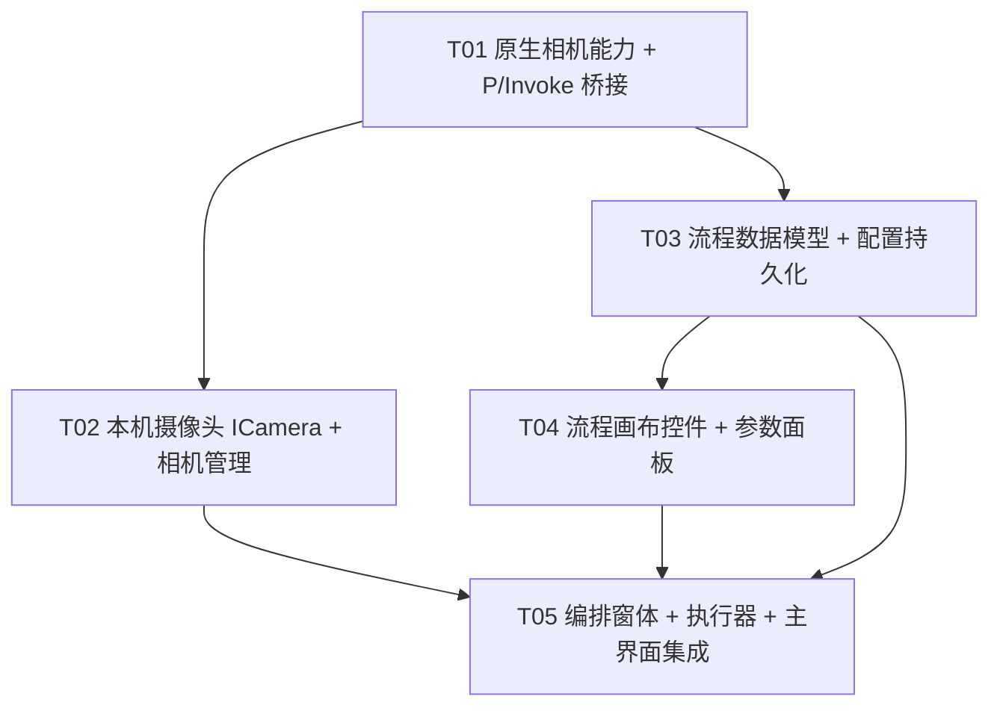

# 增量架构设计：本机摄像头接入 + 算法流程编排

| 项 | 内容 |
| --- | --- |
| 文档名称 | 增量架构设计 + 任务分解：本机摄像头接入 + 算法流程编排 |
| 版本 | v1.0 |
| 日期 | 2026-10-05 |
| 作者 | 高见远（架构师） |
| 输入 | `docs/PRD-摄像头与流程编排.md`（v1.0）、`docs/平台架构.md` |
| 变更类型 | **增量**：在既有 .NET Framework 4.8 + WinForms + C++/OpenCV 工程上扩展，不推翻现有分层 |
| 语言 | 简体中文 |

> 本设计**只覆盖主理人裁剪的本期范围**：P0 全部 + P1 的「节点参数面板 / 流程执行并输出到绑定视图」；
> 交互增强（拖影 / 框选 / 吸附）只做**基础可用**；P2 不实现，但**预留扩展点**。

---

# Part A：系统设计

## 1. 实现方案与选型理由

### 1.1 两个功能的技术难点

| 功能 | 难点 | 本质 |
| --- | --- | --- |
| 本机摄像头接入 | 工程「零第三方依赖」是硬约束，但枚举/取流必须有系统 API | 用**已有的 OpenCV `VideoCapture`（videoio 已在 `opencv_world455.dll` 内）** 在 C++ 层封装，再经既有 P/Invoke 边界暴露给 C#，不引入任何新依赖 |
| 本机摄像头接入 | 帧率/内存/线程安全 | 采集线程独立 + C# 侧分配缓冲复用（沿用 `CopyOut`「谁分配谁释放」约定）+ `BeginInvoke` 切 UI |
| 流程编排 | 画面自由拖拽 / 连线 / 重绘 | **自研 GDI+ 画布控件**（`Control` 子类），不引入任何流程图控件 |
| 流程编排 | 流程/节点/连线/绑定持久化且向下兼容 | 复用 `AppConfig` 三段式 + `ConfigStore.Load()` 逐段补齐模式 |
| 流程编排 | 与既有 `InspectionEngine` 循环检测共存 | 流程执行器**独立拥有自己的算法上下文**与相机句柄，不触碰既有循环检测管线 |

### 1.2 关键决策与「为什么不用另一个方案」

**决策 1：摄像头走 C++ 层封装 OpenCV `VideoCapture`，C# 仅做 `ICamera` 适配器。**
- 依据（已实测）：`opencv_world455.dll` 已含 `VideoCapture`/`videoio` 符号；导入库 `opencv_world455(d).lib` 齐全；vcxproj 已链好，新增源文件**只需登记，无需改链接配置**。
- ❌ 不用 `System.Windows.Media`（WPF `Capture`)：违反「禁止 WPF」硬约定。
- ❌ 不用 DirectShow 手撸 COM 互操作：工作量大、易错，且 OpenCV 已封装 DShow/MSMF 后端。
- ❌ 不引入 NuGet（如 `OpenCvSharp`、`AForge`）：违反「控件库/主程序零 NuGet」硬约定。

**决策 2：摄像头用「独立句柄」，不复用算法 `Context` 句柄。**
- 现状导出模式是 `VA_CTX()`（把 `void*` 校验后转 `va::Context*`），错误文本经 `va_get_last_error` 取回。
- 我**没有**把相机挂在 `va::Context` 上，理由：
  1. **生命周期耦合有坑**：`Program.Main` 退出顺序是 `AppContext.Algo.Dispose()`（销毁算法 Context）**先于** `CameraManager.CloseAll()`（关闭相机）。若相机句柄挂在算法 Context 上，关相机会操作已析构句柄 → 悬垂。独立句柄随 `LocalCamera` 生命周期，天然规避。
  2. **算法 Context 是单例**（`AppContext.Algo`），而 `CameraManager` 允许**多相机同时打开**（`OpenedCameras`）；把相机塞进单例 Context 需要维护「id→相机」列表，反而更绕。
  3. **解耦**：相机与算法本无关系，硬绑会让「只开相机不跑算法」的路径被迫先建算法上下文。
- ✅ 采用**平行句柄模型**：`va_camera_open` 返回 `void*`（实为 `va::CameraSource*`），配 `VA_CAM()` 宏校验 + `va_camera_get_last_error` 取错；句柄由 `va_camera_close` 释放。**沿用**「句柄=实例 / 返回 int 错误码 / 异常转码 / last-error 缓冲 / 谁分配谁释放」等既有约定，只是换一个对象。

**决策 3：流程执行器拥有独立算法上下文。**
- `FlowRunner` 自建一个 `VisionAlgo`（→ 一个新的 C++ `Context`），与 `AppContext.Algo`（供配方/循环检测）**互不干扰**。C++ 侧本就支持多 Context（`va_create` 每实例一份）。
- ❌ 不共用 `AppContext.Algo`：形状匹配的模板状态存在句柄里，流程训练模板会**污染**循环检测正在用的模板。
- 结果：流程运行与循环检测可共存，无需跨模块大锁。

**决策 4：画布控件放在 `VisionPlatform/UI/`（应用层），不放进 `VisionSystem.Controls` 库。**
- 画布要引用 `FlowDefinition` 等**应用层模型**；放进控件库会造成「控件库 → 主程序」反向依赖（循环）。
- 控件库保持**通用且零第三方**；画布只用 `System.Windows.Forms` + `System.Drawing`，仍是零依赖。

**决策 5：新增独立 `FlowForm`，保留 `AlgoForm`。**
- PRD 附录允许「改造 `AlgoForm` 或新建 `FlowForm`」。我选**新建 `FlowForm`**：既有的 `AlgoForm` 是 547 行的单图离线形状匹配工作台（支持打开本地图片/取帧），改造它风险高、且会丢掉离线能力。新增 `FlowForm` 与既有能力**并存**，`MainForm` 工具栏各给一个入口。
- 代价：形状匹配参数 UI 有两处（`AlgoForm` 与流程节点参数面板）。本期接受该重复以换取低风险，列为后续可抽象的扩展点。

**决策 6：流程绑定结果经静态事件通道 `FlowOutputChannel` 回主界面，不给 `FlowForm` 传 `MainForm` 引用。**
- 与既有静态协作模式一致（`CommState` / `RecipeStore`）。`FlowForm` 只发布，`MainForm` 订阅 → 解耦、且不破坏 `MainForm.ShowChild` 的泛型无参构造约定。

**决策 7：架构模式沿用既有「分层 + 唯一 P/Invoke 边界」。**
- 界面不碰算法；算法不认识界面；新增能力（相机、流程）都落在既有分层里（`Camera/`、`Flow/`、`Native/`、`UI/`、C++ `src/algo/`）。

---

## 2. 文件清单

> 相对路径均相对**仓库根** `VisionSystem/`。新增文件必须同步登记工程文件（见第 6 节铁律）。

### 2.1 C++ 侧（`src/VisionAlgo.Native/`）

| # | 相对路径 | 新增/修改 | 一句话职责 |
| --- | --- | --- | --- |
| 1 | `src/VisionAlgo.Native/include/algo/va_camera.h` | **新增** | 摄像头对外 C 接口：`va_camera_*` 声明 + `VA_CameraInfo`/`VA_CameraOption` 结构体 |
| 2 | `src/VisionAlgo.Native/src/algo/algo_camera.cpp` | **新增** | 用 `cv::VideoCapture` 实现枚举/打开/抓帧/关闭（MSMF 优先、DShow 回退），异常转错误码 |
| 3 | `src/VisionAlgo.Native/src/vision_algo.cpp` | 修改 | 新增 `extern "C"` 摄像头导出，`VA_CAM()` 校验后转发 `va::` |
| 4 | `src/VisionAlgo.Native/Common/va_internal.h` | 修改 | 声明 `va::CameraSource` 与 `va::CameraEnum/Open/Grab/Close/GetSize`（内部） |
| 5 | `src/VisionAlgo.Native/Common/va_error.h` | 修改 | 新增错误码 `VA_ERR_TIMEOUT(7)`、`VA_ERR_CAMERA(8)` |
| 6 | `src/VisionAlgo.Native/include/vision_algo.h` | 修改 | 聚合头新增 `#include "algo/va_camera.h"` |
| 7 | `src/VisionAlgo.Native/VisionAlgo.Native.vcxproj` | 修改 | `<ClInclude>` 登记 `va_camera.h`，`<ClCompile>` 登记 `algo_camera.cpp` |
| 8 | `src/VisionAlgo.Native/VisionAlgo.Native.vcxproj.filters` | 修改 | 为上述两文件登记 `<Filter>`，避免 VS 里平铺 |

### 2.2 C# 侧（`src/VisionPlatform/`）

| # | 相对路径 | 新增/修改 | 一句话职责 |
| --- | --- | --- | --- |
| 9 | `src/VisionPlatform/Native/NativeCamera.cs` | **新增** | 相机 P/Invoke：`VA_CameraInfo/VA_CameraOption` 结构体 + `va_camera_*` 的 DllImport 与薄封装 |
| 10 | `src/VisionPlatform/Native/VisionAlgo.cs` | 修改 | `VaResult` 新增 `ErrTimeout=7`/`ErrCamera=8` 的文案 |
| 11 | `src/VisionPlatform/Camera/LocalCamera.cs` | **新增** | `LocalCamera : ICamera`：采集线程、帧转换、Bitmap 所有权、错误上报；静态 `Enumerate()` |
| 12 | `src/VisionPlatform/Camera/CameraManager.cs` | 修改 | `Enumerate()` 追加本机摄像头；`CreateById()` 增加 `USB` 前缀分发 |
| 13 | `src/VisionPlatform/UI/CameraForm.cs` | 修改 | 列表「来源」前缀由 `CameraInfo.ToString()` 统一呈现（本机/模拟/海康）；状态区显示分辨率（P1） |
| 14 | `src/VisionPlatform/Core/AppSettings.cs` | 修改 | `AppConfig` 新增 `Flows` 段；`ConfigStore.Load()` 补 `Flows` 段向下兼容 |
| 15 | `src/VisionPlatform/Flow/FlowModels.cs` | **新增** | `FlowSettings`/`FlowDefinition`/`FlowNode`/`FlowLink`/`ParamItem`/`FlowNodeType` + 默认值与克隆 |
| 16 | `src/VisionPlatform/Flow/FlowModule.cs` | **新增** | 模块目录（工具箱与节点创建的**唯一数据源**）：Key/显示名/类型/默认参数 |
| 17 | `src/VisionPlatform/Flow/FlowRunner.cs` | **新增** | 单链拓扑执行：取图→逐节点→结果输出；自带算法上下文；每节点耗时/结论（P2 日志留点） |
| 18 | `src/VisionPlatform/Flow/FlowOutputChannel.cs` | **新增** | 静态事件通道 + `FlowOutputEventArgs`，流程结果回传主界面 |
| 19 | `src/VisionPlatform/UI/FlowCanvasControl.cs` | **新增** | 自研 GDI+ 画布：节点绘制/命中测试/移动/连线/拖入/删除/重绘 |
| 20 | `src/VisionPlatform/UI/ShapeMatchNodePanel.cs` | **新增** | 形状匹配节点的参数面板（`UserControl`），读写 `FlowNode.Params` |
| 21 | `src/VisionPlatform/UI/FlowForm.cs` | **新增** | 编排页逻辑：工具箱拖拽源、流程列表增删改切、绑定设置、运行/停止、参数面板联动 |
| 22 | `src/VisionPlatform/UI/FlowForm.Designer.cs` | **新增** | 编排页布局（四区：工具箱/画布/参数面板/底部流程列表+绑定） |
| 23 | `src/VisionPlatform/UI/MainForm.cs` | 修改 | 订阅 `FlowOutputChannel`；流程结果按 `ViewIndex` 输出到对应视图；新增打开 `FlowForm` 入口 |
| 24 | `src/VisionPlatform/UI/MainForm.Designer.cs` | 修改 | 工具栏新增「流程编排」按钮 + 事件接线 |
| 25 | `src/VisionPlatform/VisionPlatform.csproj` | 修改 | 登记全部新增 `.cs`（`<Compile Include>`；Form 加 `<SubType>Form</SubType>`，Designer 加 `<DependentUpon>`） |

---

## 3. 数据结构与接口设计

### 3.1 C++ 侧：相机接口与句柄生命周期

**句柄模型（平行于算法 Context）**：`va_camera_open` 返回 `void*`，实际是 `va::CameraSource*`。导出层用 `VA_CAM()` 校验空指针后转发给 `va::` 命名空间函数；错误文本用 `va_camera_get_last_error` 取。

```cpp
// Common/va_internal.h（内部）
struct CameraSource {
    cv::VideoCapture cap;
    std::mutex       mtx;        // 保护 cap，串行化 grab/close
    std::string      lastError;
    int  width, height;          // 打开后协商到的分辨率
    bool opened;
    CameraSource() : width(0), height(0), opened(false) {}
};
int CameraEnum(int* outCount);                                   // 探测可用设备数
void* CameraOpen(int index, const VA_CameraOption* opt);         // 成功返回句柄，失败 NULL
int CameraGrab(void* h, VA_Image* dst, int timeoutMs);           // 抓一帧到调用方 BGR 缓冲
int CameraClose(void* h);
int CameraGetSize(void* h, int* w, int* h2);
```

**对外接口**（`include/algo/va_camera.h`）：

```c
typedef struct VA_CameraInfo {
    int  index;          /* 本机设备序号 0..count-1 */
    char name[128];      /* 预留设备名（UTF-8，OpenCV 取不到时置空，由 C# 生成“本机摄像头 n”） */
    char path[256];       /* 预留唯一路径（当前置空） */
} VA_CameraInfo;

typedef struct VA_CameraOption {
    int width;      /* 期望宽，0=设备默认 */
    int height;     /* 期望高，0=设备默认 */
    int fps;        /* 期望帧率，0=设备默认 */
    int backend;    /* 0=自动(MSMF 优先,失败回退 DShow), 1=DShow, 2=MSMF */
} VA_CameraOption;

/* 枚举本机摄像头：out_count 返回设备数；返回 VA_OK。只探测不保留句柄。 */
VA_API int   VA_CALL va_camera_enum(int* out_count);
/* 打开序号 index 的本机摄像头，opt 可为 NULL（全默认）。成功返回句柄，失败返回 NULL。 */
VA_API void* VA_CALL va_camera_open(int index, const VA_CameraOption* opt);
/* 抓一帧 BGR 到 dst（channels 必须=3，data 由调用方分配，stride 由调用方给出）。超时返回 VA_ERR_TIMEOUT。 */
VA_API int   VA_CALL va_camera_grab(void* cam, VA_Image* dst, int timeout_ms);
/* 打开后有效，返回协商分辨率。 */
VA_API int   VA_CALL va_camera_get_size(void* cam, int* out_w, int* out_h);
/* 关闭并释放句柄。 */
VA_API int   VA_CALL va_camera_close(void* cam);
/* 取最近错误文本。 */
VA_API int   VA_CALL va_camera_get_last_error(void* cam, char* buffer, int size);
```

**帧缓冲选型**：**复用现有 `VA_Image`，约定 `channels=3`（BGR）**。理由：`VA_Image` 已是 C#↔C++ 的唯一图像描述，且 `va_internal.cpp` 已有 `ToMat`/`CopyOut` 支持任意 stride 的行拷贝。C# 侧用 `Bitmap(Format24bppRgb)` + `LockBits` 拿到 `Scan0/Stride` 直接构造 `VA_Image`，`grab` 内部走 `CopyOut` 把 `cv::Mat(BGR 8UC3)` 行拷贝进去 → **零新增结构体、零额外转换**。

**枚举实现说明**：OpenCV 无跨平台枚举 API。采用「探测式枚举」：用 `CAP_DSHOW`（枚举比 MSMF 可靠）对 index 0..N-1 逐个 `open`+`isOpened`，成功计数并立即 `release`。代价是枚举有几百 ms 开销 → 只在「刷新列表」时调用。**局限**：拿不到设备友好名，故 `VA_CameraInfo.name` 留空，由 C# 生成「本机摄像头 n」（符合 PRD Q1）。

**错误码新增**（`Common/va_error.h`）：`VA_ERR_TIMEOUT 7`（读帧超时/无帧）、`VA_ERR_CAMERA 8`（打开失败/设备丢失/读帧失败）。C# `VaResult` 同步加两条文案。

### 3.2 C# 侧：`LocalCamera : ICamera`

```
LocalCamera : ICamera
├── Info : CameraInfo            // Id="USB-0" Name="本机摄像头 0" Vendor="USB" Model="1280x720" Serial=""
├── _handle : IntPtr             // va_camera_open 返回；Close/Dispose 时 va_camera_close 释放
├── _index : int                 // 设备序号
├── _sync : object               // 保护 handle 与状态
├── _thread : Thread             // 采集线程（IsBackground=true，Name="LocalCameraGrab"）
├── _stopFlag : volatile bool
├── Open() : OpResult            // 调 CameraNative.Open(index, opt) → handle；GetSize() → Info.Model
├── Close() : OpResult           // StopGrab() → CameraNative.Close(handle) → handle=Zero
├── StartGrab() : OpResult       // 需已 Open；起采集线程
├── StopGrab() : OpResult        // 置 stopFlag → Join(1000) → 清线程
├── GrabOne(timeoutMs) : OpResult<Bitmap>   // 同步取一帧：分配 Bitmap→LockBits→va_camera_grab→返回（调用方持有）
├── GrabLoop()                   // 循环：新 Bitmap→LockBits→grab→UnlockBits→FrameReceived；
│                                //   无订阅者则自 Dispose；连续 N 次失败→ErrorOccurred+停线程
├── static Enumerate() : List<CameraInfo>   // va_camera_enum → 每个 index 生成 CameraInfo("USB-i")
└── Dispose()                    // Close()
```

**关键实现要点**：
- **Bitmap 所有权**：`GrabOne` 每次返回**新** `Bitmap`，调用方持有（与 `SimCamera.GrabOne` 一致）。`GrabLoop` 每帧新建 `Bitmap` 并经 `FrameReceived` 交出；**无订阅者时自行 `Dispose`**（照抄 `SimCamera.GrabLoop` 的写法）。
- **帧转换**：`VideoCapture` 输出即 BGR 8UC3 → 直接写入 `Format24bppRgb` 的 `Bitmap`，**无需颜色转换**（Windows 下 24bppRgb 内存即 BGR）。
- **线程安全**：采集线程只读 `_handle`；`Close` 先 `StopGrab`（Join 线程）再 `va_camera_close`，避免「关句柄时正在 grab」。
- **错误上报**：`va_camera_grab` 返回 `VA_ERR_TIMEOUT`/`VA_ERR_CAMERA` → 取 `va_camera_get_last_error` → `ErrorOccurred`；连续失败或 `ErrCamera` 时结束采集线程并 `Logger.Error`（PRD FR-CAM-05）。
- **`CameraInfo` 标识**：`Id="USB-"+index`（`CreateById` 按 `USB` 前缀分发），`Vendor="USB"`，`Name="本机摄像头 "+index`，`Model` 打开后填 "1280x720"，`Serial=""`。

**`CameraManager` 改动**：
```
Enumerate():  list = LocalCamera.Enumerate()   // 本机（可能为空）
              list.Add(new SimCamera().Info)     // 兜底，恒在
              list.AddRange(HikCamera.Enumerate())// SDK 可用时才有
CreateById(): if id.StartsWith("USB") → new LocalCamera(parseIndexOf(id))   // "USB-1"→1
```
（顺序按 PRD 5.1 示意图：本机 → 模拟 → 海康；见第 7 节待明确。）

### 3.3 流程模型（`Flow/FlowModels.cs`）

```
FlowNodeType（枚举，仅内存用；序列化存字符串）
  ImageSource, Preprocess, ShapeMatch, Blob, Sharpness, FitCircle, FitLine, ResultOutput

ParamItem            [DataContract] { Key:string, Value:string }   // 参数以键值对列表存，避免 Dictionary 的 JSON 形态不可控
FlowNode             [DataContract] { Id:string, Type:string, Name:string, X:float, Y:float, Params:List<ParamItem> }
FlowLink             [DataContract] { FromNodeId:string, ToNodeId:string }
FlowDefinition       [DataContract] { Id:string, Name:string, CameraId:string, ViewIndex:int,
                                      Nodes:List<FlowNode>, Links:List<FlowLink> }
FlowSettings         [DataContract] { SchemaVersion:int, ActiveFlowId:string, Flows:List<FlowDefinition> }
```

**参数序列化设计**：`Json.cs` 用 `DataContractJsonSerializer`，要求 `[DataContract]`/`[DataMember]`。
- **`Type` 用 `string` 而非枚举**：`DataContractJsonSerializer` 默认把枚举写成**数字**，可读性差、且增删枚举项会错位；用字符串（枚举名）则 JSON 稳定、可手改、前向兼容。
- **`Params` 用 `List<ParamItem>` 而非 `Dictionary`**：`DataContractJsonSerializer` 虽支持字典，但输出形态为 key/value 对象数组、键序不定；用有序列表则**确定性**、易读、易 diff。
- 节点参数读写：`FlowNode.GetDouble(key,default)` / `Set(key,value)` 扩展方法（内部按 `ParamItem` 查找）；`FlowModule` 提供各类型节点的**默认参数**，新建节点时铺默认值。
- `FlowDefinition.Clone()` / `FlowNode.Clone()`：深拷贝（UI 在「取消编辑/切换流程」时用），照抄现有 `Clone()` 风格。

### 3.4 配置扩展（`Core/AppSettings.cs`）

```
AppConfig
 ├── System    （不变）
 ├── Algorithm （不变）
 ├── Ui        （不变，ViewBindings 语义不动）
 └── Flows : FlowSettings   [DataMember]  ← 新增段
```
`ConfigStore.Load()` **向下兼容补齐**（追加，不改既有逻辑）：
```
if (cfg.Flows == null) cfg.Flows = new FlowSettings();
if (cfg.Flows.Flows == null) cfg.Flows.Flows = new List<FlowDefinition>();
if (cfg.Flows.Flows.Count == 0) {                 // 首次运行 / 旧配置
    var f = FlowDefinition.CreateEmpty("流程 1");
    cfg.Flows.Flows.Add(f);
    cfg.Flows.ActiveFlowId = f.Id;
}
if (string.IsNullOrEmpty(cfg.Flows.ActiveFlowId) ||
    cfg.Flows.Flows.Find(x => x.Id == cfg.Flows.ActiveFlowId) == null)
    cfg.Flows.ActiveFlowId = cfg.Flows.Flows[0].Id;
```
→ 旧 `appconfig.json` 无 `Flows` 段时按默认补齐、**不报错**（PRD FR-CAM-08 / R7）。

### 3.5 画布控件 `FlowCanvasControl`

```
FlowCanvasControl : Control            // 位于 UI/，自研 GDI+，零第三方
├── 属性  Flow : FlowDefinition        // 当前编辑的流程（set 后 Invalidate）
├── 属性  SelectedNodeId / SelectedLinkIndex : string?/int?
├── 属性  AllowDrop = true             // 接收工具箱拖入
├── 常量  NodeW=140, NodeH=44, PortSize=10, HitTol=6   // 屏幕像素
├── 事件  NodeAdded(Node) / NodeMoved(Node) / NodeSelected(Node?)
│         LinkAdded(FlowLink) / LinkRemoved(FlowLink) / DragLinkStarted / Changed
├── OnPaint()      // 背景网格 → 连线（带箭头）→ 节点（圆角矩形+文本）→ 选中高亮 → 连线拖拽预览
├── OnMouseDown()  // 命中测试：节点体→MoveNode；输出口(PortSize 方块)→BeginLink；连线→选中；空白→框选(P1)/清选
├── OnMouseMove()  // MoveNode：更新 node.X/Y + Invalidate；BeginLink：更新预览终点 + Invalidate
├── OnMouseUp()    // 结束 Move→触发 NodeMoved（回调持久化）；结束 Link→落到目标节点的输入口→LinkAdded
├── OnDragEnter/OnDragDrop()  // 从工具箱：从 DataObject 取模块 Key→在落点建节点→NodeAdded
├── OnKeyDown()    // Delete：删选中节点(连带其连线)/删选中连线→Changed
└── HitTestNode(pt)/HitTestPort(pt)/HitTestLink(pt)  // 返回命中对象
```

**坐标约定**：画布无缩放，**画布坐标 = 屏幕像素**；`LineWidth`/`PortSize`/`HitTol` 用屏幕像素（符合「图形几何用图像坐标、交互手感用屏幕坐标」铁律——本控件无图像，故统一屏幕坐标并**注释说明**）。
**与 `ImageViewer` 的关系**：**无继承、无复用**。`ImageViewer` 是带图像/几何/缩放的通用控件，画布是纯矢量编辑控件；画布**不引入** `ImageViewer`，避免被其图像管线绑死。
**鼠标事件流**（供实现对齐）：`MouseDown(命中判定)→（可多次 MouseMove 更新）→MouseUp(落地+抛事件)`；拖拽链路 `DragEnter→DragOver→DragDrop`。

### 3.6 执行器 `FlowRunner`

```
FlowRunner : IDisposable
├── _algo : VisionAlgo          // 自建独立上下文（与 AppContext.Algo 隔离）
├── Run(FlowDefinition flow, ICamera camera) : FlowRunResult
│     ├── ① 解析单链：找「入度为 0」的起点节点，沿唯一出边顺序展开（多入/多出/成环→返回可读错误，不执行；PRD US-FLOW-5 后半为 P2，此处只做保护性校验）
│     ├── ② 逐节点执行，记录每节点耗时/成功失败（P2 日志留点）
│     │       ImageSource : camera.GrabOne() → 当前帧（无相机→错误）
│     │       ShapeMatch  : 由 node.Params 构造 ShapeTrainParam+ShapeParam → CreateShapeModel(当前帧, ROI) → FindShapeModel
│     │       Preprocess/Blob/Sharpness/FitCircle/FitLine : 映射到 VisionAlgo 对应方法（P2 全接，本期可先占位）
│     │       ResultOutput: 汇总叠加图形（RotatedRectShape 等）+ 结论
│     └── ③ 产出 FlowOutputEventArgs{ ViewIndex, Frame, Shapes, Passed, Summary, CameraName }
├── 事件  OutputReady → 转发给 FlowOutputChannel.Publish(...)
└── Dispose()   // _algo.Dispose()
```

**与 `InspectionEngine` 共存**：`FlowRunner` 走**自己的** `VisionAlgo`（独立 C++ Context）与 `GrabOne`；既有循环检测（`MainForm.OnLoopTick`→`SyncGrabCore`→`RunInspection`→`InspectionEngine`）**完全不动**。二者唯一共享资源是「相机句柄」→ 由 `CameraManager` + 相机自身 `lock` 保证串行取帧。
**单链展开**（本期 Q3）：一入一出/一出一入。执行前校验：存在未连接节点、成环、无输入源 → 返回错误提示且不执行（P2 完整校验，本期做基本保护）。

### 3.7 结果回传与主界面集成

```
FlowOutputChannel（静态，仿 CommState/RecipeStore）
├── static event EventHandler<FlowOutputEventArgs> OutputReady
└── static void Publish(FlowOutputEventArgs e)   // 由 FlowRunner/FlowForm 调用

MainForm
├── ctor: FlowOutputChannel.OutputReady += OnFlowOutput      // 订阅
├── OnFlowOutput(e):
│      if (e.ViewIndex <1 || > _views.Count) { Logger.Warn("流程绑定视图越界，已跳过"); return; }  // PRD Q4
│      int i = e.ViewIndex - 1;
│      线程封送（InvokeRequired→BeginInvoke）
│      ShowFrame(i, e.CameraName, e.Frame)          // 复用现有 ShowFrame
│      _views[i].ClearShapes(); 叠加 e.Shapes（复用 VisionSystem.Controls.Geometry）
│      _views[i].Shapes.NotifyChanged()  // 改几何后必须通知重绘
└── OnFormClosing: 退订
```

---

## 4. 程序调用流程（时序图）

> 完整 Mermaid 见 `docs/sequence-diagram.mermaid`。

### 4.1 打开本机摄像头并实时预览

```mermaid
sequenceDiagram
    participant U as 用户
    participant CF as CameraForm
    participant CM as CameraManager
    participant LC as LocalCamera
    participant NC as NativeCamera(P/Invoke)
    participant CPP as VisionAlgo.Native (va_camera)
    participant CV as OpenCV VideoCapture
    participant IV as ImageViewer

    U->>CF: 点「刷新列表」
    CF->>CM: Enumerate()
    CM->>LC: Enumerate() (静态)
    LC->>NC: va_camera_enum(&count)
    NC->>CPP: va_camera_enum
    CPP->>CV: 逐个 DShow open/isOpened/release
    CPP-->>NC: count
    NC-->>LC: count
    LC-->>CM: List<CameraInfo>("USB-i")
    CM-->>CF: [本机..., 模拟, 海康...]
    CF->>CF: 列表刷新（[本机]/[模拟] 前缀）

    U->>CF: 选中本机摄像头 点「打开」
    CF->>CM: Open("USB-0")
    CM->>LC: new LocalCamera(0) → Open()
    LC->>NC: va_camera_open(0, opt=MSMF→DShow回退)
    NC->>CPP: va_camera_open
    CPP->>CV: VideoCapture(0, MSMF); set(W/H/FPS)
    CPP-->>NC: handle (或 NULL→VA_ERR_CAMERA)
    LC->>NC: va_camera_get_size()
    NC-->>LC: w,h → Info.Model="1280x720"
    LC-->>CM: OpResult.Ok
    CM-->>CF: OpResult<ICamera>
    CF->>LC: FrameReceived += OnFrame; ErrorOccurred += log

    U->>CF: 点「开始采集」
    CF->>LC: StartGrab()
    LC->>LC: 启动采集线程 GrabLoop
    loop 每帧
        LC->>NC: va_camera_grab(handle, VA_Image(dst BGR), timeout)
        NC->>CPP: va_camera_grab → CopyOut(cv::Mat→dst)
        CPP-->>LC: VA_OK
        LC->>LC: 新 Bitmap(24bpp) 填充后触发 FrameReceived
        LC-->>CF: FrameReceived(frame)
        CF->>CF: BeginInvoke(切UI线程)
        CF->>IV: SetImage(frame,false)
    end
    U->>CF: 点「停止采集」
    CF->>LC: StopGrab() → stopFlag + Join
```

### 4.2 新建流程→拖入节点→连线→绑定→执行→结果显示

```mermaid
sequenceDiagram
    participant U as 用户
    participant FF as FlowForm
    participant FC as FlowCanvasControl
    participant FM as FlowModule(目录)
    participant CS as ConfigStore
    participant FR as FlowRunner
    participant LC as LocalCamera
    participant OC as FlowOutputChannel
    participant MF as MainForm

    U->>FF: 点「新建流程」
    FF->>CS: Current.Flows.Flows.Add(FlowDefinition.CreateEmpty("流程 N"))
    FF->>CS: ActiveFlowId = 新Id; Save()
    FF->>FC: Flow = 新流程（画布清空）

    U->>FC: 从工具箱拖「形状匹配」到画布
    FC->>FM: 取模块默认参数
    FC->>FC: 在落点创建 FlowNode(Type="ShapeMatch")
    FC-->>FF: NodeAdded(node)
    FF->>CS: 写回流程; Save()

    U->>FC: 从节点输出口拖到另一节点输入口
    FC->>FC: 建立 FlowLink
    FC-->>FF: LinkAdded(link); FF->>CS: Save()

    U->>FF: 选中节点 → 右侧改「最小得分」
    FF->>CS: node.Set("minScore","0.75"); Save()

    U->>FF: 绑定 显示窗口=视图3 / 相机=USB-0
    FF->>CS: flow.ViewIndex=3; flow.CameraId="USB-0"; Save()

    U->>FF: 点「运行」
    FF->>FF: 校验单链（无成环/断链）
    FF->>FR: Run(flow, CameraManager[USB-0])
    FR->>LC: GrabOne()（取图节点）
    LC-->>FR: frame
    FR->>FR: 形状匹配（自建 VisionAlgo 上下文）
    FR-->>OC: Publish(FlowOutputEventArgs{ViewIndex=3, frame, shapes, passed})
    OC-->>MF: OutputReady 事件
    MF->>MF: BeginInvoke → ShowFrame(2, "USB-0", frame) + 叠加 shapes + NotifyChanged()
    MF-->>U: 视图3 显示流程结果
```

---

# Part B：任务分解

## 5. 所需依赖包

**无任何新增第三方依赖**（硬约束）。全部基于既有：
```
- OpenCV 4.5.5（已就位：opencv_world455(d).dll/.lib，含 videoio）——仅 C++ 侧使用
- .NET Framework 4.8 自带程序集：System, System.Drawing, System.Windows.Forms,
  System.Runtime.Serialization（DataContractJsonSerializer）
- 既有工程引用：VisionSystem.Controls（控件库，本身零第三方）
```

## 6. 共享知识（跨文件约定 / 项目铁律）

1. **C++ 新增 `.h`/`.cpp` 必须同时登记两处**：`.vcxproj`（`<ClInclude>` / `<ClCompile>`）**与** `.vcxproj.filters`（`<Filter>`）。漏登记会在 VS 里平铺，但不影响编译——**必须都补**。
2. **C# 新增 `.cs` 必须登记** `VisionPlatform.csproj` 的 `<Compile Include="..." />`（传统非 SDK csproj **不会**自动包含）；`Form` 加 `<SubType>Form</SubType>`，其 `Designer.cs` 用 `<DependentUpon>Xxx.cs</DependentUpon>`。
3. **不得引入任何 NuGet 包 / WPF / 第三方控件**（控件库与主程序零第三方是硬约定）。画布必须 **GDI+ 自研**，图标不用（工具箱纯文字块）。
4. **`build.bat` 内容必须是纯 ASCII**；**不在命令行直接跑 MSBuild/devenv**（走 `build.bat`）。
5. **坐标约定**：图形几何属性用**图像坐标**；屏幕像素类（`LineWidth`/`HandleSize`/命中容差）用**屏幕坐标**。画布无图像，统一屏幕坐标但**注释说明**。
6. **修改图形几何属性后必须 `Shapes.NotifyChanged()`** 才会重绘（叠加上流程结果时务必调用）。
7. **序列化类型**（进 `appconfig.json` 的）必须标 `[DataContract]` + `[DataMember]`（`Json.cs` 用 `DataContractJsonSerializer`）。枚举**存字符串**、字典**改有序列表**（见 3.3）。
8. **C++ 导出规范**：`extern "C" VA_API ... VA_CALL`，返回 `int` 错误码，内部 `try/catch` 转 `VA_ERR_INTERNAL`，细节写 `lastError`；导出层只做句柄校验（`VA_CTX()` / 新增 `VA_CAM()`）与转发。
9. **图像传递**：`VA_Image` 描述内存；C# 侧 `LockBits` 后把 `Scan0/Stride` 直接给 C++；**输出缓冲一律 C# 分配**（谁分配谁释放）。相机帧 `channels=3`（BGR）。
10. **线程/UI**：后台线程回调一律 `BeginInvoke` 切 UI 线程；`BeginInvoke` 失败要兜底 `Dispose` 帧。
11. **结果/错误**：业务返回值用 `OpResult`/`OpResult<T>`；日志用 `Logger.Info/Warn/Error`；不要到处抛异常。
12. **新增错误码需双写**：`Common/va_error.h`（C++）与 `Native/VisionAlgo.cs` 的 `VaResult`（C#）保持同步。
13. **构建产物**：C++ DLL 在 `bin/x64/{Debug,Release}/`，PostBuild 复制到 `src/VisionPlatform/bin/{Debug,Release}/`；新增相机源文件**无需改链接配置**（vcxproj 已配好 OpenCV 链）。

## 7. 有序任务列表

> 共 **5 个任务**（≤5 硬上限）；每任务 ≥3 文件；按依赖排序。第一个任务是「原生能力 + 桥接基础设施」，其后的任务尽量少线性依赖。

### T01 原生相机能力 + P/Invoke 桥接基础设施 【P0】
- **改动文件**：`include/algo/va_camera.h`、`src/algo/algo_camera.cpp`、`src/vision_algo.cpp`、`Common/va_internal.h`、`Common/va_error.h`、`include/vision_algo.h`、`VisionAlgo.Native.vcxproj`、`VisionAlgo.Native.vcxproj.filters`、`Native/NativeCamera.cs`、`Native/VisionAlgo.cs`(加错误码)、`VisionPlatform.csproj`。
- **依赖**：无。
- **要做**：
  1. `va_error.h` 加 `VA_ERR_TIMEOUT 7` / `VA_ERR_CAMERA 8`；`VaResult` 同步文案。
  2. `va_internal.h` 定义 `va::CameraSource` 与 `va::CameraEnum/Open/Grab/Close/GetSize` 声明。
  3. `algo_camera.cpp` 用 `cv::VideoCapture` 实现：枚举（DShow 探测）、打开（`backend` 0=MSMF 优先回退 DShow；设 W/H/FPS）、抓帧（`CopyOut`→`VA_Image` BGR，带超时判定）、关闭、取尺寸；全部 `try/catch` 转码 + 写 `lastError`。
  4. `va_camera.h` 声明对外接口与结构体；`vision_algo.h` 聚合包含。
  5. `vision_algo.cpp` 加 `VA_CAM()` 宏与 6 个 `extern "C"` 导出。
  6. `NativeCamera.cs`：结构体 + DllImport + 薄封装（`Enum`/`Open→IntPtr`/`Grab`/`Close`/`GetSize`/`LastError`）。
  7. **登记** vcxproj + filters（两处）与 csproj（`NativeCamera.cs`）。
- **验收标准**：
  - `build.bat` Debug/Release 均成功产出含新符号的 `VisionAlgo.Native.dll`。
  - C# 能编译通过；`NativeCamera.Enum()` 在无摄像头机器返回 `count=0` 不抛异常。
  - 有摄像头机器上 `Enum()≥1`；`Open` 成功返回非零句柄，`GetSize` 取到合理分辨率。
- **优先级**：P0。

### T02 本机摄像头 ICamera 适配 + 相机管理接入 【P0】
- **改动文件**：`Camera/LocalCamera.cs`、`Camera/CameraManager.cs`、`UI/CameraForm.cs`、`VisionPlatform.csproj`。
- **依赖**：T01。
- **要做**：
  1. `LocalCamera : ICamera`：`Enumerate()`、`Open/Close/GrabOne/StartGrab/StopGrab`、采集线程 `GrabLoop`、帧转换/所有权、`ErrorOccurred` 上报、`Dispose`（详见 3.2）。
  2. `CameraManager.Enumerate()` 追加本机摄像头；`CreateById()` 加 `USB` 前缀分发。
  3. `CameraForm`：列表来源标注（复用 `CameraInfo.ToString()` 的 `[Vendor]` 前缀）、状态区分辨率/采集态（P1 项，基础呈现）；确保开/关/采集/抓帧对 `LocalCamera` 直接可用（无需改事件逻辑）。
  4. 登记 csproj。
- **验收标准**：
  - 接摄像头机器：刷新列表出现「[USB] 本机摄像头 n」，可打开→开始采集→右侧连续刷新→停止，可重复启停。
  - 无摄像头机器：列表仍有模拟相机，刷新/打开模拟相机不报错（FR-CAM-06）。
  - 设备被占用/拔除：界面给出可读失败原因，不崩溃（FR-CAM-02/05）。
- **优先级**：P0。

### T03 流程数据模型 + 配置持久化 【P0】
- **改动文件**：`Flow/FlowModels.cs`、`Flow/FlowModule.cs`、`Core/AppSettings.cs`、`VisionPlatform.csproj`。
- **依赖**：T01（仅为串行化 csproj 编辑；逻辑上独立）。
- **要做**：
  1. `FlowModels.cs`：`FlowNodeType`、`ParamItem`、`FlowNode`、`FlowLink`、`FlowDefinition`、`FlowSettings`（全标 `[DataContract]`/`[DataMember]`）+ 默认值/克隆/参数读写扩展方法。
  2. `FlowModule.cs`：算法模块目录（图像源/预处理/形状匹配/Blob/清晰度/圆拟合/直线拟合/结果输出），每项含 Key/显示名/`FlowNodeType`/默认参数——**工具箱与节点创建的唯一数据源**。
  3. `AppSettings.cs`：`AppConfig.Flows` 段 + `Load()` 补齐逻辑（3.4）。
  4. 登记 csproj。
- **验收标准**：
  - 首次运行生成含 `Flows` 段（一条空流程）的 `appconfig.json`；删除 `Flows` 段后重启按默认补齐、不报错（R7）。
  - 保存→重启→流程/节点/连线/绑定完整恢复（用单元/小样例验证序列化往返）。
- **优先级**：P0。

### T04 流程画布控件 + 形状匹配参数面板 【P0/P1】
- **改动文件**：`UI/FlowCanvasControl.cs`、`UI/ShapeMatchNodePanel.cs`、`VisionPlatform.csproj`。
- **依赖**：T03。
- **要做**：
  1. `FlowCanvasControl`：GDI+ 绘制节点（圆角矩形+文字）与有向连线（带箭头）；命中测试、拖动移动、连线建立/删除、工具箱拖入、Delete 删除；事件 `NodeAdded/NodeMoved/NodeSelected/LinkAdded/LinkRemoved/Changed`（详见 3.5）。
  2. `ShapeMatchNodePanel : UserControl`：形状匹配节点参数编辑，读写 `FlowNode.Params`（复用 `AlgoForm` 的参数项与默认值；未选中节点时由 `FlowForm` 显示空态）。
  3. 登记 csproj。
- **验收标准**：
  - 从工具箱拖入→落点生成节点；节点可拖动改变位置；两节点间可画出有向连线并可删除。
  - 选中形状匹配节点→参数面板出现→改动即写入 `FlowNode.Params`（触发 `FlowForm` 持久化）。
  - 交互增强（拖影/框选/吸附）以**基础可用**为准（框选可先简化为单选）。
- **优先级**：P0（画布核心）/ P1（拖影、框选等增强）。

### T05 流程编排窗体 + 执行器 + 主界面集成 【P0/P1】
- **改动文件**：`UI/FlowForm.cs`、`UI/FlowForm.Designer.cs`、`Flow/FlowRunner.cs`、`Flow/FlowOutputChannel.cs`、`UI/MainForm.cs`、`UI/MainForm.Designer.cs`、`VisionPlatform.csproj`。
- **依赖**：T02（取图）、T04（画布/参数面板）、T03（模型）。
- **要做**：
  1. `FlowOutputChannel`：静态事件通道 + `FlowOutputEventArgs`（3.7）。
  2. `FlowRunner`：单链拓扑执行、自带 `VisionAlgo`、节点执行与结果叠加、`OutputReady`（3.6）。
  3. `FlowForm` + Designer：四区布局（工具箱 ListBox / `FlowCanvasControl` / 参数面板 / 底部流程列表+绑定设置）；流程新建/重命名/删除/切换（删空自动补一条空流程）；`CameraId`/`ViewIndex` 绑定下拉；运行/停止/校验按钮；所有编辑即时写回 `ConfigStore`。
  4. `MainForm`：订阅 `FlowOutputChannel`，按 `ViewIndex` 输出结果到视图（越界跳过并日志）；工具栏加「流程编排」入口；`OnFormClosing` 退订。
  5. 登记 csproj（Form 加 `SubType`，Designer 加 `DependentUpon`）。
- **验收标准**：
  - 新建流程可自动切换；重命名/删除/切换列表与画布同步；删空自动补空流程（FR-FLOW-01）。
  - 「图像源→形状匹配→结果输出」连线并绑定相机/视图后点运行，绑定视图显示结果（FR-FLOW-10）。
  - 关闭重开：流程定义、节点位置、连线、参数、绑定关系完整恢复（FR-FLOW-08）。
  - 既有循环运行/同步采集/配方检测功能**不受影响**（回归）。
- **优先级**：P0（编排窗体/执行/集成）/ P1（参数面板联动、运行耗时显示）。

## 8. 任务依赖图



---

## 9. 待明确事项（含采用的默认值，不停等）

| # | 待明确 | 采用的默认假设 |
| --- | --- | --- |
| A1 | 相机列表顺序（本机 vs 模拟在前） | 按 PRD 5.1 示意图：**本机 → 模拟 → 海康**。若希望默认选中仍是模拟相机（历史行为），可改为模拟在前——实现时一处可调。 |
| A2 | 相机设备友好名 | OpenCV 枚举拿不到，`Name` 统一为「本机摄像头 n」，`Vendor="USB"`，列表前缀「[USB]」。 |
| A3 | 采集后端默认 | `backend=0` 自动：**MSMF 优先，失败回退 DShow**；P2 再暴露为可选配置（FR-CAM-07）。 |
| A4 | 打开时的分辨率 | 默认交给设备（`width=height=fps=0`），`Model` 显示协商结果。 |
| A5 | 流程参数面板范围 | 本期仅**形状匹配**节点参数面板；其余模块节点本期可空态占位。 |
| A6 | `AlgoForm` 去留 | **保留** `AlgoForm` 作离线单图工作台；新增 `FlowForm` 作编排页；主界面两个入口并存。 |
| A7 | 绑定视图越界 | 保留绑定**序号**；运行/显示时若超出当前布局视图数则跳过并提示，**不自动改写**（PRD Q4）。 |
| A8 | 流程与循环检测并发 | 允许共存：`FlowRunner` 用**独立算法上下文**；相机取帧由 `CameraManager`+相机 `lock` 串行化。运行期间不额外加全局锁。 |
| A9 | 流程运行方式 | 本期「点运行跑**一遍**」（单帧）；连续/定时运行留作后续扩展点。 |
| A10 | 非法流程（成环/断链） | 本期做**保护性校验**：不合法则给出可读提示且不执行（完整校验文案属 P2）。 |
