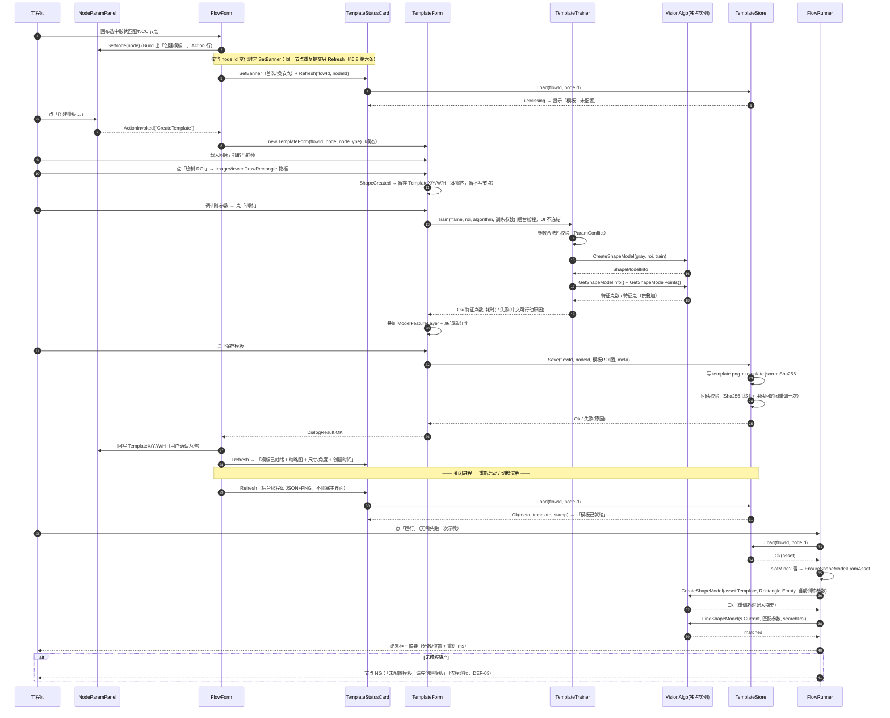
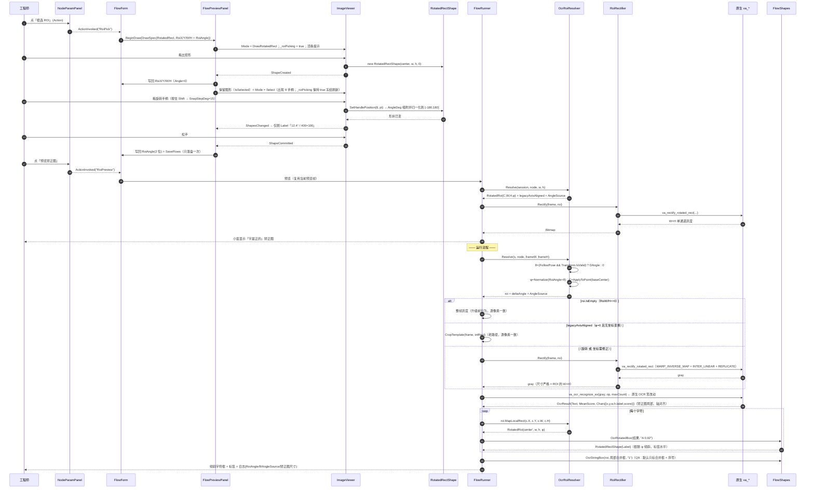

# 架构设计：模板制作能力与 OCR 带方向 ROI

> 对应 PRD：`docs/PRD-模板制作与OCR旋转ROI.md`（**v3**，术语已统一为「流程 / 配方」二分；FR-10 (b) 已按本文 §1.5 定稿）
> **两文档的唯一真源划分（PRD v3 文首已声明，此处为对等声明）**：角度命名与合成规则以本文 **§1.3** 为准；FR-10 验收口径以本文 **§1.5** 为准；需求编号与优先级以 PRD 为准。若两文档出现不一致，先改本文再回改 PRD，不许反过来。
> 目标一句话：**让"做模板"成为可见、可确认、可持久复用的一件事；让 OCR 能只认框住的那块区域、并且认得正。**
>
> 硬约束（沿用平台既有铁律）：零第三方 NuGet；传统（非 SDK）csproj；控件库纯 GDI+；C++ `VisionAlgo.Native` + OpenCV 4.5.5；C#/.NET Framework 4.8 WinForms；坐标一律图像坐标、线宽一律屏幕像素；`UiTheme` 单一来源三铁律；构建只能走 `build.bat Debug|Release`。
>
> 施工前置阅读：本文 §9「落地红线」是「违反即返工」的清单，工程师开工前必须先读。

---

## 0 结论摘要

| 事项 | 结论 |
|---|---|
| DEF-01「画 ROI 无反应」 | `FlowPreviewPanel.InitializeComponent` 丢失 3 条事件订阅（`btnDrawRoi.Click` / `btnLoadImage.Click` / `chkPauseAuto.CheckedChanged`）。下游链路完好，**补回订阅即通**，不需要改链路。 |
| 需求 1（模板制作 + 落盘） | 把模板从「原生单槽句柄 + 内存字典」改为「磁盘资产（模板图 PNG + 元数据 JSON）」；运行期改为**从资产懒训练、谁执行谁训**，彻底去掉"必须先跑一次流程做隐式示教"。 |
| 需求 2（OCR 旋转 ROI） | **原生 OCR 一行不改**。上层把旋转 ROI 仿射矫正成 `W×H` 正向灰度图 → 喂现有 `va_ocr_recognize_ex` → 用**同一套正向映射**把字符框送回整帧并画成倾斜框。 |
| 原生库改动 | 唯一新增：`va_rectify_rotated_rect`（旋转矩形裁剪 + 仿射矫正）。纯新增，不改任何现有导出。 |
| 坐标系（Q4/Q7） | ROI = 基准帧**绝对坐标**的「左上角 + 尺寸」+ **绕自身中心**的 `RoiAngle`；角度 **x 向右、y 向下、顺时针为正**，归一化 (-180,180]。生效角度 **φ = normalize(RoiAngle + θ)**，θ = 相对基准的偏差角。 |
| 像素/坐标互斥 | 位姿修正要么作用于像素（`Transform.IsValid=false`，θ 视 0），要么作用于坐标（`θ=DAngle`），**永不同时叠加**。由 `RunPositionCorrect` 现成的 `Transform.Reset()` 保证。 |
| 任务分解 | 5 个任务包 T01~T05，包内 a/b/c 步，每步都能 `build.bat Debug` 通过。 |
| 仍存限制 | 原生形状模型/NCC 模板各只有**一个槽位**，同一流程多个匹配节点会互相抢槽重训（见 §8.1 R1）。本期显式化为 **`W006`** 校验警告（§7.6），不做原生模型池。 |

> **文档修订记录**
> - rev8（T03 落地后同步，**两处"文档落后于实现"**）：① §5.2 从"两个必须做对的细节"改为**三个**——新增「GDI+ 的 PNG 编解码不保证像素格式保真」（8bpp 索引图存盘、解码回来是 `Format32bppArgb`；不丢灰度信息但**格式契约不成立**，所以"身份灰度"不能只在保存前校验，必须**加载后按 `meta.ImagePixelFormat` 归一化**），并给出 T03 实测数字（归一化前 `IsIdentityGray=false`、逐点差异 3024/3072；归一化后 `Format8bppIndexed`、差异 0）；② §6.1 末尾补「保存后必须回写 `TemplateX/Y/W/H`」的**理由与失败形态**（不回写 → 刚保存的模板当场判"与当前 ROI 不匹配"→ 用户看到"保存成功却用不了"），并明确 T05 复验不得以"多余"为由删除；③ T03 红线第 ⑤ 项改写（加"按 meta 归一化"）、新增第 ⑦ 项（回写 ROI）。
> - rev7（右键定案）：编辑态右键**选 A 本期修**（`SuppressContextMenu` + `ShowContextMenu` 首行 return）。§3.6 第 6 条补三条执行口径：① 置位跟 `_roiPicking` 走、**不跟 `_editingRotated` 走**（后者要画完第一个图形才 true，绑它会漏"刚点框选还没画完"这段）；② **复位点在 `EndRoiPickSilently()`**（完成/Esc/取消三条路径的公共出口，只在 `FinishRotatedRoiEdit` 复位会形成永久屏蔽）；③ 探针必须断言**退出编辑后 `SuppressContextMenu == false`**，三条退出路径各测一次——"该屏蔽时屏蔽了"易测，"该恢复时恢复了"才是会漏的那半。
> - rev6（T02 交付后同步）：① **§5.8 补第六条**——`SetNode` 会被高频重复调用（`FlowForm.cs:1091`，每次几何提交都调），卡片必须按 `node.Id` 复用、`Refresh` 按模板戳判脏、**Dispose+重建只由「Id 变化 / 类型无卡片」触发**，并写明"同一次拖动期间 `new Bitmap` 次数为 0"是 PRD §6.2「8h 内存无增长」的落点；§5.8「替换语义」行同时限定为"只在 Id 变化时发生"；T03 红线补第 ⑥ 条指向 §5.8 第六条；② §3.6 第 2 条补「边中点必须在局部坐标系里算」、第 3 条补「松手清 `SnapStepDeg` 否则程序化设值被吸附」、第 4 条补「切 `Select` 只对 `DrawRotatedRect` 生效」；③ §3.6 **新增第 6 条**：编辑态右键必须先退出编辑**且**抑制 viewer 内置菜单（已核实 `ImageViewer.cs:741~758` 的 `base.OnMouseUp` 先抛事件，现状是"退出编辑后仍弹菜单"），给最小改法并标注 T02 未实现、是否本期修由主理人定；④ §9 第 13 条补"`SmokeAlgo`/`SmokeUi` 均不入库，一律写本地探针"的表述红线。
> - rev5（T04 地基修正，**阻塞级**）：§5.4.1 四条采样式子重写为「(a) 唯一 master + 其余三条由它反解」，修掉三处错——(b) warpAffine 矩阵旋转方向反（`R(−φ)`→`R(+φ)`）且漏算 cv 的 `−(0.5,0.5)`、(c) 逆映射常数项多减 0.5、(d) 字符框中心多加 0.5；新增 **5 点数值自检表**（`C=(300,200)/400×100/25°`，四条式子逐点唯一真值）+ **单亮点往返断言** + 旧版错在哪的留档表；§3.2 的 GDI+ 降级链顺序与常数一并修正；§5.1 三个方法的公式注释钉到 §5.4.1；§9 第 9 条改写为「(a) 是唯一 master」。另：§5.7 **取消**模板组里的 `Note`（状态显示的唯一真源是 T03 的卡片，两处显示会互相矛盾）；新增 **§5.8 `NodeParamPanel` 接口契约**（`SetBanner` 只强制 `Dock=Top`、替换即 Dispose、`SetNode` 不清 banner）；§7 的 FR-13 表述改为事实描述（T01 **并未**新增 `Roi2X…` 键，「预留」只是命名约定）。
> - rev4（T01 落地后同步）：① 新增 **§7.6 校验规则码全表**（补 `W006`/`W007`，并给出"改码必须同改三处"的规则）；② §3.4 新增 **`Kind=Action` 的键不落盘、不进 `CreateDefaultParams()`** 的例外约定 + **OCR ROI 基础设施已就绪**的现状澄清；③ §5.7 补 `Action` 例外提示；④ T01 验收/红线、T04 新增「现状」行与红线 ⑥（`ShowBoxes` 回落值）；⑤ §9 新增第 14、15 条红线。
> - rev3：§1.5 定稿 FR-10 口径（内容等价四条），「逐像素一致」归位到 FR-06（§1.5.2）。
> - rev2：钉死 §1.3 三角色与合成式、§5.4.1 采样公式与 `+0.5` 约定。
> - rev1：初版（9 章 + 附录 A/B）。

---

## 1 坐标系与角度约定（拍板 Q4 / Q7）

### 1.1 全局角度约定（沿用现有，不改）

- 一律**图像坐标**：x 向右、y 向下。
- 角度单位「度」，从 **+X 轴起、朝 +Y 轴方向为正**，即屏幕上是**顺时针为正**。
  与库内三处既有约定完全一致：`RotatedRectShape` 类注释、`FlowShapes.CoordinateSystem`、`FlowRunTransform.ApplyToPoint` 的 `[cos,-sin; sin,cos]`。
- 归一化区间 **(-180, 180]**（`RotatedRectShape.NormalizeAngle` 现有实现），写入参数前也按此归一化。
- 精度：角度存 **double，2 位小数**；位置/尺寸 int（像素）。
  - 理由：FR-07 要 0.1° 级输入、≤0.5° 回读误差，2 位小数足够。
  - 用 int 存 X/Y/W/H 在「读→写」往返中**不产生累积漂移**：中心 = `X + W/2` 恒为 `.0` 或 `.5`，`round` 回来仍是原值。

### 1.2 ROI 的参数表示（拍板：左上角 + 尺寸 + 绕中心旋转）

沿用四个键 `RoiX/RoiY/RoiW/RoiH`，新增 `RoiAngle`，语义**定死**为：

> `RoiX/RoiY/RoiW/RoiH` = **未旋转时**矩形在「基准帧原始图坐标」下的左上角与尺寸；
> `RoiAngle` = 该矩形**绕自身中心**旋转的角度。

有效几何：

```
center = ( RoiX + RoiW/2 , RoiY + RoiH/2 )        // 绕此点旋转
```

**为什么这样定（三条硬理由）**

1. `RoiAngle = 0` 时**逐字节退化为现状**。旧配置（无 `RoiAngle` 字段 → 反序列化为 0）行为与升级前完全一致，FR-06「老配置必须仍整帧 / 轴对齐仍可用」零成本达成。
2. 绕**中心**而不是左上角旋转：与 `RotatedRectShape` 的旋转手柄（`atan2(pt − Center)`）、9 个手柄布局、OpenCV `RotatedRect`、以及形状匹配返回的 `(cx, cy, angle)` 全部同构。若以左上角为支点，用户每拖一次旋转手柄，ROI 会整体平移一段——不可接受。
3. **不引入「ROI 相对模板原点的偏移」参数**（否决 PRD v1 的 Q4 建议表述）：本系统里匹配模板 ROI 与 OCR ROI 是两套彼此独立的绝对坐标参数，"模板原点"在数据模型中不存在，凭空引入会让所有旧配置的绝对坐标语义断裂。
   等价性说明：绝对坐标 = 模板原点 + 相对偏移，而本系统的"模板原点"就是位置修正的基准点 `(RefX, RefY)`——二者数学等价，但绝对值实现不需要新增参数、不需要节点间依赖。

### 1.3 三个角度的职责划分（Q7 的答案）

| 角度 | 含义 | 是否参与 ROI 合算 |
|---|---|---|
| `RoiAngle` | 操作员在**基准帧**上画出的 ROI 角度（工件在标称位置时的角度） | 是，作为基准 |
| `RefAngle`（位置修正的 `ra`） | 基准位姿的角度（标称位置的工件朝向） | **否**。它已隐含在"操作员是在基准帧上画的 ROI"里，再叠加就是重复计入 |
| `dAngle` = θ（`FlowRunTransform.DAngle`） | 实测相对基准的**偏差角**（不是绝对角）。θ=0 ⇔ 工件完全在标称位置 | 是，**唯一**叠加项 |

**合成规则（写死）**

```
φ  = normalize( RoiAngle + θ )                       // 生效 ROI 角度
θ  = s.Transform.IsValid ? s.Transform.DAngle : 0     // 像素已扶正时 IsValid=false → θ=0
C  = s.Transform.IsValid ? ApplyToPoint(baseCenter) : baseCenter
baseCenter = ( RoiX − s.OffsetX + RoiW/2 , RoiY − s.OffsetY + RoiH/2 )   // 先减图像源裁剪偏移，同现有 ResolveRoi
W、H 不变（dScale 与现有 ApplyToRect 一样不参与，列为已知限制）
```

即：**把一个刚体变换 `T(p) = R(θ)(p − Ref) + Ref + (dX, dY)` 作用到旋转矩形上 = 角度加 θ + 中心点映射**。

> 这正是 DEF-04 的病根所在：现有 `FlowRunTransform.ApplyToRect` 返回的是"旋转后的**轴对齐外接矩形**"，角度在这一步被丢弃，200px 偏移可见误差 ≈18px。
> **OCR 链路不再调用 `ApplyToRect`。**

**Q7 答复**：θ 为 0 即"工件完全在标称位置"，生效 ROI 角度 = 配置角度（**严格相等**，不是约等于）。

### 1.4 像素已扶正时如何去重（`RunPositionCorrect` 的 `Transform.Reset()`）

`RunPositionCorrect` 在真正执行 `WarpToReference` 之后会 `s.Transform.Reset()`（把偏差烘进像素后，坐标重映射复位，避免下游二次叠加）。据此定下**互斥不变量**：

> **同一帧内，位姿修正要么作用于像素（`Transform.IsValid=false`，θ 视作 0），要么作用于坐标（`Transform.IsValid=true`，θ=DAngle）。
> 二者永不同时叠加。该不变量由 `FlowRunner` 现有代码保证，本设计不引入新状态位；OCR 侧只读 `IsValid`，因此天然不会二次叠加。**

语义解释（也是日志文案口径）：warp 之后工件已被物理扶正到基准位姿，此时基准帧的 ROI（含 `RoiAngle`）可直接套用，**θ=0 是正确结果，不是"跟随失效"**。

### 1.5 FR-10 的最终验收口径（★ 与 PRD v2 §8.1 的差异在此，以本节为准）

PRD v1 字面表述「实际生效 ROI 角度 = 模板角度 + θ」在 **warp 生效**的流程上几何必然不成立。PRD v2 已改为 (a)(b)(c) 三条，但 (b) 里「逐像素一致」**仍不可达**，理由见 §1.5.1。最终口径如下：

> **(a) 无像素级修正时**（上游无位姿输出 / 位置修正节点被跳过 / `FollowPose` 关闭 / `EnableAngle=0`）：
> 生效 ROI 角度 = `RoiAngle + θ`，误差 **≤ 0.5°**。
>
> **(b) 有像素级修正时**（`WarpToReference` 已执行、`Transform` 已 Reset）：生效角度 = `RoiAngle`（θ=0，误差 ≤0.05°），且**内容等价**于 θ=0 的静态情形，四条并列：
> **(b-1)** 识别文本**严格相等**（`string.Equals`，含空串情形）；
> **(b-2)** 字符框中心偏差 **≤ 1.5 px**、宽高偏差 **≤ 1.5 px**（同一"修正后工作帧"坐标系下比较）；
> **(b-3)** 平均置信度差 **≤ 0.05**；
> **(b-4)** 矫正图尺寸**严格等于** `(RoiW, RoiH)`。
>
> **(c) 两种情形都要求**：日志可区分角度来源（`Configured` / `Followed(θ=xx°)` / `Warped`）；连续 10 帧每帧从「`RoiAngle` + 当帧 θ」重算、不累加，因此**无漂移**。

#### 1.5.1 为什么「逐像素一致」不可达（必须写进文档，避免后续再提）

(b) 比较的两条路径**连采样方式都不同**：

| | 路径 A（θ=0 静态） | 路径 B（工件转 θ 后扶正） |
|---|---|---|
| 输入帧 | `F0`（工件在标称位姿） | `WarpToReference(Fθ)`，经 GDI+ `HighQualityBilinear` 重采样 |
| ROI 采样 | `RoiAngle=0` 且无变换 → 走**整数裁剪** `CropTemplate`（最近邻取整像素，**零插值**） | 同 A（此时 φ=0） |
| 灰度转换 | `ToGrayBitmap` | `ToGrayBitmap`（输入已被插值过） |

两次采样链不同 → 灰度值必然有差（±1~±3 灰阶），**逐像素一致从根上不可能**。
进一步：即使把路径 A 也改成 `warpAffine`，只要 θ≠0，`WarpToReference` 这一步的插值就不可能被消除。

因此 (b) 的口径必须落在**"同一块内容"**上，而不是"同一组字节"上：
- **文本相等**是业务意义最强的断言；
- **框位差 ≤1.5px** 足以证明"框跟着工件转"（若发生 θ 叠加两次这类 bug，错位是 θ 量级：5° × 400px ≈ 35px，与判据差 20 倍以上，**区分度极高**）；
- **置信度差 ≤0.05** 覆盖重采样抖动（实测定型后可收紧）；
- 尺寸断言保证矫正不会悄悄缩放。

#### 1.5.2 「逐像素一致」这个词的正确归属

「逐像素一致」只适用于**兼容性回归**。它同时出现在 PRD 的两处（**需求项 `FR-06` 的验收标准** 与 **§6.1 非功能-兼容性**），两处是同一件事、同一句断言：

> **FR-06 回归断言**：轴对齐 ROI（`RoiAngle=0`）且上游无坐标变换时，OCR 节点**实际输入算法的灰度图**必须与升级前**逐像素一致**（因为新实现刻意保留了老 `CropTemplate` 整数裁剪路径，两版本执行的是同一段代码）。

这条能成立、也**必须**成立；它和 FR-10 (b) 是两件事，不要混用。
落到实处就是 §3.6 第 1 条那条分支判断 + `BenchRoi` 里的像素哈希断言：**只要工程师把"整数裁剪"与"仿射采样"合流，这条断言立刻变红**——所以它同时也是"老路径不许合并"的自动化看门狗。

#### 1.5.3 反面用例（negative control，必须做）

`BenchRoi` 必须包含一条**故意注入 bug** 的对照：把 θ 叠加两次（`φ = RoiAngle + 2θ`）后跑同一组断言，**(a) 的 ≤0.5° 与 (b-2) 的 ≤1.5px 必须失败**。
否则无法证明断言真的在校验行为，而不是恒真。

---

## 2 实现方案总述

### 2.1 需求 1：模板制作 + 落盘

一句话：**把"模板"从「原生上下文里的单槽句柄 + 内存字典」改成「磁盘上一份可校验的资产（模板图 PNG + 元数据 JSON）」，运行期改为「从资产懒训练、谁执行谁训」。**

三层：

1. **制作层**（新增 `TemplateForm` 模态窗）：取图 / 画 ROI（复用 `ImageViewer.DrawRectangle`）/ 训练参数 / 训练 / 保存 / 模型预览（`GetShapeModelPoints` + 现有 `ModelFeatureLayer` 叠加）。形状匹配与 NCC **共用同一窗体**，按节点类型裁剪可用控件 → 满足 FR-01、FR-04；入口是参数面板上的显式按钮（`NodeParamKind.Action`），不在隐藏菜单里。
2. **存储层**（新增 `TemplateStore`）：`%AppData%\VisionPlatform\Templates\<FlowId>\<NodeId>\{template.png, template.json}`。PNG 无损 + JSON 元数据 + Sha256 + SchemaVersion。
3. **运行层**（改 `FlowRunner.RunShapeMatch / RunTemplateMatch`）：**不再拿当前帧当模板训练**（那正是"隐式示教"的病根），改为「有落盘资产 → 用资产里的模板图训练；无资产 → DEF-03 明确提示」。原生单槽位用「谁执行谁训 + 签名含模板戳」正面处理（见 §3.1）。

**DEF-01 的修法**：`FlowPreviewPanel.InitializeComponent` 里补回 3 条订阅：
```csharp
this.btnDrawRoi.Click            += this.OnDrawRoiClick;
this.btnLoadImage.Click          += this.OnLoadImageClick;
this.chkPauseAuto.CheckedChanged += this.OnPauseAutoChanged;   // 并在旁留注释防再丢
```
链路 `RoiPickRequested → FlowForm.OnDrawRequested → ShowDrawSpecMenu → StartDraw → FlowPreviewPanel.BeginDraw`（**唯一能置 `_roiPicking=true` 的地方**）完好，接上订阅即可通。
`OnViewerShapeCreated` 首行的 `if (!_roiPicking) return;` **不是缺陷**，是"非绘制态静默丢弃"的既有设计；本次改为**非绘制态给出顶条一行提示**（体验修正，可选，不影响验收）。

### 2.2 需求 2：OCR 旋转 ROI

一句话：**原生 OCR 一行不改**。上层按角度把旋转 ROI 矫正成 `W×H` 的标准正向灰度图 → 喂现有 `RecognizeEx` → 用**同一套正向映射**把返回的（矫正图局部、轴对齐）字符框送回整帧，并画成旋转框。

```
ResolveRotatedRoi（新，纯数学）
  → RectifyRotatedRoi（新，原生一次调用）
  → RecognizeEx（不变）
  → 字符框回映射（新，纯数学，与采样同一公式的正向）
  → FlowShapes.OcrRotatedBox（带 Label 的 RotatedRectShape）
```

**「原生库要不要改」的结论**

- **OCR 侧：不改。** `va_ocr_*` 全部只接受整幅 `VA_Image`、无 ROI 入参；`VA_OcrChar` 只有 `x/y/w/h/label/score`、无角度字段。而"把 ROI 转正"在几何上就是一次仿射采样，交给上层做，原生完全不需要知道 ROI 的存在——这是最省事、最不容易回归的分界点。
- **例外（唯一要动的原生能力）**：新增导出 `va_rectify_rotated_rect`（旋转矩形裁剪 + 仿射矫正）。取舍见 §3.2。改动是**纯新增**，不触碰任何现有导出。

### 2.3 可测试性设计

- 旋转裁剪 / 回映射的数学放在 `RotatedRoi`（纯 struct，无 IO、无 GDI）→ 冒烟可直接断言解析式。
- 原生采样必须与 C# 侧矩阵**逐点对齐**：`RotatedRoi.ToImage()` 就是原生用的同一公式（§5.4 给出像素中心 +0.5 约定），冒烟用"合成图打点"验证 ≤2px。
- 模板落盘用「存 → 清缓存 → 读 → 重训 → 匹配」闭环断言分数差 ≤0.01（FR-02）。
- 老行为回归：轴对齐 + 无变换时**必须走老 int 裁剪路径**，冒烟用像素哈希断言"与升级前逐像素一致"。

---

## 3 关键设计决策与取舍

### 3.1 决策①：模板落盘方案（存什么 / 存哪 / 何时重训 / 单槽位怎么办）

#### 存什么（两个文件）

| 文件 | 内容 | 说明 |
|---|---|---|
| `template.png` | **训练那一帧的模板 ROI 裁剪副本**（不是整幅原图） | 8bpp 身份灰度优先；ROI 为彩色时存 24bpp。**必须无损**，否则 FR-02 的分数一致性被破坏 |
| `template.json` | `TemplateMeta`（§5.2） | 含 `TrainSignature`、`FeatureCount`、源帧尺寸、模板 ROI、`Sha256`、`SchemaVersion` |

#### 存哪（已与产品对齐，PRD v2 术语已统一）

```
%AppData%\VisionPlatform\Templates\
    <FlowId>\<NodeId>\
        template.png
        template.json
```

理由（已核实）：本系统的**配方 `Recipe` 只装 `InspectionConfig`**，流程与节点在 `appconfig.json` 的 `Flows` 段里（`Core/AppSettings.cs` 的 `FlowSettings`、`Recipe/Recipe.cs` 全文 57 行）。所以"随配方目录存放"在本系统里没有落点。按 `FlowId + NodeId` 存放后：

- 换配方 → 流程不变 → 模板**自动仍就绪**（比 PRD 初衷更强）；
- 换流程 → 模板彼此隔离（FR-03 的"A/B 不串用"天然成立）；
- 整个 `Templates` 目录可拷到另一台同版本机器 → FR-14 零成本。

#### 何时重训（关键取舍）

| 时机 | 行为 |
|---|---|
| **保存模板时** | `TemplateForm` 用**独占的** `VisionAlgo` 实例训练（不抢 `FlowRunner` / `AppContext.Algo` 的槽位）；成功后写 PNG + JSON，并**回读校验**（读回 → Sha256 比对 → 用读回的图重训一次确认成功） |
| **软件启动 / 切流程** | **不训练**。后台线程只读 JSON + PNG 解码（20 个 ≤1s，不阻塞 UI），状态卡片直接显示"已就绪" |
| **当帧执行且原生槽位不是自己的** | 用**已保存的模板图**重训（`roi = Rectangle.Empty`），设 owner |
| **训练参数（Contrast/MaxFeatures/MinFeatureDist）被改** | 用**已保存的模板图**按新参数重训——**不重新示教、不读当前帧** |
| **匹配参数（AngleStart/End/Step/Scale/Pyramid/MinScore…）被改** | **不重训**（模型未变，只是搜索策略变了）。FR-11 正靠这条达成 |
| **模板 ROI（TemplateX/Y/W/H）被改** | 视为"模板失效"：状态卡片变「模板与当前 ROI 不匹配，请重新创建」。必须重新制作，因为模板图正是那个 ROI 的像素 |
| **模板文件被删 / 被覆盖** | 缓存签名含"模板戳"（json+png 的 `mtime + length`），戳变即作废重载 → 「删除模板」「重做模板」「外部拷贝覆盖」三条路径自动生效，**不需要跨对象通知** |

> **本次顺带修掉一个既有隐患**：现状 `RunShapeMatch` 的训练签名是 `ShapeSignature(ApplyRoi(...), train)`，`ApplyRoi` 会先过 `s.Transform.ApplyToRect`。当上游位置修正**没有触发 warp**（偏差 <0.05 阈值、但 `Transform.IsValid` 仍为 true）时，映射后的 ROI 每帧可能 ±1px 抖动 → **签名每帧变化 → 每帧重训**。
> 新设计里 `TrainSignature` **只含训练参数**、模板图来自资产，`ApplyRoi` 不再参与签名 → 该抖动路径被彻底切断。

#### 原生单槽位怎么办（正面回答）

**选型：方案 A「谁执行谁训」+ 校验期警告，一期不改原生。**

- 运行时逻辑：`slotMine = (_shapeModelOwner == node.Id)`；`!slotMine` → 用缓存模板图重训并夺槽。现有代码已具备此骨架（`slotMine` 判断 + `trainFrame = signatureSame ? cache.Template : s.Current`），本次只把"用 `s.Current` 示教"换成"用落盘资产"。
- **代价（必须让用户看见，不许掩盖）**：同一条流程里若有两个形状匹配节点交替执行，每帧要重训 N 次（200×200 目标约 60–300ms/次）→ 明显掉帧。对策：
  1. `FlowValidator` 增加 W 级提示：「本流程有 N 个形状匹配节点，共用原生单模型槽位，每帧将重训 N 次；建议一个流程只保留一个形状匹配节点」；
  2. 节点摘要与日志记录**重训耗时**，现场可定位。
- **否决方案 B**「原生改造支持多实例模型池」（新增 `va_shape_model_new/use/free` 句柄化模型）：收益是消除重训，代价是重写 `algo_shape.cpp` 的模型生命周期、牵动既有 96 项形状基准；而并发（`FlowRunManager` 并行 4 条流程）本就各自持有独立 `FlowRunner`/算法上下文，不存在跨流程冲突。**风险/收益比不划算，列为 P1 独立需求。**
- **否决方案 C**「启动时把全部模板训练进原生」：物理不可能（只有一个槽）。

### 3.2 决策②：旋转裁剪放哪一层

**选型：C++ OpenCV 新增导出 `va_rectify_rotated_rect`，C# 侧 `RoiRectifier` 只做 `LockBits` 直传。**

| 维度 | C++ OpenCV | C# GDI+ |
|---|---|---|
| 耗时（400×100 目标 / 5MP 源） | `cv::warpAffine` + `INTER_LINEAR` ≈ **0.1–0.3ms** | 变换式 `DrawImage` ≈ 0.5–2ms，且行为随源格式波动 |
| 数据搬运 | `LockBits` 拿 `Scan0/Stride`，**零拷贝** | 同左 |
| 采样可控性 | 矩阵自己算，与 C# 数学公式可**逐点对齐**（DEF-04 的前提） | GDI+ 内部矩阵不透明，"所见即所算"难保证 |
| 依赖 | 已链接 `opencv_world455`，**零新增** | 零新增 |
| 代价 | 必须**同时**改 `.vcxproj` 与 `.vcxproj.filters`；P/Invoke 签名/`VA_CALL` 要一次对上 | 无构建风险 |

> ⚠️ **性能陷阱（必读）**：**不得**复用 `VisionAlgo.GrayInput / ColorInput` 这两个内部类。它们会把整帧拷进托管 `byte[]`（5MP ≈1.5–3ms 的 `memcpy`），直接吃掉 5ms 预算。新链路必须 `LockBits` 直传指针。

**降级路径（写进任务说明）**：`RoiRectifier.Rectify(Bitmap src, RotatedRoi roi)` 是**唯一入口**，内部实现可整体替换为 GDI+ 版本，调用方零改动：

```csharp
// GDI+ 等价实现（与现有 WarpToReference 同款范式），仅在原生不可用时启用
// 目标映射：p → translate(−C) → rotate(−φ) → translate(+W/2, +H/2)（≡ §5.4.1 (c)）
// Graphics 的变换按调用顺序依次作用到点上：先调用的先作用。
g.TranslateTransform(-C.X, -C.Y);
g.RotateTransform(-φ);
g.TranslateTransform(W/2f, H/2f);     // 注意：整条链不含任何 0.5（GDI+ 以像素角点为整数）
g.DrawImage(src, 0, 0, W, H);
```
性能从 0.2ms 退到 1–2ms，仍在 5ms 预算内。**若原生编译一周内拿不下，直接切 GDI+，不要卡进度。**

### 3.3 决策③：字符框渲染方案

**选型：给 `RotatedRectShape` 加 `Label` 字段 + 在 `Draw` 里画标签。**

| 选项 | 结论 |
|---|---|
| ① 给 `RotatedRectShape` 加 `Label` | ✅ **选定** |
| ② 新建 `OcrRotatedBoxShape` | ✗ 重复 ~300 行几何代码 |
| ③ 把 `Label` 提到 `IGeometryShape` | ✗ 要改 7 个实现类 + 接口，波及面最大 |

- 理由：与 `RectangleShape` 的既有范式**完全同构**（同名字段、`Segoe UI 9pt Bold` + 半透明黑底 + 顶部越界落框内、`CopyStyleTo` 同步复制），零迁移风险。`RotatedRectShape` 现状已有 2 处生产使用（形状匹配结果框），不设 Label 时行为 100% 不变。
- **副作用收益**：旋转 ROI 编辑态的角度浮显（`12.4° / 400×100`）直接用这个 Label 实现，不必另造 HUD。
- 标签定位：**框随角度旋转、标签水平绘制**在"旋转后的左上角顶点"外侧（顶部越界则落框内）。不旋转文字：大角度下旋转文字不可读，且要 `g.Save()/g.Restore()` 包裹以免污染调用方 `Graphics` 状态。FR-09 只要求"框沿 ROI 方向 + 标签可见"，满足。
- 代价：标签能力落在具体类型而非接口上；将来第三种类型要标签时再做接口提升（不破坏现有 API）。

### 3.4 决策④：旋转 ROI 参数键命名与向后兼容

- **命名**：`RoiX / RoiY / RoiW / RoiH / RoiAngle`（OCR 组）+ `FollowPose`（bool，默认 `"1"`）。**不加前缀、不加序号**，一期单 ROI（采纳 PRD Q5 倾向）。
- **兼容三重保险**
  1. `FlowSettings.UpgradeToCurrent` 里**已有**"缺键自动补 `CreateDefaultParams()` 默认值"的机制（`Flow/FlowModels.cs` 的节点遍历段）。因此只要把新键加进 `FlowModuleInfo.CreateDefaultParams()` 的 Ocr 分支 **和** `NodeParamSchema.Ocr()`，旧配置加载时自动补 `RoiW=0 / RoiH=0 / RoiAngle=0 / FollowPose=1` → **宽高 0 即整帧，行为与升级前一致**（FR-06 达成）。
  2. **0 的语义必须合法**：`RoiW/RoiH=0`（整帧）、`RoiAngle=0`（不旋转）都是"显式合法值"，因此**一律"归一化到默认值"而不是"钳到下界"**。此处默认值就是 0，不存在"缺失 vs 显式 0"的分歧，但必须在代码里留注释，防止后人加 `if (RoiAngle <= 0) RoiAngle = 5` 这类钳制（历史教训：`MaxParallelFlows` 缺失被钳成 1，等于把并行悄悄关掉）。
  3. 二期多 ROI（FR-13）用**平行键组** `Roi2X/Roi2Y/Roi2W/Roi2H/Roi2Angle`，不把一期键改成别义；`FindDrawSpecs` 的候选表加一行即可扩展。
- **例外（重要）：`NodeParamKind.Action` 的键不落盘、不进 `CreateDefaultParams()`**
  动作行（`RoiPick` / `RoiPreview` / `CreateTemplate`）是**纯 UI 控件，没有参数值**——点击时由 `NodeParamPanel.ActionInvoked` 把 `NodeParamField.Key` 抛给宿主执行，值本身永远不写入 `node.Params`。
  因此**"Schema 里每个 Key 都能在 `CreateDefaultParams()` 里找到"这句话对 `Kind=Action` 的键不成立**；其余 `Int/Dbl/Bool/Enum/Text/File/Note` 一律必须双写（Schema + `CreateDefaultParams`）。
  为什么不能"顺手补齐"：① 会给老配置塞进一批永远无人读的死键，`appconfig.json` 白白膨胀；② 会让 `FlowSettings.UpgradeToCurrent` 的 `changed` 返回值失真——该返回值被冒烟基准里的**"二次升级幂等"**断言依赖（第一次升级 `changed=true`、第二次必须 `changed=false`），补了死键就会永远 `true`。
  施工约束：`FlowModule.CreateDefaultParams()` 与 `FlowSettings.UpgradeToCurrent` 都**不得**把 `Action` 纳入补齐范围。
- `ShowBoxes` 的**默认值**从 `"1"` 改为 `"0"`（新建节点只画合并框，符合 PRD Q9）；**键名与语义不变**，老配置里是显式 `1` → 不受影响（仍画逐字符框）。新增 `ShowStringBox`（默认 `"1"`，合并框 + 区域序号）。
- **现状澄清（T01 落地后核实，避免后续任务重复造轮子）：OCR 的 ROI 基础设施早就通了，缺的只是"角度"和"把键暴露到面板"。**
  - `FlowRunner.ResolveRoi`（`Flow/FlowRunner.cs` 2371 起）**本来**就按 `RoiX/RoiY/RoiW/RoiH` 四个键解析 ROI，键不存在或宽高 ≤0 时回落整帧。所以这次 Schema 补齐后 **`0 = 整帧`、老配置行为不变**——这是**既有逻辑**，不是本次新增。
  - `UI/FlowForm.cs` 的 `RectCandidates` / `FindDrawSpecs` 矩形候选表**已包含**这四个键 → OCR 节点在 T01 落地后**自动多出一个可拖拽的轴对齐矩形组**，画布代码一行不用改。
  - 因此 T04 真正要做的只剩三件：① 带角度矩形（`RotatedRectShape` 候选 + `RoiAngle` 键）；② 旋转裁剪/矫正（原生 `va_rectify_rotated_rect`）；③ 结果框回映射（`RunOcr` 第 ⑤ 步的轴对齐硬编码 → `OcrRotatedBox`）。

### 3.5 决策⑤：FR-10 的接入方式

**选型：参数勾选项 `FollowPose` + 读 `s.Transform.DAngle`，不新增 Pose 端子。**

理由：

1. `s.Transform` 是**全系统既有的位姿广播机制**（Blob / 直线卡尺 / 圆卡尺都在用）。OCR 加入它不改变任何拓扑规则，也不会让旧配置报错。
2. 新增 Pose 端子会造出**两套真值来源**（`s.Transform` 与端子上的 pose）。用户既连线又勾选时语义歧义；且要动 `FlowPortSchema.Register(Ocr, …)`，风险外溢。
3. 勾选项给用户**显式关闭**的手段（与升级前行为完全对齐），是兼容性上最稳的形态。

代价：Ocr 不能"绕过位置修正节点直接跟随某个匹配节点"。这本来就该由位置修正节点承担（Auto/Manual 基准、超差判定都在那里）。若将来确实需要，可在不破坏本决策的前提下**增量**加一个可选 Pose 端子（非必填）。
实现细节：`EnableAngle=0` 时 `dAngle` 已被位置修正节点置 0，OCR 无需重复判断。

### 3.6 其他必须落地的设计点（漏了就返工）

1. **轴对齐 + 无变换必须走老路径**：`φ ≈ 0 且 !Transform.IsValid 且 RoiAngle == 0` → 用现有 `CropTemplate(frame, rect)` **整数裁剪**，**不经过双线性采样**。这是"老行为不劣化 / 逐像素一致"的唯一可靠保证（§1.5.2）。
2. **9 手柄改造要动公共常量**：`RotatedRectShape.GetHandles()` 从「4 角 + 1 旋转」改为「4 角(0..3) + 4 边中点(4..7) + 旋转(8)」，`RotateHandleIndex` 由 `4` 改为 `8`。已核实全库只有 `RotatedRectShape` 自身引用该常量（`ImageViewer` 用的是 `HandleKind.Rotate`），改动安全；角点索引 0..3 **保持不动**（与 `RectangleShape` 的 0..7 顺序对齐）。**边中点拖拽必须在局部坐标系里算**（把指针逆旋转到未旋转的局部框 → 只改一个维度 → 再转回世界），不能在世界上直接改：旋转框的边中点世界里是斜的，"只改一个维度"在世界上没有意义。这条是"任意角度下边中点不失真"的唯一正确做法，T02 已按此实现（30° 下对边中点世界坐标一位不差）。
3. **Shift 吸附的实现位置**：`RotatedRectShape` 新增 `SnapStepDeg`（0 = 关闭），只在旋转分支里吸附；**读 `Control.ModifierKeys` 的职责留在 `ImageViewer.OnMouseMove`**（几何类不引入 WinForms 依赖）。默认 `SnapStepDeg = 0`（自由角度），按住 Shift 时由控件置 15；**松手必须清回 0** —— 否则后续任何程序化 `SetHandlePosition` 都会被"上一次的 Shift 状态"吸附，表现为"用代码设 12.3° 却变成 15°"。
4. **`FinishDrawing` 不切模式的"缺陷"要利用**：旋转 ROI 创建后**必须保持图形在 `Shapes` 里**并切到 `Select` 模式（否则拖不到手柄）。因此给 `ImageViewer` 新增 `ShapeCommitted` 事件（`OnMouseUp` 且 `_draggingShape == true` 时触发），宿主据此**只落盘一次**；拖动过程靠 `ShapesChanged` 只刷 Label，**不写配置**。切换只在 `DrawRotatedRect` 模式生效，**不得**顺手让 `DrawRect` / `DrawLine` / `DrawRing` 也保持图形——那会把它们"画完即结束"的既有行为一起改掉（DEF-01 的既有流程会跟着变）。
5. **编辑态要维持 `_roiPicking = true`**：否则 `OnPullTick` 会刷新画面把 ROI 冲掉。退出条件：顶条按钮变「完成」被点击 / Esc / 右键取消。`PromptFor(DrawRotatedRect)` 补提示文案。
6. **编辑态的右键必须同时抑制 viewer 内置菜单**（★ 已核实现状会弹，见下）：`ImageViewer.OnMouseUp` 的顺序是 `base.OnMouseUp(e)`（先抛 `MouseUp` 事件 → 宿主的处理器先跑）再走自己的平移/菜单分支（`ImageViewer.cs` 741~758）。所以"右键退出编辑"会先执行，**随后仍会 `ShowContextMenu`** —— 用户看到的是"退出编辑 + 立刻弹出一个菜单"，很容易以为点错了。
   - **目标行为**：编辑态右键 = 只退出编辑、不弹菜单（与 Esc 完全等价）。
   - **最小改法**（纯追加，不改任何既有行为）：`ImageViewer` 增加 `public bool SuppressContextMenu { get; set; }`（默认 `false`），在 `ShowContextMenu` 首行 `if (SuppressContextMenu) return;`；`FlowPreviewPanel` 在进/出编辑态时置 `true` / `false`。约 5 行。**不要**用"把 `ViewerContextMenu` 置 null"来抑制（该属性只有 getter），也不要改 `OnMouseUp` 的分支顺序（会影响右键平移）。
   - **置位点必须跟 `_roiPicking` 走，不要跟 `_editingRotated` 走**（rev7 定）：`_editingRotated` 要等"画完第一个图形"才置 true（`FlowPreviewPanel.cs:1003`），而 `_roiPicking` 从点「框选 ROI」就为 true。只绑 `_editingRotated` 的话，用户刚点完「框选 ROI」、还没画完时右键仍会弹菜单。**复位点放 `EndRoiPickSilently()`**——它是三条退出路径（完成按钮 / Esc / 右键取消）的公共出口（`512` / `534` / `726` 三处调用），只在 `FinishRotatedRoiEdit` 里复位会漏掉"取消"路径，形成**永久屏蔽**。
   - **探针必须测"该恢复时恢复了"**（rev7 定，比"该屏蔽时屏蔽了"更重要）：断言**退出编辑后 `SuppressContextMenu == false`**，且三条退出路径各测一次（完成 / Esc / 右键）。失败形态是"右键菜单从此再也不弹"——它不会报错、不会崩，只是某个功能静默消失，比原缺陷更难查。
   - **T02 现状**：尚未实现，当前右键会弹菜单。**主理人已裁「本期修」（rev7），按上面的改法落地。**
7. **模板训练必须用独占原生上下文**：`TemplateForm` 自建 `VisionAlgo` 实例并在关闭时 `Dispose`。否则会和 `FlowRunner` 抢单槽（这正是"训练与匹配互相踢模型"的坑）。
8. **主题接入**：`TemplateForm` 构造函数**末尾一行** `UiStyle.ApplyForm(this)`；自带自绘子控件（`ImageViewer`）在 `UiStyle` 跳过名单里，需自行取色。`TemplateStatusCard` 挂在 `NodeParamPanel` 的 body 上（该子树整体被 `UiStyle` 跳过）→ 卡片内部**所有**颜色/字体必须显式取自 `UiTheme`，不能指望 `ApplyForm` 传下来。三铁律：不改 `Form.Font`、只覆盖系统默认色、自绘控件整棵子树跳过。
9. **传统 csproj**：每个新增 `.cs` 必须手工加 `<Compile Include>`；原生新增 `.h/.cpp` 必须**同时**加 `.vcxproj`（`ClInclude`/`ClCompile`）与 `.vcxproj.filters`。

---

## 4 文件清单

> 动作：**新增** / **修改**。组内按依赖先后排序。

### 4.1 原生算法库（C++）

| 相对路径 | 动作 | 职责 |
|---|---|---|
| `src/VisionAlgo.Native/include/algo/va_affine.h` | 新增 | 声明 `va_rectify_rotated_rect`（唯一新导出，纯新增） |
| `src/VisionAlgo.Native/src/algo/algo_affine.cpp` | 新增 | `cv::getRotationMatrix2D` + `cv::warpAffine` 实现旋转矩形裁剪；3ch→1ch 按 Rec.601 转灰 |
| `src/VisionAlgo.Native/VisionAlgo.Native.vcxproj` | 修改 | 加 `<ClInclude>` + `<ClCompile>`（漏了不参与编译） |
| `src/VisionAlgo.Native/VisionAlgo.Native.vcxproj.filters` | 修改 | 加 `<Filter>` 归组（漏了文件平铺在项目根） |

### 4.2 控件库（VisionSystem.Controls，纯 GDI+）

| 相对路径 | 动作 | 职责 |
|---|---|---|
| `src/VisionSystem.Controls/Geometry/RotatedRectShape.cs` | 修改 | 9 手柄（4 角 + 4 边中点 + 旋转=8）；`SnapStepDeg` 吸附；新增 `Label` 与标签绘制；`CopyStyleTo` 带 Label |
| `src/VisionSystem.Controls/ImageViewer.cs` | 修改 | 新增 `ShapeCommitted` 事件；拖动时按 Shift 设 `SnapStepDeg`；`DrawRotatedRect` 创建后不自动退模式 |

### 4.3 平台层 · 数据与流程

| 相对路径 | 动作 | 职责 |
|---|---|---|
| `src/VisionPlatform/Core/AppPaths.cs` | 修改 | 新增 `TemplateDir`（`%AppData%\VisionPlatform\Templates`）并纳入 `Ensure()` |
| `src/VisionPlatform/Flow/RotatedRoi.cs` | 新增 | 旋转 ROI 纯数学：`RotatedRoi` struct + `OcrRoiResolver`（参数 / Offset / Transform / 角度合成 / 角度来源） |
| `src/VisionPlatform/Flow/TemplateStore.cs` | 新增 | 模板落盘：路径规则、`TemplateMeta` 序列化、PNG 读写（先读后拷）、Sha256、模板戳、失败分类、进程内小缓存 |
| `src/VisionPlatform/Flow/TemplateTrainer.cs` | 新增 | 训练封装：独占 `VisionAlgo`、参数校验、失败原因分类（中文化）、特征点导出、耗时统计 |
| `src/VisionPlatform/Native/VisionAlgo.cs` | 修改 | P/Invoke `va_rectify_rotated_rect` + `RoiRectifier.Rectify`（`LockBits` 直传，绕过 `GrayInput` 的整帧拷贝） |
| `src/VisionPlatform/Flow/FlowRunner.cs` | 修改 | ① `RunShapeMatch/RunTemplateMatch` 改从 `TemplateStore` 取资产训练（签名 = 模板戳 + 训练参数）；② `RunOcr` 全链路改造（旋转 ROI + 角度跟随 + 原生矫正 + 回映射 + 日志）；③ `ResolveRoi` 保留给其他节点不动；④ 无模板 → DEF-03 文案 |
| `src/VisionPlatform/Flow/FlowShapes.cs` | 修改 | 新增 `OcrRotatedBox(...)`（带 Label 的旋转框）、`OcrStringBox(...)`、`RotatedRoiOutline(...)`（FR-12） |
| `src/VisionPlatform/Flow/NodeParamSchema.cs` | 修改 | 新增 `NodeParamKind.Action`；`Ocr()` 加 ROI 组 + 跟随勾选 + 显示开关 + 两个 Action 行；`ShapeMatch()/TemplateMatch()` 加「模板」组 + `CreateTemplate` Action 行 |
| `src/VisionPlatform/Flow/FlowModule.cs` | 修改 | `CreateDefaultParams()` 的 Ocr / ShapeMatch / TemplateMatch 分支同步补同名同默认值键 |
| `src/VisionPlatform/Flow/FlowValidator.cs` | 修改 | W 级提示：多匹配节点共用单槽位（每帧重训）；OCR 勾了跟随但链上无位置修正节点 |

### 4.4 平台层 · 界面

| 相对路径 | 动作 | 职责 |
|---|---|---|
| `src/VisionPlatform/UI/FlowDrawSpec.cs` | 修改 | `DrawShapeKind.RotatedRect`；`DrawSpec` 增 `Angle` 键；`MakeRotatedRect(...)` |
| `src/VisionPlatform/UI/FlowForm.cs` | 修改 | `RotatedCandidates` / `FindDrawSpecs` / `SpecOrder` / `ReadCurrentGeometry` / `DescribeDrawSpec` / `OnShapePicked` 全面加分支；「框选 ROI ↔ 完成」按钮态；挂载并刷新模板状态卡片；模板动作与预览矫正图转发；FR-12 选中节点叠加轮廓 |
| `src/VisionPlatform/UI/FlowPreviewPanel.cs` | 修改 | **补回 3 条丢失订阅（DEF-01）**；旋转 ROI 编辑态（保持图形 / Label 实时角度 / `ShapeCommitted` 写回 / 完成·Esc 退出）；`PromptFor` 增文案 |
| `src/VisionPlatform/UI/NodeParamPanel.cs` | 修改 | 渲染 `Action` 行（按钮）并抛 `ActionInvoked(string key)`；新增 `SetBanner(Control)` 顶部插槽 |
| `src/VisionPlatform/UI/TemplateStatusCard.cs` | 新增 | 模板状态卡片：未配置 / 已就绪 / 失败三类文案 + 缩略图 + ROI 尺寸角度 + 创建时间 + 重新制作 / 删除 |
| `src/VisionPlatform/UI/TemplateForm.cs` | 新增 | 模板制作模态窗（**单文件手写 `InitializeComponent`，不建 Designer**）：取图 / 画 ROI / 训练参数 / 训练 / 保存 / 取消 / 特征点叠加 / 底部诊断区 |
| `src/VisionPlatform/UI/MainForm.Designer.cs` | 修改（可选 P2） | `tsBtnAlgo.Visible` 由 `false` 改 `true`，把旧「形状匹配调试」恢复为可见的"算法离线调试"入口（PRD Q1 建议） |

### 4.5 工程与验收

| 相对路径 | 动作 | 职责 |
|---|---|---|
| `src/VisionPlatform/VisionPlatform.csproj` | 修改 | 5 个新 `.cs` 的 `<Compile Include>`（RotatedRoi / TemplateStore / TemplateTrainer / TemplateForm / TemplateStatusCard） |
| `src/SmokeAlgo/BenchRoi.cs` | 新增 | 旋转裁剪与回映射基准：0°/±5°/±15°/±30° 四角误差 ≤2px；矫正图尺寸严格 W×H；角度合成与来源；**§1.5.3 反面用例**；FR-06 老路径像素哈希 |
| `src/SmokeAlgo/BenchTemplate.cs` | 新增 | 模板落盘闭环：存→清缓存→读→重训→匹配，分数差 ≤0.01、位置差 ≤1px；单节点二次运行不重训 |
| `src/SmokeAlgo/Program.cs` | 修改 | 注册新基准（既有 128 项必须全绿） |
| `src/SmokeAlgo/SmokeAlgo.csproj` | 修改 | 新 `.cs` 的 `<Compile Include>` |

---

## 5 数据结构与接口

### 5.1 旋转 ROI 数学（`src/VisionPlatform/Flow/RotatedRoi.cs`，新增）

```csharp
namespace VisionPlatform.Flow
{
    /// <summary>生效角度来源（日志与验收口径用）。</summary>
    public enum RoiAngleSource { Configured, Followed, Warped }

    /// <summary>工作帧坐标下的旋转矩形 ROI：中心 + 宽高 + 角度（度，顺时针为正）。</summary>
    public struct RotatedRoi
    {
        public PointF Center;
        public float  Width, Height, AngleDeg;

        public static readonly RotatedRoi Empty;   // Width<=0 || Height<=0 视为空（= 整帧）
        public bool IsEmpty { get; }

        /// <summary>矫正图局部坐标 (u,v) → 工作帧坐标 = §5.4.1 (a)，唯一 master 式：
        ///   p = C + R(φ)·(u+0.5−W/2, v+0.5−H/2)。</summary>
        public PointF ToImage(float u, float v);
        /// <summary>工作帧坐标 → 矫正图局部坐标 = §5.4.1 (c)：
        ///   (u_c,v_c) = R(−φ)·(p−C) + (W/2,H/2)，返回连续坐标；像素索引 = u_c − 0.5。</summary>
        public PointF ToLocal(PointF image);
        /// <summary>四个角点（图像坐标，顺序 TL/TR/BR/BL）。</summary>
        public PointF[] Corners();
        /// <summary>轴对齐外接框（仅用于"是否与图像相交"的快速剔除，不参与精度计算）。</summary>
        public Rectangle Aabb();
        /// <summary>把矫正图中的一个轴对齐局部框（如字符框）映射成图像坐标下的旋转矩形 = §5.4.1 (d)：
        ///   中心取 (x+w/2, y+h/2)（已是连续坐标，勿再 +0.5）。</summary>
        public RotatedRoi MapLocalRect(float x, float y, float w, float h);
    }

    /// <summary>把节点参数 + 会话状态解析成"本帧实际生效的 ROI"。</summary>
    public static class OcrRoiResolver
    {
        public static RotatedRoi Resolve(FlowRunSession s, FlowNode node,
                                        int frameW, int frameH,
                                        out RoiAngleSource source,
                                        out double deltaAngle,
                                        out bool legacyAxisAligned);
        // 规则：
        //   RoiW<=0 || RoiH<=0                     → RotatedRoi.Empty（整帧）
        //   θ = (node.FollowPose && s.Transform.IsValid) ? s.Transform.DAngle : 0
        //   φ = Normalize(RoiAngle + θ)
        //   baseCenter = (RoiX - s.OffsetX + RoiW/2, RoiY - s.OffsetY + RoiH/2)
        //   Center = s.Transform.IsValid ? ApplyToPoint(baseCenter) : baseCenter
        //   source = !Transform.IsValid && (warped?) ? Warped : (θ!=0 ? Followed : Configured)
        //   legacyAxisAligned = (|φ| < 1e-6 && !s.Transform.IsValid)
    }
}
```

### 5.2 模板元数据与存储（`src/VisionPlatform/Flow/TemplateStore.cs`，新增）

```csharp
namespace VisionPlatform.Flow
{
    /// <summary>模板加载失败的三类可分原因（PRD 6.3 要求界面文案不同）。</summary>
    public enum TemplateLoadError { None, FileMissing, CorruptedOrVersionMismatch, MismatchWithNode }

    [DataContract]
    public sealed class TemplateMeta
    {
        [DataMember] public int    SchemaVersion { get; set; }    // 1
        [DataMember] public string Algorithm { get; set; }        // "ShapeMatch" | "TemplateMatch"
        [DataMember] public string AppVersion { get; set; }       // 诊断用
        [DataMember] public string CreatedUtc { get; set; }       // ISO 8601
        [DataMember] public int    SourceFrameWidth  { get; set; }
        [DataMember] public int    SourceFrameHeight { get; set; }
        [DataMember] public int    TemplateX { get; set; }        // 原始图坐标（诊断/显示/不匹配判定）
        [DataMember] public int    TemplateY { get; set; }
        [DataMember] public int    TemplateW { get; set; }
        [DataMember] public int    TemplateH { get; set; }
        [DataMember] public double TemplateAngle { get; set; }    // 预留，当前恒 0
        [DataMember] public double Contrast { get; set; }         // 形状匹配训练参数
        [DataMember] public int    MaxFeatures { get; set; }
        [DataMember] public double MinFeatureDist { get; set; }
        [DataMember] public string TrainSignature { get; set; }   // "C=30|F=1500|D=2"（只含训练参数，不含 ROI）
        [DataMember] public int    FeatureCount { get; set; }     // 形状匹配 GetShapeModelInfo 的点数；NCC 为 0
        [DataMember] public int    TrainElapsedMs { get; set; }
        [DataMember] public string ImageFile { get; set; }        // "template.png"
        [DataMember] public int    ImageW { get; set; }
        [DataMember] public int    ImageH { get; set; }
        [DataMember] public string ImagePixelFormat { get; set; } // "8bppIndexed" / "24bppRgb"
        [DataMember] public string ImageSha256 { get; set; }
    }

    public sealed class TemplateAsset
    {
        public TemplateMeta Meta;
        public Bitmap Template;   // 调用方持有，需 Dispose
        public string Dir;
        public string Stamp;      // json+png 的 mtime+length，用于缓存失效
    }

    public static class TemplateStore
    {
        public static string DirOf(string flowId, string nodeId);          // 含非法字符清洗（GUID 安全但仍要防手改）
        public static bool   Exists(string flowId, string nodeId);
        public static TemplateAsset Load(string flowId, string nodeId,
                                        out TemplateLoadError error, out string message);
        public static bool   Save(string flowId, string nodeId, Bitmap templateImage,
                                 TemplateMeta meta, out string message);   // 内含回读校验
        public static bool   Delete(string flowId, string nodeId, out string message);
        public static string StampOf(string flowId, string nodeId);        // 不存在返回 "0"
    }
}
```

**磁盘布局**

```
%AppData%\VisionPlatform\Templates\
    <FlowId>\<NodeId>\
        template.png
        template.json
```

**体积控制**：PNG 优先（无损）。若 `> 2MB` 且源为彩色 → 改存 8bpp 灰度 PNG 再测；仍超 → **拒绝保存**并给出中文原因「模板区域过大（W×H），建议缩小到 2000×2000 以内」。
**不许悄悄降采样或改 JPEG**——那会直接破坏 FR-02 的"分数差 ≤0.01"。

**★ 三个必须做对的细节**

1. **模板图必须是"身份灰度调色板"**：`VisionAlgo.CreateGrayBitmap` 建出来的 8bpp 位图满足 `IsIdentityGrayPalette`。若换成别的调色板存 PNG，下次加载后 `GrayInput` 会走 24bpp 转换路径，灰度值发生偏移 → 训练结果变化 → FR-02 挂。保存前必须校验。
2. **★ GDI+ 的 PNG 编解码<u>不保证像素格式保真</u>（rev8 补，T03 实测）**：8bpp 索引图 `image.Save(path, ImageFormat.Png)` 之后，`new Bitmap(stream)` 解回来通常是 **`Format32bppArgb`**，而不是 `Format8bppIndexed`。也就是说——**不管我们保存时调色板多正确，GDI+ 解码都不还给我们索引格式**。
   - 后果一：上面第 1 条担心的偏移会发生（`IsIdentityGray` 判 false → 走 24bpp 转换路径，白多一次逐像素乘法）；
   - 后果二（更麻烦）：**"保存前校验"本身失去意义**——它只能证明"写出去的那份是对的"，证明不了"读回来的那份是什么"。
   - 它**不丢灰度信息**：GDI+ 把灰度 PNG 当 32bpp 存解时 R=G=B=原索引值，按 Rec.601 转回来仍是原值（`(v·114 + v·587 + v·299)/1000 = v`）。所以这不是精度问题，是**格式契约不成立**。
   - **必须的修法**：`TemplateStore.Load` 在读回后，若 `meta.ImagePixelFormat == "8bppIndexed"` 而当前不是身份灰度，**显式归一化回身份灰度**（`ConvertToIdentityGray`）。这样"存储层的输出契约"才成立——谁拿 `Load` 的结果都能直接喂算法库。
   - 自检数字（T03 实测）：不归一化时 `IsIdentityGray = false`、逐点差异 **3024/3072**；归一化后 `Format8bppIndexed`、逐点差异 **0**。
   - **同样的坑适用于 OCR 字符模板库**（增量需求同样用 PNG 存取），见 `docs/架构-增量-OCR字符模板与结果呈现.md` §3.11。
3. **加载必须"先读后拷"**（否则锁文件，「删除模板」「重做模板」「拷入覆盖」全部失败）：

```csharp
using (var fs = File.OpenRead(pngPath))
using (var probe = new Bitmap(fs))
    return new Bitmap(probe);      // 立刻复制一份，probe 随 using 释放，不持文件句柄
```
本库已有同款先例：`FlowPreviewPanel.LoadImageFromFile` 的注释明确写了这个坑。

### 5.3 训练器（`src/VisionPlatform/Flow/TemplateTrainer.cs`，新增）

```csharp
public enum TemplateTrainStatus { Ok, RoiTooSmall, NoFeature, ParamConflict, Timeout, NativeError }

public sealed class TemplateTrainResult
{
    public TemplateTrainStatus Status;
    public string Message;                 // 中文、可行动
    public int FeatureCount;
    public int ElapsedMs;
    public Rectangle EffectiveRoi;
    public List<ShapeModelPoint> Points;   // 形状匹配特征点（给 ModelFeatureLayer 叠加）；NCC 为 null
}

public sealed class TemplateTrainer : IDisposable
{
    public TemplateTrainer();                                   // 内部 new VisionAlgo()，独占上下文
    public TemplateTrainResult Train(Bitmap frame, Rectangle roi, string algorithm,
                                    double contrast, int maxFeatures, double minFeatureDist);
    public TemplateTrainResult TrainFromTemplate(Bitmap template, string algorithm,
                                    double contrast, int maxFeatures, double minFeatureDist); // roi = Empty
    public void Dispose();                                      // 释放独占上下文
}
```

**失败分类口径（对应 DEF-02 的"四类可行动原因"）**

| 分类 | 判定 | 界面文案要点 |
|---|---|---|
| `RoiTooSmall` | W 或 H < 8，或 < 3 × `MinFeatureDist` | 「ROI 区域过小（W×H），请扩大 ROI 或缩小最小间距」 |
| `NoFeature` | `CreateShapeModel` 成功但 `GetShapeModelInfo` 点数 < 8 | 「ROI 内有效特征过少（<8 个），请扩大 ROI 或降低对比度阈值」 |
| `ParamConflict` | `ScaleMin > ScaleMax` / `AngleStart > AngleEnd` / `Contrast <= 0` | 指名冲突的那两个参数 |
| `Timeout` | `ElapsedMs > 3000` | 「训练超时（>3000ms），请缩小 ROI 或减少最大特征点数」 |
| `NativeError` | 其余 | 中文前缀 + 原生原文 |

### 5.4 原生新导出（`va_affine.h`）

```c
/* 旋转矩形裁剪 + 仿射矫正：把 src 中以 (cx, cy) 为中心、width×height、旋转 angle_deg 的
 * 矩形区域，采样成 width×height 的单通道灰度正向图。
 *
 * 【采样约定 —— 与 C# RotatedRoi.ToImage 严格一致，任何一侧都不许单独改动】
 *   dst(u,v) 的像素中心对应 src 中：
 *       p = C + R(angle) · ( u + 0.5 − W/2 ,  v + 0.5 − H/2 )
 *   其中 C = (cx, cy)，R 为顺时针正（y 向下）旋转矩阵 [cos,-sin; sin,cos]。
 *   上面这一式是**唯一 master**；内部的 dst→src 矩阵必须由它反解
 *   （见 docs/架构-模板制作与OCR旋转ROI.md §5.4.1 (b)，含数值自检表）：
 *       M = [ R(+angle) | C − (0.5,0.5) − R(+angle)·(W/2−0.5, H/2−0.5) ]
 *   禁止改符号、禁止调 cv::getRotationMatrix2D（其 angle 语义与本式相反）。
 *
 * src.channels 支持 1 / 3（3 通道按 Rec.601 转灰：Y = (114B + 587G + 299R)/1000）；
 * dst 必须 channels = 1，width/height 由调用方填好，data 由调用方分配（width*height 字节，
 * stride 建议取 width）。越界沿边 replicate（ROI 在帧内时几何上不存在黑边）。
 *
 * 返回 VA_OK / VA_ERR_ARG / VA_ERR_SIZE / VA_ERR_INTERNAL。 */
VA_API int VA_CALL va_rectify_rotated_rect(void* handle,
                                          const VA_Image* src,
                                          double cx, double cy,
                                          double width, double height,
                                          double angle_deg,
                                          VA_Image* dst,
                                          int interpolation /*0=NEAREST, 1=LINEAR*/,
                                          int border_mode   /*0=ZERO, 1=REPLICATE*/);
```

#### 5.4.1 采样公式与 +0.5 像素中心约定（★ DEF-04 能过 ≤2px 的唯一依据）

**写作前提（四条式子共用）**：所有公式都写在「ROI 已解析到工作帧」**之后**的同一坐标系里。ROI 参数本身是基准帧绝对坐标，`OcrRoiResolver` 负责 `OffsetX/OffsetY` 与 `Transform` 的映射、以及 `φ = normalize(RoiAngle + θ)` 的合成；`Rectify` 内部只做下面这套纯几何，**不再读任何配置、不再判断 Transform**。

**像素中心约定（只此一句，四条式子共用，任何一条都不得自行再加/减 0.5）**：像素 `(i,j)` 覆盖连续区域 `[i,i+1]×[j,j+1]`，中心在 `(i+0.5, j+0.5)`。**"连续坐标"与"像素索引"永远相差 0.5**——四条式子的本质差异只是"各自落在哪种坐标里"：OpenCV 以**整数坐标＝像素中心**，GDI+ 与我们的连续坐标以**角点**为整数。

**为什么必须统一**：若两端一边按角点、一边按中心，会引入恒定 `0.5·√2 ≈ 0.7071px` 的偏移（**模长不随 φ 变，只换方向**），再叠加重采样 ±0.5px 与字符统计 ±0.5px 就顶破 2px 预算；而 `φ=0` 走老 `CropTemplate` 整数路径，**永远测不出来**，只在 `φ≠0` 时表现为"基线/框位永远差半像素"，看起来像正常的重采样噪声——这是本设计里最难查的一类错。

**（a）正向 master 式（唯一真值来源：`RotatedRoi.ToImage`、字符框回映射都从它推出）**

```
p = C + R(φ) · ( u + 0.5 − W/2 ,  v + 0.5 − H/2 )

R(φ) = [ cosφ  −sinφ ]        // y 向下 ⇒ 顺时针为正
       [ sinφ   cosφ ]
```

语义：矫正图第 `(u,v)` 个**像素的中心**，落在工作帧连续坐标 `p` 处。

**（b）给 `cv::warpAffine` 的 dst→src 矩阵（`WARP_INVERSE_MAP`）**

OpenCV 的像素坐标 = 我们的连续坐标 − `(0.5, 0.5)`（cv 里整数坐标即像素中心）。把 (a) 的 `p` 换成 cv 坐标、再对 `(u,v)` 线性化：

```
p_cv = R(φ) · (u, v) + [ C − (0.5,0.5) − R(φ) · ( W/2 − 0.5 , H/2 − 0.5 ) ]

⇒  M = [ R(φ) | t ] ,   t = C − (0.5,0.5) − R(φ) · ( W/2 − 0.5 , H/2 − 0.5 )
```

**是 `R(+φ)` 不是 `R(−φ)`**：`WARP_INVERSE_MAP` 下 `M` 就是 dst→src，方向与 (a) 相同；写成 `R(−φ)` 等于反向旋转。

两条禁止（都是"下次有人翻 OpenCV 文档时会改回去"的地方，务必留注释）：

1. **不混用另一套写法**。不用 `WARP_INVERSE_MAP` 时 `M` 表示 src→dst，对应写法是 `R(−φ)` 配**另一组平移**（与上式不同的一组，别直接套用）。本设计**只采用 `WARP_INVERSE_MAP` 这一种**：另一种一律用 `cv::invertAffineTransform` 由 (b) 求逆得到，**不许手写**；同一个文件里出现两种写法即视为缺陷。
2. **不调 `cv::getRotationMatrix2D`**。它的 `angle` 是"逆时针为正"、且以像素索引为原点，两个坑叠在一起，正是本节三条式子曾经同时错掉的根源。矩阵直接按上面的 6 个分量**手写**。

**（c）C# 逆向（GDI+ 降级实现 / 冒烟断言用）——由 (a) 直接反解**

```
(u_c, v_c) = R(−φ) · (p − C) + ( W/2 , H/2 )      // 解出来的是"连续坐标"，像素索引 = u_c − 0.5
```

注意是 `+ (W/2, H/2)`，**不是** `+ (W/2 − 0.5, H/2 − 0.5)`：因为 (a) 里 `−W/2` 配的是 `u + 0.5`，反解出来自然是 `u + 0.5`。

GDI+ 链（GDI+ 的 `DrawImage` 以像素**角点**为连续坐标原点，天然就是我们的约定，**整条链不需要任何 0.5**）：

```csharp
// 目标：p → translate(−C) → rotate(−φ) → translate(+W/2, +H/2)
// Graphics 的变换按调用顺序依次作用到点上（先调用的先作用）
g.TranslateTransform(-C.X, -C.Y);
g.RotateTransform(-φ);                 // GDI+ 正角 = 顺时针（y 向下），故这里取 −φ
g.TranslateTransform(W/2f, H/2f);
g.DrawImage(src, 0, 0, W, H);
```

（把顺序写反是比 0.5px 更响的错：先平移到中心、再旋转、再 `−C`，等于绕原点转，整幅图飞出画布。）

**（d）字符框回映射（DEF-04 的核心）**

原生返回的 `(x, y, w, h)` 是**矫正图局部**的像素索引框，覆盖连续区域 `[x, x+w] × [y, y+h]`，因此**其中心已经是连续坐标**：

```
localCenter = ( x + w/2 , y + h/2 )          // ← 已经是连续坐标，不要再 +0.5
p           = C + R(φ) · ( localCenter − ( W/2 , H/2 ) )
输出          RotatedRectShape(center = p, width = w, height = h, angle = φ)
```

一致性自检：取 `w = h = 1`、框在 `(x,y) = (u,v)`，(d) 给出 `C + R(φ)·(u + 0.5 − W/2, v + 0.5 − H/2)`，与 (a) 逐字相同。

**数值自检表（四条式子的唯一真值：写代码与写断言都照抄这张表）**

输入：`C = (300, 200)`、`W = 400`、`H = 100`、`φ = 25°`（`cos = 0.906307787`、`sin = 0.422618262`）。

| `(u,v)`（矫正图像素索引） | (a)/(c) 连续坐标 `p` | (b) 的 cv 坐标 `p_cv = p − (0.5,0.5)` |
|---|---|---|
| `(0, 0)` | `(140.1112, 70.8254)` | `(139.6112, 70.3254)` |
| `(399, 0)` | `(501.7280, 239.4501)` | `(501.2280, 238.9501)` |
| `(399, 99)` | `(459.8888, 329.1746)` | `(459.3888, 328.6746)` |
| `(0, 99)` | `(98.2720, 160.5499)` | `(97.7720, 160.0499)` |
| `(200, 50)` | `(300.2418, 200.6645)` | `(299.7418, 200.1645)` |

配套的 `M` 数值（上述参数，2×3 行主序）——把 dst 像素索引 `(u,v)` 代入 `M·(u,v,1)` 必须**逐点**等于表中第 3 列（误差 ≤0.01px）：

```
M = [ 0.906307787   -0.422618262   139.611200 ]
    [ 0.422618262    0.906307787    70.325421 ]
```

两条读数要点（这两条是表的用途，不是巧合）：

- `(200,50)` 的结果落在 `C` 附近但**不等于** `C`（`(300.2418, 200.6645)` vs `(300,200)`）——因为该像素中心是 `(200.5, 50.5)`，比 ROI 几何中心偏了半像素。**若你的实现给出恰好的 `(300,200)`，就是整幅图偏了 0.5px。**
- `(a)` 与 `(b)` 两列**恒差 `(0.5, 0.5)`**，差多少都是错。

**(d) 的自检**：把任一 `(u,v)` 当作 `w=h=1` 的框 `(x,y)=(u,v)` 代入 (d)，结果必须等于表中第 2 列同一点的 `p`。

**旧版错在哪（留档，防止有人"改回去"）**

| 式子 | 旧写法 | 偏差（φ=25°、400×100） | 症状 |
|---|---|---|---|
| (a) | 正确 | — | 唯一 master |
| (b) | `R(−φ)`，且 `t` 未做 cv 的 `−(0.5,0.5)` 换算 | dst(0,0) 落到 `(98.2720, 239.4501)`，正确应 `(140.1112, 70.8254)` → **偏 173.74px** | 很响：FR-08 基线偏差约 50°，立刻红 |
| (c) | `+ (W/2 − 0.5, H/2 − 0.5)` | 恒定 **0.7071px**（模长不随 φ 变） | 很静：像"重采样误差"，混进 2px 预算 |
| (d) | `localCenter + 0.5` | 恒定 **0.7071px** | 同上，且 φ=0 时被老路径掩盖 |

**「单亮点往返」自检口径（T04 硬性交付物，同时校验 (a) ↔ (b) ↔ (d) 三者一致）**

1. 取矫正图上要检验的目标像素 `(u,v)`，按 **(a)** 算出它在工作帧的连续坐标 `p`；
2. 在工作帧上以 `p` 为中心画一个**小亮斑**（纯黑底 + 3×3 白块，或按双线性权重铺一个以 `p` 为峰值的 2×2 分布）——用亮斑而不是单像素，是为了让双线性采样也有确定的可测质心；
3. 跑矫正，取矫正图 `(u,v)` 邻域 `3×3` 的**亮度加权质心**，必须在 `(u,v)` 的 `±0.5px` 内（第一步纯 C# + NearestNeighbor 时要求**恰好** `(u,v)`，误差 `< 0.01px`）；
4. 再用 **(d)** 把 `(u,v)` 当 `w = h = 1` 的框回映射成 `p'`，要求 `|p' − p| ≤ 0.01px`（这一步纯 C#，不含重采样，所以门限可以很紧）。

这四步合起来把「采样式 (a) ↔ warpAffine 矩阵 (b) ↔ 回映射 (d)」串成一条闭环：任何一条式子单独写错，第 3 步或第 4 步必红，**不依赖人眼看图**。

门限分两档，按实现阶段切换：

| 阶段 | 实现 | 判定 |
|---|---|---|
| 第一步（不依赖原生） | 纯 C# `RotatedRoi.ToImage`（GDI+ 路径，无重采样） | 往返误差 `< 0.01px`（只允许浮点误差） |
| 第二步（接原生后） | `va_rectify_rotated_rect` | 亮点**加权质心**偏差 `≤ 0.5px`（双线性会让峰值扩散，允许亚像素抖动，但不允许系统性偏移） |

用例必须**表驱动**，角度至少覆盖 `φ ∈ {±5°, ±15°, ±25°, ±30°}`，另加 `±90°` 与 `179°` 两个"框架边界"用例（这两种角度下算子/索引最容易写错）；**`φ = 0` 不进本表**——它走老 `CropTemplate` 整数路径，由 FR-06 的像素哈希断言单独覆盖。

**验收误差预算（合成图断言时按此拆分）**

| 误差源 | 量级 |
|---|---|
| 四条式子之间的浮点不一致（§5.4.1 自检表门限） | ≤ 0.01 px（必须，与实拍预算无关） |
| 采样网格（双线性） | ≤ 0.5 px |
| 原生字符框整像素统计 | ≤ 0.5 px |
| float 舍入 | ≪ 0.01 px |
| **实拍合计** | **≤ 1.1 px ＜ 2 px ✓** |

### 5.5 FlowRunner 改动点（对外签名不变，只列内部成员）

```csharp
// 训练缓存扩展（原来只有 Signature + Template 两项）
private sealed class TrainedModel
{
    public string Signature;   // "T@" + 模板戳 + "|" + TrainSignature   ← 不含 ApplyRoi 的映射结果
    public Bitmap Template;    // 来自 TemplateStore 的模板图，不再来自 s.Current
    public TemplateMeta Meta;  // 状态卡片与日志用
}

// 新增：单槽位重训的显式入口（RunShapeMatch / RunTemplateMatch 共用）
private bool EnsureShapeModelFromAsset(FlowRunSession s, FlowNode node, FlowNodeProgress p, out string error);
private bool EnsureNccModelFromAsset  (FlowRunSession s, FlowNode node, FlowNodeProgress p, out string error);

// RunOcr 分支（return false = 节点 NG 且流程继续，满足 DEF-03）
//   roi = OcrRoiResolver.Resolve(...)
//   if (roi.IsEmpty)            → 整帧灰度（升级前行为）
//   else if (legacyAxisAligned) → CropTemplate(frame, intRect)   （老路径，逐像素一致）
//   else                        → RoiRectifier.Rectify(frame, roi)
//   RecognizeEx(gray, op, maxCount)                  ← 不变
//   foreach char: FlowShapes.OcrRotatedBox(roi, c.X, c.Y, c.W, c.H, label)
//   日志：RoiAngle / θ / AngleSource / 矫正图尺寸 / 实际生效 ROI
```

### 5.6 `RotatedRectShape` 与 `ImageViewer` 增量

```csharp
public class RotatedRectShape : IGeometryShape
{
    public const int RotateHandleIndex = 8;   // 由 4 改为 8（4..7 让给边中点）
    public string Label { get; set; }         // 新增：标签文本（空 = 不画，现状不变）
    public float  SnapStepDeg { get; set; }   // 新增：0=自由；>0 时旋转吸附到该整数倍（Shift=15）
    // GetHandles(): 0..3 角、4=T 5=R 6=B 7=L、8=Rotate（共 9 个）
    // SetHandlePosition(): 旋转分支应用 SnapStepDeg；边中点只改一个维度、对角固定
    // Draw(): 追加标签段（Segoe UI 9pt Bold + 半透明黑底 + 顶部越界落框内 + 水平文字）
    // CopyStyleTo(): 增加 target.Label
}

// ImageViewer 增量
public event EventHandler<ShapeEventArgs> ShapeCommitted;   // MouseUp 且 _draggingShape 时触发
```

### 5.7 参数表增量（`NodeParamSchema.Ocr()` 追加；`CreateDefaultParams()` 同步追加同名同默认值）

```
Group("ROI（宽或高为 0 = 整帧）")
  Int   ("RoiX",     "X",        0, 100000, "0")
  Int   ("RoiY",     "Y",        0, 100000, "0")
  Int   ("RoiW",     "宽",       0, 100000, "0")
  Int   ("RoiH",     "高",       0, 100000, "0")
  Dbl   ("RoiAngle", "角度(°)", -180, 180, decimals:2, inc:0.5, "0", "绕 ROI 中心；顺时针为正")
  Action("RoiPick",  "框选 ROI",  "在画布上拖拽画出带角度的矩形 ROI（画完可拖旋转手柄）")
  Action("RoiPreview","预览矫正图","按当前角度把 ROI 仿射矫正成正向图")
Group("方向跟随")
  Bool  ("FollowPose", "角度跟随位置修正", "1", "θ = 实测相对基准的偏差角；关闭则只用配置角度")
Group("结果显示")
  Bool  ("ShowStringBox", "显示合并字符串框", "1", "按 ROI 方向倾斜 + 区域序号")
  Bool  ("ShowBoxes",     "显示逐字符框",     "0", "默认关（老配置为显式 1，不受影响）")
```

`ShapeMatch()` / `TemplateMatch()` 追加：

```
Group("模板")
  Action("CreateTemplate", "创建模板…", "打开模板制作界面：取图 / 画 ROI / 训练 / 保存")
```

> **这一组只有一行 `Action`，不要放 `Note("模板状态：见上方卡片…")`**（rev5 修正：原文写了 Note）。
> 理由：模板状态卡片（`TemplateStatusCard`）挂在**面板顶部的 banner 插槽**上，T03 才落地。在 T01 就加 Note 会出现"界面指向一个还不存在的控件"；而卡片落地后 Note 与卡片是**两处状态显示**，一旦刷新时机不同步就会互相矛盾（"卡片显示加载失败、Note 说已就绪"）。**状态显示的唯一真源是卡片**，T03 落地后也不再加 Note。

> **`Action` 行的例外**：三个 `Action` 键（`RoiPick` / `RoiPreview` / `CreateTemplate`）只存在于 **Schema**（用于渲染按钮），**不进 `CreateDefaultParams()`、不落盘**（理由见 §3.4 的"例外"条）。施工时若发现 `CreateDefaultParams()` 里被顺手补了这三个键，视为缺陷退回。

### 5.8 `NodeParamPanel` 增量（T01 → T03 的接口契约，已成文避免返工）

```csharp
// 动作行：面板只负责抛 Key，语义由宿主（FlowForm）解释
public event Action<string> ActionInvoked;          // 参数 = NodeParamField.Key

// 顶部 banner 插槽：T03 的 TemplateStatusCard 挂这里
public void SetBanner(Control banner);              // 传 null = 清空
```

契约（**T01 落地后按此固定，T03 不得改面板**）：

| 项 | 约定 | 理由 |
|---|---|---|
| `SetBanner` 只管什么 | **只强制 `Dock = Top`**；**不代管**配色 / 字体 / 高度 / 边距 | 面板整棵子树被 `UiStyle` 跳过（§3.6 第 8 条），卡片必须自己从 `UiTheme` 取色；面板代管配色必然与主题热切换打架 |
| 替换语义 | 再次调用即**先 `Dispose` 旧卡片**再挂新的；**但"再次调用"只应发生在 `node.Id` 变化时**（同一节点重复提交不得走这条路，见第六条） | 卡片持有缩略图 `Bitmap`，不 Dispose 就是每次切节点漏一张图 |
| 与 `SetNode` 的关系 | `SetNode(node)` **不清空 banner**；显隐归调用方（`FlowForm`） | "有没有卡片"取决于节点类型（只有匹配类节点才有），这是宿主的业务判断，面板不该猜 |
| 主题热切换 | 面板只 `Invalidate()`，不遍历 banner 子树改色 | 同上：子树被跳过，改色是卡片自己的事（订阅 `UiThemeManager` 或用 `UiTheme` 现值重绘） |
| 动作行渲染 | `Kind=Action` 渲染为按钮 + hint 文本；**不参与**"参数是否被修改"判断 | 动作行无值，若参与脏检查会触发无意义的 `SaveFlows` |

**第六条（rev6 补，T03 必踩）：`SetNode` 会被高频重复调用，卡片必须按 `node.Id` 复用、不得重建。**

事实依据（已核实，不是推测）：`FlowForm.SyncAndReport`（`FlowForm.cs:1091`）在**每次几何提交**后都会 `nodeParamPanel.SetNode(node)`，为的是把画布改过的几何值回填到面板。而旋转矩形是**编辑态**：用户每拖一次手柄、每松一次手就提交一次（`ShapeCommitted` → `CommitRotatedRoi` → `ShapePicked` → `SyncAndReport`），`SetNode` 也就跟着被调一次。

因此契约补一条：

| 项 | 约定 | 理由 |
|---|---|---|
| 卡片实例复用 | **宿主（`FlowForm`）持有卡片实例**，只在 `node.Id` **变化**时才调 `SetBanner`；同一个节点重复提交时**只调 `card.Refresh(flowId, nodeId)`，绝不 `new`** | 否则用户拖一次手柄就重建一次卡片：旧缩略图不 Dispose 直接漏（§9 第 12 条），且每次重建都要重新读模板 PNG，拖动体验直接崩 |
| `Refresh` 必须判脏 | `Refresh` 只按**模板戳（`mtime + length`，即 `TemplateStore.StampOf`）**判断是否需要重载缩略图；戳没变时**只更新文本**（状态/尺寸/角度/时间），不动 `Bitmap` | 一次拖动期间的 N 次 `Refresh` 会变成 N 次文件读 + N 张位图；判脏后只有"模板真的换了"才重载 |
| 复用判断的位置 | 判断逻辑放在**卡片自身 + `FlowForm` 的持有关系**里，**不要**在 `SyncAndReport` 里加"如果 banner 已经是我就不重建"这类特判 | 提交路径会越来越多（画布/面板/键盘/模板窗体回来），每条路径各补一次必然漏；正确位置只有一处 |
| **Dispose + 重建的唯一触发条件** | 只有**① `node.Id` 变化**、或 **② 新节点类型没有卡片（切到 OCR / 图像源）需清空** 这两种情况才 `Dispose` 旧卡片并构造新的。**其余一律 `Refresh`**，包括"模板刚训练完""参数被画布改写""主题切换"等全部场景 | 把"重建"收敛到单一判据，T03 就不会在每条提交路径上各踩一次。模板刚训练完也**不重建**——只是模板戳变了，`Refresh` 判脏后重载缩略图即可 |
| 内存红线 | 上述三条合并起来保证：**同一次拖动期间 `new Bitmap` 的次数为 0**（模板戳没变），换节点时才发生一次（且旧的已 `Dispose`） | PRD §6.2 的「8 小时内存无持续增长」直接落在这条上：若卡片每次 `SetNode` 都 `new Bitmap`，拖一天手柄就是几千张未释放位图，内存必涨；这是本期唯一能在"正常操作"下把内存吃穿的地方 |

> 这条与 §3.6 第 4 条（拖动过程只刷 Label、不写配置）是一对：那条管"写配置的频率"，这条管"写完之后刷 UI 的频率"。两者任一漏掉，表现都是拖动手柄时卡顿 + 内存缓慢上涨——**卡顿容易发现，内存涨要到 8 小时验收才暴露，所以判据必须写死而不是"注意一下"**。

---

## 6 程序调用流程

### 6.1 链路 ①：点创建模板 → 训练 → 保存 → 重启后加载 → 匹配



**★ 为什么"保存后必须回写 `TemplateX/Y/W/H`"不是多余动作（rev8 补，T03 落地后写入红线）**

模板图是"那块 ROI 的像素"，而节点参数 `TemplateX/Y/W/H` 是**用户随时可改的另一份数据**。两者是一对必须同步的事实：

- 若保存后不写回：用户刚点完「保存模板」，卡片立刻显示「与设置不匹配」；更糟的是**运行期会判「模板与当前 ROI 不匹配」→ 刚做好的模板当场失效**，而用户无法理解"我明明保存成功了"。
- 实现口径（T03 已落地）：`TemplateForm` 暴露 `SavedRoi`，`FlowForm` 在 `DialogResult.OK` 后写回四个键并 `SaveFlows()`（即上面时序图里 `FF->>NP: 回写 TemplateX/Y/W/H` 那一步）。
- **后续维护者注意**：这一步看起来像"重复劳动"（窗体里已经算过 ROI 了），实际上是**把窗体里的临时 ROI 提升为节点配置的唯一真源**。删掉它等于让资产与配置永久分叉。T05 集成复验时**不得**以"多余/冗余"为由移除。

### 6.2 链路 ②：画旋转 ROI → 保存参数 → 运行时裁剪 → 仿射矫正 → OCR → 回映射 → 按角度绘制



---

## 7 任务列表（5 个任务包）

> 硬性上限收敛为 5 个任务包；包内 a→b→c 为施工顺序，**每一步都能 `build.bat Debug` 通过**。
> 依赖图：`T01 → {T02, T03}`；`T02 → T04`；`{T02, T03, T04} → T05`。
> 本节末尾另有两条公共约定：**「验收编号 → 任务映射」** 与 **§7.6 校验规则码全表**（`W006`/`W007` 在此）。

### T01 参数层与参数面板动作机制（基座，零绘制风险）

| 项 | 内容 |
|---|---|
| **涉及文件** | `Flow/NodeParamSchema.cs`（新增 `NodeParamKind.Action`；`Ocr()` 追加 ROI 组 / `FollowPose` / `ShowStringBox` / 两个 Action 行；`ShapeMatch()`、`TemplateMatch()` 追加「模板」组 + `CreateTemplate` Action）· `Flow/FlowModule.cs`（`CreateDefaultParams()` 三个分支同步追加同名同默认值键）· `UI/NodeParamPanel.cs`（Action 行渲染为按钮 + 抛 `ActionInvoked(string key)`；新增 `SetBanner(Control)`）· `Flow/FlowValidator.cs`（两条 W 级提示） |
| **依赖** | 无 |
| **施工顺序** | a) `NodeParamKind.Action` + 面板渲染 + `ActionInvoked` + `SetBanner`（纯机制，不改节点表，可编译）→ b) `Ocr()` 与 `CreateDefaultParams(Ocr)` 同步加键 + 匹配节点加动作行 → c) `FlowValidator` 两条警告：**`W006`**（一流程 >1 个形状匹配节点）与 **`W007`**（OCR `FollowPose` 为真但上游无位置修正），码表与文案口径见 **§7.6** |
| **验收** | **FR-06**（拿升级前的 appconfig.json 打开，OCR 仍整帧识别、`RoiAngle` 自动补 0；手改 `RoiAngle=12.5` 重启后原样回读）· **FR-05 前半**（面板顶部出现状态卡片插槽）· Q5/Q9 默认值（新建 OCR 节点 `ShowBoxes=0`、`ShowStringBox=1`、`FollowPose=1`）· `W006`/`W007` 能被 `FlowValidator` 正确报出（见 §7.6） |
| **红线** | 新键必须**同时**加到 Schema 与 `CreateDefaultParams`（只加一处 → 旧配置不会补齐，FR-06 直接挂）。**唯一例外**是 `Kind=Action` 的键（`RoiPick`/`RoiPreview`/`CreateTemplate`）：**不落盘、不进 `CreateDefaultParams()`**，否则老配置被塞死键、且 `UpgradeToCurrent` 的 `changed` 失真（冒烟"二次升级幂等"断言会红）——详见 §3.4 |

### T02 画布与几何能力（DEF-01 + FR-07 + FR-12）

| 项 | 内容 |
|---|---|
| **涉及文件** | `UI/FlowPreviewPanel.cs`（**补回 3 条订阅**；旋转 ROI 编辑态；`PromptFor` 文案）· `VisionSystem.Controls/Geometry/RotatedRectShape.cs`（9 手柄 + `Label` + `SnapStepDeg` + 标签绘制 + `CopyStyleTo`）· `VisionSystem.Controls/ImageViewer.cs`（`ShapeCommitted`；Shift→`SnapStepDeg`；`DrawRotatedRect` 创建后切 `Select`）· `UI/FlowDrawSpec.cs`（`DrawShapeKind.RotatedRect` + `Angle` 键 + `MakeRotatedRect`）· `UI/FlowForm.cs`（`RotatedCandidates` / `FindDrawSpecs` / `SpecOrder` / `ReadCurrentGeometry` / `DescribeDrawSpec` / `OnShapePicked` 分支；「框选 ROI ↔ 完成」按钮态；FR-12 选中节点叠加轮廓） |
| **依赖** | T01（需要参数键才能生成 `DrawSpec`） |
| **施工顺序** | a) **先只做 3 条订阅** → 立刻可验 DEF-01，单独一次可编译提交 → b) `RotatedRectShape` 9 手柄 + Label + Snap（改 `RotateHandleIndex = 8`）→ c) `ImageViewer.ShapeCommitted` + Shift 吸附 → d) `FlowDrawSpec` + `FlowForm` 分支 + 编辑态（完成/Esc 退出）+ FR-12 轮廓 |
| **验收** | **DEF-01**（形状匹配与 NCC 节点各连点「画 ROI」3 次，3 次都进绘制态：鼠标变十字 + 顶条提示）· **FR-07**（拖出 → 拖旋转手柄角度实时浮显 → Shift 吸附 15° → 面板键入精确值 → 保存 → 重开误差 ≤0.5°/1px；-180~180 任意角度可停）· **FR-12**（选中 OCR 节点画布显示轮廓 + 角度标签，切走隐藏）· **本地探针 `SmokeUi` 332 项 PASS / 0 FAIL**（手柄布局 4 角 0..3 / 边中点 4..7 / 旋转 8、边中点局部坐标法、Shift 吸附与松手清零、`DrawRotatedRect` 画完回 `Select`；**该目录不入库，按 §9 第 13 条只写"本地探针"**） |
| **红线** | 改 `RotateHandleIndex` 后**必须**复查 `SetHandlePosition` 与新边中点分支（4..7 只改一个维度、对角固定）；**除 `ShapeCommitted` 外不得在拖动过程中写配置**（否则每帧 `SaveFlows`） |

### T03 模板制作与落盘（需求 1 主体）

| 项 | 内容 |
|---|---|
| **涉及文件** | 新增 `Flow/TemplateStore.cs`、`Flow/TemplateTrainer.cs`、`UI/TemplateForm.cs`、`UI/TemplateStatusCard.cs`；修改 `Core/AppPaths.cs`（`TemplateDir`）、`Flow/FlowRunner.cs`（匹配节点改从资产训练 + `TrainedModel` 扩字段 + DEF-03 文案）、`UI/FlowForm.cs`（卡片挂载/刷新、模板动作转发）、`VisionPlatform.csproj`（4 个新 `.cs`）；可选 `UI/MainForm.Designer.cs` |
| **依赖** | T01 |
| **施工顺序** | a) `AppPaths.TemplateDir` + `TemplateStore`（先只做 Save/Load/Delete/Stamp + Sha256，临时目录手测）→ b) `TemplateTrainer`（独占 `VisionAlgo`、失败分类）→ c) `TemplateForm`（取图/画 ROI/训练/保存/特征点叠加/底部诊断）→ d) `FlowRunner` 改造 + `TemplateStatusCard` + csproj（**最后一步**统一改运行期，保证前面能编译） |
| **验收** | **FR-01**（选中匹配节点 → 面板「创建模板」→ 2s 内弹窗；窗内「绘制 ROI / 训练 / 保存模板」+ 模型预览区；NCC 同路径）· **DEF-02**（成功绿字给特征点数/尺寸/耗时；失败红字给四类可行动原因，无"点了没变化"）· **FR-02**（保存 → 关进程 → 重启 → 不跑流程，分数差 ≤0.01、位置差 ≤1px）· **FR-03**（启动/切流程自动就绪；A/B 两流程不串用；加载失败显示三类文案之一）· **FR-04**（NCC 全流程可做模板 + 重启后分数一致）· **FR-05**（卡片显示就绪/缩略图/尺寸/角度/时间 + 重做/删除；删除后运行出现 DEF-03 文案）· **DEF-03**（无模板运行 → 节点 NG 且文案明确，流程其余节点继续）· **FR-11**（角度范围改 ±30 后 25° 目标匹配成功）· **FR-14**（拷 `Templates` 目录到另一台同版本机器即就绪） |
| **红线** | ① `TemplateForm` 必须用**独占** `VisionAlgo` 并 `Dispose`；② 运行期**禁止**再用 `s.Current` 当训练帧；③ `TrainedModel.Signature` 必须含模板戳；④ 新 `.cs` 手工进 csproj；⑤ 加载必须"先读后拷"、且**按 `meta.ImagePixelFormat` 归一化回身份灰度**（GDI+ 的 PNG 解码不保真，见 §5.2 第 2 条）；⑥ **状态卡片必须按 `node.Id` 复用、按模板戳判脏**（§5.8 第六条）——`SetNode` 会被每次几何提交打到，在它里面重建卡片/`new Bitmap` 直接踩 PRD §6.2 的「8h 内存无持续增长」；⑦ **保存成功后必须回写 `TemplateX/Y/W/H`**（§6.1 末段）——不回写则刚做好的模板当场失效，且**不得**以"多余"为由删除 |

### T04 OCR 旋转 ROI 运行时（需求 2 主体）

| 项 | 内容 |
|---|---|
| **涉及文件** | 新增 `src/VisionAlgo.Native/include/algo/va_affine.h`、`src/VisionAlgo.Native/src/algo/algo_affine.cpp`、`Flow/RotatedRoi.cs`；修改 `VisionAlgo.Native.vcxproj` + `.vcxproj.filters`、`Native/VisionAlgo.cs`（P/Invoke + `RoiRectifier`）、`Flow/FlowShapes.cs`（`OcrRotatedBox`/`OcrStringBox`/`RotatedRoiOutline`）、`Flow/FlowRunner.cs`（`RunOcr` 改造 + 角度跟随 + 日志）、`UI/FlowPreviewPanel.cs` + `UI/FlowForm.cs`（预览矫正图）、`VisionPlatform.csproj` |
| **依赖** | T01（参数键）+ T02（`RotatedRectShape.Label` 用于倾斜框渲染） |
| **现状（T01 后已就绪，别重复做）** | ① OCR 的 `RoiX/RoiY/RoiW/RoiH` 四键已通，`ResolveRoi` 已能解析、画布已能拖拽——**0 = 整帧、老配置不变**；② 参数面板的 ROI 组与两个 `Action` 按钮已存在。**剩余工作只有带角度的旋转链路**（`RoiAngle` → 矫正 → 回映射） |
| **施工顺序** | a) `RotatedRoi` + `OcrRoiResolver` 纯数学（纯 C#，无原生依赖，**可先做**）。**第一件事把 §5.4.1 的数值自检表（5 点 × 四条式子）写成表驱动断言，再写实现**——公式争议靠断言钉死，不靠人眼 → b) 原生 `va_rectify_rotated_rect` + vcxproj/filters + P/Invoke（先跑 §5.4.1 的「单亮点往返」断言验尺寸与采样对齐，再接上层）→ c) `RoiRectifier`（`LockBits` 直传）→ d) `RunOcr` 三分支 + 角度跟随 + 日志 → e) `FlowShapes` 旋转框 + 预览矫正图 |
| **验收** | **FR-08**（25° 框选 → 矫正图文字基线偏差 ≤1°、尺寸严格 W×H；与正向图 NCC ≥0.95）· **DEF-04**（合成图：400×100 ROI 在 0°/±5°/±15°/±30° 下，四角字符框中心映射误差 ≤2px）· **§5.4.1 数值自检表 5 点全部 ≤0.01px**（(a)(b)(c)(d) 四条式子逐点同构，这是 DEF-04 的地基）· **§5.4.1「单亮点往返」断言**（纯 C# 阶段 <0.01px、接原生后质心 ≤0.5px，角度表驱动覆盖 ±5°/±15°/±25°/±30°/±90°/179°）· **FR-09**（整帧字符框随 ROI 倾斜 + 标签/序号可见）· **FR-10**（按 §1.5 的 (a)(b-1..b-4)(c) 执行，含 §1.5.3 反面用例必须失败） |
| **红线** | ① 轴对齐 + 无变换**必须**走老 `CropTemplate` 整数路径；② `+0.5` 像素中心约定两侧一致（否则 DEF-04 直接超标 ≈0.71px）；③ 原生新增文件必须同改 `.vcxproj` 与 `.filters`；④ **不得**用 `GrayInput/ColorInput`（整帧 memcpy 吃掉预算）；⑤ 矫正图/裁剪图一律 `try/finally` Dispose；⑥ **顺手对齐回落值**：`FlowRunner.cs:844` 的 `node.GetBool("ShowBoxes", true)` 改为 `false`——`ShowBoxes` 的 Schema 默认值已从 `"1"` 改为 `"0"`，回落值必须一致（实际运行时键一定存在，`false` 只是防后人误读；同类历史坑见 §7.6 口径 2） |

### T05 集成、诊断与回归

| 项 | 内容 |
|---|---|
| **涉及文件** | `Flow/FlowValidator.cs`（收尾警告）· `Flow/FlowRunner.cs`（日志：RoiAngle / θ / AngleSource / 矫正图尺寸 / 模板加载时间戳与路径 / 训练参数与分数）· 新增 `src/SmokeAlgo/BenchRoi.cs`、`src/SmokeAlgo/BenchTemplate.cs` + 改 `SmokeAlgo/Program.cs`、`SmokeAlgo.csproj` · `UI/UiThemeManager.cs`（`TemplateForm` 主题热切换注册）· 可选 `VisionSystem.Demo/MainForm.cs`（新 Label / 9 手柄演示） |
| **依赖** | T02、T03、T04 |
| **施工顺序** | a) 日志与三类失败文案统一（PRD 6.3）→ b) `BenchRoi`（含 §1.5.3 反面用例、FR-06 老路径像素哈希）→ c) `BenchTemplate`（落盘闭环 + 单节点二次运行不重训）→ d) 全量手测清单 + 8h 内存/性能自检 |
| **验收** | `build.bat Debug` 与 `build.bat Release` 双双成功；`_build_smoke.bat` 全绿且**既有 128 项一项不红**（形状 96 + OCR API 17 + OCR 流程 15）+ 新增基准全绿；PRD §6.2 性能表逐条实测（裁剪+矫正 ≤5ms/帧、训练 ≤300ms 且 UI 不冻结、模板 ≤2MB、20 模板加载 ≤1s、8h 内存无增长）；PRD §5.1/§5.2 两条交互流程图逐节点走通 |

### 验收编号 → 任务映射

| PRD 编号 | 主责任务 |
|---|---|
| DEF-01 | T02 |
| DEF-02 / DEF-03 | T03 |
| DEF-04 | T04 |
| FR-01 / 02 / 03 / 04 / 05 / 11 / 14 | T03 |
| FR-06 | T01（补键）+ T04（老路径分支）+ T05（像素哈希断言） |
| FR-07 / FR-12 | T02 |
| FR-08 / FR-09 / FR-10 | T04（FR-10 按 §1.5 最终口径 + §1.5.3 反面用例） |
| FR-13（P2） | 不在本期。T01 **没有新增任何 `Roi2X…` 键**（一期单 ROI，加了等于给老配置塞一串永远为空的死键）；"预留"只体现在**命名约定**上：`RoiX/RoiY/RoiW/RoiH/RoiAngle` 无前缀无序号，二期平行追加一组 `Roi2X/Roi2Y/Roi2W/Roi2H/Roi2Angle` 即可，`FindDrawSpecs` 的 `RectCandidates` 加一行就扩展 |
| 兼容性 6.1 / 性能 6.2 / 可诊断 6.3 | T01 + T04 + T05 |

### 7.6 校验规则码全表（`FlowIssue.Code` 的**唯一真源**）

> 规则：`FlowValidator` / `FlowOrder` 里出现的每一个码，必须在本表**有且只有一行**。**新增或修改码时同一次提交改三处**：本表 → `FlowValidator`（或 `FlowOrder`）里的 `Code*` 常量 → `FlowOrder.FlowIssue.Code` 的 XML 注释（该注释已过期一次：写着 `E001~E008 / W001~W004`，实际 `W005` 之前就漏了，现应写 `E001~E008 / W001~W007`，**且后续再改码必须一起改**）。

| 码 | 级别 | 触发条件 | 文案要点（可行动） | 归属 |
|---|---|---|---|---|
| `E001` | Error | 流程里没有任何节点 | 提示先放图像源 | 既有 `FlowValidator` |
| `E002` | Error | 没有图像源节点 | 提示补图像源 | 既有 |
| `E003` | Error | 必填输入端子未连线 | 指名节点 + 端子；「结果输出」的 `Any` 端子豁免（交 `W003`） | 既有 |
| `E004` | Error | 连线两端数据类型不匹配 | 给两侧类型的**中文名** | 既有 |
| `E005` | Error | 执行顺序成环 | 指名环上节点 | 既有 `FlowOrder` |
| `E006` | Error | 同一输入端子接了多条连线 | 按 `Key` 排序 → 报告顺序确定 | 既有 |
| `E007` | Error | 连线端点非法 / 找不到可用端子（源无输出、目标无输入） | 补端子或换端子 | 既有 |
| `E008` | Error | 幽灵节点（配置里有、类型表里没有） | 建议删除或升级配置 | 既有 |
| `W001` | Warning | 孤立节点（无任何连线） | 仍排在最后执行（旧行为是拦死，已放宽） | 既有 `FlowOrder` |
| `W002` | Warning | 扇出 > 1 | 提示可能并发写同一输入 | 既有 |
| `W003` | Warning | 「结果输出」节点无上游 | 不会汇总到有效结论 | 既有 |
| `W004` | Warning | 端子名缺失/非法但能补出默认值 | **只写 `Logger.Warn`，不进报告** | 既有 |
| `W005` | Warning | 位置修正节点上游无匹配类节点 | 本次运行不生效 | 既有 |
| `W006` | Warning | **一条流程里有 >1 个形状匹配节点** | 单模型槽位 → 每帧每个节点各自重训（约 60~300ms/个），节点越多越容易掉帧；建议一流程一个，其余拆到别的流程 | **T01 新增** |
| `W007` | Warning | **OCR 的 `FollowPose` 为真，但上游没有「位置修正」节点** | θ 恒为 0，实际只用配置角度；要在工件旋转时跟着转，请在该节点前接位置修正 | **T01 新增** |

三条配套口径（防后人误解）：

1. **`W006` 只提示、不拦截**。现场确实有人为了比对两组参数临时放两个形状匹配节点，硬拦会挡住正常调试。`NodeId` 故意指向**第 2 个**形状匹配节点，方便用户在报告里点击定位到"多出来的那个"。
2. **警告里的默认值读取必须与 Schema 完全一致**。`W007` 用 `node.GetBool("FollowPose", true)`，与 `Bool("FollowPose", …, "1")` 对齐；`ShowBoxes` 的反例就在 `FlowRunner.cs:844`（回落 `true` vs Schema 默认 `"0"`，见 T04 红线 ⑥）。**判据：Schema 默认值一改，所有 `GetBool/GetInt` 的回落值必须同步改。**
3. **`W005` / `W007` 对"完全没连线"的节点直接 `continue`**，不重复报——那是 `W001` 的职责（历史教训：重复报会让报告里同一个节点出现 3 条警告，用户直接忽略整份报告）。
4. **`W006` 本期只覆盖形状匹配，故意不覆盖 NCC**。NCC 模板同样单槽位（`_nccModelOwner`），但它的"训练"只是把模板图拷进槽位，代价远小于形状特征提取，实测不构成掉帧主因。若将来现场出现"多个模板匹配节点 → 掉帧"，**按本表新增 `W008`，不要复用 `W006` 的码**（码与文案一一对应；复用会让用户拿同一个码看到两种意思，报告不可搜）。
5. **上游判定必须沿连线递归**（`HasUpstreamOfType` 用 `Stack + HashSet` 做过环保护），**不能只看直接前驱**——OCR 与位置修正之间夹一个「结果输出」节点是常见画法，只看直接前驱会误报 `W007`。`W005` 的"上游有匹配类节点"（`HasPoseUpstream`）复用同一个函数，同样必须递归。改这个函数等于同时改 `W005` 与 `W007`，**先看本节再动手**。

---

## 8 风险与待明确事项

### 8.1 风险（按危险度排序）

**R1｜原生单槽位在多匹配节点流程里会每帧重训（最高风险，且不是本次引入）**
一条流程里各有 1 个形状匹配 + 1 个 NCC 是安全上限；放 2 个形状匹配则每帧重训 2 次（60–300ms/次），现场表现为"莫名其妙掉帧"。对策是**显式化**（`FlowValidator` 的 **`W006`** 警告 + 摘要记录重训耗时 + 日志，见 §7.6），不掩盖。**这条软限制已在 T01 落地为 `W006`**：校验期就把"一流程一个形状匹配"摆到用户面前，不必等现场掉帧才发现。彻底解决需原生句柄化模型池（`va_shape_model_new/use/free`），会牵动 `algo_shape.cpp` 的模型生命周期与既有 96 项形状基准 → **列为 P1 独立需求，本期不做**。**必须让用户知道这条软限制。**

**R2｜FR-10 的 (b) 不能写成"逐像素一致"（已在 §1.5 定案，需 PM 同步 PRD v2 §8.1 与 FR-10 条目）**
两条路径的采样方式不同（整数裁剪 vs 双线性插值），逐像素一致从根上不可达。定案口径：文本相等 + 框位差 ≤1.5px + 置信度差 ≤0.05 + 尺寸严格相等（§1.5）。「逐像素一致」只留给 FR-06 的兼容性回归（§1.5.2）。

**R3｜模板"随配方存放"在本系统里没有落点（已定案：`FlowId + NodeId`）**
PRD v2 已按此统一术语。实施时注意：`Templates` 目录必须纳入 `AppPaths.Ensure()`，且 `FlowId/NodeId` 要做非法字符清洗（防手改配置）。

**R4｜新增 C++ 导出的构建链风险（可控，有降级路径）**
三处易错：`.vcxproj` 与 `.filters` 漏改、`VA_CALL` 调用约定与 `VA_Image` 布局对不齐（表现为乱码而非报错）、`stride/channels` 传错（花屏）。降级路径：`RoiRectifier.Rectify` 是唯一入口，可整体换 GDI+ 实现（§3.2），调用方零改动。**若原生一周内拿不下，直接切 GDI+，不要卡进度。**

**R5｜"老行为逐像素一致"完全依赖一条分支判断（最容易被顺手改掉）**
`φ==0 且 !Transform.IsValid` 必须走老 `CropTemplate`。若工程师出于"代码整洁"把三条路径合成一条，FR-06 的逐像素一致立刻失效，且既有 15 项 OCR 流程冒烟可能变红。对策：`RunOcr` 里把该分支写成显式注释红线；`BenchRoi` 加"老路径像素哈希 == 升级前哈希"断言。

**R6｜5MP 帧的性能陷阱：`VisionAlgo.GrayInput/ColorInput` 每帧整帧 memcpy**
这两个内部类会把整幅图拷进托管 `byte[]`（5MP ≈1.5–3ms），直接吃掉 5ms 预算。新链路**必须** `LockBits` 直传。

### 8.2 已拍板事项（无需再议）

| # | 事项 | 结论 |
|---|---|---|
| 1 | Q4 ROI 坐标系 | 基准帧**绝对坐标** + 绕 ROI **中心**旋转（否决 PRD v1 的"相对模板原点"表述） |
| 2 | Q7 θ 语义 | **相对基准的偏差角**；θ=0 即生效 ROI 等于配置角度 |
| 3 | FR-10 (b) 口径 | §1.5 的"内容等价四条"，**不是**逐像素一致 |
| 4 | 模板存放 | `Templates/<FlowId>/<NodeId>/` |
| 5 | Q1 模板制作界面 | **模态弹窗** `TemplateForm` |
| 6 | Q2/Q5 | 一节点一套模板；一期**单 ROI**，`Roi2X…` 预留 |
| 7 | Q5/Q9 显示 | `ShowBoxes` 默认 `0`、`ShowStringBox` 默认 `1`（老配置显式值不受影响） |
| 8 | 训练超时门限 | 3000ms |

> **落实状态**：以上 8 条已全部写入 **PRD v3**（FR-10 验收 → 内容等价四条；FR-06 验收 + §6.1 → 逐像素一致回归断言；§8.7 → 采样算子对照表与废止理由；4.2 表后备注 2 → 反面用例；§6.2/§6.4 → 单/多节点重训的准确表述）。**设计与需求两侧已闭合，后续改动以本文为准再回改 PRD。**

### 8.3 仍需用户/产品确认

1. 重新训练/R1 的软限制（一个流程一个形状匹配节点）是否可接受。
2. 旧「形状匹配调试」窗体（`tsBtnAlgo.Visible`）是否恢复可见（T03 可选项）。
3. FR-13（多 OCR 区域）是否进下一期——本期只预留键位结构。

---

## 9 落地红线清单（开工前必读）

1. **构建**：只能 `build.bat Debug|Release`。禁止直调 MSBuild/devenv/cmd（安全策略以 LOLBin 拦截）。bat 必须纯 ASCII。
2. **传统 csproj**：新增 `.cs` 手工加 `<Compile Include>`；原生新增 `.h/.cpp` **同时**加 `.vcxproj`（`ClInclude`/`ClCompile`）与 `.vcxproj.filters`（`<Filter>`）。
3. **零第三方依赖**：不引 NuGet；控件库纯 GDI+；OpenCV 互操作基于 `IntPtr + stride`，不引 OpenCvSharp。
4. **UiTheme 三铁律**：① 不改 `Form.Font`（`AutoScaleMode.Font` 会触发整窗重缩放）；② 只覆盖系统默认色控件（`IsSystemColor()`），设计器写死的深色保留；③ 自绘控件（`UiButton` / `VisionSystem.Controls.*` / `FlowCanvasControl` / `FlowPreviewPanel` / `NodeParamPanel`）整棵子树跳过。新窗体构造末尾 `UiStyle.ApplyForm(this)`。
5. **坐标约定**：图形几何属性一律**图像坐标**；`LineWidth`/`HandleSize`/命中容差一律**屏幕像素**。换算 `control = image * Zoom + Offset`。
6. **反序列化**：缺失字段 `bool→false`、`int→0`、`string→null`；**"缺失"与"显式 0"必须区分** → 新增字段用**归一化**（0→默认值）而不是**钳制**（0→下界）。
7. **像素/坐标互斥**：`Transform.IsValid` 是唯一判据；warp 后不得二次叠加 θ。
8. **老路径不可合并**：`φ==0 且 !Transform.IsValid` 必须走 `CropTemplate` 整数裁剪。
9. **§5.4.1 (a) 是唯一 master 采样式**：(b) warpAffine 矩阵、(c) C# 逆映射、(d) 字符框回映射**都必须由 (a) 反解，不得独立改动**。改成 `R(−φ)`、或任一条自行加减 0.5，即判 DEF-04 失败（(b) 方向反 → 偏 173.74px；(c)/(d) 多一个 0.5 → 恒定 0.7071px）。数值以 **§5.4.1 自检表 5 个点**为唯一真值。**禁止用 `cv::getRotationMatrix2D`**（其 angle 语义与本式相反）。
10. **`FlowRunner` 自建独立算法上下文**；`TemplateForm` 训练也必须独占上下文。
11. **释放原生上下文前必须 Join 运行线程**（并发 Dispose = 访问违例崩溃）。
12. **图像所有权**：`ImageViewer.SetImage(bmp, true)` 后调用方**不得**再 Dispose；`PictureBox.Image` 每次刷新先 Dispose 旧图。
13. **回归基准**：`src/SmokeAlgo/`（128 项）用 `_build_smoke.bat <Debug|Release>` 编译；既有 128 项必须全绿。该目录按早先决定不入库，但用于验收。
    **表述红线**：`src/SmokeAlgo/` 与 **`src/SmokeUi/`** 都被 `.gitignore` 忽略（`SmokeUi` 见 `.gitignore:401`），因此文档与汇报里**一律写"本地探针"**，**不得**写成"仓库内测试 / CI 已覆盖"——否则接手的人会去仓库里找一套不存在的测试。`SmokeUi` 现状 332 项 PASS / 0 FAIL，覆盖手柄布局（4 角 0..3 / 边中点 4..7 / 旋转 8）、边中点局部坐标法、Shift 吸附与松手清零、`DrawRotatedRect` 画完回 `Select`。
14. **校验规则码**：`FlowIssue.Code` 的唯一真源是 **§7.6 码表**。新增/修改码必须同一次提交改三处（码表 / `Code*` 常量 / `FlowOrder.FlowIssue.Code` 的 XML 注释）。`FlowOrder.cs` 那句 `E001~E008 / W001~W004` 已经过期，现应为 `E001~E008 / W001~W007`。
15. **Schema 默认值 ➜ 回落值联动**：任何 `GetBool/GetInt/GetDouble` 的默认实参必须等于 Schema 里该键的默认值。已发现的不一致：`FlowRunner.cs:844` 的 `GetBool("ShowBoxes", true)`（应为 `false`，见 T04 红线 ⑥）。

---

## 附录 A 代码定位索引（工程师查证用）

| 位置 | 说明 |
|---|---|
| `UI/FlowPreviewPanel.cs` · `InitializeComponent()` | 丢失的 3 条订阅在此补（DEF-01） |
| `UI/FlowPreviewPanel.cs` · `OnViewerShapeCreated` | 首行 `if (!_roiPicking) return;` 是既有设计；`Rect`/`Line`/`Ring` 三分支需加 `RotatedRect` 分支 |
| `UI/FlowForm.cs` · `RectCandidates` / `FindDrawSpecs` | 矩形候选表按"键名精确匹配 + 4 键齐全"识别，需加旋转矩形候选 |
| `UI/FlowForm.cs` · `DescribeDrawSpec` | `Rect` 分支硬转型 `((RectangleShape)cur).Rect`，复用会 `InvalidCastException` |
| `Flow/FlowRunner.cs` · `RunOcr` 第 ⑤ 步 | `FlowShapes.OcrBox(c.X + roi.X, c.Y + roi.Y, ...)` 是简单加法，改造点 |
| `Flow/FlowRunner.cs` · `RunPositionCorrect` | `WarpToReference` 后 `Transform.Reset()`，互斥不变量来源 |
| `Flow/FlowRunner.cs` · `RunShapeMatch` | `sig = ShapeSignature(ApplyRoi(...), train)` 含映射后 ROI → 本次改为不含 |
| `Flow/FlowRunContext.cs` · `FlowRunTransform` | `ApplyToPoint` / `ApplyToRect`（后者丢角度）/ `ApplyToAngle` / `IsValid` / `Reset` |
| `Flow/FlowModels.cs` · `FlowSettings.UpgradeToCurrent` | 缺键自动补 `CreateDefaultParams()` 默认值——旧配置兼容的唯一保险。**`Kind=Action` 的键例外**（无值、不落盘、不补齐，见 §3.4） |
| `Flow/FlowRunner.cs` · 第 844 行 | `GetBool("ShowBoxes", true)` 回落值需改 `false`（Schema 默认已改 `"0"`，见 T04 红线 ⑥） |
| `Flow/FlowValidator.cs` · `Code*` 常量 | `W005`/`W006`/`W007` 的唯一真源在 **§7.6**；改码必须同改码表与 `FlowOrder.FlowIssue.Code` 注释 |
| `Native/VisionAlgo.cs` · `GrayInput` / `ColorInput` | **禁止**在本链路复用（整帧 memcpy） |
| `Flow/FlowShapes.cs` · `OcrBox` / `MatchBox` | 轴对齐字符框 / 旋转匹配框的现有构造范式 |

## 附录 B 类关系（新增部分）

```mermaid
classDiagram
    class RotatedRoi {
        +PointF Center
        +float Width
        +float Height
        +float AngleDeg
        +bool IsEmpty
        +PointF ToImage(float u, float v)
        +PointF ToLocal(PointF image)
        +PointF[] Corners()
        +Rectangle Aabb()
        +RotatedRoi MapLocalRect(float x, float y, float w, float h)
    }
    class RoiAngleSource {
        <<enumeration>>
        Configured
        Followed
        Warped
    }
    class OcrRoiResolver {
        +RotatedRoi Resolve(FlowRunSession s, FlowNode node, int w, int h, out RoiAngleSource src, out double delta, out bool legacy)
    }
    class TemplateMeta {
        +int SchemaVersion
        +string Algorithm
        +Rectangle TemplateRoi
        +string TrainSignature
        +int FeatureCount
        +string ImageFile
        +string ImageSha256
    }
    class TemplateStore {
        +string DirOf(string flowId, string nodeId)
        +TemplateAsset Load(string flowId, string nodeId, out TemplateLoadError err, out string msg)
        +bool Save(string flowId, string nodeId, Bitmap img, TemplateMeta meta, out string msg)
        +bool Delete(string flowId, string nodeId, out string msg)
        +string StampOf(string flowId, string nodeId)
    }
    class TemplateTrainer {
        +TemplateTrainResult Train(Bitmap frame, Rectangle roi, string algo, double contrast, int maxFeatures, double minFeatureDist)
        +TemplateTrainResult TrainFromTemplate(Bitmap template, string algo, double contrast, int maxFeatures, double minFeatureDist)
        +void Dispose()
    }
    class TemplateTrainResult {
        +TemplateTrainStatus Status
        +string Message
        +int FeatureCount
        +int ElapsedMs
        +List~ShapeModelPoint~ Points
    }
    class RoiRectifier {
        +static Bitmap Rectify(Bitmap src, RotatedRoi roi)
    }
    class TrainedModel {
        +string Signature
        +Bitmap Template
        +TemplateMeta Meta
    }
    class TemplateForm
    class TemplateStatusCard

    OcrRoiResolver ..> RotatedRoi : 产出
    FlowRunner ..> OcrRoiResolver : 调用
    FlowRunner ..> RoiRectifier : 调用
    FlowRunner *-- TrainedModel : 按节点缓存
    FlowRunner ..> TemplateStore : 读资产
    TemplateTrainer ..> TemplateMeta : 填充
    TemplateForm --> TemplateTrainer : 训练
    TemplateForm --> TemplateStore : 保存/回读
    TemplateStatusCard --> TemplateStore : 读状态
    TemplateStore *-- TemplateMeta : 序列化
```


