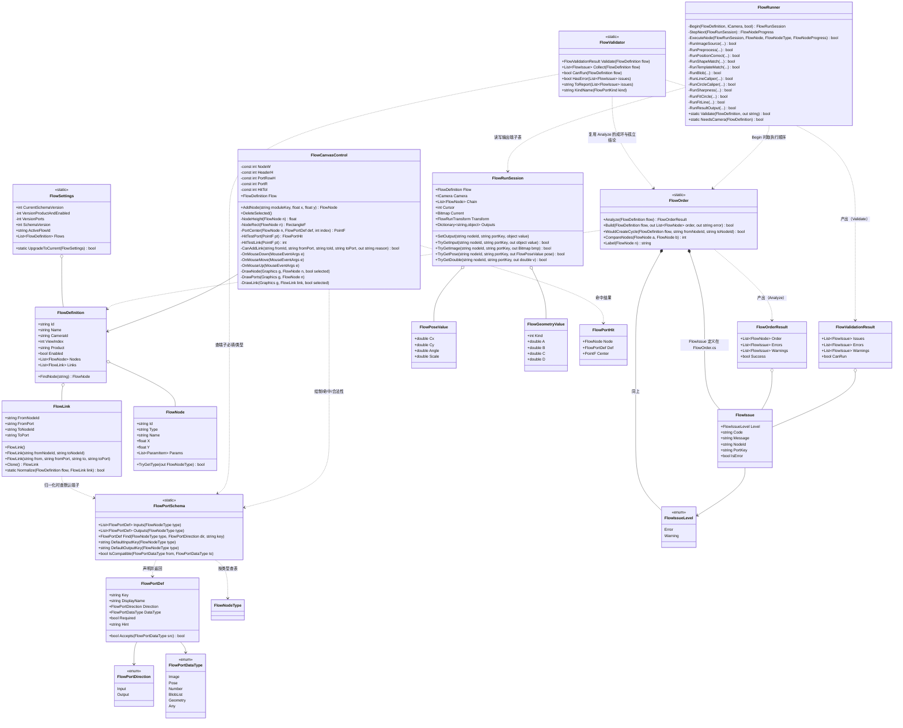
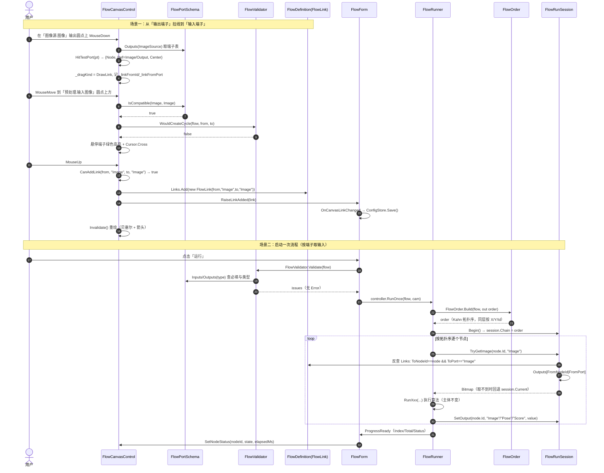
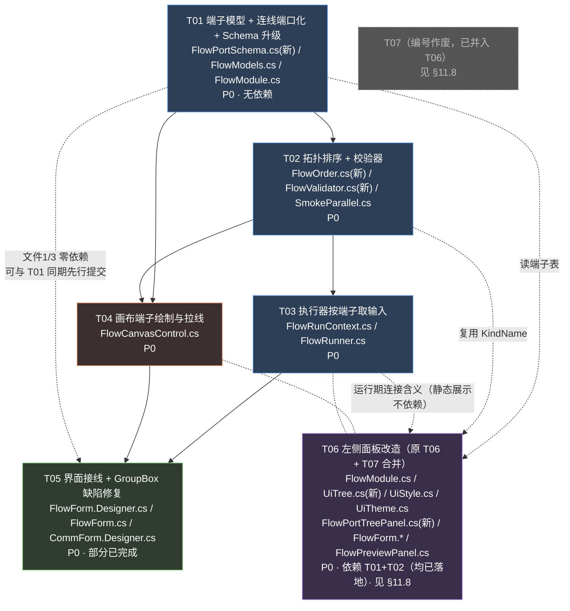

# 架构设计：流程图「端子（Terminal）级」连线改造

> 目标一句话：把现在的「整块对整块、一条单链」改成 **Cognex VisionPro / QuickBuild 式端子连线**——每个算法块左右两侧列出**具名输入 / 输出端子**，箭头从「某个输出端子」连到「某个输入端子」，端子名在块上直接可见。
>
> 硬约束：**零第三方依赖**（不引入任何 NuGet 包），C++ `VisionAlgo.Native` + C#/.NET Framework 4.8 WinForms + 自研 GDI+ 控件库。
> 用户明确说过「具体算法功能可以暂时不用很完善，主要是整体框架和显示」→ **算法不做深，框架与显示必须做对**。

---

## 0. 结论摘要与两个根因

### 0.1 用户反馈拆解

| 用户原话 | 根因 | 本次是否解决 |
|---|---|---|
| 「流程图界面不能新建流程」 | **GroupBox 子控件从未 Add 进容器**（见 0.2） | ✅ 解决 |
| 「流程图连接方式不对」 | `FlowLink` 只有 `FromNodeId/ToNodeId`，`CanAddLink` 强制单链 | ✅ 解决 |
| 「应保留每个算法的输入输出名称，用箭头对应输入输出连接」 | 节点只有一个匿名输入口 + 一个匿名输出口 | ✅ 解决（画布 §6/§11.5 + 端子面板 §11.3） |
| （追加）「界面格式要像参考图那样」 | 工具箱是平铺 `ListBox`；无端子面板；图像视图无状态条 | ✅ 见 **§11**（已合并的 **T06**；§11.8） |

### 0.2 【根因 1】流程页底部按钮根本没有被挂到界面上

`src\VisionPlatform\UI\FlowForm.Designer.cs` 里，`grpFlows`（流程管理）与 `grpBind`（绑定与运行）两个 GroupBox **被创建、被 Add 进 `panelBottom`，但它们的子控件一个都没 Add**：

```csharp
// FlowForm.Designer.cs 中全部 Controls.Add 清单（共 12 处）
panelLeft.Controls.Add(listModules);      panelLeft.Controls.Add(lblModules);
panelRight.Controls.Add(nodeParamPanel);  panelRight.Controls.Add(lblParams);
panelBottom.Controls.Add(grpBind);        panelBottom.Controls.Add(grpFlows);
splitMain.Panel1.Controls.Add(canvas);    splitMain.Panel2.Controls.Add(flowPreview);
Controls.Add(splitMain); Controls.Add(panelBottom); Controls.Add(panelRight); Controls.Add(panelLeft);

// ❌ 缺失：grpFlows.Controls.Add(lstFlows / btnNewFlow / btnRenameFlow / btnDeleteFlow)
// ❌ 缺失：grpBind.Controls.Add(lblCamera / cmbCamera / btnRefreshBinding / lblView /
//                               numViewIndex / btnValidate / btnRun / btnStep /
//                               btnRunLoop / btnStop / lblRunStatus)
```

后果：`lstFlows`、`btnNewFlow`、相机下拉、`btnRun`……**全部没有 Parent，永远不显示也不响应事件**。用户看到的是两个空 GroupBox，于是「新建流程 / 绑定相机 / 运行 / 校验」全都「找不到、点不了」。

> 顺带（同一脚本扫出来的同类问题，本次一并修）：`CommForm.Designer.cs` 的 `groupClient / groupModbus / groupServer` 也是同样情况。
> `AlgoForm` / `CameraForm` 的 `panelRight` 是**故意**空着、运行时 Add `ImageViewer`，不属于缺陷。

**修复要点（务必注意）**：补 `Controls.Add` 后，`UiStyle.ApplyTree` 才会递归进 GroupBox 并给 `lblCamera / lblView / lblRunStatus` 套上深色底；否则 `SmokeUi` 的 `ScanLight`（38 项冒烟之一）会因为这三个 Label 的 `BackColor == KnownColor.Control` 而报「残留浅色控件」。Designer 里给这三个 Label 显式加 `BackColor = Color.FromArgb(34,34,42)` 更稳妥。

### 0.3 【根因 2】连线模型是「单链」而不是「端子」

- `FlowLink` 只有 `FromNodeId` / `ToNodeId`。
- `FlowCanvasControl` 只有 `InputPort(n)` / `OutputPort(n)`（各一个匿名方块）。
- `CanAddLink` 强制「一个节点最多一条出边、一条入边」。
- `FlowRunner.TryBuildChain` 要求严格单链，多出/多入/孤立节点直接报错。

### 0.4 ⚠️ 勘误：本文件 §3–§8 写于 T01/T02 之前，命名一律以「已落地代码」为准

T01（端子模型 / 数据层）与 T02（拓扑排序 / 校验器）**已落地**，实现与本文件初稿的命名有出入。
**以 `src\VisionPlatform\Flow\` 里的真实代码为准**，读后续章节时按本表换算（**T04 画布 worker 尤其注意**）：

| 本文件初稿的写法 | 已落地的真实实现 |
|---|---|
| `FlowPortDataType` | **`FlowPortKind`**（成员相同：`Image/Pose/Number/BlobList/Geometry/Any`） |
| `FlowPortDirection { Input, Output }` | **`FlowPortDir { In, Out }`** |
| `FlowPortDef.Direction` 字段 | **不存在** —— 方向由「出现在 `InputsOf` 还是 `OutputsOf` 里」决定 |
| `FlowPortSchema.Inputs()` / `Outputs()` | 主名为 **`InputsOf()` / `OutputsOf()`**；另有兼容别名 `Inputs()` / `Outputs()` |
| `DefaultInputKey()` / `DefaultOutputKey()` | 主名为 **`PrimaryInput()` / `PrimaryOutput()`**；另有兼容别名 |
| `FlowPortSchema.Find(type, dir, key)` | 签名一致，`dir` 参数类型是 **`FlowPortDir`**；另有 `HasPort` / `CanConnect` / `PortsOf` |
| `FlowOrder.Build(...)` | 新增 **`FlowOrder.Analyze(flow) → FlowOrderResult { Order, Errors, Warnings, Success }`**（推荐用它） |
| `FlowValidator.Validate(flow) → List<FlowIssue>` | 返回 **`FlowValidationResult { Issues, Errors, Warnings, CanRun }`**；另有 `Collect / CanRun / HasError / ToReport` |
| `FlowIssue` 定义在 `FlowValidator.cs` | 实际定义在 **`FlowOrder.cs`**（`FlowIssueLevel` 与 `FlowIssue.IsError` 也在其中）；`FlowOrder.Label(node)` 可用于取节点显示名 |
| `FlowLink(from, fromPort, to, toPort)` | ✅ 签名一致（`FlowModels.cs:239`），两参构造 `FlowLink(fromNodeId, toNodeId)` **仍在**（`FlowModels.cs:231`） |
| 位置修正「输入位姿」= **必填** | 已落地为 **可选**（`Required=false`）。理由已写进源码注释：`RefSource=Auto` 时按历史语义自动取上游最近匹配位姿，标必填会让**所有现存含位置修正的流程**报 E003 —— 那是自造回归 |
| `FlowValidator` 是否提供类型中文名 | ✅ **有 `public static string KindName(FlowPortKind)`**（`FlowValidator.cs:301`）—— 画布/端子面板做「图像 / 位姿 / 数值」文案时**直接复用，勿重复实现** |

既有 API 保持可用：`FlowRunner.Validate(flow, out string error)`（`FlowRunner.cs:1372`）、`FlowRunner.NeedsCamera(flow)`（:1385）。
统计口径：`FlowPortSchema` 声明 **43 个端子**（12 类节点输入+输出合计），与 §4 清单表逐项一致。

---

# Part A：系统设计

## 1. 实现思路（Implementation Approach）

### 1.1 技术难点

| # | 难点 | 方案 |
|---|---|---|
| D1 | 端子要「具名 + 分类型」，12 类块各不相同 | 新增声明式端子表 `FlowPortSchema`（对齐既有 `NodeParamSchema` 的写法），**端子定义与绘制/执行/校验三方共用同一数据源** |
| D2 | 旧配置没有端子字段，反序列化得 `null` | 走「**归一化 Normalize**」而非「钳制 Clamp」：`null/空/非法 → 查默认端子`。幂等、只补不覆盖 |
| D3 | 执行顺序从「单链」变「图」 | 新增 `FlowOrder`：**Kahn 拓扑排序**，同层用 `(X, Y, Id)` 稳定排序，保证顺序确定且贴近画布视觉顺序 |
| D4 | 跨节点数据（位姿/Blob/几何）怎么传 | `FlowRunSession` 加一张 `Dictionary<string,object>` **输出端子值表**，key = `nodeId\|portKey`；下游按「输入端子 → 反向查连线 → 上游输出端子」取值 |
| D5 | 算法不能重写，但框架要对 | `RunXxx` 只改**入口（取输入）与出口（写输出）**，且**取不到端子值时回退旧行为**（`s.Current` / `s.HasPose`），保证 79 项冒烟不炸 |
| D6 | GDI+ 自绘：端子分行后节点高度动态 | `NodeHeight(node)` 按 `max(输入数, 输出数)` 计算；连线改**三次贝塞尔**；命中测试用**16 段采样折线** |

### 1.2 架构模式

沿用现有分层，**不引入新框架**：

```
FlowPortSchema（声明式端子定义，唯一数据源）
      ↑ 读取                    ↑ 读取                    ↑ 读取
FlowCanvasControl（绘制/交互）  FlowValidator（校验）     FlowRunner（执行）
      ↓ 写                       ↓ 读                     ↓ 读写
   FlowLink(FromPort/ToPort) ─────────────────────────────────→  FlowRunSession.Outputs
```

`FlowPortSchema` 是三方的**唯一真源**（Single Source of Truth），与 `FlowModule`（模块目录）、`NodeParamSchema`（参数表）并列，三者互不重复：模块目录管「有哪些块」，参数表管「块里填什么」，端子表管「块外连什么」。

---

## 2. 文件清单（File List）

| 文件 | 动作 | 说明 | 预估行数 |
|---|---|---|---|
| `src\VisionPlatform\Flow\FlowPortSchema.cs` | **新增** | 端子模型 + 12 类端子表 + 类型兼容判定 | ~280 |
| `src\VisionPlatform\Flow\FlowModels.cs` | 改 | `FlowLink` 加 `FromPort`/`ToPort`；`SchemaVersion` 3→4；`UpgradeToCurrent` 归一化 | +~110 |
| `src\VisionPlatform\Flow\FlowOrder.cs` | **新增** | 拓扑排序 + 成环检测 | ~160 |
| `src\VisionPlatform\Flow\FlowValidator.cs` | **新增** | 校验规则表 + 中文文案 | ~230 |
| `src\VisionPlatform\Flow\FlowRunContext.cs` | 改 | `FlowPoseValue` / `FlowGeometryValue` / `Outputs` 表 / `SetOutput` / `TryGetInput` | +~150 |
| `src\VisionPlatform\Flow\FlowRunner.cs` | 改 | `Begin` 换拓扑序；`RunXxx` 出入口改端子；删 `TryBuildChain` | 改 ~230 |
| `src\VisionPlatform\UI\FlowCanvasControl.cs` | 改 | 端子几何/绘制/命中/拉线/删除 | 改 ~420 |
| `src\VisionPlatform\UI\FlowForm.Designer.cs` | 改 | **补 GroupBox 子控件 Add** + Label 深色底 | +~30 |
| `src\VisionPlatform\UI\FlowForm.cs` | 改 | 「校验」按钮接 `FlowValidator`；状态栏提示 | +~50 |
| `src\VisionPlatform\UI\CommForm.Designer.cs` | 改 | 同根因 1 的修复（顺带） | +~25 |
| `src\SmokeParallel\Program.cs` | 改 | 端口化回归断言 | +~40 |
| ——— **以下为 §11 UI 对齐增量的文件** ——— | | | |
| `src\VisionPlatform\UI\UiTree.cs` | **新增**（§11.6） | WinForms `TreeView` 深色主题（`UiStyle` 目前无 TreeView 分支） | ~90 |
| `src\VisionPlatform\UI\FlowPortTreePanel.cs` | **新增**（§11.3） | 「输入/输出」端子面板（自绘 UserControl + TreeView） | ~260 |
| `src\VisionPlatform\Flow\FlowModule.cs` | 改（§11.2） | `FlowModuleInfo` 加 `Category`；新增 `FlowModuleCategory` / `GroupByCategory` / `CategoryOf` | +~90 |
| `src\VisionPlatform\UI\UiStyle.cs` | 改（§11.6） | `ApplyOne` 补 `TreeView` 分支；`IsSelfDrawn` 按需补类型名 | +~8 |
| `src\VisionPlatform\UI\UiTheme.cs` | 改（§11.5 A2） | 新增 `ColorPortBlobList` / `ColorPortGeometry` | +~6 |
| `src\VisionPlatform\UI\FlowPreviewPanel.cs` | 改（§11.4） | 图像视图状态条 `lblViewStatus`（Space/Zoom/Value） | +~60 |
| `src\VisionPlatform\UI\FlowForm.Designer.cs` | 改（§11.2 / §11.3） | `listModules` → `treeModules`（TreeView）；左侧改 `TabControl`（工具箱 / 输入输出） | 改 ~60 |
| `src\VisionPlatform\UI\FlowForm.cs` | 改（§11.2 / §11.3） | 删 ListBox 拖拽逻辑改 `ItemDrag`；接线端子面板刷新 | 改 ~70 |
| `docs\架构-流程端口化改造.md` | 本文 | — | — |

**不改**：`FlowNodeType`（12 项枚举保持不动）、`NodeParamSchema.cs`、`MainForm.cs`、`FlowRunController.cs`、`FlowRunManager.cs`、`FlowRunner.cs`（除 T03 既定改动外不再动）、Native 侧。

---

## 3. 数据结构与接口（Class Diagram）

> 📌 **本节已按已落地代码校正**（命名一律以代码为准，见 §0.4）：
> `FlowIssue` / `FlowIssueLevel` 实际定义在 **`FlowOrder.cs`**（不是 `FlowValidator.cs`），故在图中挂在 `FlowOrder` 之下；
> `FlowOrder` 实际 API 为 **`Analyze / Build / WouldCreateCycle / CompareNodes / Label`**；
> `FlowValidator.Validate` 返回 **`FlowValidationResult`**（不是裸 `List<FlowIssue>`）。



---

## 4. 端子清单表（12 类节点，完整）

> `Key` 是落盘的稳定标识（英文，一旦发布不得改名）；`显示名` 是画在块上的中文（可直接改）。
> **约定**：`Outputs` 的**第 1 项**是「主输出」，`Inputs` 中**第 1 个必填项**（无必填则第 1 项）是「主输入」。旧配置归一化时就取这两个——这样历史上「整块对整块」的语义被无损继承。

| 节点类型 | 方向 | Key | 显示名 | 数据类型 | 必填 |
|---|---|---|---|---|---|
| **图像源** ImageSource | OUT | `Image` | 图像 | Image | — |
| **预处理** Preprocess | IN | `Image` | 输入图像 | Image | ✅ |
| | OUT | `Image` | 输出图像 | Image | — |
| **位置修正** PositionCorrect | IN | `Image` | 输入图像 | Image | ✅ |
| | IN | `Pose` | 输入位姿 | Pose | ⬜ 可选 ※ |
| | OUT | `Image` | 输出图像 | Image | — |
| | OUT | `Pose` | 修正位姿 | Pose | — |
| **形状匹配** ShapeMatch | IN | `Image` | 输入图像 | Image | ✅ |
| | IN | `Pose` | 搜索基准 | Pose | ⬜ 可选 |
| | OUT | `Image` | 输出图像 | Image | — |
| | OUT | `Pose` | 匹配位姿 | Pose | — |
| | OUT | `Score` | 匹配分数 | Number | — |
| **模板匹配** TemplateMatch | IN | `Image` | 输入图像 | Image | ✅ |
| | IN | `Pose` | 搜索基准 | Pose | ⬜ 可选 |
| | OUT | `Image` | 输出图像 | Image | — |
| | OUT | `Pose` | 匹配位姿 | Pose | — |
| | OUT | `Score` | 匹配分数 | Number | — |
| **Blob 分析** Blob | IN | `Image` | 输入图像 | Image | ✅ |
| | OUT | `Image` | 输出图像 | Image | — |
| | OUT | `Blobs` | Blob 列表 | BlobList | — |
| | OUT | `Count` | Blob 数量 | Number | — |
| **直线卡尺** LineCaliper | IN | `Image` | 输入图像 | Image | ✅ |
| | IN | `Pose` | 定位位姿 | Pose | ⬜ 可选 |
| | OUT | `Image` | 输出图像 | Image | — |
| | OUT | `Geometry` | 直线几何 | Geometry | — |
| | OUT | `Value` | 直线度 RMS | Number | — |
| **圆卡尺** CircleCaliper | IN | `Image` | 输入图像 | Image | ✅ |
| | IN | `Pose` | 定位位姿 | Pose | ⬜ 可选 |
| | OUT | `Image` | 输出图像 | Image | — |
| | OUT | `Geometry` | 圆几何 | Geometry | — |
| | OUT | `Value` | 直径 | Number | — |
| **清晰度** Sharpness | IN | `Image` | 输入图像 | Image | ✅ |
| | OUT | `Image` | 输出图像 | Image | — |
| | OUT | `Value` | 清晰度评分 | Number | — |
| **圆拟合** FitCircle | IN | `Image` | 输入图像 | Image | ✅ |
| | IN | `Blobs` | Blob 列表 | BlobList | ⬜ 可选 |
| | OUT | `Image` | 输出图像 | Image | — |
| | OUT | `Geometry` | 拟合圆 | Geometry | — |
| **直线拟合** FitLine | IN | `Image` | 输入图像 | Image | ✅ |
| | IN | `Blobs` | Blob 列表 | BlobList | ⬜ 可选 |
| | OUT | `Image` | 输出图像 | Image | — |
| | OUT | `Geometry` | 拟合直线 | Geometry | — |
| **结果输出** ResultOutput | IN | `Any` | 任意输入 | Any | ✅ |

### 4.0 ⚠️ 本表的真源与一处修订

**本表的权威真源是 `FlowPortSchema.cs` 的静态构造块**（`Register(...)` 调用，约 115~240 行），本表是它的可读镜像。
已落地实现与本节初稿有**一处修订**，请以代码为准：

> ※ **位置修正的「输入位姿」由「必填」改为「可选」**（`P(... , FlowPortKind.Pose, required: false, ...)`）。
> 原因：`RefSource=Auto` 模式下位置修正会自动取上游最近匹配位姿作为基准，用户只连一条 `Image` 线即可跑通；
> 若标成必填，**所有现存含位置修正节点的流程都会报 E003「输入端子未连接」** —— 属于自造回归。
> 该决定由 team-lead 拍板，**优先级高于本表初稿**。

### 4.1 端子类型兼容矩阵

```
            to:  Image  Pose  Number BlobList Geometry  Any
from: Image       ✅     ✗      ✗      ✗        ✗       ✅
      Pose        ✗     ✅      ✗      ✗        ✗       ✅
      Number      ✗     ✗      ✅      ✗        ✗       ✅
      BlobList    ✗     ✗      ✗      ✅        ✗       ✅
      Geometry    ✗     ✗      ✗      ✗        ✅       ✅
      Any         ✅    ✅      ✅      ✅       ✅       ✅
```

规则实现：`IsCompatible(from, to) => from == to || from == Any || to == Any`。
`Any` 只出现在「结果输出」的输入端，因此它实际只做「接受一切」的通配。

### 4.2 代码骨架

```csharp
namespace VisionPlatform.Flow
{
    public enum FlowPortDirection { Input, Output }

    public enum FlowPortDataType { Image, Pose, Number, BlobList, Geometry, Any }

    public sealed class FlowPortDef
    {
        public string Key { get; private set; }
        public string DisplayName { get; private set; }
        public FlowPortDirection Direction { get; private set; }
        public FlowPortDataType DataType { get; private set; }
        public bool Required { get; private set; }
        public string Hint { get; private set; }

        public FlowPortDef(string key, string displayName, FlowPortDirection dir,
                           FlowPortDataType dataType, bool required, string hint = null) { ... }

        public bool Accepts(FlowPortDataType src)
        {
            return src == DataType || src == FlowPortDataType.Any || DataType == FlowPortDataType.Any;
        }
    }

    public static class FlowPortSchema
    {
        // 12 类 × (输入表, 输出表)，静态只读，进程内构建一次
        private static readonly Dictionary<FlowNodeType, List<FlowPortDef>> _inputs;
        private static readonly Dictionary<FlowNodeType, List<FlowPortDef>> _outputs;

        public static List<FlowPortDef> Inputs(FlowNodeType type);
        public static List<FlowPortDef> Outputs(FlowNodeType type);
        public static FlowPortDef Find(FlowNodeType type, FlowPortDirection dir, string key);
        public static string DefaultInputKey(FlowNodeType type);   // 第 1 个 Required，否则第 1 个，无则 ""
        public static string DefaultOutputKey(FlowNodeType type);  // 第 1 个输出，无则 ""
        public static bool IsCompatible(FlowPortDataType from, FlowPortDataType to);
    }
}
```

---

## 5. 数据模型改动（向后兼容）

### 5.1 `FlowLink` 扩字段

```csharp
[DataContract]
public sealed class FlowLink
{
    [DataMember] public string FromNodeId { get; set; }
    [DataMember] public string ToNodeId   { get; set; }

    /// <summary>源<strong>输出端子</strong> Key。旧配置缺失时为 null（不是 ""），由 Normalize 归一。</summary>
    [DataMember] public string FromPort { get; set; }

    /// <summary>目标<strong>输入端子</strong> Key。同上。</summary>
    [DataMember] public string ToPort { get; set; }

    public FlowLink() { FromNodeId = ""; ToNodeId = ""; FromPort = ""; ToPort = ""; }

    // ⚠️ 保留旧的两参构造：SmokeParallel / 现有调用点不用改
    public FlowLink(string fromNodeId, string toNodeId) : this() { ... }

    public FlowLink(string from, string fromPort, string to, string toPort) : this() { ... }

    public FlowLink Clone() => new FlowLink(FromNodeId, FromPort, ToNodeId, ToPort);

    /// <summary>
    /// 归一化一条连线：FromPort / ToPort 为 null、空串、或在该类型端子表中查不到时，
    /// 补成「默认端子」。幂等：已是合法值时返回 false（不改）。
    /// </summary>
    public static bool Normalize(FlowDefinition flow, FlowLink link) { ... }
}
```

### 5.2 ⚠️ 序列化陷阱与「归一化」原则（务必遵守）

`DataContractJsonSerializer` 对 JSON 中**缺失**的字段：
- `string` → **`null`**（不是 `""`）
- `bool` → `false`
- `int` → `0`

因此：

1. **绝不能用「钳制」写法**（例：`if (link.FromPort != _lastValue) link.FromPort = _lastValue;`），也**不能**在 getter 里做 `?? ""` 之外还带副作用的逻辑。
2. **必须用「缺失即补」的归一化**：判断条件是 `string.IsNullOrEmpty(link.FromPort) || FlowPortSchema.Find(...) == null`，覆盖 `null`、空串、非法值三种情况。
3. 归一化**只补不覆盖**：合法值原样保留 → 幂等 → 反复 `UpgradeToCurrent` 不会把配置改坏（我们已在 `MaxParallelFlows` 上栽过一次）。
4. `bool` 新字段同理：本次**不加新的 bool 字段**（端子必填性是端子表里的静态属性，不是流程数据），避免重蹈覆辙。

### 5.3 Schema 版本 3 → 4

```csharp
public const int CurrentSchemaVersion = 4;

private const int VersionProductAndEnabled = 3;
private const int VersionPorts = 4;          // 连线端子化

public static bool UpgradeToCurrent(FlowSettings fs)
{
    int oldVersion = fs.SchemaVersion;
    bool changed = fs.SchemaVersion != CurrentSchemaVersion;
    fs.SchemaVersion = CurrentSchemaVersion;

    if (fs.Flows == null) { fs.Flows = new List<FlowDefinition>(); changed = true; }

    foreach (FlowDefinition flow in fs.Flows)
    {
        // ---- 既有：Schema 2 → 3（Product / Enabled），保持不变 ----
        if (oldVersion < VersionProductAndEnabled) { ... }

        // ---- 新增：Schema 3 → 4（连线端子）----
        // ⚠️ 这里【不】用 oldVersion < VersionPorts 做门禁：
        //    手工编辑过的 v4 配置也可能缺字段，必须无条件兜底补一遍（幂等，代价极低）。
        if (flow.Links != null)
        {
            foreach (FlowLink l in flow.Links)
                if (l != null && FlowLink.Normalize(flow, l)) changed = true;
        }

        // ---- 既有：节点缺失参数键补默认值，保持不变 ----
        ...
    }
    return changed;
}
```

> 关键点：端子归一化**不受 `oldVersion` 门禁限制**，因为 `null` 值在 v3→v4 与「v4 手工残缺」两种场景下长得一模一样，用版本号门禁反而会漏掉后者。

### 5.4 归一化算法

```
Normalize(flow, link):
    from = flow.FindNode(link.FromNodeId);  to = flow.FindNode(link.ToNodeId)
    if from == null or to == null: return false          # 悬空连线，交给 Validator 报错
    if not from.TryGetType(out ft) or not to.TryGetType(out tt): return false   # 未知类型，跳过

    changed = false
    if Find(ft, Output, link.FromPort) == null:
        link.FromPort = DefaultOutputKey(ft)             # 主输出；无输出端子时为 ""
        changed = true
    if Find(tt, Input, link.ToPort) == null:
        link.ToPort = DefaultInputKey(tt)                # 主输入（第 1 个必填）；无输入端子时为 ""
        changed = true
    return changed
```

**对既有冒烟数据的推演**（`SmokeParallel` 第 406~447 行的 `OldV2ConfigJson`）：

| 旧连线 | 归一化结果 | 校验 |
|---|---|---|
| `n1(ImageSource) → n2(ResultOutput)` | `n1.Image → n2.Any` | ✅ Image→Any 通配 |
| `m1(ImageSource) → m2(Preprocess)` | `m1.Image → m2.Image` | ✅ |
| `m2(Preprocess) → m3(ResultOutput)` | `m2.Image → m3.Any` | ✅ |

→ **79 项冒烟中涉及旧配置的用例不会因此失败**。

### 5.5 `FlowNode` / `FlowDefinition` 要不要动

- **`FlowNode` 不动**：位置/参数都在，端子是「类型推导」出来的，不需要落盘。
- **`FlowDefinition` 只加只读辅助方法**（不新增 `[DataMember]`，避免破坏序列化）：
  ```csharp
  public List<FlowLink> FindLinksTo(string nodeId, string portKey = null);
  public List<FlowLink> FindLinksFrom(string nodeId, string portKey = null);
  public bool HasLinkTo(string nodeId, string portKey);
  ```

---

## 6. 画布交互与绘制（FlowCanvasControl）

### 6.1 几何常量（屏幕像素，画布无缩放）

| 常量 | 值 | 说明 |
|---|---|---|
| `NodeW` | **168** | 节点宽（从 140 加宽，容纳中文端子名如「输入图像」4 字 ≈ 32px + 圆点 + 边距） |
| `HeaderH` | **26** | 标题行高（节点名 + 类型） |
| `PortRowH` | **18** | 端子行高 / 行间距 |
| `PortR` | **5** | 端子圆点半径（直径 10） |
| `HitTol` | **7** | 端子命中容差（= PortR + 2） |
| `ArrowSize` | **9** | 箭头长度（沿用） |
| `PadBottom` | **6** | 底部内边距 |

节点高度**动态计算**：

```csharp
private static float NodeHeight(FlowNode n)
{
    FlowNodeType t;
    if (n == null || !n.TryGetType(out t)) return HeaderH + PortRowH + PadBottom;
    int rows = Math.Max(FlowPortSchema.Inputs(t).Count, FlowPortSchema.Outputs(t).Count);
    return HeaderH + Math.Max(1, rows) * PortRowH + PadBottom;
}
// 12 类中 max(in,out) = 3（匹配类 / Blob / 卡尺）→ 最高节点 = 26 + 3*18 + 6 = 86px
private static RectangleF NodeRect(FlowNode n) =>
    new RectangleF(n.X, n.Y, NodeW, NodeHeight(n));
```

### 6.2 端子布局

输入端子在**左**、输出端子在**右**，**各自从 `HeaderH` 起独立分行**（VisionPro 风格，互不占行）：

```csharp
private static PointF PortCenter(FlowNode n, FlowPortDef def, int index)
{
    float y = n.Y + HeaderH + index * PortRowH + PortRowH * 0.5f;
    return def.Direction == FlowPortDirection.Input
        ? new PointF(n.X, y)                 // 左边界
        : new PointF(n.X + NodeW, y);        // 右边界
}
```

端子名文字：
- 输入：`StringAlignment.Near`，`x = n.X + PortR + 5`，8pt
- 输出：`StringAlignment.Far`，`x = n.X + NodeW - PortR - 5`，8pt

端子圆点样式：
| 状态 | 画法 |
|---|---|
| 普通（未连接） | 深色填充 + 浅灰描边（空心感） |
| 已连接 | 实心填充（强调色 `#C878BEFF` → 沿用现有连线色） |
| **必填输入未连接** | 红色描边 `UiTheme.ColorNg` |
| 悬停且**合法** | 绿色描边 `UiTheme.ColorOk` + 半径放大到 `PortR + 2` |
| 悬停但**非法** | 红色描边 + 半径放大 |

> 全部靠**形状/颜色/文字**区分，不引入图标资源（符合既有「纯文本不靠图标」的约束）。

### 6.3 连线绘制：三次贝塞尔

端子分行后，出/入端子的 y 高度不同，直线段容易互相压叠、看不出「从哪个端子到哪个端子」。改用**三次贝塞尔**（VisionPro / Blueprint 都是这么画的）：

```csharp
private static void Bezier(PointF a, PointF b, out PointF c1, out PointF c2)
{
    float dx = Math.Abs(b.X - a.X);
    float off = Math.Max(40f, dx * 0.5f);          // 水平外扩，反向连线时也拉得开
    c1 = new PointF(a.X + off, a.Y);
    c2 = new PointF(b.X - off, b.Y);
}
```

- 线宽：普通 2px，选中 2.6px（沿用）。
- 颜色：普通 `Color.FromArgb(200,120,190,255)`，选中 `Orange`（沿用）。
- 箭头：`FillPolygon` 画在**目标输入端子圆心**上，方向取贝塞尔终点切线（`b - c2` 归一化），而不是 `b - a`——否则箭头角度会歪。
- 拖拽预览线：虚线 `DashStyle.Dash`，合法目标=青色 `DeepSkyBlue`，非法目标=红色。

### 6.4 命中测试

```csharp
private FlowPortHit HitTestPort(PointF pt)
{
    // 先扫输出端子再扫输入端子（输出优先，拉线手感更顺）
    // 命中判定：Dist(pt, center) <= HitTol
    // 返回 FlowPortHit { Node, Def, Center } 或 null
}

private int HitTestLink(PointF pt)
{
    // 贝塞尔无法直接求点线距离 → 采样 16 段折线，逐段用既有 DistanceToSegment
    // 最小距离 <= HitTol 即命中；从后往前扫（后画的在上层）
}
```

> `DistanceToSegment` / `Dist` 两个既有私有静态方法**原样复用**，只替换调用点。

### 6.5 拉线交互

```
MouseDown(左键):
    hit = HitTestPort(pt)
    if hit != null && hit.Def.Direction == Output:
        _dragKind = DrawLink; _linkFromId/FromPort = ...; _linkPreviewEnd = pt; Invalidate()
    else if hit != null && hit.Def.Direction == Input && 该输入端子未连接:
        _dragKind = DrawLink; 反向拉（_reverseLink = true），目标锁定为「输出端子」
    else if HitTestNode(pt):      选中 + MoveNode（沿用）
    else if HitTestLink(pt) >= 0: 选中连线（改用贝塞尔采样命中）
    else: 清空选择

MouseMove:
    if DrawLink:
        _linkPreviewEnd = pt
        hover = HitTestPort(pt)
        _hoverValid = (hover != null && CanAddLink(...))   // 决定预览线颜色 + Cursor
        Cursor = hover == null ? Cursors.Default
               : (_hoverValid ? Cursors.Cross : Cursors.No)
        Invalidate()

MouseUp:
    if DrawLink:
        hover = HitTestPort(pt)
        if hover 是合法的目标端子:  落库 FlowLink(FromPort/ToPort) → RaiseLinkAdded → RaiseChanged
        else if hover != null:      仅在状态栏显示一行原因（SetStatus），**不弹 MessageBox**
                                    ——拖拽过程中弹窗会打断手感，也会吞掉 MouseUp
        重置拖拽态；Invalidate()
```

> **反向拉线（从输入端子起手）是 P1 增强**，若时间紧可只做「从输出端子起手」——但正向必须做对。
> 反向拉线要求：起手的输入端子**未连接**；松开时落在**输出端子**上；校验逻辑与正向完全对称（`CanAddLink` 内部交换参数）。

### 6.6 `CanAddLink` 新规则（替换旧的「单链」约束）

```csharp
private bool CanAddLink(string fromId, string fromPort, string toId, string toPort, out string reason)
```

| # | 规则 | 级别 | 中文提示（`reason` / 状态栏） |
|---|---|---|---|
| R1 | 禁止自连（`fromId == toId`） | 拒绝 | 「不能把节点连到它自己。」 |
| R2 | 完全相同的 `from+fromPort → to+toPort` 已存在 | 拒绝 | 「这两个端子之间已经有连线了。」 |
| R3 | **一个输入端子只能接一条连线** | 拒绝 | 「输入端子「{端口名}」已连接。一个输入端子只能接一条连线，请先删除原连线。」 |
| R4 | **一个输出端子允许扇出到多个输入** | **允许** | 校验阶段给 W002 警告（见 §8） |
| R5 | 端子类型不兼容 | 拒绝 | 「端子类型不匹配：「{A端口名}」（{A类型}）不能连到「{B端口名}」（{B类型}）。」 |
| R6 | 会成环（加边前 DFS） | 拒绝 | 「这条连线会形成环路（{A} → {B} → {A}）。」 |
| R7 | 源节点类型无输出端子 / 目标无输入端子 | 拒绝 | 「「{节点名}」没有可用的{输入/输出}端子。」 |

**成环检测（加边前）**：从 `toId` 出发沿现有出边 DFS，若能到达 `fromId` → 拒绝。节点规模 < 100，直接递归即可，无需并查集。

```csharp
public static bool WouldCreateCycle(FlowDefinition flow, string fromNodeId, string toNodeId)
{
    if (fromNodeId == toNodeId) return true;
    var stack = new Stack<string>(); var seen = new HashSet<string>();
    stack.Push(toNodeId);
    while (stack.Count > 0)
    {
        string cur = stack.Pop();
        if (cur == fromNodeId) return true;
        if (!seen.Add(cur)) continue;
        foreach (FlowLink l in flow.Links)
            if (l != null && l.FromNodeId == cur) stack.Push(l.ToNodeId);
    }
    return false;
}
```

### 6.7 连线删除

- 保留现有三条路径：① 点中连线 → `Delete` 键；② 选中节点后 `Delete` → 级联删除其所有连线（逻辑改为匹配 `FromNodeId`/`ToNodeId` 即可，与端子无关）；③ 右键菜单（可选，本次不做）。
- `DeleteSelected()` 里判断「节点相关连线」的条件**不变**（仍按 NodeId 比），端子字段不影响。

---

## 7. 执行器改动（最小改动路径）

### 7.1 执行顺序：拓扑排序（替换 `TryBuildChain`）

新增 `Flow\FlowOrder.cs`：

```csharp
public static bool Build(FlowDefinition flow, out List<FlowNode> order, out string error)
{
    // 1) 建图：入度 = 「指向该节点的连线中，去重后的上游节点数」
    //    （同一上游节点的多个输出端子连到本节点的不同输入端子，只算 1 条入度）
    // 2) Kahn：每轮从 ready 集合中取 (X 升序, Y 升序, Id 升序) 的第一个 → 保证确定性
    // 3) 剩余节点数 > 0 → 成环，error = "流程存在环：A → B → A"
    // 4) 孤立节点（无任何连线）：不报错，按 (X,Y,Id) 排在末尾（见下方说明）
}
```

**同层稳定排序的意义**：把「画布上从左到右」作为执行顺序的直觉依据，也让旧的单链配置（节点 X 递增）排序结果与原来完全一致 → 冒烟行为不变。

**孤立节点策略变更**：旧行为是「报错、不让跑」；新行为是 **Warning + 仍执行**。

> 🔴 **明确口径（避免被读成「参与排序但位置随意」）：**
> **孤立节点仍然参与执行，只是按 `(X, Y, Id)` 排在执行序列的最后。**
> 对应提示为 `W001`：「节点「{节点名}」没有任何连线，运行时会排到最后执行。」（见 §8.1 与 §8.1.1）

理由：端口化后「拖进来还没连」是合法编辑中间态，动不动就拒绝运行很烦人。但 `ImageSource` 除外——它没有输入端子，天然是起点。

### 7.2 跨节点数据：输出端子值表

`FlowRunContext.cs` 新增：

```csharp
/// <summary>位姿端子值（工作帧坐标；角度单位度，Scale 1.0 = 无缩放）。</summary>
public sealed class FlowPoseValue
{
    public double Cx, Cy, Angle, Scale;
}

/// <summary>几何端子值：Kind=1 直线(A=X1,B=Y1,C=X2,D=Y2)；Kind=2 圆(A=Cx,B=Cy,C=R,D=0)。</summary>
public sealed class FlowGeometryValue
{
    public int Kind; public double A, B, C, D;
}

public sealed class FlowRunSession
{
    // key = nodeId + "|" + portKey
    public Dictionary<string, object> Outputs { get; private set; }

    public void SetOutput(string nodeId, string portKey, object value)
    {
        if (string.IsNullOrEmpty(nodeId) || string.IsNullOrEmpty(portKey)) return;
        if (value == null) { Outputs.Remove(nodeId + "|" + portKey); return; }
        Outputs[nodeId + "|" + portKey] = value;
    }

    /// <summary>按「输入端子 → 反查连线 → 上游输出端子」取值。</summary>
    public bool TryGetInput(string nodeId, string portKey, out object value)
    {
        value = null;
        if (Flow == null || Flow.Links == null) return false;
        foreach (FlowLink l in Flow.Links)
        {
            if (l == null || l.ToNodeId != nodeId || l.ToPort != portKey) continue;
            return Outputs.TryGetValue(l.FromNodeId + "|" + l.FromPort, out value);
        }
        return false;
    }

    // 强类型便捷封装（内部做 as / 转型，失败返回 false）
    public bool TryGetImage(string nodeId, string portKey, out Bitmap bmp);
    public bool TryGetPose(string nodeId, string portKey, out FlowPoseValue pose);
    public bool TryGetDouble(string nodeId, string portKey, out double v);
    public bool TryGetBlobs(string nodeId, string portKey, out List<Rectangle> blobs);
    public bool TryGetGeometry(string nodeId, string portKey, out FlowGeometryValue geo);
}
```

### 7.3 `RunXxx` 的改造边界（**这条最重要**）

**只改入口与出口，不改算法主体。** 且**一律「先按端子取，取不到回退旧行为」**——这是保证 79 项冒烟不炸的关键。

| 节点 | 入口改造 | 出口改造 |
|---|---|---|
| ImageSource | 无输入 | `s.SetOutput(node.Id, "Image", s.Current)` |
| Preprocess | `TryGetImage(node,"Image", out bmp)`，失败回退 `s.Current` | `SetOutput(node.Id,"Image", s.Current)` |
| PositionCorrect | 图像同上；位姿：`TryGetPose(node,"Pose",...)`，失败回退 `s.HasPose/PoseCx/Cy/Angle/Scale` | `SetOutput("Image",...)`；`SetOutput("Pose", new FlowPoseValue(dX,dY,dAngle,dScale))` |
| ShapeMatch / TemplateMatch | 图像同上；`Pose` 可选，取不到就当「无搜索基准」（= 旧行为） | `SetOutput("Image"/"Pose"/"Score")`，**同时**继续 `s.SetPose(...)`（旧路径保留，ROI 换算依赖它） |
| Blob | 图像同上 | `SetOutput("Image"/"Blobs"/"Count")` |
| LineCaliper / CircleCaliper | 图像同上；`Pose` 可选 | `SetOutput("Image"/"Geometry"/"Value")` |
| Sharpness | 图像同上 | `SetOutput("Image"/"Value")` |
| FitCircle / FitLine | 图像同上；`Blobs` 可选 | `SetOutput("Image"/"Geometry")` |
| ResultOutput | `Any` 端子：连了就读（读了也不参与计算，仅用于表达依赖顺序） | 无输出 |

**`FlowRunTransform` 保留不动**：现有 `ApplyRoi` / `ApplyToRect` 全靠它。位姿端子值是它的「端子化镜像」——两者并存一段时间，等后续版本再统一。

### 7.4 `FlowRunner` 具体改动点

```csharp
// Begin(): 换数据源
-  if (!TryBuildChain(flow, out chain, out chainError))
+  if (!FlowOrder.Build(flow, out chain, out chainError))

// Validate(): 委托给 FlowValidator 的 Error 级
   public static bool Validate(FlowDefinition flow, out string error)
   {
       var result = FlowValidator.Validate(flow);      // ⚠️ 返回 FlowValidationResult，不是 List<FlowIssue>
       // 只把 result.Errors 拼成一行给旧调用方（FlowForm.PrepareRun / OnValidate 用的是这个签名）
   }

// 删除 TryBuildChain（约 65 行），其职责拆到 FlowOrder + FlowValidator
```

> `Validate` 的**对外签名不变**（`static bool Validate(FlowDefinition, out string)`），`FlowForm` 的 `PrepareRun` / `OnValidate` 不用改调用方式。
> ⚠️ **调 `FlowValidator.Validate` 时取 `.Errors`**（返回类型是 `FlowValidationResult`，见 §3 类图与 §0.4）。

**落地进度（T03 进行中，按代码实际状态标注）**

| 项 | 状态 |
|---|---|
| `Begin()` 改走 `FlowOrder.Build` | ✅ **已落地**（`FlowRunner.cs` 的 `Begin` 段） |
| `Validate()` 委托给 `FlowValidator` 的 Error 级 | ⬜ **待做** —— 当前仍走 `TryBuildChain`（`FlowRunner.cs` 的 `Validate` 段） |
| 删除 `TryBuildChain`（约 65 行） | ⬜ **待做** —— 须等上面一项完成，且删除前确认冒烟里没有对「单链」文案的断言 |

### 7.5 改造边界（明确划线）

✅ **做**：端子取输入 / 写输出的框架、拓扑排序、输出值表、按端子校验。
❌ **不做**：算法精度/性能、多分支并行执行、分支间的帧隔离（见 §9 风险 R-2）、几何/Blob 数据的强类型深化（本轮 `BlobList` 先传 `List<Rectangle>`，`Geometry` 用 `FlowGeometryValue` 表达，够用即可）。

---

## 8. 校验与提示

### 8.1 规则表（中文文案）

| 代码 | 级别 | 触发条件 | 文案 |
|---|---|---|---|
| `E001` | Error | 节点数为 0 | 「流程没有任何节点，请先从左侧工具箱拖入算法块。」 |
| `E002` | Error | 无 `ImageSource` 节点 | 「流程缺少「图像源」节点，没有图像输入无法运行。」 |
| `E003` | Error | 必填输入端子未连接 | 「节点「{节点名}」的输入端子「{端口名}」未连接。」 |
| `E004` | Error | 端子类型不兼容 | 「端子类型不匹配：「{A节点}.{A端口}」（{A类型}）不能连到「{B节点}.{B端口}」（{B类型}）。」 |
| `E005` | Error | 成环 | 「流程存在环：{A} → {B} → {A}。」 |
| `E006` | Error | 一个输入端子接了多条连线 | 「输入端子「{节点名}.{端口名}」连接了多条连线，一个输入端子只能接一条。」 |
| `E007` | Error | 连线端子归一化后为空（源无输出 / 目标无输入） | 「连线无效：「{A节点}」没有可用的输出端子（或「{B节点}」没有输入端子）。」 |
| `E008` | Error | 连线指向不存在的节点 | 「连线指向了不存在的节点，请删除该连线。」 |
| `W001` | Warning | 孤立节点（无任何连线） | 「节点「{节点名}」没有任何连线，运行时会排到最后执行。」 |
| `W002` | Warning | 一个 `Image` 输出扇出 ≥ 2 | 「「{A节点}.{A端口}」同时连接了 {n} 个下游。本期执行器按拓扑顺序串行执行并共用同一帧，建议先只用单路。」 |
| `W003` | Warning | 结果输出未接上游 | 「「结果输出」节点未接入任何上游，不会汇总到有效结论。」 |
| `W004` | Warning(日志) | 端子被归一化补全 | 「连线端子缺失，已按默认端子补全（旧配置升级）。」→ 只写 `Logger.Warn`，不进报告 |

#### 8.1.1 本表两处注记（避免被后人当成漏判或笔误）

**① `W001` 文案已修订 —— 与行为对齐**

旧文案写「运行时会被跳过」，与实际行为**相反**。实现是（`FlowOrder.cs` → `FlowOrder.Analyze` 的「孤立节点处理」段）：孤立节点进 `isolated` 列表 → `result.Warnings.Add(W001)` → **`result.Order.Add(n)`**，即 **Warning + 照常排入执行序列的末尾跑一遍**。

统一口径（代码侧 engineer-2 与本表已同步）：

> **孤立节点仍然参与执行，只是按 `(X, Y, Id)` 排在执行序列的最后。**
> 提示文案：`节点「{节点名}」没有任何连线，运行时会排到最后执行。`

**② `E003` 对「结果输出」的 `Any` 端子豁免 —— 不是漏判**

`FlowValidator.cs` → `FlowValidator.Validate` 的「E003 必填输入未连接」段里有一行 `if (type == FlowNodeType.ResultOutput) continue;`：**「结果输出」节点的必填 `Any` 端子未连接时不报 `E003`，改由 `W003` 报警告**。

理由：`Any` 端子对 `ResultOutput` 而言只是「依赖表达」，不承载真实数据需求；若照常报 `E003`，用户在编辑中间态（刚拖进来还没连上游）会被硬拦，与 `W001` 放宽孤立节点的精神不一致。**其它节点类型的必填输入未连接仍然照常报 `E003`。**

### 8.2 三层校验的职责划分

| 层 | 时机 | 做什么 | 表现形式 |
|---|---|---|---|
| **画布实时** | `MouseMove` / `MouseUp` | 只判 **R1~R7（能不能落这一条线）** | 端子红/绿高亮 + 预览线颜色 + `Cursor.No` + **状态栏一行**（不弹窗） |
| **「校验」按钮** | `FlowForm.OnValidate` | 跑完整 `FlowValidator.Validate`，列出**全部** Error + Warning | `MessageBox` 多行报告（沿用现有形态，扩展文本） |
| **启动流程** | `FlowForm.PrepareRun` | 只判 **Error 级**（`HasError`） | 有 Error → 拒绝运行 + `MessageBox`；无 Error 但有 Warning → 正常跑（Warning 写状态栏） |

> 画布层**绝不弹 `MessageBox`**——拖拽中途弹窗会吞掉 `MouseUp`，导致拖拽状态卡死。这是本方案里一条硬性交互纪律。

---

## 9. 程序调用流程（Sequence Diagram）



---

## 10. Anything UNCLEAR（待澄清与假设）

| # | 事项 | 本方案假设（如与预期不符请指出） |
|---|---|---|
| A1 | 反向拉线（从输入端子起手）是否必须 | 假设 **P1 增强**，正向（输出→输入）必须做对。若排期允许再补反向 |
| A2 | 「一个输入端子只能接一条」是否过严 | 假设**是**（拒绝新连线而非静默替换）。VisionPro 也是单输入语义；静默删用户数据风险更高 |
| A3 | 孤立节点：报错还是警告 | 假设 **Warning + 仍执行**（旧行为是报错）。端口化后「拖进来还没连」是合法中间态 |
| A4 | `BlobList` / `Geometry` 的承载类型 | 假设先用 `List<Rectangle>` / `FlowGeometryValue`（Kind + 4 个 double），**不**新建完整几何类型体系 |
| A5 | 「结果输出」的 `Any` 输入端子是否需要多个 | 假设只要 1 个（表达「依赖上游」即可）。若需要汇总多路，后续再加 `Any2/Any3` |
| ~~A6~~ | ~~位置修正的 `Pose` 输入是否必填~~ | ❌ **本条已作废** —— T01 已落地为 **可选**（`Required=false`），且 team-lead 已拍板。理由见 **§4.0**：`RefSource=Auto` 时按历史语义自动取上游最近匹配位姿，标必填会让所有现存含位置修正的流程报 E003 = 自造回归。**以代码为准** |
| A7 | 画布是否需要缩放 / 平移 / 自动布局 | 假设**本次都不做**（节点变高后画布可能更挤，如需可后续加滚动） |
| A8 | 旧配置里「一个节点多条出边」的非法数据 | 旧 `CanAddLink` 已禁止，理论上不存在；若存在，Validator 报 W002 且拓扑排序照常处理 |

### 10.1 本轮新增待拍板（参考图实测后产生，需 team-lead / 用户答复）

| # | 事项 | 本方案默认（未答复即按此执行，不停工） | 需谁拍板 |
|---|---|---|---|
| ~~**D1**~~ | ~~参考图是**浅色**，我们 `UiTheme` 是**深色**，要不要改成浅色？~~ | ✅ **已决定：本轮保持深色、不动**（复核后从「待拍板」降级为「已决定」）。五条理由见 §11.1.1，**决定性的第 5 条：用户从未提过配色**，其「界面格式」指的是结构与端子命名，不是主题。仅在用户**主动**要求浅色时才重启；届时架构上可行（`UiTheme` 已是颜色唯一来源），但必须**单开一个任务**，且 `ImageViewer` 图像区仍保持深色 | 无需（已决定） |
| **D2** | 端子面板要不要做 VisionPro 式的「**勾选 = 暴露为输出端子**」？ | **本轮不做，列 P2。** 我们没有子流程 / ToolBlock 嵌套，勾了没有消费方；且会引入新的序列化字段。实施口径已备好（`FlowNode.ExposedOutputs` + 归一化，只改 2 个文件），见 §11.3 末节 | **team-lead** |
| **D3** | `Filmstrip`（实测确认存在）要不要进本轮？ | **不做（YAGNI）。** 用户没点名要；是独立子系统（帧池 + 缩略图 + 帧所有权冲突）；`FlowPreviewPanel` 顶条与 `LogPanel` 已覆盖大半诉求。详见 §11.8.4 | **team-lead** |
| **D4** | 左侧 `panelLeft` 宽度 160 → 200，是否可接受？ | **按 200 执行。** 依据实测左列 0..279 ≈ 14.5%（1280 × 14.5% ≈ 186 → 取 200，4 px 栅格对齐）；`TreeView` 缩进 16 + 折叠三角需要余量 | 无需（知会） |
| **D5** | 工具箱分类名要不要改用 VisionPro 的英文原名（`Acquisition` / `Image Processing` / …）？ | **保持中文。** 我们是中文界面；英文名只在代码注释里做对照。实测只支撑「存在这些分类名」，**不支撑**「我们的模块该怎么归类」（§11.2 标注） | 无需（知会） |

---

## 11. UI 布局对齐参考图（Cognex VisionPro QuickBuild）

> 参考图：`C:\Users\admin\Desktop\VisionSystem\流程图参考图.png`
>
> 🔴 **参考图细节一律以 `docs/参考图-VisionPro界面实测.md` 为准。**
> 那一份由 Windows 内置 OCR（WinRT，`zh-Hans-CN`）实测 + Python/Pillow 像素统计得出，**每一项都标注了来源（像素测量 / OCR 文本 / 推断）**。
>
> **本节此前写的「逐条核对图中原文与坐标」不成立** —— 当时的读图尝试返回的是「当前模型不支持图片」，那批描述属于臆测，现已在 §11.0 逐条更正。
>
> **本轮从参考图只吸收三样东西：结构（分区与层次）、命名（端子名与分类名）、信息组织（图像区下沿状态条）。不吸收配色**——理由见 §11.1.1。

### 11.0 历史臆测更正表（与实测冲突处，以实测为准）

| # | 此前写法（作废） | 实测事实（采用） | 性质 |
|---|---|---|---|
| 1 | 底部胶片条叫 **`Filmscript`** | 实测是 **`Filmstrip`**（`ocr_ref.txt:67`） | 误读 |
| 2 | 图像视图状态条 `Zoom: 131.23%` | 实测状态栏是 **`Zoom: 175%`**（`ocr_ref.txt:72`） | 误读 |
| 3 | 工具实例 `PMAAlignTool1` | 实测 **`PMAlignTool1`**（`ocr_ref.txt:16`） | 误读 |
| 4 | 工具列表里有 `PMLineTool` / `PinTool` / `ToolBlock` | 实测出现的是 **`PMRedLineTool`**（`:43`）、**`JobTool` / `JobTool1`**（`:39` / `:55`）、`LineMaxTool1`（`:51`） | 误读 |
| 5 | 状态条 `Space: (505.571, 132)` / `Value: 40` / `#` 准星 | **OCR 里根本没有这三个词**，只有 `Zoom: 175%` 被证实 | 臆测 → 降级为「未证实」 |
| 6 | 最底部状态条 `3.945ms  12.362ms` | OCR 读作 `94g5ms 123b2m5`，实测文档判为**推断**（疑似 `94.5ms / 123.2MB`） | 不可信，不采用 |
| 7 | 中间是**流程图画布** | 实测那块是 **x 760..1640 / y 176..792 的深色大块（880 × 616 ≈ 4:3）**，形态上更像**图像显示区**。「中间是流程图画布」**存疑，不得当需求写** | 推断 |
| 8 | 六个区域的**左右归属**（如「④ 右侧工具面板」） | 分区边界只有亮度突变给出的**坐标带**（x ≈ 9 / 279 / 472 / 657 / 787 / 855 / 1017 / 1206 / 1631），**哪个带属于哪个面板未证实** | 推断 |
| 9 | Blob 端子写作 `Results.GetBlob(i).Item(0).CenterOfMassX` | 实测是 **`Results.GlobBlob.Item(0).CenterOfMassX`**（`GlobBlob` 疑为 `CogBlob` 的误码，按实测照抄） | 误读 |

### 11.1 参考图实测（只列有来源的部分）

图源尺寸 **1920 × 1159**。

#### 1) 像素分区（来源：脚本统计，可信）

| 项 | 实测值 | 换算（占 1920 × 1159） |
|---|---|---|
| 纵向分隔带 | x ≈ 9, 279, 472, 657, 787, 855, 1017, 1206, 1631 | 左起第一列 0..279 ≈ **14.5%** 宽 |
| 横向分隔带 | y ≈ 20, 110, 170, 215, 290, 320, 812, 885, 915, 980 | — |
| **深色大块**（整幅图唯一的连续深色区） | **x 760..1640，y 176..792**（880 × 616 ≈ 4:3） | x 39.6%~85.4%，y 15.2%~68.3% |
| 底部内容密集带 | y 979..1089（高约 110） | 84.5%~94.0% |
| 最底一行 | y 1119..1129 | 96.5%~97.4% |

#### 2) 配色（来源：脚本统计，可信）—— 是浅色界面

| 颜色 | 占比 |
|---|---|
| `#F0F2F5` | 31.76%（主背景，浅灰） |
| `#DFE2E6` | 11.19%（次要背景 / 分隔） |
| `#BCC4CC` | 1.44%（边框灰） |
| `#1D1D1D` / `#1C1C1C` / `#1B1B1B` 等 | 各约 0.6%（深色块：画面 / 图标 / 文字） |

> ⚠️ 关键判读：**参考图里唯一的连续深色区就是那块 4:3 的图像显示区**；浅色是它的**窗体外框**，不是内容区。这条是 §11.1.1 结论的主要依据。

#### 3) OCR 文本（来源：Windows OCR，可信；个别字符有误码）

| 区域 | 实测文本 | 与本项目的关系 |
|---|---|---|
| 标题栏 / Ribbon | `VisionPro QuickBuild - [C:\Program Files\Cognex\VisionPro C++ & .NET ...]`；页签 `File` / `Home` / `Tool` | 确认是 **Cognex VisionPro QuickBuild**，即**桌面工程开发环境**，不是产线运行时 HMI |
| 左侧面板 | 标题 **`Workspace Explorer`**；树节点 `Acquisition`、`Image Databases` | 参考图左列确实是**树** |
| ★ 端子面板 | 面板标题 **`Inputs/Outputs`**；分组 **`[Inputs]`** / **`[Outputs]`**；同层还有 `Tools` / `Graphics` 标签 | ⭐ **用户原话「保留每个算法的输入输出名称」就是这一块** |
| ★ 端子名样例 | 图像输入：`InputImage`<br>`PMAlignTool1`：`Results.Count`、`Results.Item(0).GetPose().TranslationX` / `.TranslationY` / `.Rotation`、`Results.Item(0).Score`<br>`LineMaxTool1`：`InputImage`、`Results.Item(0).GetLine()`、`Results.Item(0).GetLineSegment()`<br>Blob（OCR 作 `GlobBlob`）：`InputImage`、`Results.GlobBlob.Count`、`Results.GlobBlob.Item(0).CenterOfMassX` / `.CenterOfMassY` | **端子名是「结果路径」风格**，与我们的「中文短名 + 类型」是两种风格（决定见 §11.3） |
| 工具箱分类 | `Acquisition`、`Image Processing`、`Geometry - Finding & Fitting`、`Calibration & Fixturing`、`ID & Metrics`、`Deep Learning`；另出现 `Graphics` / `Communication` / `DIO Device` 标签（位置未证实） | **工具按类别组织**，不是平铺 |
| 工具实例 | `CaliperTool`、`ImageFileTool`、`PMAlignTool`、`PMRedLineTool`、`LineMaxTool1`、`JobTool` / `JobTool1` | — |
| 底部 | 面板标题 **`Filmstrip`**；条目 `LastRun.PMAlignTool1.InputImage`、`InputImage (C:\Program Files\Cognex\...)`、时间戳 `Time ...` | 见 §11.7 N8 与 §11.8.4 |
| 状态栏 | **`Zoom: 175%`** | 对应 `FlowPreviewPanel` 的状态条（§11.4） |

### 11.1.1 深浅色对齐 —— 结论：**保持深色，不做浅色改造**

**事实对撞**：参考图主背景 `#F0F2F5`（31.76%）+ `#DFE2E6`（11.19%）→ **浅色**；本项目 `UiTheme` → **深色**（`ColorAppBg #26262E`、`ColorPanelBg #2A2A32`、`ColorViewBg #181820`，已读 `src/VisionPlatform/UI/UiTheme.cs` 核实）。

**结论：不一致，但不改。** 四条理由：

1. **参考图里唯一的连续深色区正是图像显示区**（x 760..1640 / y 176..792，880 × 616 ≈ 4:3）。也就是说 **QuickBuild 自己也是「图像区深色、窗框浅色」**。我们是全屏产线 HMI，图像区占比远大于它；把深色延伸到全屏是该原则的**合理延续**，不是背离。
2. **场景不同**：OCR 证实参考图是 `VisionPro QuickBuild - [C:\Program Files\Cognex\...]` 的**桌面工程开发环境**（有 `File/Home/Tool` Ribbon、`Workspace Explorer`、工程文件路径）。本项目 PRD 定位是**产线运行时 HMI**（暗房 / 强光干扰 / 操作员长时间盯屏），深色是工业 HMI 的常见选择。
3. **深色已全量落地并验收**：`UiTheme` 13 语义色 + `MainForm` 右栏四区块 + 徽标 + 统计卡 + 日志分级着色 + `SmokeUi` 38 项冒烟（其中 `ScanLight` 是**主动抓「残留浅色控件」**的）。改浅色 = 推翻已验收资产，且 `ScanLight` 的白名单逻辑要反向重写。
4. **成本不对称**：改浅色要动 `UiTheme` 全部常量 + 所有自绘控件（`FlowCanvasControl` / `FlowPreviewPanel` / 日志 `ListBox` / 徽标 / `NodeParamPanel`）+ 每个窗体的 `ApplyTheme()` + 重跑全部视觉验收 → **全量返工**，直接违反「最小变更」。

5. **用户从来没有提过配色**（本条为复核补充，权重最高）：用户原话是「流程图界面不能新建流程 / 连接方式不对 / 应保留每个算法的输入输出名称，用箭头对应输入输出连接」，以及「主要是整体框架和显示」——
   这里的「显示」指的是**流程图与端子的呈现**（结构、命名、连线方式），**不是窗口配色**。
   用户把参考图拿出来是为了说明「**界面格式**」（分区层次 + 端子命名 + 信息组织），不是要求换主题。
   **把未提出的诉求做进本轮 = 范围失控**，且会消耗掉本该花在端子化上的工作量。

> ✅ **复核结论（software-architect-1 复核 software-architect 的改动）：同意「保持深色」，且认为这条不需要等用户答复即可执行。**
> 上面第 5 条（用户从未提配色）是决定性的 —— D1 应当从「待拍板」降级为「**已决定：本轮不动**」，只在用户**主动**提出要浅色时才重启。
> 另补一条存档依据：若将来真做浅色，`ImageViewer` 的图像区**必须保持深色**（参考图实测如此，`RenderOptions.BackdropColor` 默认值 `Color.FromArgb(32,32,36)` 已经是深色，天然满足）。

**若 team-lead / 用户坚持要浅色**（已记为 §10 待拍板 D1）：

- 架构上**确实可行**：`UiTheme` 已是**颜色唯一来源**（本类头注释写明「颜色 / 字体 / 尺寸常量只允许出现在本文件」），各窗体外观集中在 `ApplyTheme()`。因此新增 `UiTheme.ThemeMode { Dark, Light }` + 一整套浅色常量 + 各 `ApplyTheme` 分叉即可，**不需要逐控件改**。
- 但工作量 ≈ 重做一遍视觉层，**必须单开一个任务，不进本轮**。
- 需先回答一个问题：浅色主题下 `ImageViewer` 图像显示区是否仍保持深色？（QuickBuild 的实测答案是**保持深色**。）

### 11.1.2 可执行布局规格（左 / 中 / 右 / 底）

> 依据：`FlowForm.Designer.cs` 实测现状 —— `ClientSize 1280×800`、`MinimumSize 1280×800`、
> `panelLeft`（Dock=Left，160×720）、`panelRight`（Dock=Right，300×720）、
> `panelBottom`（Dock=Bottom，1180×150）、`splitMain`（Dock=Fill，Panel1=`canvas` / Panel2=`flowPreview`）。

| 区 | 参考图实测依据 | 我们放什么 | 本轮尺寸动作 |
|---|---|---|---|
| **左** | 左列 0..279 ≈ 14.5% 宽；`Workspace Explorer` 是**树**；`Inputs/Outputs` 面板同处左侧区域（**位置未证实**） | `panelLeft` 内一个 `TabControl`：页1 `工具箱`（`treeModules`）、页2 `输入输出`（`portTree`） | 宽度 **160 → 200**（1280×14.5% ≈ 186，取 200 以对齐 4 px 栅格；`TreeView` 缩进 16 + 折叠三角需要余量） |
| **中** | 深色大块 880 × 616 ≈ 4:3（形态像图像显示区，「是画布」存疑） | `splitMain`：Panel1 画布（上）/ Panel2 `flowPreview`（下），60/40 | **保持不变**。⚠️ 不因为「参考图中间是画布」这条推断去改画布与预览的比例 |
| **右** | 右侧面板归属**未证实**；实测只证实有分类名与端子名，没证实它们在右 | `panelRight` 300：`nodeParamPanel`（参数面板，已验收） | **保持不变** |
| **底** | 底部密集带 y 979..1089 ≈ 高 9.5%（≈ 76 px @800）= `Filmstrip`；最底一行 y 1119..1129 = 状态栏（`Zoom: 175%`） | `panelBottom` 150：流程管理 + 绑定与运行（既有）；`flowPreview` 底部新增 `lblViewStatus`（对应 `Zoom`） | `panelBottom` **保持不变**；`Filmstrip` **本轮不做**（§11.8.4） |

**端子树落位：为什么放左侧页2 而不放右侧？**（参考图推断端子在右，但我们不跟）

1. 右侧 300 已被 `nodeParamPanel` 占满且**已验收**；再塞一个 `TabControl` 会把参数面板压到 300 内两页，两处都要压缩，得不偿失。
2. 参考图「端子面板在右」是**推断**（§11.0 第 8 条），不是实测事实，不值得为它推翻既有布局。
3. 端子面板与工具箱语义相邻（都是「可用资源」），切换频率高，放同一处 `TabControl` 切换成本最低。
4. `UiStyle.ApplyOne` 已有 `TabControl` 分支（→ `UiTabControl.StylePage`），零额外工作。

> ✅ **复核结论（software-architect-1）：同意放左侧页 2，按此执行。**
> 补第 5 条理由：**参考图自己的 `Inputs/Outputs` 也在左列区域** —— 实测 §11.1 第 3 段里，`Workspace Explorer`（左侧面板标题）与 `Inputs/Outputs`（端子面板标题）是**同一批 OCR 条目**，且 §11.0 第 8 条已说明「右侧归属未证实」。
> 也就是说，**「端子面板在右」从来就没有实测支撑**，而我们放左侧反而与「左侧面板簇」的实测方向一致。这个决定不需要再犹豫。
> ⚠️ 唯一代价：参考图的 `Inputs/Outputs` 与 `Tools` / `Graphics` 是**同层三个标签**（不是两个），我们本轮只做 `工具箱` / `输入输出` 两页（`Graphics` 属 §11.7 N10 不做）。将来若要加第三页，`tabLeft` 结构不用改，直接加 `TabPage` 即可。

### 11.2 工具箱按类别分组（P0）

**现状**：`FlowForm.Designer.cs` 第 81~87 行是**一长条平铺的 `ListBox`**（`listModules`，12 项，`ItemHeight = 22`），与参考图④「按类别组织」不符。

#### 分类方案（12 个模块 → 6 个分类，顺序即工具箱自上而下的顺序）

| 序 | 分类 Key | 分类显示名 | 归入的模块 | 对应 VisionPro 分类 |
|---|---|---|---|---|
| 1 | `Acquisition` | 采集 | 图像源 | Acquisition |
| 2 | `ImageProcessing` | 图像处理 | 预处理、清晰度 | Image Processing |
| 3 | `Location` | 定位与匹配 | 位置修正、形状匹配、模板匹配(NCC) | Calibration & Fixturing / Geometry-Finding & Fitting |
| 4 | `Caliper` | 卡尺与测量 | 直线卡尺、圆卡尺 | ID & Metrics |
| 5 | `Segmentation` | 分割与拟合 | Blob 分析、圆拟合、直线拟合 | Geometry-Finding & Fitting |
| 6 | `Output` | 输出与通信 | 结果输出 | Communication（`ocr_ref.txt:20`，实测出现但**归属未证实**） |

**合计 1+2+3+2+3+1 = 12，无遗漏无重复。** 分类顺序刻意与数据流方向一致（采集 → 处理 → 定位 → 测量 → 拟合 → 输出），这样工具箱从上往下的顺序≈画布从左往右的连线顺序。

> ⚠️ **来源标注（不要当需求读）**：
> - **实测**的只有「存在这 6 个分类名」：`Acquisition` / `Image Processing` / `Geometry - Finding & Fitting` / `Calibration & Fixturing` / `ID & Metrics` / `Deep Learning`。
> - 表格最右列「哪个模块属于哪个 VisionPro 分类」是**推断** —— OCR 只给出分类名与工具名的**两个平铺列表**，没有给出归属关系。**不得据此调整我们自己的归类。**
> - `Deep Learning` 实测存在但我们**没有对应模块**，不补（零第三方依赖下无法做）。
> - `Graphics` / `Communication` / `DIO Device` 也出现在 OCR 里，位置与层级未证实。
> - **分类显示名保持中文**：我们是中文界面，`VisionPro` 英文名只在代码注释里做对照，不当 UI 文案。

#### 控件选型：`TreeView`（不是 ListBox + 假分组头）

| 方案 | 评价 |
|---|---|
| (a) `ListBox` 里插「── 采集 ──」这种不可选分组头 | 需要额外维护"哪些行是头"的索引映射（插入/过滤时空索引易错）；不能折叠；与参考图观感差距大 |
| **(b) `TreeView`：分类=根节点，模块=叶子** ✅ | `TreeView.ItemDrag` 事件天生为此设计；分类可展开/折叠（对齐参考图 `Workspace Explorer` 的折叠观感）；与 11.3 的端子面板**共用同一套自绘主题**（两棵树观感统一）；`TreeNode.Tag` 天然承载 `FlowModuleInfo`（分类节点 `Tag = null` 即"不可拖"） |

**关键好处**：改用 TreeView 后，**`FlowCanvasControl.OnDragDrop` 一行都不用改** —— 仍只认 `DataObject(FlowCanvasControl.DragFormat, moduleKey)` 里的 Key 字符串，拖拽契约完全不变，跨文件零影响。

#### 数据模型（`FlowModule.cs`）

```csharp
public sealed class FlowModuleCategory
{
    public string Key { get; private set; }              // "Location"
    public string DisplayName { get; private set; }      // "定位与匹配"
    public int Order { get; private set; }               // 1..6，工具箱顺序
    public List<FlowModuleInfo> Modules { get; private set; }
}

public sealed class FlowModuleInfo
{
    /// <summary>所属分类 Key（对应 FlowModule.Categories 的 Key）。</summary>
    public string Category { get; private set; }

    // ⚠️ 新增第 4 个【无默认值】的构造参数：故意不给默认值，
    //    让编译器强制把 12 个调用点全部改到 —— 有默认值就会静默漏分类，
    //    表现为"某个模块在工具箱里凭空消失"，且只有肉眼能发现。
    public FlowModuleInfo(string key, string displayName, FlowNodeType type, string category) { ... }
}

public static class FlowModule
{
    /// <summary>分类目录（含各自模块），顺序 = 工具箱显示顺序。</summary>
    public static List<FlowModuleCategory> GroupByCategory();

    /// <summary>按模块取其分类；未知返回 null。</summary>
    public static FlowModuleCategory CategoryOf(FlowNodeType type);
}
```

⚠️ **`FlowModule.All` 的既有顺序与内容必须保持不变**（`SmokeParallel` 的 `TestFlowModuleProduct` 等用例依赖它），分类只是**另一条组织视图**，不是替换。

#### `FlowForm` 侧改动

```csharp
// Designer：删 listModules(ListBox) + lblModules，新增
private System.Windows.Forms.TreeView treeModules;

// 构造函数：InitModules() 改写
treeModules.BeginUpdate();
treeModules.Nodes.Clear();
foreach (FlowModuleCategory cat in FlowModule.GroupByCategory())
{
    var root = new TreeNode(cat.DisplayName) { Tag = null };   // Tag==null ⇒ 分类节点，不可拖
    foreach (FlowModuleInfo m in cat.Modules)
        root.Nodes.Add(new TreeNode(m.DisplayName) { Tag = m });
    treeModules.Nodes.Add(root);
    root.Expand();                                            // 默认全展开（12 项不多，折叠反而费事）
}
treeModules.EndUpdate();

// 拖拽：OnModuleMouseDown/OnModuleMouseMove/_dragIndex/_dragStart 全部删除，改用 ItemDrag
treeModules.ItemDrag += OnModuleItemDrag;

private void OnModuleItemDrag(object sender, ItemDragEventArgs e)
{
    var m = ((TreeNode)e.Item).Tag as FlowModuleInfo;
    if (m == null) return;                                    // 分类节点不参与拖拽
    treeModules.DoDragDrop(new DataObject(FlowCanvasControl.DragFormat, m.Key),
                           DragDropEffects.Copy);
}
```

**验收**：工具箱显示 6 个分类、12 个模块；拖动任一模块到画布仍能建节点（`FlowCanvasControl` 未改动）。

### 11.3 「输入 / 输出」端子面板（P1 —— 建议**进本轮**，但**只做到端子层**）

#### 这是用户诉求的正中靶心

用户原话「**应该保留每个算法的输入输出名称**」指的正是参考图②这块。我们已经有 `FlowPortSchema` 的 43 个端子，**零模型改动**即可渲染。

#### 树结构（对齐参考图的 `[Inputs]` / 工具 / 端子 三层）

```
图像源1 · 图像源
├─ 输入
│   （无输入端子）
└─ 输出
    ● 图像 · 图像                      [未连接]
预处理1 · 预处理
├─ 输入
│   ● 输入图像 · 图像  ★必填          [← 图像源1.图像]
└─ 输出
    ● 输出图像 · 图像                  [未连接]
形状匹配1 · 形状匹配
├─ 输入
│   ● 输入图像 · 图像  ★必填          [未连接]
│   ○ 搜索基准 · 位姿
└─ 输出
    ● 输出图像 · 图像
    ● 匹配位姿 · 位姿
    ● 匹配分数 · 数值
结果输出1 · 结果输出
└─ 输入
    ● 任意输入 · 任意  ★必填           [← 形状匹配1.输出图像]
```

- 根节点 = **流程里的节点实例**（`flow.Nodes`，对应参考图里的 `PMAlignTool1` 工具实例，OCR 实测名），标题格式 `{节点名} · {模块显示名}`。
- 第二层 = `输入` / `输出` 两个固定分组（对应参考图的 `[Inputs]` / `[Outputs]`）。
- 第三层 = 端子（`FlowPortSchema.InputsOf/OutputsOf`）。
- 端子节点文本 = `● {DisplayName} · {KindName(Kind)}{(Required ? "  ★必填" : "")}`，右侧追加连接状态 `[未连接]` / `[← 上游节点.上游端子]`；连接状态由扫描 `flow.Links` 现算。
- 端子圆点颜色沿用 11.5 的 `FlowPortKind` 配色表（与画布端子一致 → 两处观感打通）。

#### 🔴 决定：本轮**只展示到端子层，不做「输出项子字段」层**

不做 `Results.Item(0).GetPose().TranslationX` 这类子字段。理由：

1. **没有数据源**。我们没有任何「结果字段 schema」。`FlowRunner` 的产出是 `FlowNodeProgress.Shapes`（`List<IGeometryShape>`）与 `FlowRunSession.Outputs`（`object`：`Bitmap` / `FlowPoseValue{ Cx,Cy,Angle,Scale }` / `double` / `List<Rectangle>`）—— 子字段名（`TranslationX`/`Rotation`/`CenterOfMassX`）在代码里**根本不存在**，硬编造就是**凭空设计**。
2. **改造成本与冲突**。要做就得新增一份 `FlowPortFieldSchema` + 在每个 `RunXxx` 里逐字段填充 → 直接改 `FlowRunner`；而**此刻有 worker 正在改 `FlowRunner`**（执行器端子化），必然打架。
3. **收益已由端子层覆盖**。42 个端子名 + 类型已经回答了「输入输出名称是什么」。
4. **预留扩展点**：端子节点下预留 `Children`（本轮恒为空）。将来 `FlowPortFieldSchema` 落地后挂上去即可，**树的结构不用改**。

> 若 team-lead 要求必须做子字段层：那是一个独立任务（新 schema + 改 12 个 `RunXxx` + 新面板），建议排在**执行器端子化（T03）完全落地并稳定之后**，且必须由**另一个 worker** 做，避免与 T03 争 `FlowRunner.cs`。

#### 新控件 `UI\FlowPortTreePanel.cs`

仿 `NodeParamPanel` 风格的自绘 `UserControl`（内含一个 `TreeView`）：

```csharp
public sealed class FlowPortTreePanel : UserControl
{
    /// <summary>按流程重建整棵树；selectedNodeId 用于高亮定位（可为 ""）。</summary>
    public void BuildFrom(FlowDefinition flow, string selectedNodeId);

    /// <summary>只刷新连接状态文本，不重建树（运行后调用，代价低）。</summary>
    public void RefreshConnectionStates();

    /// <summary>双击端子 → 请求画布定位到该端子（可选，P2）。</summary>
    public event EventHandler<PortSelectedEventArgs> PortSelected;

    /// <summary>没有流程 / 空流程时的占位文本。</summary>
    public void ShowEmpty(string message);
}
```

**刷新时机**：流程切换（`FlowForm.LoadFlowToCanvas`）→ `BuildFrom`；画布增删节点/连线（`OnCanvasChanged` / `OnCanvasLinkChanged`）→ `BuildFrom`（12 类规模下重建成本可忽略）；运行结束（`OnControllerCompleted`）→ `RefreshConnectionStates`。

**放置位置**（对齐参考图①的「左侧面板分标签页」）：把 `FlowForm` 左侧的 `panelLeft` 改成一个 `TabControl`（两个 `TabPage`：`工具箱` / `输入输出`），**不要**新开一个面板挤占横向空间。`UiStyle.ApplyOne` 已有 `TabControl` 分支（→ `UiTabControl.StylePage`），零额外工作。落位的完整论证见 §11.1.2（放左侧页 2，不跟参考图「在右」的推断）。

#### 端子树交互规格

| 交互 | 行为 | 优先级 |
|---|---|---|
| 单击端子行 | 选中并**在画布高亮该节点**（`canvas.SelectedNodeId = node.Id`；不移动视口） | P0 |
| 双击端子行 | 触发 `PortSelected` → 画布定位到该端子（**P2，本轮可不接**） | P2 |
| 单击节点行 | 选中并画布高亮该节点（等价于单击画布节点） | P0 |
| 右键 | **不提供上下文菜单**（本轮无删除/重命名端子的语义） | — |
| 拖拽端子行 | **不支持**（端子级连线只在画布上做，参考图也是这样） | — |
| 端子名文本溢出 | `EndEllipsis` + `ToolTip` 显示全名（`DisplayName · KindName · Hint`） | P0 |

#### 「勾选 = 暴露为输出端子」的处置 —— **本轮不做，列为 P2**

VisionPro 的 `Inputs/Outputs` 页在端子左侧有复选框，**勾中的端子才会成为该 ToolBlock 对外的输入/输出端点**；未勾的仅块内可用。

**本轮不实现勾选。** 三条理由：

1. **没有消费方**。该语义的前提是「ToolBlock / 子流程可以嵌套、被别的流程当黑盒调用」。我们**没有**子流程嵌套概念（`FlowDefinition` 是扁平单链拓扑，C-1 不推翻），勾了也没有东西去读它。
2. **纯 UI 糖收益不足**。若只把勾选做成「置顶 + 加粗」，那是排序偏好，不是"暴露"，反而会误导用户以为有权限控制。
3. **会引入新的序列化字段**。需要在 `FlowNode` 上加 `List<string> ExposedOutputs` 并配套归一化（共享知识 2 的陷阱：缺失字段必须走「归一化补默认」，**绝不**写钳制/覆盖），本轮没有这个预算。

**若 team-lead 拍板要做**（记为 §10 待拍板 D2），实施口径已备好：

```csharp
// FlowModels.cs —— FlowNode 追加（不改 FlowPortSchema，不改现有端子定义）
[DataMember]
public List<string> ExposedOutputs { get; set; }   // null 或空 = 全部暴露（默认）

// 归一化语义（幂等）：null → 视为「全暴露」，不写回 null
//   ⚠️ 禁止用 bool 表达"是否暴露"（缺失 bool 反序列化为 false，会让旧配置全部变成"不暴露"）
```

- 勾选状态**只影响 `FlowPortTreePanel` 的显示**（勾中行加粗 + 前缀 `▣`），**不影响执行器**（`FlowRunner` 一行不改）；
- 落地文件只有 2 个：`FlowModels.cs` + `FlowPortTreePanel.cs`；
- 排在合并后的 T06（§11.8）**之后**单独做，避免与 Designer 一次性改动打架。

### 11.4 图像视图状态条（Zoom 已实测；Space / Value 未证实）

#### 🔎 先给事实：`ImageViewer` 实测暴露了什么

我读了 `src\VisionSystem.Controls\ImageViewer.cs`（1728 行）与 `Rendering\RenderOptions.cs`，**实测**公开接口如下（不臆测）：

| 成员 | 用途 |
|---|---|
| `float Zoom { get; set; }` | 1.0 = 100%；另有 `ZoomStep` / `SetZoom` / `ZoomIn` / `ZoomOut` / `FitToWindow` |
| `PointF MouseImagePosition { get; }` | 当前鼠标图像坐标 |
| `Size ImageSize { get; }` | 图像像素尺寸 |
| `Color? GetPixelColor(PointF imagePoint)` | 按图像坐标取像素色 |
| `Viewport Viewport { get; }` | `Zoom / OffsetX / OffsetY / Offset / ImageOrigin / ImageSize / ImageToControl() / ControlToImage()` |
| `event EventHandler ZoomChanged` | 缩放变化 |
| `event EventHandler<ImagePointEventArgs> MouseImageMove` | 参数含 `ImagePoint(PointF)` / `ControlPoint(Point)` / **`PixelColor(Color?)`** |
| `bool ShowHud { get; set; }` | 右下角浮层开关 |
| `RenderOptions Options` | `HudBackColor / HudForeColor / HudBorderColor / ShowCrosshair / CrosshairColor / ShowPixelGrid / …` |

**内建 HUD 当前实际画的是**（`ImageViewer.cs:1472 DrawHud`）：`X: {0:F1}    Y: {1:F1}` + `Gray: {v}` 或 `Color: (r,g,b)`，浮层贴右下角。

➡️ **结论：坐标 / 缩放 / 灰度三个字段我们都能取到**，只差「坐标空间（Space）」——我们没有这个概念。

#### 字段映射（⚠️ 已按实测更正：只有 `Zoom` 是实测，`Space` / `Value` / 坐标数值未证实）

| 参考图 | 来源 | 我们的实现 | 数据源 |
|---|---|---|---|
| `#`（准星图标） | 未证实 | 不画 | — |
| `Space: <下拉框>` | **OCR 里没有这个词**（臆测，见 §11.0 第 5 条） | `空间: 图像`（**只读 Label**，我们无坐标空间概念） | 常量字符串 |
| `(505.571, 132)` | **臆测** | `坐标: (x.x, y.y)` | `MouseImageMove` 的 `ImagePoint`（或 `MouseImagePosition`）—— 这个字段我们自己有，保留 |
| **`Zoom: 175%`** | ✅ **实测**（`ocr_ref.txt:72`） | `缩放: 175.0%`（格式对齐实测，保留 1 位小数） | `ZoomChanged` + `viewer.Zoom * 100f` |
| `Value: 40` | **OCR 里没有这个词**（臆测） | `灰度: 40` / 彩色图 `RGB: (r, g, b)` | `ImagePointEventArgs.PixelColor` —— 这个字段我们自己有，保留 |

> 📌 口径：状态条字段**由我们自己能提供什么决定**，不再声称「对齐参考图」。
> 实测只支撑一条：**状态栏里应该有 Zoom 百分比**。其余三个字段是 `ImageViewer` 既有能力，与参考图无关。

#### 落地方案（`FlowPreviewPanel.cs`）

```csharp
// 字段
private Label lblViewStatus;

// 构造：放在 panelView 的资源区里
lblViewStatus = new Label();
lblViewStatus.Dock = DockStyle.Bottom;
lblViewStatus.Height = 22;
lblViewStatus.TextAlign = ContentAlignment.MiddleLeft;
lblViewStatus.Name = "lblViewStatus";
lblViewStatus.Text = "空间: 图像    坐标: --    缩放: 100.0%    灰度: --";

// ⚠️ 停靠顺序：本文件既有注释已言明「停靠按集合逆序生效」
//    → Fill 必须先加，Bottom 后加，否则状态条会被 viewer 整块盖住。
panelView.Controls.Add(viewer);         // Fill   ← 先
panelView.Controls.Add(lblViewStatus);  // Bottom ← 后
panelView.Controls.Add(lblEmpty);

// 订阅
viewer.MouseImageMove += OnViewerMouseMove;
viewer.ZoomChanged     += OnViewerZoomChanged;
```

- 事件里只 `lblViewStatus.Text = string.Format(...)`，**不做任何重绘**（Label 自刷新）。
- ⚠️ **必须在 `Shutdown()` / `Dispose` 里退订**两个事件 —— `FlowForm.OnFormClosing` 会调 `flowPreview.Shutdown()`，不退订会在窗体销毁后收到事件。
- ⚠️ `lblViewStatus` 是 `Label`，`UiStyle.ApplyForm` 会把它的 `BackColor` 设成 `ColorPanelBg`；若要像参考图那样"贴图像下沿"的观感，在 `ApplyForm` **之后**显式覆盖为 `UiTheme.ColorHeaderBg`（后写者生效，与文件既有约定一致）。
- ℹ️ **与内建 HUD 功能重叠**：两者都显示坐标与灰度值。若嫌重复，`viewer.ShowHud = false` 一行即可只留状态条（状态条信息更全，且不遮挡图像）。**建议保留 HUD**（有底色块+色板，鼠标快速掠过时更易读），由 team-lead 定夺。

### 11.5 T04 规格增补（画布节点端子绘制，结合参考图）

T04（`FlowCanvasControl.cs`）**尚未落地**（文件仍是 10-10 23:36 的旧版），以下为对该任务规格的**追加**，与 §6 并存、不冲突。

| # | 增补项 | 说明 |
|---|---|---|
| A1 | **节点「标题条 + 内容区」两段式** | 标题区（高 `HeaderH`）填 `UiTheme.ColorHeaderBg`(#1E1E26)，内容区填现有 `Color.FromArgb(52,54,66)`，两者之间画 1px `UiTheme.ColorDivider` 分隔线，外框仍 8px 圆角。对齐参考图工区块的层次感，**成本极低、观感提升明显** |
| A2 | **端子圆点按 `FlowPortKind` 分色** | `Image = UiTheme.ColorAccent`(#00A0E6)、`Pose = UiTheme.ColorWarn`(#F39C12)、`Number = UiTheme.ColorOk`(#2ECC71)、`BlobList = 紫`、`Geometry = 青`、`Any = UiTheme.ColorTextSecondary`。已连接=**实心**；未连接=**空心描边**；必填未连接=空心 + `UiTheme.ColorNg` 外环。⚠️ 紫/青两个新色请**加到 `UiTheme`**（如 `ColorPortBlobList` / `ColorPortGeometry`），**禁止**在画布代码里写字面量 hex |
| A3 | **端子名宽度结论：`NodeW = 168` 够用，不必加宽** | 左右分栏独立排版后，左栏最长「输入图像」(4 字 ≈ 36px)、右栏最长「清晰度评分」(5 字 ≈ 45px)；加圆点 10 + 间距 12 + 内边距 12 → 单侧 ≤ 79px，两侧 ≤ 158px < 168 ✅。仍用 `TextRenderer` 的 `EndEllipsis` 兜底 |
| A4 | **每个端子挂 `ToolTip`** | 文本 = `DisplayName + " · " + FlowValidator.KindName(Kind) + (Required ? "（必填）" : "") + (Hint 非空 ? "　" + Hint : "")`。`KindName` **直接复用 T02 已落地的 `FlowValidator.KindName(FlowPortKind)`**，勿重复实现。位置用 `ToolTip.Show(...)` 在 `MouseMove` 命中端口时触发 |
| A5 | **不画 `[Inputs]` / `[Outputs]` 分组头** | `FlowPortDef` **不含 Direction 字段**（方向由属 `InputsOf` 还是 `OutputsOf` 决定）；节点最多 3 行端子、只有 34px 两栏，加两个分组头各吃一行（+36px 高），收益不抵成本。**改由 A2 的圆点分色 + 左右分栏天然表达分组** |
| A6 | **选中连线时显示两端端子标签** | 当绘制的是 `_selectedLinkIndex` 命中的连线时，在贝塞尔中点画圆角标签：`{上游节点名}.{上游端子显示名}  →  {下游节点名}.{下游端子显示名}`，底 `ColorHeaderBg`、边 `ColorAccent`、字 8pt。**这直接回应用户「用箭头对应输入输出连接」**。数据已齐：`DrawLink` 手上有 `FlowLink` + 两端 `FlowNode` + `FlowPortSchema.Find(type, dir, key)`；节点名可用 `FlowOrder.Label(node)` |
| A7 | **不改动** | 节点下方的 `xx ms` / `NG` / `运行中` 覆盖文本（FR-ALG-23 已实现，`DrawRunOverlay` 保持原样），避免动到已验收行为 |

### 11.6 `TreeView` 主题化方案（零 NuGet）

🔴 **实测发现**：`UiStyle.ApplyOne`（`UiStyle.cs:75~235`）**目前没有 `TreeView` 分支** —— 现有分支只有
`Panel / GroupBox / SplitContainer / TabControl / Label / TextBox / ComboBox / NumericUpDown / CheckBox / RadioButton / Button / ListBox / DataGridView / ToolStrip / StatusStrip / PictureBox`。
**不补分支 → 新增的两棵树会是系统浅色，直接破坏深色主题，也会被 `SmokeUi` 抓。**

#### 补丁 1：`UiStyle.ApplyOne` 增加分支（紧挨 `ListBox` 分支之后）

```csharp
TreeView tree = c as TreeView;
if (tree != null) { UiTree.Apply(tree); return; }
```

#### 补丁 2：新增 `VisionPlatform\UI\UiTree.cs`（仿既有 `UiGrid.Apply` 的写法）

```csharp
public static class UiTree
{
    public static void Apply(TreeView tree)
    {
        tree.BackColor   = UiTheme.ColorViewBg;      // #181820
        tree.ForeColor   = UiTheme.ColorTextPrimary; // #DCE0E8
        tree.LineColor   = UiTheme.ColorDivider;     // #46464E
        tree.BorderStyle = BorderStyle.None;
        tree.FullRowSelect = true;
        tree.HideSelection = false;                  // 失焦后仍保持选中高亮
        tree.ShowRootLines = true;
        tree.ShowPlusMinus = true;
        tree.ShowLines     = true;
        tree.Indent        = 16;
        tree.DrawMode      = TreeViewDrawMode.OwnerDrawText;   // ★ 只接管文本与背景
        tree.ItemHeight    = 20;                               // ★ 仅 owner-draw 模式生效
        tree.Font          = UiTheme.FontBody;

        tree.DrawNode -= OnDrawNode;   // 幂等：重复 Apply 不叠加处理器
        tree.DrawNode += OnDrawNode;
    }

    private static void OnDrawNode(object sender, DrawTreeNodeEventArgs e)
    {
        // 1) 背景：选中行填 ColorAccent 半透明矩形，其余填 tree.BackColor
        // 2) 文本：TextRenderer.DrawText(..., TextFormatFlags.EndEllipsis | VerticalCenter)
        //    颜色优先取 e.Node.ForeColor（分类节点=ColorTextPrimary，端子节点=按 Kind 上色），
        //    若为默认值再回退 tree.ForeColor
    }
}
```

**关键要点与坑**

1. **用 `OwnerDrawText`，不用 `OwnerDrawAll`**：`+/-` 折叠按钮与层级连线仍由系统绘制，我们只接管文本与背景 → 改动最小、风险最低。`OwnerDrawAll` 要自己画折叠按钮，本轮不选。
2. **`ItemHeight` 只在 owner-draw 模式下生效**（`Normal` 模式设了没用）→ 必须与 `DrawMode` 同时设置。
3. **逐行上色不需要子类**：`TreeNode.ForeColor` 会被 `DrawNode` 读到，直接 `node.ForeColor = KindColor(port.Kind)` 即可（前提是 `OnDrawNode` 优先使用它，而不是无脑用 `tree.ForeColor`）。
4. **已知限制（必须写进代码注释，避免被当 bug 报）**：`TreeView` 的**滚动条仍是系统浅色** —— WinForms 不提供原生深色滚动条，`TreeView` 的绘制由 comctl32 托管，零依赖约束下无法改。这与项目里已在用的 `ListBox` 属同一类固有限制；真要解决只能整控件自绘（**本轮不做**）。
5. **`SmokeUi.ScanLight` 的白名单不含 `TreeView`**（只查 `Panel / GroupBox / TextBox / ComboBox / NumericUpDown / ListBox / Label`）→ 新增 `TreeView` **不会**触发 38 项冒烟误报。但若 `FlowPortTreePanel` 外包一层 `Panel`，该 `Panel` 会被检查 → 由 `UiStyle` 正常处理即可。
6. **若 `FlowPortTreePanel` 要像 `NodeParamPanel` 那样完全自管配色**，需在 `UiStyle.IsSelfDrawn` 的类型名白名单里补 `"FlowPortTreePanel"`。现有白名单：`FlowCanvasControl / FlowPreviewPanel / NodeParamPanel / UiTabControl`（`UiStyle.cs:67-70`）。**建议不自管**，交给 `UiStyle` 更省事。

### 11.7 本轮【不做】（对齐参考图的范围控制）

| # | 参考图里有的、本轮不做 | 原因 |
|---|---|---|
| N8 | **胶片条 `Filmstrip`**（实测确认存在；条目形如 `LastRun.PMAlignTool1.InputImage` + 时间戳。此前误写作 `Filmscript`，已按实测更正） | 需要多帧历史缓存 + 缩略图渲染 + 时间轴播放，是一个**独立子系统**；且会与 `FlowPreviewPanel` 的帧所有权（`OwnsImage` / `Session.Dispose`）产生新的生命周期问题。详见 §11.8.4 |
| N9 | **`Workspace Explorer` 分类树**（①左） | `MainForm` 已有左侧导航，重复建设 |
| N10 | **`Graphics` 标签页**（①内第三个子标签） | 图形渲染选项（颜色/线宽/显示开关）属另一层配置，本轮无诉求 |
| N11 | **`Space` 的真实坐标空间下拉与切换** | 我们没有「坐标空间」这一概念（QuickBuild 里是 ToolBlock 的坐标系）；本轮只做**只读 Label** 占位。引入坐标系是另一轮的事 |
| N12 | **Zoom / Value 的高级交互**（框选缩放到 ROI、Value 拾取工具、`#` 准星跟随） | `ImageViewer` 已有 `ZoomIn/ZoomOut/FitToWindow/SetZoom` 与 ROI 拖框，够用；高级交互无诉求 |
| N13 | **工具搜索框 / 收藏 / 最近使用**（④顶部下拉的增强） | 12 个模块规模下表格式搜索是负收益 |
| N14 | **输出项子字段层**（`Results.Item(0).GetPose().TranslationX`） | 无结果字段 schema，且会与正在改 `FlowRunner` 的 worker 冲突（详见 11.3 的决定） |
| N15 | **节点块内的 `[Inputs]` / `[Outputs]` 分组头** | 见 A5 |
| N16 | **`TreeView` 深色滚动条** | 零依赖约束下的固有限制（见 11.6 第 4 条） |

### 11.8 T06 / T07 合并后的实施步骤（**一次性改完 `FlowForm.Designer.cs`**）

> **结论：合并。** 原 T06（工具箱 ListBox → TreeView）与 T07（端子面板 + 图像视图状态条）
> 都要改 `UI/FlowForm.Designer.cs` 与 `UI/FlowForm.cs`，且 T07 的端子树**直接复用** T06 产出的
> `UiTree.cs` / `UiStyle` 的 `TreeView` 分支 —— 拆成两个任务只会把同一个 Designer 文件改两遍。
> 合并后的任务编号沿用 **T06**，原 T07 的内容并入，编号不再使用（§13 已同步）。

#### 11.8.1 Designer 控件清单（`FlowForm.Designer.cs`）

| 动作 | 控件名 | 类型 | 容器 | Dock / Anchor | 尺寸 / 属性 |
|---|---|---|---|---|---|
| **删** | `listModules` | `ListBox` | `panelLeft` | Fill（原） | 整块删除（连同 `ItemHeight = 22`） |
| **删** | `lblModules` | `Label` | `panelLeft` | Top（原 148×26） | 整块删除；标题由 `TabPage.Text` 承担 |
| **增** | `tabLeft` | `TabControl` | `panelLeft` | **Fill** | `Appearance = Normal`，`ItemSize` 默认，`Padding = (6, 3)` |
| **增** | `tabPageToolbox` | `TabPage` | `tabLeft` | — | `Text = "工具箱"` |
| **增** | `treeModules` | `TreeView` | `tabPageToolbox` | **Fill** | `BorderStyle = None`、`HideSelection = false`、`FullRowSelect = true` |
| **增** | `tabPagePorts` | `TabPage` | `tabLeft` | — | `Text = "输入输出"` |
| **增** | `portTree` | `FlowPortTreePanel` | `tabPagePorts` | **Fill** | 新增 UserControl |
| **改** | `panelLeft` | `Panel` | `this` | Left | `Size` **160×720 → 200×720** |
| **改** | `splitMain` | `SplitContainer` | `this` | Fill | `Location` **(160, 0) → (200, 0)**（数值需与 `panelLeft` 同步，否则出现 40 px 空隙/重叠） |
| **不动** | `panelRight`（300）、`panelBottom`（150）、`splitMain` 的 60/40、`this.Controls.Add` 四行顺序 | | | | 全部保持不变 |

⚠️ **Designer 三处硬要求**（沿用 §13 T05 已验证的写法）：

1. `Controls.Add` 顺序 = z-order（后加的在下层）。`panelLeft` 内现在只有 `tabLeft` 一个 `Dock=Fill` 控件，无兄弟竞争；**不要**动 `this.Controls.Add(this.splitMain / panelBottom / panelRight / panelLeft)` 的四行顺序。
2. 删掉 `lblModules` 后必须同步清掉 `FlowForm.ApplyTheme()` / `UiStyle` 里对它的任何引用，否则编译不过。
3. `tabLeft` 是 `TabControl` → `UiStyle.ApplyOne` 已有分支（`UiTabControl.StylePage`）；`treeModules` / `portTree` 内的 `TreeView` → 依赖本次新增的 `TreeView` 分支（步骤 3），**顺序不能反**。

#### 11.8.2 实施顺序（合并后 T06 内部）

| 步 | 文件 | 动作 |
|---|---|---|
| 1 | `Flow/FlowModule.cs` | `FlowModuleCategory` + `FlowModuleInfo.Category`（第 4 个**无默认值**构造参数）+ 12 处调用点补分类 + `GroupByCategory()` / `CategoryOf()`。⚠️ `FlowModule.All` 顺序与内容不变 |
| 2 | `UI/UiTheme.cs` | 新增 `ColorPortBlobList`（紫）/ `ColorPortGeometry`（青） |
| 3 | `UI/UiTree.cs`（新增） | `UiTree.Apply(TreeView)` + `OnDrawNode`（`DrawMode = OwnerDrawText`、`ItemHeight = 20`） |
| 4 | `UI/UiStyle.cs` | `ApplyOne` 在 `ListBox` 分支后补 `TreeView → UiTree.Apply(tree)` |
| 5 | `UI/FlowPortTreePanel.cs`（新增） | §11.3 的三层树 + `BuildFrom` / `RefreshConnectionStates` / `ShowEmpty` / `PortSelected` |
| 6 | `UI/FlowForm.Designer.cs` | §11.8.1 全部增删，**一次性改完** |
| 7 | `UI/FlowForm.cs` | `InitModules()` 改两层树 + `ItemDrag`；切页/切流程/画布变更 → `portTree.BuildFrom`；运行结束 → `RefreshConnectionStates`；⚠️ `DataObject(FlowCanvasControl.DragFormat, m.Key)` 契约不变 |
| 8 | `UI/FlowPreviewPanel.cs`（+ `.Designer.cs`） | 新增 `lblViewStatus`（`Dock = Bottom`、`Height = 22`），订阅 `MouseImageMove` / `ZoomChanged`，`Shutdown()` 退订，`ApplyForm` 之后显式设 `BackColor = UiTheme.ColorHeaderBg` |
| 9 | `VisionPlatform.csproj` | 登记 `UiTree.cs` / `FlowPortTreePanel.cs`（`UserControl` → `<SubType>UserControl</SubType>`，Designer 加 `<DependentUpon>`） |

#### 11.8.3 合并后的验收

- 工具箱显示 **6 个分类 + 12 个模块**；拖任一模块到画布仍能建节点（`FlowCanvasControl` 未改动）；
- 左侧第二页「输入输出」显示按节点分组的端子树（中文端子名 + 类型 + ★必填 + 连接状态）；点端子行 → 画布对应节点高亮；
- 图像视图下方出现 `空间 / 坐标 / 缩放 / 灰度` 状态条，随鼠标与缩放实时更新，缩放文本形如 `缩放: 175.0%`；
- `SmokeUi` 38 项全绿（新增 `TreeView` 不在 `ScanLight` 白名单内，但外包它的 `TabPage` / `Panel` 要交给 `UiStyle`）；
- `SmokeParallel` 全绿（`FlowModule.All` 未变）。

#### 11.8.4 `Filmstrip` 要不要进本轮 —— 建议**不做（YAGNI）**

实测确认它存在（`Filmstrip` 标题 + `LastRun.PMAlignTool1.InputImage` 条目 + 时间戳），但：

1. **用户没点名要**。用户诉求是「保留每个算法的输入输出名称，用箭头对应输入输出连接」+「界面格式像参考图」。`Filmstrip` 不在其中任何一条里，它是 QuickBuild 的**调试回放**设施。
2. **它是独立子系统**：多帧历史缓存（N 帧 × 全分辨率 `Bitmap`，内存风险）、缩略图渲染、帧生命周期所有权（与 `FlowPreviewPanel.OwnsImage` / `Session.Dispose` 直接冲突 —— 这正是 N8 记录的原因）、时间轴播放控件、选中态同步。
3. **功能已被覆盖大半**：`FlowPreviewPanel` 顶条已有「显示模式（选中节点 / 链尾结果 / 原始图像）+ 节点名 + `第 n/m` + `xx ms` + 暂停刷新」，已经回答了「当前看的是哪个工具的哪张图」；日志区（第二轮 `LogPanel`）也已按流程名记录每一帧的结论。
4. **成本近乎为零的折中**（若确实想留个口子）：在 `FlowPreviewPanel` 顶条右侧加一个**只读文本** `LastRun · {流程名}.{节点名}.{端子}`（纯字符串，不缓存帧、不产生所有权问题）。但连这个也建议**不做**，等用户真的提出"我要回看上一帧"再说。

**结论：留在 §11.7 N8（本轮不做）。** 若用户后续提出"回看历史帧"诉求，再单开一个任务（含帧池容量上限 + LRU 淘汰 + 所有权约定）。

---

# Part B：任务拆分

## 12. Required Packages

**无。零第三方依赖是硬约束。** 全部使用 .NET Framework 4.8 BCL + 自研 GDI+ 控件库：

```
- System.Drawing (GDI+)      : 端子圆点 / 贝塞尔连线 / 箭头绘制
- System.Runtime.Serialization: DataContractJsonSerializer（既有，不改）
- System.Windows.Forms        : 画布控件 / GroupBox 挂载修复
```

## 13. 任务清单（T01 ~ T06）

> ⚠️ **编号变更**：原 T07 已并入 T06（依据 §11.8），**T07 编号作废**。
> 现共 6 个任务：T01 / T02 / T03 / T04 / T05 / T06。

> 每个任务**自足**：按文件清单改完即可独立编译验证。

---

### T01 — 端子模型 + 连线端口化 + Schema 升级

| 项 | 内容 |
|---|---|
| **优先级** | **P0** |
| **依赖** | 无（可立即开工） |
| **可否并行** | ✅ 与 T05 的 Designer 部分可并行；T02/T03/T04 都依赖它，必须先落地 |

**改哪些文件**
1. `src\VisionPlatform\Flow\FlowPortSchema.cs` **【新增 ~280 行】**
   - `FlowPortDirection` / `FlowPortDataType` 枚举
   - `FlowPortDef`（Key / DisplayName / Direction / DataType / Required / Hint / `Accepts()`）
   - `FlowPortSchema` 静态表：12 类节点的 `Inputs()` / `Outputs()`（严格按 §4 清单表）、`Find()`、`DefaultInputKey()`、`DefaultOutputKey()`、`IsCompatible()`
2. `src\VisionPlatform\Flow\FlowModels.cs` **【改 ~110 行】**
   - `FlowLink` 加 `FromPort` / `ToPort` `[DataMember]`；新增 4 参构造；`Clone()` 带上新字段；**保留** 2 参构造
   - 新增 `public static bool Normalize(FlowDefinition flow, FlowLink link)`（§5.4 算法）
   - `FlowSettings.CurrentSchemaVersion` 3 → 4；新增 `VersionPorts = 4`
   - `UpgradeToCurrent` 内新增连线归一化循环（**不受 oldVersion 门禁限制**，§5.3）
   - `FlowDefinition` 加只读辅助 `FindLinksTo` / `FindLinksFrom` / `HasLinkTo`（**不**加 `[DataMember]`）
3. `src\VisionPlatform\Flow\FlowModule.cs` **【改 ~15 行】**
   - `FlowModuleInfo` 加两个只读属性 `Inputs` / `Outputs`，内部转发 `FlowPortSchema`（让 UI 层一处取用，避免各处重复查表）

**验收**
- 编译通过。
- 手工验证：把 `SmokeParallel` 里的 `OldV2ConfigJson` 反序列化 → `UpgradeToCurrent` → 断言 `Links[0].FromPort == "Image"` 且 `ToPort == "Any"`；二次调用返回 `changed == false`（幂等）。

---

### T02 — 拓扑排序 + 校验器

| 项 | 内容 |
|---|---|
| **优先级** | **P0** |
| **依赖** | **T01** |
| **可否并行** | ✅ 与 T04（画布）**可并行**——两者都只依赖 T01 的端子表接口，不互相改文件 |

**改哪些文件**
> ✅ **本任务已落地**，以下描述已按实际代码校正（与 §0.4 / §3 一致）。

1. `src\VisionPlatform\Flow\FlowOrder.cs` **【新增】**
   - `Analyze(FlowDefinition) → FlowOrderResult { Order, Errors, Warnings, Success }`：Kahn 拓扑排序 + 成环 + 孤立节点，**推荐入口**
   - `Build(FlowDefinition, out List<FlowNode> order, out string error)`：Kahn 拓扑排序，入度按「去重上游节点数」，同层按 `(X, Y, Id)` 稳定排序；孤立节点排末尾
   - `WouldCreateCycle(FlowDefinition, string fromNodeId, string toNodeId)`：DFS 可达性（§6.6）
   - `CompareNodes(a, b)` / `Label(node)`：稳定排序与节点显示名
   - ⚠️ **`FlowIssueLevel` 与 `FlowIssue`（Level / Code / Message / NodeId / PortKey / `IsError`）实际定义在本文件**，不在 `FlowValidator.cs`
2. `src\VisionPlatform\Flow\FlowValidator.cs` **【新增】**
   - `Validate(FlowDefinition)` → **`FlowValidationResult { Issues, Errors, Warnings, CanRun }`**（不是裸 `List<FlowIssue>`），覆盖 §8.1 全部 E001~E008 / W001~W004
   - `Collect(flow)` / `CanRun(flow)` / `HasError(List<FlowIssue>)` / `ToReport(List<FlowIssue>)` / `KindName(FlowPortKind)`
   - 🔴 **E003 豁免**：`ResultOutput` 的必填 `Any` 未连接时不报 `E003`，交由 `W003`（见 §8.1.1 ②）
3. `src\SmokeParallel\Program.cs` **【改 ~40 行】**
   - 新增「[9] 端口化回归」小节：旧配置归一化、端子类型不兼容判定、成环检测、拓扑序确定性、幂等二次升级

**验收**：`SmokeParallel` 全绿（79 项 + 新增项）。

---

### T03 — 执行器：按端子取输入 / 写输出

| 项 | 内容 |
|---|---|
| **优先级** | **P0** |
| **依赖** | **T01 + T02** |
| **可否并行** | ✅ 与 T04 **可并行**（文件无交集：`Flow/*` vs `UI/FlowCanvasControl.cs`） |

**改哪些文件**
1. `src\VisionPlatform\Flow\FlowRunContext.cs` **【改 ~150 行】**
   - 新增 `FlowPoseValue` / `FlowGeometryValue`
   - `FlowRunSession` 加 `Dictionary<string,object> Outputs`（构造里初始化）
   - 加 `SetOutput` / `TryGetInput` / `TryGetImage` / `TryGetPose` / `TryGetDouble` / `TryGetBlobs` / `TryGetGeometry`
   - `Dispose()` **不**释放 `Outputs` 里的 Bitmap（所有权仍归 `session.Current`，沿用既有约定）
2. `src\VisionPlatform\Flow\FlowRunner.cs` **【改 ~230 行】**
   - `Begin()`：`TryBuildChain` → `FlowOrder.Build`
   - `Validate()`：改为委托 `FlowValidator`，对外签名不变
   - **删除** `TryBuildChain`（约 65 行）
   - 12 个 `RunXxx` 的入口/出口按 §7.3 表格改造（**算法主体不动**；一律「先按端子取，取不到回退旧行为」）

**验收**：`SmokeParallel` 全绿；旧单链配置（ImageSource → 预处理 → 结果输出）跑通，行为与改造前一致。

---

### T04 — 画布：端子绘制 + 拉线交互 + 删除

| 项 | 内容 |
|---|---|
| **优先级** | **P0**（用户最在意的就是这一块的「显示」） |
| **依赖** | **T01 + T02** |
| **可否并行** | ✅ 与 T03 **可并行**；只依赖 T01 的端子表和 T02 的 `WouldCreateCycle` 接口签名 |

**改哪些文件**
1. `src\VisionPlatform\UI\FlowCanvasControl.cs` **【改 ~420 行】**
   - 几何常量改为 `NodeW=168 / HeaderH=26 / PortRowH=18 / PortR=5 / HitTol=7`（§6.1）
   - `NodeHeight(n)` + `NodeRect(n)` 动态高度；`OnDragDrop` 居中改用 `NodeHeight`
   - `PortCenter(n, def, index)`（§6.2）；删除旧的 `InputPort` / `OutputPort`
   - 新增 `FlowPortHit` 结构；`HitTestPort(pt)`；`HitTestLink` 改**贝塞尔 16 段采样**
   - `DrawNode` 拆出 `DrawPorts`（圆点 5 态 + 端子中文名左右对齐）
   - `DrawLink` 改**三次贝塞尔**；箭头方向取 `b - c2` 切线（§6.3）
   - `OnMouseDown/Move/Up` 改端子级拉线（§6.5），含悬停高亮 + `Cursor`
   - `CanAddLink` 换 5 参新规则 R1~R7（§6.6）
   - `DeleteSelected` 保持按 NodeId 级联（不变）
   - **纪律**：拖拽过程中**不弹 MessageBox**，非法只在状态栏提示一行

**验收**：手拖一条「图像源.图像 → 预处理.输入图像」能看到具名端子 + 箭头；类型不兼容时端子变红；成环被拒绝。

---

### T05 — 界面接线 + GroupBox 缺陷修复 + 冒烟对齐

| 项 | 内容 |
|---|---|
| **优先级** | **P0**（含「不能新建流程」的直接修复） |
| **依赖** | **T03 + T04**——但 **Designer 部分（1、3）零依赖，可与 T01 同期先行提交** |
| **可否并行** | ⚠️ 部分可并行：文件 1/3 可立即开工；文件 2 需等 T02/T03 |

**改哪些文件**
1. `src\VisionPlatform\UI\FlowForm.Designer.cs` **【改 ~30 行】** ← **根因 1 的修复**
   ```csharp
   this.grpFlows.Controls.Add(this.lstFlows);
   this.grpFlows.Controls.Add(this.btnNewFlow);
   this.grpFlows.Controls.Add(this.btnRenameFlow);
   this.grpFlows.Controls.Add(this.btnDeleteFlow);

   this.grpBind.Controls.Add(this.lblCamera);
   this.grpBind.Controls.Add(this.cmbCamera);
   this.grpBind.Controls.Add(this.btnRefreshBinding);
   this.grpBind.Controls.Add(this.lblView);
   this.grpBind.Controls.Add(this.numViewIndex);
   this.grpBind.Controls.Add(this.btnValidate);
   this.grpBind.Controls.Add(this.btnRun);
   this.grpBind.Controls.Add(this.btnStep);
   this.grpBind.Controls.Add(this.btnRunLoop);
   this.grpBind.Controls.Add(this.btnStop);
   this.grpBind.Controls.Add(this.lblRunStatus);
   ```
   ⚠️ 同时给 `lblCamera` / `lblView` / `lblRunStatus`（以及两个 GroupBox 自身）显式设 `BackColor = Color.FromArgb(34,34,42)`——否则 `SmokeUi` 的 `ScanLight` 会报「残留浅色控件」（§0.2）。
   ⚠️ `Controls.Add` 顺序 = z-order，后加的在下层；按「子控件先、容器后」的既有风格加即可，不要动 `this.Controls.Add` 的四行顺序。
2. `src\VisionPlatform\UI\FlowForm.cs` **【改 ~50 行】**
   - `OnValidate` 改用 `FlowValidator.Validate` + `ToReport`，展示全部 Error/Warning（保留相机/视图校验段落）
   - 画布非法连线的状态栏提示：`canvas` 新增 `event Action<string> HintRequested`（或在 T04 中直接暴露 `LastHint` 属性），`FlowForm` 订阅后写 `lblRunStatus`
3. `src\VisionPlatform\UI\CommForm.Designer.cs` **【改 ~25 行】**
   - 同根因 1：`groupClient` / `groupModbus` / `groupServer` 补 `Controls.Add`（顺带修复，避免同类问题再报）

**验收**：打开流程编排页，底部「流程管理 / 绑定与运行」两个 GroupBox 里控件全部可见可点；`SmokeUi` 38 项全绿。

---

> ### 📌 关于 T01~T05 的执行状态（截至本次更新）
> - **T01 已落地** ✅（`FlowPortSchema.cs` / `FlowModels.cs` / `FlowModule.cs` 均已改；命名差异见 §0.4）
> - **T02 已落地** ✅（`FlowOrder.cs` / `FlowValidator.cs` 已存在）
> - **T03 进行中**（`FlowRunner.cs` / `FlowRunContext.cs`）
> - **T04 未开始** ⬜ → **必须叠加 §11.5 的 A1~A7 增补**
> - **T05 部分完成**（`FlowForm.Designer.cs` 的 GroupBox 修复**已落地**；`FlowForm.cs` 接线部分进行中）
>
> T01~T05 的任务定义**保持不变**，仅 T04 增加 §11.5 的规格增补。
> **T06 是 §11 带来的新增增量**（已由原 T06 + T07 **合并**而成，见 §11.8）；**T07 编号作废**。

---

### T06 — 左侧面板改造（工具箱分类树 + 输入输出端子面板 + 图像状态条 + TreeView 主题化）

> 🔀 **本任务由原 T06 + T07 合并而成**（依据 §11.8）。
> 两者都要改 `UI/FlowForm.Designer.cs` 与 `UI/FlowForm.cs`，且端子面板**直接复用** `UiTree.cs` 与 `UiStyle` 的 `TreeView` 分支；
> 拆成两个任务 = 同一个 Designer 文件改两遍，且中间态（只有工具箱没有端子面板）无法验收。
> **原 T07 编号作废**；依赖图 §15 已同步。

| 项 | 内容 |
|---|---|
| **优先级** | **P0**（用户明确提「界面格式」要对齐参考图；工具箱分类 + 端子面板是最直观的两处） |
| **依赖** | **T01 + T02**（读 `FlowPortSchema` / `FlowValidator.KindName`）—— **两者均已落地 ✅**，故本任务**可立即开工**。<br>⚠️ **不与 T03/T05 争文件**：本任务只碰 `UI/*`，不碰 `Flow/FlowRunner.cs`（那是 T03 的冲突热点，共享知识 17） |
| **可否并行** | ✅ 与 **T03**（执行器）**可并行**（文件零交集：`UI/*` vs `Flow/FlowRunner.cs` + `Flow/FlowRunContext.cs`）<br>✅ 与 **T04**（画布）**可并行**（`UI/FlowCanvasControl.cs` vs `UI/FlowForm*.cs` + `UI/UiTree.cs` + `UI/FlowPortTreePanel.cs` 无交集）<br>❌ **不可再拆成两个任务并行** —— 同一个 Designer 文件 |

**改哪些文件**（实施顺序即 §11.8.2 的 9 步，Designer 控件清单见 §11.8.1）

1. `src\VisionPlatform\Flow\FlowModule.cs` **【改 ~90 行】**
   - 新增 `FlowModuleCategory { Key, DisplayName, Order, List<FlowModuleInfo> Modules }`
   - `FlowModuleInfo` 新增 `Category` 属性 + **第 4 个无默认值的构造参数**（故意不给默认值，让编译器强制 12 个调用点全部改到位）
   - 12 个 `new FlowModuleInfo(...)` 逐条补分类 Key（见 §11.2 分类表）
   - 新增 `FlowModule.GroupByCategory()` / `CategoryOf(type)`
   - ⚠️ **`FlowModule.All` 的顺序与内容保持不变**
2. `src\VisionPlatform\UI\UiTheme.cs` **【改 ~6 行】**
   - 新增 `ColorPortBlobList`（紫）/ `ColorPortGeometry`（青）—— 供 T04 的 A2 与本端子面板共用
3. `src\VisionPlatform\UI\UiTree.cs` **【新增 ~90 行】**
   - `UiTree.Apply(TreeView)` + `OnDrawNode` 自绘（§11.6）
4. `src\VisionPlatform\UI\UiStyle.cs` **【改 ~8 行】**
   - `ApplyOne` 在 `ListBox` 分支后补 `TreeView` → `UiTree.Apply(tree)`
   - ⚠️ **必须在第 3 步之后**，否则两棵树是系统浅色，会被 `SmokeUi` 抓
5. `src\VisionPlatform\UI\FlowPortTreePanel.cs` **【新增 ~260 行】**
   - `UserControl` + `TreeView`（交由 `UiStyle` 主题化，**不**加入 `IsSelfDrawn` 白名单）
   - `BuildFrom(FlowDefinition flow, string selectedNodeId)`：三层树（节点 → 输入 / 输出 → 端子），端子文本 `● {DisplayName} · {KindName(Kind)}{★必填}` + `[未连接]` / `[← 上游节点.端子]`
   - `RefreshConnectionStates()`、`ShowEmpty(message)`、`event PortSelected`
   - 🔴 **只做到端子层，不做 `Results.Item(0)....` 子字段层**（理由见 §11.3）；端子节点下**预留 `Children` 扩展点**
   - 🔴 **不做「勾选 = 暴露为输出端子」**（P2，理由与备好的实施口径见 §11.3 末节）
6. `src\VisionPlatform\UI\FlowForm.Designer.cs` **【改 ~60 行，一次性改完】**
   - 删 `listModules`(ListBox) + `lblModules`
   - 新增 `tabLeft`(TabControl, Dock=Fill) → `tabPageToolbox`(Text=`工具箱`) + `tabPagePorts`(Text=`输入输出`)
   - `treeModules`(TreeView, Dock=Fill, BorderStyle=None, HideSelection=false, FullRowSelect=true) 放页 1
   - `portTree`(FlowPortTreePanel, Dock=Fill) 放页 2
   - `panelLeft.Size` **160×720 → 200×720**；`splitMain.Location` **(160,0) → (200,0)**（两处必须同步）
   - ⚠️ 不动 `panelRight`(300) / `panelBottom`(150) / `splitMain` 60/40 / `this.Controls.Add` 四行顺序
7. `src\VisionPlatform\UI\FlowForm.cs` **【改 ~70 行】**
   - `InitModules()` 改为遍历 `FlowModule.GroupByCategory()` 建两层树（分类根 `Tag=null` + 模块叶，根默认 `Expand()`）
   - 删 `OnModuleMouseDown` / `OnModuleMouseMove` / `_dragIndex` / `_dragStart`，改 `treeModules.ItemDrag += OnModuleItemDrag`
   - ⚠️ `DataObject(FlowCanvasControl.DragFormat, m.Key)` 契约**不变** → `FlowCanvasControl.OnDragDrop` 一行不改
   - `LoadFlowToCanvas()` → `portTree.BuildFrom(f, "")`
   - `OnCanvasChanged` / `OnCanvasLinkChanged` → `portTree.BuildFrom(CurrentFlow, canvas.SelectedNodeId)`
   - `OnControllerCompleted` → `portTree.RefreshConnectionStates()`
   - ⚠️ 删 `lblModules` 后同步清掉 `ApplyTheme()` 里的引用
8. `src\VisionPlatform\UI\FlowPreviewPanel.cs` **【改 ~60 行】**
   - ⚠️ **没有 `.Designer.cs`** —— 该文件是**手写的单文件控件**（`lblInfo` / `lblEmpty` / `lblVerdict` / `lblSummary` / `panelTop` / `panelView` 全在同一个 `.cs` 里，构造函数里手写布局）。所有增删都在 **`FlowPreviewPanel.cs`** 内完成，**不要**去找或新建 Designer 分部文件
   - 新增 `lblViewStatus`（`Dock = Bottom`, `Height = 22`），文本 `空间: 图像    坐标: --    缩放: 100.0%    灰度: --`
   - ⚠️ `panelView.Controls.Add` 顺序必须是 **`viewer`(Fill) 先、`lblViewStatus`(Bottom) 后**（停靠按集合逆序生效，否则被盖住）
   - 订阅 `viewer.MouseImageMove` / `viewer.ZoomChanged`；**`Shutdown()` / `Dispose` 必须退订**
   - 构造末尾（`ApplyForm` 之后）显式 `lblViewStatus.BackColor = UiTheme.ColorHeaderBg`
   - 缩放文本格式对齐实测 `Zoom: 175%` → `缩放: 175.0%`
9. `src\VisionPlatform\VisionPlatform.csproj` **【改 ~6 行】**
   - ⚠️ **这一步是强制的，漏了会「文件存在但类型找不到」**：本项目 csproj 是**旧式（non-SDK）**格式（`<Project ToolsVersion="15.0" xmlns="...">`），**所有 `.cs` 都要显式 `<Compile Include>` 登记**，不像 SDK 风格那样自动 glob
   - 登记 `UI\UiTree.cs`（普通 `<Compile Include="UI\UiTree.cs" />`）
   - 登记 `FlowPortTreePanel.cs` 并加 `<SubType>UserControl</SubType>`（参照既有 `UI\NodeParamPanel.cs` 的写法，**`SubType` 挂在主文件上**）
   - 本任务不给 `FlowPortTreePanel` 建 Designer 分部文件 → **不需要** `<DependentUpon>`

**验收**（= §11.8.3）

- 工具箱显示 **6 个分类 + 12 个模块**；拖任一模块到画布仍能建节点（`FlowCanvasControl` 未改动）；
- 左侧第二页「输入输出」显示按节点分组的端子树（中文端子名 + 类型 + ★必填 + 连接状态）；点端子行 → 画布对应节点高亮；
- 图像视图下方出现 `空间 / 坐标 / 缩放 / 灰度` 状态条，随鼠标与缩放实时更新；
- 两棵树均为深色主题（`TreeView` 滚动条仍为系统浅色，属已知限制，**必须写进代码注释**）；
- `SmokeUi` 38 项全绿；`SmokeParallel` 全绿（`FlowModule.All` 未变）。

**本轮不做**：`Filmstrip`（§11.8.4，YAGNI）、输出项子字段层（§11.3）、端子勾选暴露（§11.3）、`TreeView` 深色滚动条（§11.6 第 4 条）。

---

## 14. Shared Knowledge（跨任务共识）

1. **零第三方依赖**是硬约束，任何方案都不得引入 NuGet 包。
2. **序列化陷阱**：`DataContractJsonSerializer` 对缺失的 `string` 给 `null`（不是 `""`），缺失的 `bool` 给 `false`。新增字段一律走「**归一化（缺失即补）**」，**绝不**写「钳制 / 覆盖」逻辑；归一化必须**幂等**（二次调用 `changed == false`）。
3. **端子定义唯一真源是 `FlowPortSchema`**：画布、校验器、执行器三方都从它读，任何一处都不许硬编码端子名。
4. **端子 Key 是英文稳定标识，一旦发布不得改名**；中文显示名可随时改。
5. **执行顺序 = Kahn 拓扑序**，同层按 `(X, Y, Id)` 升序，保证确定性且兼容旧单链视觉顺序。
6. **执行器改造纪律**：`RunXxx` 只改入口/出口，**算法主体不动**；取端子值失败时**一律回退旧行为**（`session.Current` / `session.HasPose`），保证旧配置与 79 项冒烟不回归。
7. **画布交互纪律**：拖拽（MouseDown~MouseUp）过程中**绝不弹 `MessageBox`**，非法只在状态栏给一行文本 + 红色高亮。弹窗会吞掉 `MouseUp` 导致拖拽状态卡死。
8. **坐标为屏幕像素**（画布无缩放，画布坐标 = 屏幕像素），与图形几何用的图像坐标是两套，勿混。
9. **`FlowRunTransform` 保留不动**：`ApplyRoi` / `ApplyToRect` 全依赖它，位姿端子值是它的端子化镜像，两者本轮并存。
10. **GroupBox 必须显式 `Controls.Add` 子控件**——本项目 Designer 是手写风格，已出现 5 处漏 Add；新增容器时务必检查。
11. **对外签名尽量不变**：`FlowRunner.Validate(FlowDefinition, out string)`、`FlowLink(from,to)` 两参构造、`FlowCanvasControl` 的事件（`NodeAdded`/`LinkAdded`/`Changed`）都保留，避免波及 `MainForm` / `FlowRunController` / `SmokeParallel`。
12. **端子中文类型文案统一走 `FlowValidator.KindName(FlowPortKind)`**：画布 tooltip、端子面板、校验报告三处共用，**任何人不得另写一份 switch**（否则会出现「图像 / Image / 图像帧」三种叫法）。
13. **端子颜色只有一处定义**：`FlowPortKind` → 颜色的映射放在 `UiTheme`（`ColorPortBlobList` / `ColorPortGeometry` 等）。画布与端子面板共用，禁止在 `FlowCanvasControl` / `FlowPortTreePanel` 里写 hex 字面量。
14. **`TreeView` 一律经 `UiStyle` → `UiTree.Apply` 上色**：WinForms 的 `TreeView` 除 `BackColor` 外几乎不受主题影响，`DrawMode` 必须是 `OwnerDrawText`，且 `ItemHeight` 只在 owner-draw 模式下生效。新增任何 `TreeView` 前先确认 `UiStyle.ApplyOne` 已覆盖（本轮补上）。
15. **新增面板后要自查 `SmokeUi.ScanLight` 白名单**：它只检查 `Panel / GroupBox / TextBox / ComboBox / NumericUpDown / ListBox / Label` 的 `BackColor` 是否为 `KnownColor.Control`。`TreeView` 不在名单内（安全），但**外包它的 `Panel` 在名单内**，必须交给 `UiStyle` 处理，否则 38 项冒烟会新增失败项。
16. **工具箱换控件时保持 `DataObject(FlowCanvasControl.DragFormat, moduleKey)` 契约不变** —— 从 `ListBox` 换 `TreeView` 之所以零风险，就是因为这个契约没动。
17. **并发改代码期间 `FlowRunner.cs` 是冲突热点**：T03（执行器端子化）正在改它。任何需要改 `FlowRunner` 的新需求（例如将来做「输出项子字段」）必须**另开任务串行排队**，不得与 T03 并行。
18. **文档引用代码时只写「文件 + 方法名 / 段落名」，不写行号。** 行号会随后续任务持续漂移（本轮 `FlowOrder.cs` 因补注释已整体下移数行），写进文档就成了下一轮的维护负债。正确写法：`FlowOrder.Analyze` 的「孤立节点处理」段；**不要**写 `FlowOrder.cs:221~234`。
    - 例外：**静态产物可以写行号** —— 例如 `ocr_ref.txt:67`（OCR 输出是一次性产物，不会再变）。
    - 同理，**引用本文档的章节用 `§x.y` 而不是行号**。
18. **新增 `.cs` 文件必须同步登记 csproj**：`VisionPlatform.csproj` 是**旧式（non-SDK）**格式，所有 `.cs` 都要显式 `<Compile Include="..." />`，**不会自动 glob**。新建 `UiTree.cs` / `FlowPortTreePanel.cs` 后不登记 → 编译期报「找不到类型」。`UserControl` 另需在主文件上挂 `<SubType>UserControl</SubType>`（参照 `UI\NodeParamPanel.cs`）。
19. **新增持久化字段一律走归一化，且禁用 `bool`**：缺失 `string` 反序列化为 `null`、缺失 `bool` 反序列化为 **`false`**。所以「是否暴露为输出端子」这类开关**不能用 `bool`**（会让所有旧配置静默变成「不暴露」），要用 `string` 字段 + 归一化（见 §11.3 末节 `FlowNode.ExposedOutputs`）。
20. **参考图相关的一切以 `docs/参考图-VisionPro界面实测.md` 为准**：该文件的每一项都标了来源（像素测量 / OCR / **推断**）。**标为「推断」的条目不得当需求写进架构或代码**；本架构文档 §11.0 已逐条更正此前基于臆测的描述。

## 15. 任务依赖图



**并行建议**
- 第 1 批（同时开工）：`T01` + `T05 的文件 1/3`（Designer 修复，零依赖，且直接解决用户「不能新建流程」的抱怨）
- 第 2 批（T01 完成后同时开工）：`T02` 打底 → `T03`（Flow 层）与 `T04`（UI 层）**完全并行**，文件无交集
- 第 3 批：`T05 的文件 2`（等 T02/T03 落地后接线）
- **第 4 批（§11 增量，已合并为单个 `T06`）**：
  - ✅ **`T06` 现在可立即开工** —— 它只依赖 T01 + T02，**两者均已落地**
  - ✅ `T06` 与 `T03`（执行器）**可并行**：`UI/*` vs `Flow/FlowRunner.cs` + `Flow/FlowRunContext.cs`，零交集
  - ✅ `T06` 与 `T04`（画布）**可并行**：`UI/FlowForm*.cs` + `UI/UiTree.cs` + `UI/FlowPortTreePanel.cs` vs `UI/FlowCanvasControl.cs`，零交集（前提是 T04 不碰 `FlowForm.Designer.cs`）
  - ⚠️ **T06 内部不可再拆并行**：`FlowForm.Designer.cs` 必须**一次性改完**（§11.8.1），中途态无法验收

**冲突矩阵（同一格内不可并行）**

| 文件 | T03 | T04 | T06 |
|---|---|---|---|
| `Flow/FlowRunner.cs` | ✏️ | | |
| `Flow/FlowRunContext.cs` | ✏️ | | |
| `Flow/FlowModule.cs` | | | ✏️ |
| `UI/FlowCanvasControl.cs` | | ✏️ | |
| `UI/UiTree.cs`（新） | | | ✏️ |
| `UI/UiStyle.cs` | | | ✏️ |
| `UI/UiTheme.cs` | | | ✏️ |
| `UI/FlowPortTreePanel.cs`（新） | | | ✏️ |
| `UI/FlowForm.Designer.cs` | | （前提：不碰） | ✏️ |
| `UI/FlowForm.cs` | | （前提：不碰） | ✏️ |
| `UI/FlowPreviewPanel.cs` | | | ✏️ |

---

## 16. 风险与「不做的事」

### 16.1 本次【不做】的事

| # | 不做 | 原因 |
|---|---|---|
| N1 | 真正的多分支**并行**执行 | 用户说算法不用很完善；本轮只做拓扑序**串行** |
| N2 | 分支间的**帧隔离**（一个 Image 输出扇出多路时各自持有独立 Bitmap） | 代价大；改为校验阶段给 W002 警告 |
| N3 | 算法精度 / 性能提升 | 明确不在本轮范围 |
| N4 | 画布缩放 / 平移 / 自动布局 / 撤销重做 | 节点变高后可能变挤，如需滚动后续再加 |
| N5 | 端子数据类型自动转换（如 Image → Gray） | 严格按兼容矩阵，不匹配就拒绝 |
| N6 | 改 `FlowNodeType` 枚举（12 项）/ `NodeParamSchema` / `FlowModule` 目录 | 保持既有序列化稳定 |
| N7 | 引入任何 NuGet 包 | 硬约束 |
| N8~N16 | **对齐参考图时不做的事**（胶片条 / Workspace Explorer / Graphics 页 / Space 真实切换 / 高级 Zoom·Value 交互 / 工具搜索收藏 / 输出项子字段层 / 节点内 `[Inputs]` 分组头 / TreeView 深色滚动条） | 逐条原因见 **§11.7** |

### 16.2 回归风险点

| 对象 | 风险 | 缓解 |
|---|---|---|
| **`SmokeParallel`（79 项）** | ① `OldV2ConfigJson`（L406~447）的 Links 只有 NodeId → 必须能归一化且不报错；② 若某用例断言 `Validate()` 对「非单链」返回 false，新规则下会变 true | 已推演：两条旧链归一化后均合法（§5.4）；T02 里逐条跑冒烟，若有用例依赖「非单链必须失败」，改为断言 `FlowValidator` 产生 W002 而不是 `Validate()==false` |
| **`SmokeUi`（38 项）** | 补 `Controls.Add` 后 `ScanLight` 会首次扫到 `lblCamera / lblView / lblRunStatus`（默认 `KnownColor.Control`）→ 报「残留浅色控件」 | T05 里给这三个 Label **和**两个 GroupBox 显式设深色 `BackColor`；或依赖 `UiStyle.ApplyTree`（它会在运行时递归设置）——**推荐两者都做** |
| **`MainForm`** | `ShowChild(ref _flowForm)` 打开流程页；`MainForm.ActiveViewCount` 被 `FlowForm.CheckView` 使用 | 两者均不改；`FlowForm` 底部控件出现后布局仍在设计尺寸（1180×150）内，不影响 MainForm |
| **`FlowPreviewPanel`** | 依赖 `FlowNodeProgress.Index/Total` 显示「第 n/m 个节点」；拓扑序后 `Total` 会包含孤立节点 | `Total` 语义仍是「本次执行序列长度」，与旧「链长」等价；预览「选中节点」过滤走 `SetSelectedNodeId`，不受影响 |
| **`FlowRunController` / `FlowRunManager`** | 单步 / 连续运行 / 并行槽位都基于 `Begin + StepNext + Finish` 循环 | 这三个 API **签名与语义不变**，只是 `session.Chain` 的构造方式变了；`IsDone` 判断（`Cursor >= Chain.Count`）不变 |
| **`FlowRunTransform`** | 删除它会破坏 `ApplyRoi` / `ApplyToRect` | **保留不动**，位姿端子值作为其镜像并存 |
| **节点变高（44 → 最多 86 px）** | 既有流程配置的节点坐标是旧的，可能出现视觉重叠 | 不自动重排（避免静默改用户数据）；如需，后续单独做「整理布局」按钮 |
| **`DataContractJsonSerializer` 字段顺序** | 新增 `FromPort`/`ToPort` 加在 `ToNodeId` 之后 | 追加式改动，旧 JSON 缺字段 → `null` → 归一化，安全；新 JSON 旧程序读 → 忽略未知字段，安全 |
| **`FlowModule.All` 顺序（T06）** | 分类化时若顺手重排 `All`，会波及 `SmokeParallel.TestFlowModuleProduct` 等用例 | 分类是**另一条组织视图**（`GroupByCategory()`），`All` 的顺序与内容**一字不动** |
| **`FlowModuleInfo` 构造签名（T06）** | 加第 4 个 `Category` 参数若给默认值，漏改的模块会**静默消失**在工具箱里（只有肉眼能发现） | **故意不给默认值**，让编译器强制 12 个调用点全改到位 |
| **工具箱 `ListBox` → `TreeView`（T06）** | 拖拽回调从 `MouseDown/MouseMove` 换成 `ItemDrag`，若漏改 `FlowForm` 里旧的事件订阅会残留空引用 | 删除 `OnModuleMouseDown` / `OnModuleMouseMove` / `_dragIndex` / `_dragStart`；`DataObject(DragFormat, key)` 契约不变 → `FlowCanvasControl` 零改动 |
| **`TreeView` 未主题化（T06）** | `UiStyle.ApplyOne` **当前没有 `TreeView` 分支**（实测），不加分支两棵树会是系统浅色 | T06 内部**第 4 步**必须先补 `TreeView → UiTree.Apply` 分支，第 6 步的 Designer 控件才能上到色（顺序不可反） |
| **`SmokeUi.ScanLight`（T06）** | `TreeView` 不在白名单（安全），但**外包它的 `TabPage` / `Panel` 在名单内**；`FlowPortTreePanel` 若自管配色且未加进 `IsSelfDrawn` 白名单，会被误判 | 走 `UiStyle` 统一处理；若确实要自管，必须把类型名加进 `UiStyle.IsSelfDrawn` 白名单 |
| **`FlowPreviewPanel` 新增状态条（T06）** | ① `panelView.Controls.Add` 顺序写反 → 状态条被 `viewer` 盖住；② 不退订 `MouseImageMove`/`ZoomChanged` → 窗体销毁后回调 | ① 严格 `viewer`(Fill) **先**、`lblViewStatus`(Bottom) **后**（文件内既有注释已言明）；② 在 `Shutdown()` / `Dispose` 里退订（`FlowForm.OnFormClosing` 必调 `flowPreview.Shutdown()`） |
| **`FlowForm.Designer.cs` 一次改完（T06）** | 工具箱 / 端子面板 / `panelLeft` 宽度 / `splitMain.Location` 四处互相牵连，分次改会产生中间态（例如 `panelLeft` 已加宽但 `splitMain.Location` 没同步 → 40 px 空隙） | 按 §11.8.1 的控件清单**一次性改完**；`panelLeft.Size` 与 `splitMain.Location` 必须同步改 |
| **删 `lblModules` 后残留引用** | `FlowForm.ApplyTheme()` / `UiStyle` 里若还有对它的引用会编译不过 | 删除控件的同时同步清引用 |

### 16.3 已知遗留（不在本轮修）

- `CommForm` 的 `groupClient / groupModbus / groupServer` 同样漏 Add（T05 顺带修）。
- `AlgoForm` / `CameraForm` 的 `panelRight` 空着是**设计如此**（运行时 Add `ImageViewer`），非缺陷。
- 节点变高后画布可能需要滚动条 —— 留待下一轮。
- **`TreeView` 的滚动条仍是系统浅色**（`UiTree` 无法覆盖）—— WinForms 不提供原生深色滚动条，`TreeView` 绘制由 comctl32 托管，零依赖约束下的固有限制（与已在用的 `ListBox` 同类）。真要解决只能整控件自绘，本轮不做（见 §11.7 N16）。
- **「输出项子字段」层**（`Results.Item(0).GetPose().TranslationX`）未做 —— 需先有结果字段 schema，且要改 `FlowRunner`，与 T03 冲突（见 §11.3 的决定与 §14 第 17 条）。
- **`ImageViewer` 内建 HUD 与新增状态条信息重叠**（都显示坐标 + 灰度）—— 保留两者是有意为之（HUD 有色板底色、状态条信息更全）；若要二选一，`viewer.ShowHud = false` 一行即可。
