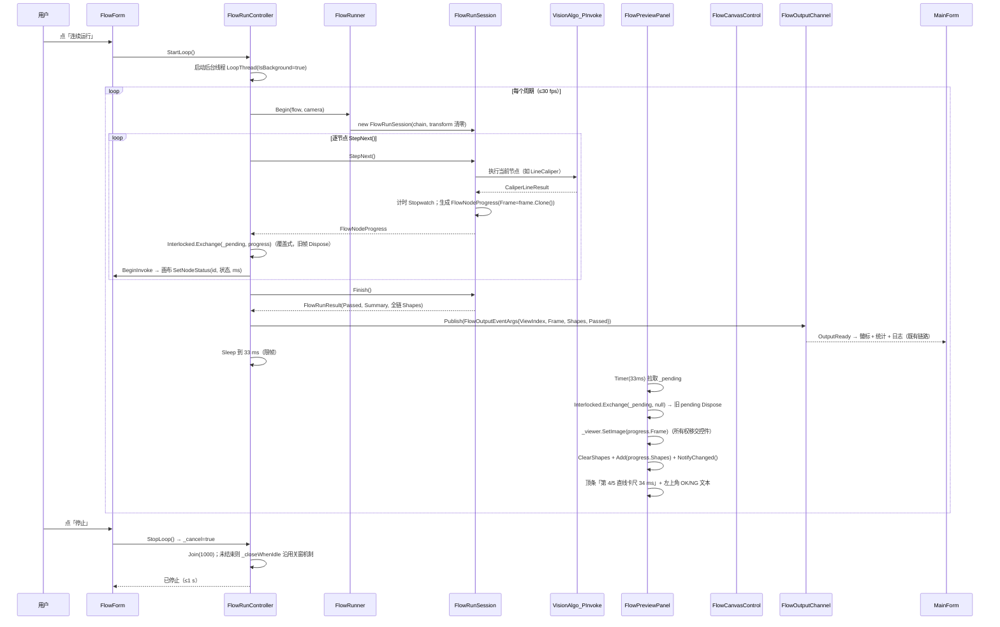
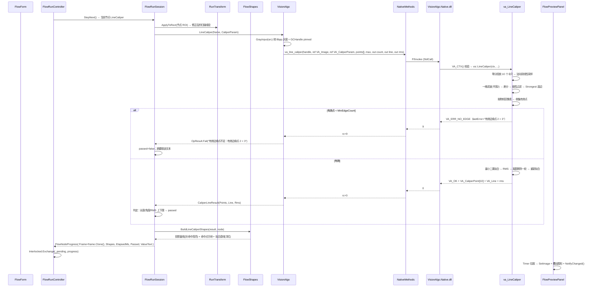
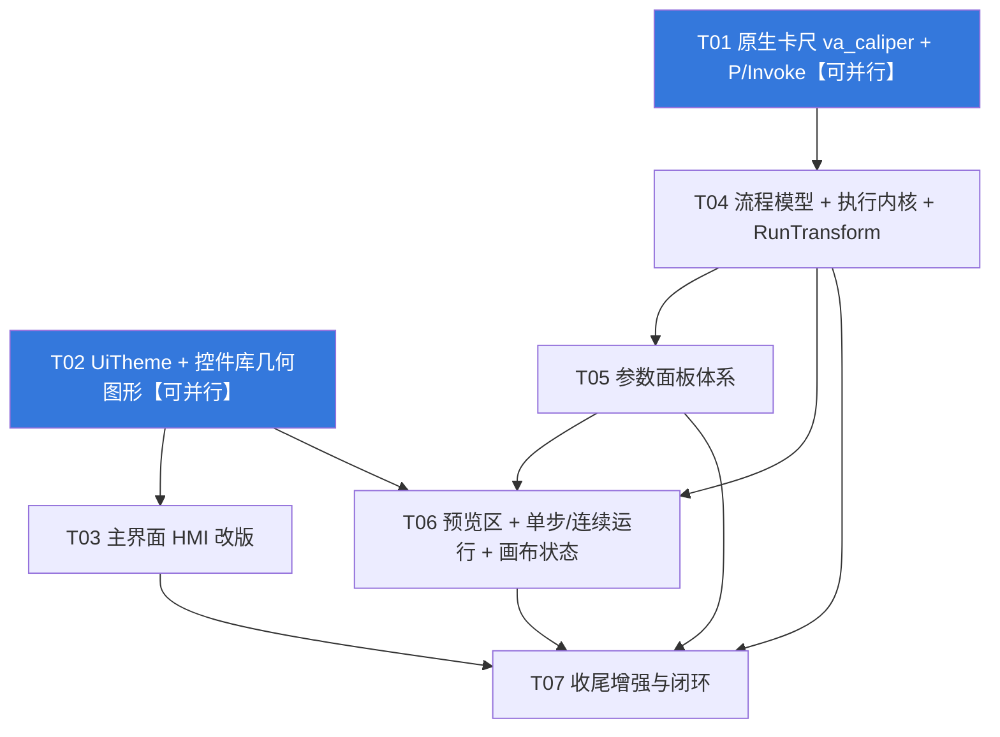

# 增量架构设计：界面布局工程化 + 算法模块完善与实时显示

| 项 | 内容 |
| --- | --- |
| 文档名称 | 增量架构设计 + 任务分解：界面布局工程化 + 算法模块完善与实时显示 |
| 版本 | v1.0 |
| 日期 | 2026-10-10 |
| 作者 | 高见远（架构师） |
| 输入 | `docs/PRD-界面布局与算法模块.md`（v1.0，38 条需求）、`docs/架构-摄像头与流程编排.md`（v1.0，风格与约定基线） |
| 变更类型 | **增量**：在既有 .NET Framework 4.8 + WinForms + C++/OpenCV 工程上扩展，**不推翻现有分层与既有能力** |
| 语言 | 简体中文 |
| 交付范围 | P0 全部 19 条 + P1 主体；P2 只做低成本项（日志分级、状态栏、预览工具条） |

> 本设计**只描述"变更部分"**。既有文件未在本文件清单中出现的，一律**不动**。
> 与上一轮架构文档的关系：本文是它的**续篇**，§6「共享知识」在上一轮 13 条铁律基础上**追加**本期新约定（编号接续 14~）。

---

# Part A：系统设计

## 1. 实现方案与关键决策

### 1.1 本期五个技术难点

| 难点 | 本质 | 本期解法 |
| --- | --- | --- |
| ① 12 类节点各有参数，手写面板会爆炸 | 参数 UI 的**规模化**问题，不是算法问题 | 声明式参数面板：`NodeParamSchema`（一张字段表）+ `NodeParamPanel`（一个通用 `UserControl` 动态生成） |
| ② 中间结果"逐节点"可见 + 单步/单帧/连续三种运行模式 | 执行内核必须**可分段、可观察**，不能只暴露 `Run()` | 把 `FlowRunner.Run()` 拆为 `Begin()/StepNext()` 会话式内核，三种模式共用；产出的 `FlowNodeProgress` 携带「该节点输出帧 + 该节点图形 + 耗时 + 结论」 |
| ③ 位置修正要把偏移传给下游 ROI | 执行期需要一条**沿链传递的运行时状态** | 新增 `FlowRunContext`，内含 `RunTransform`（覆盖式，后写胜）；下游节点取 ROI 时统一走 `ApplyToRect()` |
| ④ 卡尺是原生层**从零新增**的算法族 | C++ 侧需新建头/源 + 导出 + 工程登记 + P/Invoke 双向结构体对齐 | `va_caliper.h/.cpp` + `VA_CaliperParam/VA_CaliperPoint`，严格沿用「句柄校验 → 转发 → 异常转码 → lastError」既有导出范式 |
| ⑤ 界面要"醒目"但**禁止图标与第三方库** | 只能靠字号/颜色/留白/区块 | 纯代码静态色板 `UiTheme`；**Designer 只管控件树与布局，`ApplyTheme()` 运行时统一套色**（见决策 2） |

### 1.2 关键决策与「为什么不用另一个方案」

**决策 1：主题用纯代码静态类 `UiTheme`，不用资源文件、不用第三方主题库。**
- PRD `FR-UI-12` 是硬验收项（diff 无二进制资源、无 NuGet 包）。`UiTheme` 是 `static class`，只含 `readonly Color`、`static Font`（懒构造）、`const int` 尺寸常量。
- ❌ 不用 `.resx` 资源字典：会被判为"资源文件"，且无法用常量做布局计算。
- ❌ 不改 `App.Config` / 不引入 JSON 主题文件：本期无换肤需求（PRD 范围外），静态常量最简单、编译期可校验。

**决策 2：Designer 管结构，`ApplyTheme()` 管外观（颜色/字体）。**
- 现状：`MainForm.Designer.cs` / `FlowForm.Designer.cs` 里散落着 `Color.FromArgb(38,38,46)` 之类的魔法值；若 12 个面板 + 2 个窗体都硬写色值，`FR-UI-01` 的验收②「单点修改全局生效」无法满足。
- 做法：**新增/改动的控件在 Designer 里只写结构（Dock/Size/Text/父子关系），颜色与字体统一在各窗体的 `ApplyTheme()` 里用 `UiTheme` 赋值**（`InitializeComponent()` 之后调用）。
- 好处：色板单点生效；Designer 文件不引入对 `UiTheme` 的硬引用（VS 设计器打开不出错）；评审只需看 `UiTheme` 一处。
- 代价：设计器里看不到真实配色。**接受**（本工程主要由工程师手改 .Designer.cs，不以可视化设计为主）。

**决策 3：参数面板走「声明式 schema + 通用面板」，不为 12 类节点各写一个 UserControl。**

| 方案 | 新增文件 | 新增代码量 | 风格一致性 | 配置兼容 |
| --- | --- | --- | --- | --- |
| A. 声明式 `NodeParamSchema` + `NodeParamPanel` | 2 | ~700 行（表 500 + 面板 200） | 天然一致 | 无影响（读写同一份 `FlowNode.Params`） |
| B. 每类节点一个手写 `UserControl` | 11 | ~2200 行（11×200） | 需靠人肉保持 | 无影响 |

- 选 **A**。字段类型覆盖本期全部需求：`Int` / `Double` / `Bool`（CheckBox）/ `Enum`（ComboBox，用字符串存值）/ `Text`（TextBox）/ `File`（TextBox + 「选择文件」Button）/ `Action`（纯按钮，如位置修正「示教」）/ `Note`（纯文本提示，如 NCC 局限说明）。
- **既有 `ShapeMatchNodePanel.cs` 的处置（需评审拍板，见 §9-B1）**：
  - **推荐方案**：**废弃并从 `VisionPlatform.csproj` 移除** `ShapeMatchNodePanel.cs`，其 20 个参数项 1:1 迁入 `NodeParamSchema`（Key 完全不变 → 旧配置零影响）；`FlowForm.Designer.cs` 中该字段替换为 `NodeParamPanel`。
  - **备选方案 B**：保留 `ShapeMatchNodePanel`（仅改配色），`FlowForm` 按类型二选一。风险更低，但两套面板风格长期漂移。
- `FlowNode.Params` 的 `List<ParamItem>` 结构**完全不变**，序列化零影响 —— 这是本决策低风险的根本原因。

**决策 4：执行内核拆为会话式 `Begin()/StepNext()`，单步 / 单帧 / 连续共用。**
- 现状 `FlowRunner.Run(flow, camera)` 一次性跑完，只回传最终结果，无法逐节点刷新。
- 改造：新增 `FlowRunSession`（持有 chain / 当前索引 / 工作帧 / `RunTransform` / 每节点 `FlowNodeProgress`），`FlowRunner` 提供：
  ```
  Begin(flow, camera) -> FlowRunSession         // 建链、重置状态、取首帧前的准备
  session.StepNext()  -> FlowNodeProgress|null  // 执行一个节点；null 表示链已跑完
  session.Finish()    -> FlowRunResult          // 汇总（结论/摘要/总耗时/全链图形）
  Run(flow, camera)                             // 【保留】= Begin + while(StepNext) + Finish，对外 API 不变
  ```
- ✅ 对外 `Run()` 签名与 `FlowOutputChannel` 链路**完全不动** → `MainForm` 既有集成零回归。
- ❌ 不做「每节点一个后台线程」：单链语义下并行无收益，且会与 VisionAlgo 句柄的线程安全冲突。

**决策 5：`RunTransform` 放在 `FlowRunContext`（执行期对象），不写进 `FlowNode`（持久化对象）。**
- 位置修正的输出是**运行时量**（每帧不同），写进节点参数会导致：①每帧改配置 → 触发 `ConfigStore.Save()` 磁盘写；②多流程/连续运行时互相污染。
- `RunTransform` 是纯内存结构，生命周期 = 一次执行会话；`RefSource=Manual` 的 `RefX/RefY/RefAngle` 才是持久化参数（存节点 `Params`）。

**决策 6：预览帧**覆盖式投递 + `Timer` 拉取**，不用 `BeginInvoke` 逐帧推送。**
- 既有踩坑（上一轮实测）：帧率高于渲染能力时 `BeginInvoke` 会积压 `Bitmap`。本期预览区帧率上限 30 fps、连续运行 5 分钟，风险更高。
- 做法：`FlowRunController` 用 `Interlocked.Exchange(ref _pending, progress)` 只留最新一份；`FlowPreviewPanel` 内部挂一个 `System.Windows.Forms.Timer`（33 ms）在 UI 线程取走 `Interlocked.Exchange(ref _pending, null)`，**取到旧 pending 时立即 `Dispose()` 其 Frame**。
- ✅ 零第三方（`Timer` 是 `System.Windows.Forms` 自带）；✅ 天然限帧；✅ UI 线程不阻塞。

**决策 7：`FlowForm` 画布与预览用 `SplitContainer` 上下分栏。**
- `SplitContainer` 是 `System.Windows.Forms` 自带控件（**不是第三方**），提供可拖动 Splitter 与 `SplitterDistance` 百分比，正好满足 PRD §5.3「横向可拖动 Splitter，默认上 60% / 下 40%」。
- ❌ 不用自研 Splitter 控件：重复造轮子且要处理光标/键盘/最小尺寸。

**决策 8：卡尺可视化新增两个几何图形类型，放进 `VisionSystem.Controls.Geometry`。**
- 现有 `CircleShape / RectangleShape / RingShape / RotatedRectShape` 无法表达「线段（拟合直线 / 卡尺投影窗 / 基准十字）」与「固定屏幕尺寸的点标记（边缘命中点）」。
- 新增 `LineSegmentShape`（端点为图像坐标，`LineWidth` 与 `DashStyle` 为屏幕像素语义）与 `PointMarkerShape`（中心为图像坐标，`Size` 为屏幕像素）。
- 放进控件库而非 `VisionPlatform/UI` 的理由：与主界面视图（`MainForm` 的 `ImageViewer`）复用同一套图形类型；控件库本身零依赖，新增两个类不引入任何依赖。
- ❌ 不放 `VisionPlatform/UI`：会造成「应用层实现控件库接口」的反向依赖味道，且主界面无法复用。

**决策 9：NCC 与形状匹配共存，两个独立节点类型 + 各自 schema 分支。**
- PRD 已拍板（Q1），本设计只落实：`FlowNodeType` 追加 `TemplateMatch`，`va_match.h` 既有 `TrainTemplate/MatchTemplate` 直接复用（**C++ 侧零改动**），仅在 `FlowRunner` 加执行分支 + schema 加字段 + 面板底部加 `Note` 字段声明局限。

**决策 10：连续运行不复用 `MainForm.loopTimer`，独立放在 `FlowRunController`。**
- 主界面循环检测（`InspectionEngine` + `SyncGrabCore`）与流程运行是两条独立管线（上一轮决策 3：流程执行器拥有独立算法上下文），混用定时器会导致状态机纠缠。
- 连续运行仍走 `FlowOutputChannel` 回传主界面（既有链路不动），只是**每个周期都发布一次**；主界面徽标/统计随之每周期更新（`FR-ALG-26`）。

---

## 2. 文件清单

> 相对路径均相对**仓库根** `VisionSystem/`。
> **铁律**：C++ 新增 `.h/.cpp` 必须同时登记 `.vcxproj` 与 `.vcxproj.filters`；C# 新增 `.cs` 必须登记对应 csproj（传统非 SDK 工程不自动包含；Form 加 `<SubType>Form</SubType>`，Designer 加 `<DependentUpon>`）。

### 2.1 C++ 侧（`src/VisionAlgo.Native/`）

| # | 相对路径 | 新增/修改 | 一句话职责 |
| --- | --- | --- | --- |
| 1 | `src/VisionAlgo.Native/include/algo/va_caliper.h` | **新增** | 卡尺对外 C 接口：`VA_CaliperParam` / `VA_CaliperPoint` 结构体 + `va_line_caliper` / `va_circle_caliper` 声明 |
| 2 | `src/VisionAlgo.Native/src/algo/algo_caliper.cpp` | **新增** | 直线/圆卡尺实现：等分投放投影卡尺 → 一维滤波 + 差分找边 → 亚像素 → 最小二乘拟合 → 离群剔除一轮 → RMS |
| 3 | `src/VisionAlgo.Native/src/vision_algo.cpp` | 修改 | 追加 2 个 `extern "C"` 导出（`VA_CTX()` 校验后转发 `va::`） |
| 4 | `src/VisionAlgo.Native/Common/va_internal.h` | 修改 | 声明 `va::LineCaliper` / `va::CircleCaliper`（内部签名，把 `void*` 换成 `va::Context*`） |
| 5 | `src/VisionAlgo.Native/Common/va_error.h` | 修改 | 新增错误码 `VA_ERR_NO_EDGE 9`；`va_error_string` 补分支 |
| 6 | `src/VisionAlgo.Native/include/vision_algo.h` | 修改 | 聚合头新增 `#include "algo/va_caliper.h"` 与头注释新增一行说明 |
| 7 | `src/VisionAlgo.Native/VisionAlgo.Native.vcxproj` | 修改 | `<ClInclude>` 登记 `va_caliper.h`，`<ClCompile>` 登记 `algo_caliper.cpp` |
| 8 | `src/VisionAlgo.Native/VisionAlgo.Native.vcxproj.filters` | 修改 | 为上述两文件登记 `<Filter>`（`include\algo` / `src\algo`） |

### 2.2 控件库（`src/VisionSystem.Controls/`）

| # | 相对路径 | 新增/修改 | 一句话职责 |
| --- | --- | --- | --- |
| 9 | `src/VisionSystem.Controls/Geometry/LineSegmentShape.cs` | **新增** | `IGeometryShape` 线段实现：端点图像坐标，线宽/虚线样式屏幕像素（拟合直线 / 卡尺投影窗 / 基准十字 / 修正后 ROI 轮廓） |
| 10 | `src/VisionSystem.Controls/Geometry/PointMarkerShape.cs` | **新增** | `IGeometryShape` 点标记：中心图像坐标，边长屏幕像素（卡尺命中边缘点、Blob 质心十字） |
| 11 | `src/VisionSystem.Controls/VisionSystem.Controls.csproj` | 修改 | `<Compile Include>` 登记上述两个 `.cs` |

### 2.3 平台层（`src/VisionPlatform/`）

| # | 相对路径 | 新增/修改 | 一句话职责 |
| --- | --- | --- | --- |
| 12 | `src/VisionPlatform/UI/UiTheme.cs` | **新增** | 纯代码主题常量：13 语义色 + 7 字体 + 栅格/尺寸常量 + `StyleBadge/StyleStatValue/StyleButton/ApplyGroupTitle` 等小工具（**零依赖、零资源**） |
| 13 | `src/VisionPlatform/Native/VisionAlgo.cs` | 修改 | ①新增 `VA_CaliperParam` / `VA_CaliperPoint` / `VA_CaliperLineResult` / `VA_CaliperCircleResult` 托管结构；②`VaResult.ErrNoEdge = 9` 及文案；③`NativeMethods` 增 2 个 DllImport；④`VisionAlgo` 增 `LineCaliper()` / `CircleCaliper()` 方法 |
| 14 | `src/VisionPlatform/Flow/FlowModels.cs` | 修改 | `FlowNodeType` **追加** `TemplateMatch / PositionCorrect / LineCaliper / CircleCaliper`（追加到末尾，已存的枚举名字符串不受影响）；`FlowSettings.SchemaVersion` 1 → 2 |
| 15 | `src/VisionPlatform/Flow/FlowModule.cs` | 修改 | 模块目录 8 → 12 项（新增 位置修正 / 模板匹配(NCC) / 直线卡尺 / 圆卡尺）+ 12 类节点各自的 `CreateDefaultParams()` |
| 16 | `src/VisionPlatform/Flow/FlowRunContext.cs` | **新增** | 执行期上下文：`RunTransform`（dX/dY/dAngle/dScale + 基准点 + EnableAngle）、`FlowNodeProgress`（节点级输出：帧/图形/耗时/结论/摘要）、`FlowRunSession`（会话状态机） |
| 17 | `src/VisionPlatform/Flow/FlowRunner.cs` | 修改 | ①拆出 `Begin()/StepNext()/Finish()` 会话式内核（`Run()` 保留为语法糖）；②新节点执行分支（TemplateMatch / PositionCorrect / LineCaliper / CircleCaliper）；③带 ROI 节点统一 `ApplyTransform`；④节点级计时与图形收集 |
| 18 | `src/VisionPlatform/Flow/FlowShapes.cs` | **新增** | 各节点叠加图形构造工具：卡尺投影窗 + 命中点 + 拟合结果、位置修正基准十字 + 修正后 ROI 虚线、Blob 外接矩形 + 质心 + 序号、匹配框多目标着色 |
| 19 | `src/VisionPlatform/Flow/FlowRunController.cs` | **新增** | 单帧 / 单步 / 连续运行的线程编排、取消、限帧 ≤30 fps、覆盖式投递到预览、帧率与平均耗时统计 |
| 20 | `src/VisionPlatform/Flow/NodeParamSchema.cs` | **新增** | 12 类节点的参数字段声明表（`NodeParamField` + `NodeParamSchema.For(FlowNodeType)`），含分组、范围、步进、提示文本 |
| 21 | `src/VisionPlatform/UI/NodeParamPanel.cs` | **新增** | 通用声明式参数面板 `UserControl`：按 schema 动态生成控件、读写 `FlowNode.Params`、抛出 `ParamsChanged` |
| 22 | `src/VisionPlatform/UI/ShapeMatchNodePanel.cs` | **删除（推荐）/ 修改（备选）** | 推荐：废弃并从 csproj 注销，参数项迁入 schema（Key 不变）。备选：保留，仅把颜色改为 `UiTheme` |
| 23 | `src/VisionPlatform/UI/FlowPreviewPanel.cs` | **新增** | 预览区容器：顶条（显示模式下拉 / 节点名 / `n/m` / `xx ms` / 暂停自动刷新）+ `ImageViewer` + 左上角 OK/NG 文本覆盖标签 + 33 ms 拉取定时器（覆盖式） |
| 24 | `src/VisionPlatform/UI/FlowCanvasControl.cs` | 修改 | 新增 `NodeStatus` 字典与 `SetNodeStatus(id, status, elapsedMs)`；`DrawNode` 按状态画边框（灰/蓝/绿/红）并在节点下方画 `xx ms` 纯文本；`HighlightRunning(id)` |
| 25 | `src/VisionPlatform/UI/FlowForm.cs` | 修改 | ①接入 `SplitContainer`（画布/预览）+ `FlowPreviewPanel`；②新增「单步」「连续运行」按钮逻辑；③参数面板切换（`NodeParamPanel`）；④结果汇总与状态区；⑤关窗 Join 机制**加强**（连续运行线程） |
| 26 | `src/VisionPlatform/UI/FlowForm.Designer.cs` | 修改 | 新增 `splitMain`（`Orientation=Horizontal`）、`flowPreview`、`btnStep`、`btnRunLoop`；右栏 280 → 300；`lblParams` 由 `ShapeMatchNodePanel` 改为 `NodeParamPanel`；`MinimumSize` → 1280×800 |
| 27 | `src/VisionPlatform/UI/MainForm.cs` | 修改 | ①`ApplyTheme()`；②徽标三态更新 `SetVerdict(bool?)`；③统计升级（良率 28pt / 其余 15pt / 良率告警着色 / 连续 NG 警示条）；④运行控制按钮状态机 `UpdateRunButtons()`（三态互斥）；⑤日志分级着色；⑥状态栏分段文本；⑦视图角标；⑧右栏折叠 |
| 28 | `src/VisionPlatform/UI/MainForm.Designer.cs` | 修改 | `panelRight` 244 → 300；新增 `panelVerdict` + `lblVerdict`、`panelRunCtrl`、`panelRunState`、`lblConsecutiveNg`；`btnLoop/btnPause/btnStop/btnResetStats` 移入 `panelRunCtrl` 并放大；新增 `btnGrabOnce`；`panelBottom` 170 → 120；`listLog.DrawMode = OwnerDrawFixed`；`MinimumSize` → 1280×800 |
| 29 | `src/VisionPlatform/Core/AppSettings.cs` | 修改 | `SystemSettings` 新增 `YieldAlarmPercent`（默认 95）+ `CreateDefault()`/`Clone()` 同步；`UiSettings` 新增 `LogCollapsed`；`ConfigStore.Load()` 补两条向下兼容赋值；`FlowSettings.SchemaVersion` 2 |
| 30 | `src/VisionPlatform/UI/SettingsForm.cs` + `.Designer.cs` | 修改 | 新增「良率告警下限（%）」输入框（P1 `FR-UI-05`） |
| 31 | `src/VisionPlatform/VisionPlatform.csproj` | 修改 | 登记全部新增 `.cs`；注销 `ShapeMatchNodePanel.cs`（若采用推荐方案）；`NodeParamPanel`/`FlowPreviewPanel` 加 `<SubType>UserControl</SubType>` |

**合计：新增 11 个文件 + 修改 19 个文件 + 删除 1 个（待拍板）= 31 处变更。**

---

## 3. 数据结构与接口设计

### 3.1 C++ 侧：卡尺原生 API（`va_caliper.h`）

> 命名与结构体最终定版如下（PRD Q5 交由架构确定）。

```c
/* 卡尺公共参数（直线模式用线段字段，圆模式用圆环字段；另一组字段忽略） */
typedef struct VA_CaliperParam {
    /* --- 直线模式 ROI --- */
    double x1, y1;              /* 扫描线段起点（图像坐标） */
    double x2, y2;              /* 扫描线段终点（图像坐标） */
    /* --- 圆模式 ROI --- */
    double cx, cy;              /* 圆心（图像坐标） */
    double inner_radius;        /* 内径 */
    double outer_radius;        /* 外径 */
    double start_angle;         /* 起始角（度，0=+X 轴，顺时针为正，因图像 y 轴向下） */
    double angle_span;          /* 角度跨度（度）；>360 时截断为 360 */
    /* --- 公共 --- */
    int    caliper_count;       /* 卡尺个数（默认：直线 10 / 圆 20） */
    double projection_length;   /* 投影窗口长度（沿法线/径向），px，默认 20 */
    int    polarity;            /* 0=Any 1=DarkToLight 2=LightToDark（默认 0） */
    double edge_threshold;      /* 边缘跳变幅值阈值（灰度差），默认 30 */
    int    filter_half_width;   /* 一维均值滤波半宽，默认 2 */
    int    select_mode;         /* 0=Strongest 1=First 2=Last（默认 0） */
    int    min_edge_count;      /* 有效边缘点下限（直线 3 / 圆 5） */
    int    reject_outliers;     /* 1=剔除离群点一轮（默认 1） */
    double outlier_tolerance;   /* 残差剔除阈值 px，默认 2.0 */
} VA_CaliperParam;

/* 单个卡尺的输出：投影窗口两端 + 命中边缘点 */
typedef struct VA_CaliperPoint {
    double px1, py1;    /* 投影窗口起点（内侧端点，图像坐标） */
    double px2, py2;    /* 投影窗口终点（外侧端点，图像坐标） */
    double x, y;        /* 命中边缘点（亚像素，图像坐标） */
    double strength;    /* 边缘强度（灰度跳变幅值） */
    int    valid;       /* 1=命中，0=未命中（未命中时 x/y/strength 置 0） */
} VA_CaliperPoint;

/* 直线卡尺：沿扫描线段法向等分投放卡尺 → 找边 → 拟合直线。
   out_points   : 调用方分配，容量 >= caliper_count；实际写入 *out_count 个
   out_line     : 拟合线段两端（图像坐标）
   out_rms      : 直线度残差 RMS（px）
   返回 VA_OK / VA_ERR_ARG / VA_ERR_TYPE / VA_ERR_NO_EDGE / VA_ERR_INTERNAL */
VA_API int VA_CALL va_line_caliper(void* handle,
                                   const VA_Image* gray,
                                   const VA_CaliperParam* param,
                                   VA_CaliperPoint* out_points,
                                   int max_count,
                                   int* out_count,
                                   VA_Line* out_line,
                                   double* out_rms);

/* 圆卡尺：沿圆周等分投放径向卡尺 → 找边 → 代数最小二乘拟合圆。
   out_circle   : 圆心 / 半径；residual 字段回填 = 圆度 RMS
   out_rms      : 圆度残差 RMS（px） */
VA_API int VA_CALL va_circle_caliper(void* handle,
                                     const VA_Image* gray,
                                     const VA_CaliperParam* param,
                                     VA_CaliperPoint* out_points,
                                     int max_count,
                                     int* out_count,
                                     VA_Circle* out_circle,
                                     double* out_rms);
```

**实现要点（`algo_caliper.cpp`）**

| 步骤 | 说明 |
| --- | --- |
| ① 输入校验 | `gray` 必须 `channels==1`（C# 侧统一走 `GrayInput`，永远是 1）；`param != NULL`；`out_points` 容量 ≥ `caliper_count` |
| ② 等分投放 | 直线：`Pi = P1 + ((i+0.5)/N)·(P2-P1)`，法线 `n = perp(normalize(P2-P1))`；圆：`θi = start + ((i+0.5)/N)·span`，`Pi = C + Ri·(cosθ, sinθ)`，`n = (cosθ, sinθ)` |
| ③ 投影采样 | 沿 `±n·L/2` 双线性采样 `ceil(L)` 个灰度点（越界像素按边缘钳制） |
| ④ 一维滤波 | 对**梯度序列**（`[-1,0,1]` 卷积）做半宽 `filter_half_width` 的均值滤波（抗噪） |
| ⑤ 找边 | 按 `Polarity` 过滤符号；`Strongest` 取 `|d|` 最大、`First/Last` 取沿投影方向首/末个超阈值点；幅值 < `edge_threshold` 记 `valid=0` |
| ⑥ 亚像素 | 抛物线插值 `δ = 0.5·(d[j-1]-d[j+1]) / (d[j-1]-2·d[j]+d[j+1])`，点位置 `= Pi + n·(j+δ-L/2)` |
| ⑦ 拟合 | 直线：`cv::fitLine(DIST_L2)` 或总最小二乘；圆：代数最小二乘解 `x²+y² = A·x + B·y + C` → `center=(A/2, B/2)`，`R=√(C+(A²+B²)/4)` |
| ⑧ 残差 | 点到直线距离 / `|dist - R|` 的 **RMS** |
| ⑨ 离群剔除 | `reject_outliers==1` 时剔除残差 > `outlier_tolerance` 的点并**重新拟合一轮**（仅一轮） |
| ⑩ 端点 | 直线：参与点投影到直线取 `tmin/tmax` 求端点；角度 `atan2(dy,dx)` 转度并归一化到 `(-90°, 90°]` |
| ⑪ 错误 | 有效点 < `min_edge_count` → `VA_ERR_NO_EDGE`，`lastError` 写 `"有效边缘点 2 < 3"`（C# 侧直接取来作摘要文本） |

### 3.2 C# 侧 P/Invoke（`Native/VisionAlgo.cs` 新增部分）

> **C# 结构体与 C 端一一对应**，字段顺序、类型、`[StructLayout(LayoutKind.Sequential)]` 必须严格一致。

```csharp
[StructLayout(LayoutKind.Sequential)]
public struct VA_CaliperParam {
    public double x1, y1, x2, y2;
    public double cx, cy, inner_radius, outer_radius;
    public double start_angle, angle_span;
    public int    caliper_count;
    public double projection_length;
    public int    polarity;
    public double edge_threshold;
    public int    filter_half_width;
    public int    select_mode;
    public int    min_edge_count;
    public int    reject_outliers;
    public double outlier_tolerance;
}

[StructLayout(LayoutKind.Sequential)]
public struct VA_CaliperPoint {
    public double px1, py1, px2, py2;
    public double x, y;
    public double strength;
    public int    valid;
}

[DllImport(Dll, CallingConvention = CallingConvention.StdCall)]
public static extern int va_line_caliper(IntPtr handle, ref VA_Image gray,
                                         ref VA_CaliperParam param,
                                         [In, Out] VA_CaliperPoint[] out_points,
                                         int max_count, out int out_count,
                                         out VA_Line out_line, out double out_rms);

[DllImport(Dll, CallingConvention = CallingConvention.StdCall)]
public static extern int va_circle_caliper(IntPtr handle, ref VA_Image gray,
                                           ref VA_CaliperParam param,
                                           [In, Out] VA_CaliperPoint[] out_points,
                                           int max_count, out int out_count,
                                           out VA_Circle out_circle, out double out_rms);
```

托管封装（同样在 `VisionAlgo` 类内）：
```
public OpResult<CaliperLineResult> LineCaliper(Bitmap gray, CaliperParam p)
public OpResult<CaliperCircleResult> CircleCaliper(Bitmap gray, CaliperParam p)

CaliperParam              // 托管参数类（字段与 VA_CaliperParam 同名同义），ToNative()
CaliperLineResult         // { List<CaliperPoint> Points; LineResult Line; double Rms; double Length; double AngleDeg; }
CaliperCircleResult       // { List<CaliperPoint> Points; CircleResult Circle; double Rms; double Diameter; }
CaliperPoint              // { double Px1,Py1,Px2,Py2; double X,Y; double Strength; bool Valid; }
```
`AngleDeg` / `Length` / `Diameter` 在 C# 侧由 `Line` / `Circle` 计算（原生保持精简）。`VaResult` 新增 `ErrNoEdge = 9` → 文案「有效边缘点不足」。

### 3.3 流程模型扩展

```
FlowNodeType（追加 4 项到末尾，序列化按名字符串，旧配置零影响）
  ImageSource, Preprocess, ShapeMatch, Blob, Sharpness, FitCircle, FitLine, ResultOutput,
  TemplateMatch, PositionCorrect, LineCaliper, CircleCaliper

FlowSettings.SchemaVersion : 1 → 2     // 仅标记；无破坏性迁移，旧流程照常加载
```

**12 类节点默认参数（`FlowModule.CreateDefaultParams()`）**

| 节点 | 关键默认参数（完整表见 `NodeParamSchema`） |
| --- | --- |
| `ImageSource` | `Source=Camera / File`、`FilePath=""`、`TimeoutMs=3000`、`RoiX/Y/W/H=0`（0=整图）、`Rotate=0`(0/90/180/270)、`Mirror=0`、`GrabMode=Once / Latest` |
| `Preprocess` | 既有 6 项 + `RoiX/Y/W/H=0` |
| `ShapeMatch` | 既有 20 项**原样保留** + `RoiX/Y/W/H=0`（搜索 ROI 既有的 `SearchX..` 不动） |
| `TemplateMatch` | `TemplateX/Y/W/H=0`、`SearchX/Y/W/H=0`、`MinScore=0.8`、`MaxMatches=1`、`Subpixel=1` |
| `PositionCorrect` | `RefSource=Auto / Manual`、`RefX/RefY/RefAngle=0`、`EnableAngle=1`、`MaxShiftX/Y=0`、`MaxAngle=0`、`MaxScaleDev=0` |
| `Blob` | `BinMode=Inherit / Otsu / Manual`、`Threshold=128`、`Polarity=Bright / Dark`、`MinArea=100`、`MaxArea=0`、`MinWidth/MinHeight=0`、`MinCircularity=0`、`MaxCount=50`、`SortBy=Area`、`ExpectMin/Max=0`、`AreaMin/Max=0`、`RoiX/Y/W/H=0` |
| `Sharpness` | `MinSharpness=100`、`RoiX/Y/W/H=0` |
| `FitCircle` / `FitLine` | `MinContourArea=0`、`DrawResult=1`、`RoiX/Y/W/H=0` |
| `LineCaliper` | `X1/Y1/X2/Y2`、`CaliperCount=10`、`ProjectionLength=20`、`Polarity=Any`、`EdgeThreshold=30`、`FilterHalfWidth=2`、`SelectMode=Strongest`、`MinEdgeCount=3`、`RejectOutliers=1`、`OutlierTolerance=2.0`、`LengthMin/Max=0`、`AngleMin/AngleMax=0`、`MaxRms=0` |
| `CircleCaliper` | `Cx/Cy/InnerRadius/OuterRadius`、`StartAngle=0`、`AngleSpan=360`、`CaliperCount=20`、其余同直线、`DiameterMin/Max=0`、`RoundnessMax=0`、`CenterToleranceX/Y=0` |
| `ResultOutput` | `WriteLog=1`、`SummaryMode=All / FailedOnly` |

**向下兼容**：所有新增 Key 都是**新字符串**；旧流程的 `Params` 不含这些 Key 时，`node.GetDouble(key, def)` 走默认值 → 旧流程行为**完全不变**，加载不失败（`C3` / `FR-UI-11` 类约束）。

### 3.4 执行期上下文与 `RunTransform`

```
RunTransform（纯内存，生命周期 = 一次执行会话）
├── bool   HasValue
├── double Dx, Dy          // 平移量（图像像素）
├── double DAngle          // 角度差（度）
├── double DScale          // 缩放（本期只记录并参与 MaxScaleDev 判定）
├── double RefX, RefY      // 基准点（旋转中心）
├── bool   EnableAngle
└── RectangleF ApplyToRect(RectangleF r)   // ①绕 (RefX,RefY) 旋转 DAngle（EnableAngle=0 时跳过）②平移 (Dx,Dy)
                                           // 宽高不变；中心点做变换，角度累加 DAngle

FlowNodeProgress（节点级输出，供预览与画布使用）
├── int      Index, Total          // 第 n/m 个节点
├── FlowNode Node
├── Bitmap   Frame                 // 该节点输出帧的克隆（所有权：移交消费者）
├── List<IGeometryShape> Shapes    // 仅本节点产出的图形
├── int      ElapsedMs
├── bool     Passed
├── string   Message               // 摘要行（如 "直线卡尺：有效边缘点 2 < 3"）
└── string   ValueText             // 关键值文本（如 "长度 300.4 px / 角度 0.72° / RMS 0.38"）

FlowRunSession（会话状态机，由 FlowRunner 创建）
├── FlowDefinition Flow / ICamera Camera
├── List<FlowNode> Chain
├── int      Cursor                // 下一个待执行节点下标
├── Bitmap   Current               // 工作帧
├── RunTransform Transform         // 覆盖式：多个位置修正节点以最后一个为准
├── bool     Passed                // 累积结论
├── List<string> SummaryLines
├── Dictionary<string,int> NodeMs  // 节点 Id → 耗时（供画布显示）
└── StepNext() : FlowNodeProgress | null
```

**位置修正的传递规则（对应 PRD 假设 B）**
1. `PositionCorrect` 节点执行时：取上游**最近一个**匹配类节点（ShapeMatch / TemplateMatch）的第 1 个结果作为 `(Cx, Cy, Angle, Scale)`；`RefSource=Manual` 时基准取节点参数 `RefX/RefY/RefAngle`，`Auto` 时基准 = 上一次成功匹配记录的位姿（首次运行时以当前测得位姿为基准，记 `dX=dY=dAngle=0`）。
2. 计算 `dX=Cx-Rx`、`dY=Cy-Ry`、`dAngle=Angle-Ra`、`dScale=Scale`，**覆盖式**写入 `session.Transform`（不累加）。
3. 超差判定：`|dX| > MaxShiftX` / `|dY| > MaxShiftY` / `|dAngle| > MaxAngle` / `|1-dScale| > MaxScaleDev`（任一 > 0 且超差）→ `passed=false`，摘要 `"位置修正：偏移超差 dX=40.0 > 20.0"`。
4. 下游节点在使用 ROI 前统一 `session.Transform.ApplyToRect(roi)`；**上游节点不受影响**（单链语义，本期无分支）。
5. `EnableAngle=0` → 只平移不旋转。
6. 裁剪子图执行时：算法结果坐标必须 **加回 ROI 左上角偏移** 才能回到原图坐标系（见共享知识 14.6）。

### 3.5 原生卡尺 C# 调用链

```
FlowRunner.ExecuteLineCaliper(node, Bitmap frame, FlowRunSession s)
  → Rectangle roi = s.Transform.ApplyToRect(node 的 ROI)     // 卡尺 ROI 属几何，图像坐标
  → CaliperParam p = BuildLineCaliperParam(node)
  → _algo.LineCaliper(frame, p)                              // VisionAlgo 封装：GrayInput → DllImport → va_line_caliper
      → OpResult<CaliperLineResult>
  → 判定：Points(valid) 计数 < MinEdgeCount → NG
          长度 ∉ [LengthMin, LengthMax]（非 0 时）→ NG
          角度 ∉ [AngleMin, AngleMax] → NG
          RMS > MaxRms（非 0 时）→ NG
  → FlowShapes.BuildLineCaliperShapes(result, node)          // 投影窗线 + 命中点 + 拟合直线
  → 产出 FlowNodeProgress{ Frame = frame.Clone(), Shapes, ElapsedMs, Passed, ValueText }
```

### 3.6 参数面板（声明式）

```
NodeParamField
├── string  Key                 // = FlowNode.Params 的 Key（与 FlowModule.CreateDefaultParams 一致）
├── string  Label
├── FieldKind Kind              // Int | Double | Bool | Enum | Text | File | Action | Note
├── double  Min, Max, Step      // Int/Double 有效
├── int     Decimals
├── string[] EnumOptions        // Enum 有效（显示名数组，存值为下标或字符串；本期存下标字符串）
├── string  Note                // Note 字段的提示文本 / 其它字段的 ToolTip
├── string  Group               // 分组标题（如「扫描线段」「卡尺」「判定」）
└── object  Default             // 缺失时的兜底默认

NodeParamSchema
└── static List<NodeParamField> For(FlowNodeType type)     // 12 个分支，共约 130 个字段

NodeParamPanel : UserControl
├── event EventHandler ParamsChanged
├── void SetNode(FlowNode node)          // 按 Type 取 schema → 动态构建 TableLayoutPanel → 回填 Params
├── void ShowRuntime(string valueText)   // 实时结果只读区（P1，与 FlowForm 的「实时结果」面板联动）
└── 内部：AddNum / AddCombo / AddCheck / AddText / AddFile / AddButton / AddNote / AddHeader
```

### 3.7 `UiTheme`（纯代码色板）

| 常量 | 值 | 用途 |
| --- | --- | --- |
| `ColorAppBg` | `#26262E` | 窗体背景 |
| `ColorPanelBg` | `#2A2A32` | 右栏 / 参数面板 |
| `ColorCardBg` | `#34343E` | 统计卡、输入区 |
| `ColorHeaderBg` | `#1E1E26` | 工具栏 / 分组标题 |
| `ColorViewBg` | `#181820` | 图像区底色 |
| `ColorDivider` | `#46464E` | 分隔线 |
| `ColorTextPrimary` | `#DCE0E8` | 数值、正文 |
| `ColorTextSecondary` | `#A0A6B2` | 标签、单位 |
| `ColorAccent` | `#00A0E6` | 分区标题、选中态 |
| `ColorOk` | `#2ECC71` | OK 徽标 / OK 计数 / 成功 |
| `ColorNg` | `#E74C3C` | NG 徽标 / NG 计数 / 失败 |
| `ColorWarn` | `#F39C12` | 暂停按钮、告警 |
| `ColorRunning` | `#3478DC` | 运行按钮、进行中 |
| `ColorDisabled` | `#3A3A44` | 空态、禁用控件 |

```
字体：FontBody 微软雅黑 9 | FontGroupTitle 微软雅黑 9.5 Bold | FontBadge 微软雅黑 44 Bold
     FontYield Consolas 28 Bold | FontStat Consolas 15 Bold | FontMono Consolas 9 | FontButton 微软雅黑 11 Bold
栅格：Margin 8 | BlockGap 8 | ControlGap 6 | Step 4
尺寸：RightPanelWidth 300 | BadgeHeight 96 | StatsHeight 152 | ViewHeaderHeight 22
     BtnRunH 56 | BtnPauseH 56 | BtnStopH 56 | BtnGrabH 48 | BtnResetH 40
     LogHeight 120 | ToolbarHeight 40 | StatusBarHeight 26
```

**颜色语义遵循工业通用约定**：OK=绿、NG=红、告警=橙、进行中=蓝（`UiTheme` 头部注释必须写这句，杜绝后续误用金融配色语义）。

### 3.8 主界面运行控制状态机

```
RunState : Stopped | Running | Paused
UpdateRunButtons()（单一状态源，工具栏与右栏大按钮共用）
  Stopped → 启动运行(可点) / 暂停(禁用) / 停止(禁用) / 单帧采集(可点) / 清空统计(可点)
  Running → 启动运行(禁用) / 暂停(可点，文案「暂停」) / 停止(可点) / 单帧采集(禁用) / 清空统计(禁用)
  Paused  → 启动运行(禁用) / 暂停(可点，文案「继续」) / 停止(可点) / 单帧采集(可点) / 清空统计(禁用)
禁用态：BackColor = UiTheme.ColorDisabled，ForeColor = UiTheme.ColorTextSecondary（肉眼可分辨）
```

### 3.9 类图（完整版见 `docs/class-diagram-界面与算法.mermaid`）

```mermaid
classDiagram
    class UiTheme {
        <<static>>
        +Color ColorOk
        +Color ColorNg
        +Color ColorWarn
        +Color ColorRunning
        +Font FontBadge
        +Font FontYield
        +int RightPanelWidth
        +StyleButton(Button, ButtonKind) void
        +StyleBadge(Label, VerdictState) void
    }

    class FlowNodeType {
        <<enum>>
        ImageSource
        Preprocess
        ShapeMatch
        Blob
        Sharpness
        FitCircle
        FitLine
        ResultOutput
        TemplateMatch
        PositionCorrect
        LineCaliper
        CircleCaliper
    }

    class FlowNode {
        +string Id
        +string Type
        +string Name
        +List~ParamItem~ Params
        +GetDouble(key, def) double
        +Set(key, value) void
    }

    class NodeParamSchema {
        <<static>>
        +For(FlowNodeType) List~NodeParamField~
    }
    class NodeParamField {
        +string Key
        +string Label
        +FieldKind Kind
        +string Group
        +string Note
    }
    class NodeParamPanel {
        +SetNode(FlowNode) void
        +ShowRuntime(string) void
        +event ParamsChanged
    }

    class RunTransform {
        +bool HasValue
        +double Dx
        +double Dy
        +double DAngle
        +double DScale
        +double RefX
        +double RefY
        +ApplyToRect(RectangleF) RectangleF
    }
    class FlowNodeProgress {
        +int Index
        +int Total
        +FlowNode Node
        +Bitmap Frame
        +List~IGeometryShape~ Shapes
        +int ElapsedMs
        +bool Passed
        +string Message
        +string ValueText
    }
    class FlowRunSession {
        +List~FlowNode~ Chain
        +int Cursor
        +Bitmap Current
        +RunTransform Transform
        +bool Passed
        +StepNext() FlowNodeProgress
        +Finish() FlowRunResult
    }
    class FlowRunner {
        -VisionAlgo _algo
        +Begin(FlowDefinition, ICamera) FlowRunSession
        +Run(FlowDefinition, ICamera) FlowRunResult
        +event OutputReady
    }
    class FlowRunController {
        -Thread _thread
        -FlowNodeProgress _pending
        +RunOnce() void
        +StepOnce() void
        +StartLoop() void
        +StopLoop() void
        +TakePending() FlowNodeProgress
        +event ProgressReady
    }
    class FlowShapes {
        +BuildLineCaliperShapes(CaliperLineResult, FlowNode) List~IGeometryShape~
        +BuildCircleCaliperShapes(CaliperCircleResult, FlowNode) List~IGeometryShape~
        +BuildPositionCorrectShapes(RunTransform, FlowNode) List~IGeometryShape~
        +BuildBlobShapes(List~BlobResult~) List~IGeometryShape~
    }

    class FlowPreviewPanel {
        -ImageViewer _viewer
        -Timer _pump
        +SetProgress(FlowNodeProgress) void
        +SetDisplayMode(PreviewMode) void
        +SetVerdict(bool?) void
    }
    class FlowCanvasControl {
        +SetNodeStatus(string, NodeStatus, int) void
        +HighlightRunning(string) void
    }
    class FlowForm {
        -FlowRunController _ctl
        -NodeParamPanel _paramPanel
    }

    class VisionAlgo {
        +LineCaliper(Bitmap, CaliperParam) OpResult~CaliperLineResult~
        +CircleCaliper(Bitmap, CaliperParam) OpResult~CaliperCircleResult~
        +TrainTemplate(Bitmap, Rectangle) OpResult
        +MatchTemplate(Bitmap) OpResult~MatchResult~
    }
    class VA_CaliperParam {
        <<struct>>
        +double x1
        +double y1
        +int caliper_count
        +double projection_length
        +int polarity
        +int min_edge_count
    }
    class VA_CaliperPoint {
        <<struct>>
        +double px1
        +double py1
        +double x
        +double y
        +int valid
    }

    class LineSegmentShape {
        +PointF P1
        +PointF P2
        +DashStyle Dash
        +Draw(Graphics, Viewport, RenderOptions) void
    }
    class PointMarkerShape {
        +PointF Center
        +float Size
        +MarkerKind Kind
    }
    class IGeometryShape {
        <<interface>>
        +Color StrokeColor
        +float LineWidth
        +Draw(Graphics, Viewport, RenderOptions) void
    }

    class MainForm {
        -bool _running
        -int _statOk
        -int _consecutiveNg
        +ApplyTheme() void
        +SetVerdict(bool?) void
        +UpdateStats() void
        +UpdateRunButtons() void
    }

    class SystemSettings {
        +double YieldAlarmPercent
    }

    FlowRunner --> FlowRunSession : creates
    FlowRunSession *-- RunTransform
    FlowRunSession ..> FlowNodeProgress : produces
    FlowRunner --> VisionAlgo : owns
    FlowRunner ..> FlowShapes : uses
    FlowRunController --> FlowRunSession : drives
    FlowRunController ..> FlowNodeProgress : pending(覆盖式)
    FlowForm --> FlowRunController
    FlowForm --> FlowPreviewPanel
    FlowForm --> FlowCanvasControl
    FlowForm --> NodeParamPanel
    NodeParamPanel ..> NodeParamSchema : reads
    NodeParamSchema ..> FlowNodeType
    NodeParamPanel --> FlowNode : reads/writes Params
    VisionAlgo --> VA_CaliperParam
    VisionAlgo --> VA_CaliperPoint
    FlowShapes ..> LineSegmentShape : creates
    FlowShapes ..> PointMarkerShape : creates
    LineSegmentShape ..|> IGeometryShape
    PointMarkerShape ..|> IGeometryShape
    FlowPreviewPanel --> IGeometryShape
    MainForm ..> UiTheme
    FlowForm ..> UiTheme
    NodeParamPanel ..> UiTheme
    MainForm --> SystemSettings
```



---

## 4. 程序调用流程（时序图）

> 完整 Mermaid 见 `docs/sequence-diagram-界面与算法.mermaid`。

### 4.1 连续运行 → 逐节点执行 → 预览区实时刷新



### 4.2 位置修正 `RunTransform` 传递给下游 ROI

```mermaid
sequenceDiagram
    participant SES as FlowRunSession
    participant SM as 形状匹配节点
    participant PC as 位置修正节点
    participant BL as Blob 节点(下游)
    participant TR as RunTransform
    participant ALGO as VisionAlgo

    Note over SES: 链：图像源 → 形状匹配 → 位置修正 → Blob → 结果输出
    SES->>SM: StepNext()
    SM->>ALGO: CreateShapeModel + FindShapeModel(frame, SearchRoi)
    ALGO-->>SM: ShapeMatchResult(Cx=140, Cy=90, Angle=3.2, Scale=1.0)
    SM->>SES: 记录 LastPose(Cx,Cy,Angle,Scale) + 图形 + 摘要
    SM-->>SES: FlowNodeProgress#2

    SES->>PC: StepNext()
    PC->>SES: 取上游最近匹配结果 (Cx,Cy,Angle,Scale)
    PC->>PC: RefSource=Auto → (Rx,Ry,Ra)=上次基准（首次=当前位姿）
    PC->>PC: dX=Cx-Rx; dY=Cy-Ry; dAngle=Angle-Ra; dScale=Scale
    PC->>TR: 覆盖式写入（不累加，多个位置修正以最后一个为准）
    PC->>PC: 超差判定：|dX|>MaxShiftX? |dAngle|>MaxAngle? |1-dScale|>MaxScaleDev?
    alt 超差
        PC->>SES: passed=false；摘要「位置修正：偏移超差 dX=40.0 > 20.0」
    else 正常
        PC->>SES: passed=true；摘要「位置修正 dX=40.0 dY=25.0 dA=3.2°」
    end
    PC->>PC: 图形：基准十字(青) + 修正后下游 ROI 虚线(青) + dX/dY/dA 文本
    PC-->>SES: FlowNodeProgress#3

    SES->>BL: StepNext()
    BL->>BL: roi = node 的 RoiX/Y/W/H（0=整图）
    BL->>TR: ApplyToRect(roi)
    TR->>TR: ①绕 (RefX,RefY) 旋转 dAngle（EnableAngle=0 时跳过）
    TR->>TR: ②平移 (dX, dY)
    TR-->>BL: 修正后 ROI
    BL->>ALGO: AnalyzeBlobs(裁剪子图, MinArea, MaxArea)
    ALGO-->>BL: List~BlobResult~（子图坐标）
    BL->>BL: 所有结果坐标 + ROI 左上偏移 → 回到原图坐标系
    BL->>BL: 个数 ∉ [ExpectMin, ExpectMax] → NG
    BL-->>SES: FlowNodeProgress#4
```

### 4.3 卡尺节点的原生调用链



---

# Part B：任务分解

## 5. 所需依赖包

**无任何新增第三方依赖**（硬约束 `C1` / `FR-UI-12`）。全部基于既有：

```
- OpenCV 4.5.5（已就位：opencv_world455(d).dll/.lib，含 imgproc/core）—— 仅 C++ 侧使用
  · 卡尺实现只用 cv::Mat / 双线性采样 / cv::fitLine；无需新增 OpenCV 模块，无需改链接配置
- .NET Framework 4.8 自带程序集：System, System.Drawing, System.Windows.Forms,
  System.Runtime.Serialization（DataContractJsonSerializer）
- 既有工程引用：VisionSystem.Controls（自研控件库，本身零第三方）
```

**验收检查项**（`FR-UI-12`）：
- `VisionPlatform.csproj` / `VisionSystem.Controls.csproj` 无新增 `PackageReference`、无 `<Reference>` 新增项；
- diff 中无 `.png/.ico/.svg/.bmp` 等新增二进制资源；
- 所有节点、按钮、工具箱项为纯文字（仅允许 Unicode `▲▼` 作折叠指示）。

## 6. 共享知识（跨文件约定 / 项目铁律）

> 第 1~13 条沿用上一轮架构文档（`docs/架构-摄像头与流程编排.md` §6），**继续有效**。以下 14~ 为本期新增。

**既有 13 条（摘要，务必遵守）**
1. C++ 新增 `.h/.cpp` 必须同时登记 `.vcxproj` 与 `.vcxproj.filters`。
2. C# 新增 `.cs` 必须登记 csproj；Form 加 `<SubType>Form</SubType>`，Designer 加 `<DependentUpon>`（UserControl 同理加 `<SubType>UserControl</SubType>`）。
3. 不得引入 NuGet / WPF / 第三方控件；画布与图形一律 GDI+ 自研；不用图标。
4. `build.bat` 必须纯 ASCII；不在命令行直接跑 MSBuild/devenv。
5. 图形**几何属性用图像坐标**；线宽/手柄/命中容差/屏幕常量用**屏幕像素**。
6. 修改图形几何属性后必须 `Shapes.NotifyChanged()` 才重绘。
7. 进 `appconfig.json` 的类型必须 `[DataContract]/[DataMember]`；枚举存字符串、字典改有序列表。
8. C++ 导出规范：`extern "C" VA_API ... VA_CALL`，返回 `int` 错误码，`try/catch` 转 `VA_ERR_INTERNAL` + 写 `lastError`，导出层只做句柄校验与转发。
9. 图像传递用 `VA_Image`；C# 侧 `LockBits`/`GrayInput` 给 `Scan0/Stride`；输出缓冲一律 C# 分配。
10. 后台线程回调一律 `BeginInvoke` 切 UI；失败要兜底释放帧。
11. 业务返回值用 `OpResult/OpResult<T>`；日志 `Logger.Info/Warn/Error`；不到处抛异常。
12. 新增错误码需**双写** `Common/va_error.h` 与 `Native/VisionAlgo.cs` 的 `VaResult`。
13. C++ DLL 产物在 `bin/x64/{Debug,Release}/`，PostBuild 复制到 `src/VisionPlatform/bin/{Debug,Release}/`；新增源文件无需改链接配置。

**本期新增（14~）**

14. **坐标与角度**
    14.1 卡尺 ROI（线段端点 / 圆心 / 内外径 / 起止角）**全部是几何量 → 图像坐标**；卡尺投影窗**线宽**、命中点**方块边长**是屏幕像素（`LineSegmentShape.LineWidth` / `PointMarkerShape.Size`）。
    14.2 **角度约定**：图像坐标系下 0° = +X 轴，**顺时针为正**（因 y 轴向下）。位置修正 `dAngle`、卡尺 `StartAngle/AngleSpan`、形状匹配 `Angle` 一律遵循此约定；跨模块传递时不换算。
    14.3 直线卡尺输出角度归一化到 `(-90°, 90°]`；圆卡尺角度跨度 > 360° 时截断为 360°。

15. **`RunTransform` 作用域**：只在**一次执行会话内**有效，`FlowRunner.Begin()` 时清零；链内多个 `PositionCorrect` 节点**覆盖式**（最后一个生效，不累加）。**禁止**把 dX/dY/dAngle 写回 `FlowNode.Params`（会触发磁盘保存并跨帧污染）。

16. **ROI 裁剪后的坐标回算**：任何节点在「按 ROI 裁剪子图 → 调算法」后，算法返回的坐标必须 **加回 ROI 左上角偏移** 才是原图坐标；叠加图形一律用**原图坐标**。

17. **帧所有权（预览链路）**
    17.1 `FlowNodeProgress.Frame` 是**该节点输出帧的克隆**，所有权归**消费者**。
    17.2 `FlowRunController` 覆盖式投递时，被顶掉的旧 `pending` 必须 `Dispose()` 其 `Frame`。
    17.3 `ImageViewer.OwnsImage` 默认 `true` → `preview.SetImage(frame, true)` 之后**调用方不得再 Dispose**。
    17.4 `MainForm.OnFlowOutput` 既有"克隆后 Dispose 原帧"写法**保持不变**（最小变更，不动既有链路）。

18. **投递与限帧**：连续运行与预览一律**覆盖式**（`Interlocked.Exchange`），预览由 33 ms `Timer` 拉取，**不得**用 `BeginInvoke` 逐帧推送；连续运行每周期 `Thread.Sleep` 补到 ≥33 ms（≤30 fps）。

19. **UI 外观单一来源**：颜色/字体/尺寸常量只出现在 `UiTheme`；Designer 只写结构，`ApplyTheme()` 运行时统一套用。**禁止**在新代码里硬写 `Color.FromArgb(...)` 与 `new Font(...)`。

20. **参数 Key 命名**：沿用既有驼峰（如 `MinScore`、`TemplateX`）；新增统一为 `RoiX/RoiY/RoiW/RoiH`（矩形 ROI）、`X1/Y1/X2/Y2`（线段）、`Cx/Cy`（圆心）。`NodeParamSchema` 的 Key 必须与 `FlowModule.CreateDefaultParams()` 的 Key **逐字一致**（否则面板改了参数但执行读不到）。

21. **序列化兼容**：`FlowNodeType` 只在枚举**末尾追加**；新增参数 Key 一律新字符串；旧流程缺失 Key 时走 `GetXxx(key, default)` 默认值，**不得抛异常、不得拒绝加载**。`FlowSettings.SchemaVersion` 升到 2 仅作标记，不做破坏性迁移。

22. **线程与关窗（既有踩坑沿用 + 加强）**
    22.1 释放原生算法上下文前**必须 Join 运行线程**；并发 `Dispose` 会访问违例崩溃。
    22.2 `FlowForm.OnFormClosing` 已有「Join 超时 → `e.Cancel` 取消关闭 → 收尾后自动关窗」机制；新增连续运行后**必须沿用同一机制**，且 `FlowRunController` 的线程也要纳入 Join（`_ctl.Join(2000)`）。
    22.3 `cv::VideoCapture::read` **阻塞且无超时**，关相机不能等 C++ 互斥量。

23. **Bitmap Stride 踩坑**：`Bitmap(Format24bppRgb)` 的 `Stride` 是 **4 字节对齐、≠ width*3**；传给 C++ 必须如实传 stride，C++ 内部按行拷贝（`ToMat`/`CopyOut` 已处理，新增代码不得假设 `stride == width*channels`）。

24. **日志着色**：`listLog` 改 `DrawMode.OwnerDrawFixed` 后必须自己实现 `DrawItem`（画背景 + 文本），否则列表全黑。上限 500 行（超出 `RemoveAt(0)`）。

25. **色弱兜底**：任何结论表达都必须有**文本**（`OK`/`NG` 字面），不得仅靠颜色（`C8`）。徽标、视图角标、预览左上角结论一律带文字。

## 7. 有序任务列表

> 共 **7 个任务**；每任务 ≥3 文件；按依赖排序。**T01 与 T02 完全独立，可并行**（原生卡尺与 UI 改版零耦合）。
> 若需压缩到 5 个：合并 `T06 → T05`、`T07 → T03`。

### T01 原生卡尺能力（`va_caliper`）+ P/Invoke 桥接 【P0】【可并行】

- **改动文件**：
  - 【新增】`src/VisionAlgo.Native/include/algo/va_caliper.h`
  - 【新增】`src/VisionAlgo.Native/src/algo/algo_caliper.cpp`
  - 【修改】`src/VisionAlgo.Native/src/vision_algo.cpp`
  - 【修改】`src/VisionAlgo.Native/Common/va_internal.h`
  - 【修改】`src/VisionAlgo.Native/Common/va_error.h`
  - 【修改】`src/VisionAlgo.Native/include/vision_algo.h`
  - 【修改】`src/VisionAlgo.Native/VisionAlgo.Native.vcxproj`
  - 【修改】`src/VisionAlgo.Native/VisionAlgo.Native.vcxproj.filters`
  - 【修改】`src/VisionPlatform/Native/VisionAlgo.cs`
  - 【修改】`src/VisionPlatform/VisionPlatform.csproj`（若无可省）
- **依赖**：无。**与 T02 并行，与 UI 全部任务零耦合。**
- **要做**：
  1. `va_error.h` 加 `VA_ERR_NO_EDGE 9`，`va_error_string` 补分支；`VaResult` 同步 `ErrNoEdge=9` 与文案。
  2. `va_internal.h` 声明 `va::LineCaliper` / `va::CircleCaliper`（签名见 §3.1，句柄改 `va::Context*`）。
  3. `algo_caliper.cpp` 按 §3.1「实现要点」十一歩实现；全部 `try/catch(cv::Exception)/catch(std::exception)` 转码 + `SetError`。
  4. `va_caliper.h` 声明两个结构体与两个接口；`vision_algo.h` 聚合包含。
  5. `vision_algo.cpp` 加两个 `extern "C"` 导出（`VA_CTX()` + 转发）。
  6. `VisionAlgo.cs`：新增 `VA_CaliperParam` / `VA_CaliperPoint` 结构体（`[StructLayout(LayoutKind.Sequential)]`，字段顺序与 C 端一致）、2 个 `DllImport`、`CaliperParam`/`CaliperPoint`/`CaliperLineResult`/`CaliperCircleResult` 托管类型、`VisionAlgo.LineCaliper()`/`CircleCaliper()`（走既有 `GrayInput`）。
  7. **登记 vcxproj + filters（两处）**。
- **验收标准**：
  - `build.bat` Debug 与 Release 均通过，产出含 `va_line_caliper` / `va_circle_caliper` 符号的 `VisionAlgo.Native.dll`（可用 `dumpbin /exports` 验证）。
  - 合成直边图（已知角度/位置）：拟合角度误差 ≤ 0.2°、位置误差 ≤ 1 px。
  - 合成圆环（已知 R=100）：半径误差 ≤ 1.5 px、圆心误差 ≤ 2 px；`AngleSpan=180` 只拟合半圆弧且不报错。
  - `CaliperCount=2` 且 `MinEdgeCount=3` → 返回 `VA_ERR_NO_EDGE`，`LastError` 为「有效边缘点 2 < 3」，**不崩溃**。
  - 5 分钟连续调用内存无增长。

### T02 主题常量 + 控件库几何图形扩展 【P0】【可并行】

- **改动文件**：
  - 【新增】`src/VisionPlatform/UI/UiTheme.cs`
  - 【新增】`src/VisionSystem.Controls/Geometry/LineSegmentShape.cs`
  - 【新增】`src/VisionSystem.Controls/Geometry/PointMarkerShape.cs`
  - 【修改】`src/VisionSystem.Controls/VisionSystem.Controls.csproj`
  - 【修改】`src/VisionPlatform/VisionPlatform.csproj`
- **依赖**：无。**与 T01 并行。**
- **要做**：
  1. `UiTheme`：13 语义色 + 7 字体（静态懒构造 `Font`，避免大量 `Font` 实例）+ 栅格/尺寸常量 + `StyleButton/StyleBadge/StyleStatValue/StyleGroupTitle` 工具方法；头部注释写死「工业语义：OK=绿、NG=红、告警=橙、进行中=蓝」。
  2. `LineSegmentShape : IGeometryShape`：`P1/P2`（图像坐标）、`LineWidth`（屏幕像素）、`DashStyle`；`HitTest` 用点到线段距离 ≤ 容差；`GetHandles` 返回两端点手柄；`Clone`。
  3. `PointMarkerShape : IGeometryShape`：`Center`（图像坐标）、`Size`（屏幕像素）、`Kind`（Square/Cross）；绘制时按 `Viewport` 换算中心、按屏幕像素画固定大小。
  4. 两个 csproj 登记（控件库 `<Compile Include>`；`UiTheme.cs` 无需 SubType）。
- **验收标准**：
  - 编译通过；`UiTheme` 无资源引用、无第三方类型。
  - 在 `ImageViewer` 上叠加两个新图形，缩放时线宽/点大小**不随缩放变化**，位置随图像坐标正确移动。
  - 改动 `UiTheme.ColorOk` 一处 → 所有引用处生效（抽查徽标 / 统计 / 按钮）。

### T03 主界面 HMI 改版（右栏四区块 + 徽标 + 统计 + 大按钮 + 收尾 UI） 【P0/P1】

- **改动文件**：
  - 【修改】`src/VisionPlatform/UI/MainForm.Designer.cs`
  - 【修改】`src/VisionPlatform/UI/MainForm.cs`
  - 【修改】`src/VisionPlatform/Core/AppSettings.cs`
  - 【修改】`src/VisionPlatform/UI/SettingsForm.cs`、`SettingsForm.Designer.cs`
- **依赖**：T02（`UiTheme`）。
- **要做**：
  1. Designer：`panelRight` 244 → **300**；新增 `panelVerdict`(Dock=Top, H=96) + `lblVerdict`；`groupStats`(H=152) 内 `tableStats` 行高重排（良品率 28pt 单独一行）；新增 `panelRunCtrl`（5 个按钮：启动 56 / 暂停 56 / 停止 56 / 单帧 48 / 清空 40）；新增 `panelRunState`（运行状态/相机/当前流程/最近结论 + `lblConsecutiveNg`）；`panelBottom` 170 → 120 且 `listLog.DrawMode=OwnerDrawFixed`；`MinimumSize` → 1280×800；工具栏按「采集组 | 布局组 | 功能组 | 状态位」加 `ToolStripSeparator`，统一高 40。
  2. `MainForm.cs`：`ApplyTheme()`（InitializeComponent 后调用）；`SetVerdict(bool?)` 三态（OK 绿 / NG 红 / `--` 灰，结论保持到下次判定）；`UpdateStats()`（良率 `--` 或 `98.6 %`、节拍 `82 ms`、OK 绿 / NG 红 / 良率深天蓝；良率 < `YieldAlarmPercent` 转橙、< 一半转红）；`UpdateRunButtons()` 三态互斥（§3.8）；连续 NG ≥3 显示橙色警示条；日志 `DrawItem` 分级着色（OK 绿 / NG 红 / ERROR 橙 / 其余灰）+ 上限 500 行；状态栏分段文本（无数据显示 `--`，禁止 `NaN`/空白）；视图标题条（相机名 · 流程名）+ 右下角 OK/NG 小徽标（≥14pt Bold）；右栏折叠开关。
  3. `AppSettings`：`SystemSettings.YieldAlarmPercent`（默认 95，`CreateDefault`/`Clone` 同步）；`UiSettings.LogCollapsed`；`ConfigStore.Load()` 补 `if (cfg.System.YieldAlarmPercent <= 0) ... = 95;`。
  4. `SettingsForm`：加「良率告警下限（%）」输入框。
- **验收标准**：
  - 1280×800 / 1440×900 / 1920×1080 三档下无控件重叠、无文字截断；窗口高压缩到 700 时运行控制区与徽标不被裁切。
  - OK/NG 徽标 ≥44pt Bold、高 ≥88（实现 96）；良率 ≥28pt；按钮高 56/56/56/48/40、≥11pt Bold。
  - 三态互斥正确，工具栏与右栏同名按钮行为同步（同一状态源）。
  - 日志 5 分钟连续运行内存增长 ≤20 MB；旧 `appconfig.json`（无 `YieldAlarmPercent`）加载不报错并取默认 95。

### T04 流程模型 + 执行内核（`RunTransform` + 会话式执行 + 新节点） 【P0】

- **改动文件**：
  - 【修改】`src/VisionPlatform/Flow/FlowModels.cs`
  - 【修改】`src/VisionPlatform/Flow/FlowModule.cs`
  - 【新增】`src/VisionPlatform/Flow/FlowRunContext.cs`
  - 【修改】`src/VisionPlatform/Flow/FlowRunner.cs`
  - 【新增】`src/VisionPlatform/Flow/FlowShapes.cs`
- **依赖**：T01（卡尺 P/Invoke 与 `VisionAlgo.LineCaliper/CircleCaliper`）。
- **要做**：
  1. `FlowModels.cs`：`FlowNodeType` 末尾追加 4 项；`FlowSettings.SchemaVersion = 2`。
  2. `FlowModule.cs`：目录 8 → 12 项（位置修正在形状匹配之后、模板匹配紧随、两个卡尺在 Blob 之后）；12 类 `CreateDefaultParams()`（§3.3 表）。
  3. `FlowRunContext.cs`：`RunTransform`（含 `ApplyToRect`）、`FlowNodeProgress`、`FlowRunSession`（`StepNext`/`Finish`/`NodeMs`）。
  4. `FlowRunner.cs`：把节点 switch 抽成 `ExecuteNode(...)`；新增 `Begin/StepNext/Finish`，`Run()` 保留为三者的组合（对外 API 与 `OutputReady` 行为不变）；新增 `TemplateMatch` / `PositionCorrect` / `LineCaliper` / `CircleCaliper` / `ImageSource`（文件源 + ROI + 旋转镜像 + 超时 + 触发模式）执行分支；带 ROI 节点统一 `Transform.ApplyToRect`；`ResultOutput` 汇总各节点判定行。
  5. `FlowShapes.cs`：卡尺（投影窗线 + 命中点 + 拟合结果：直线洋红 `255,80,200` / 圆青绿 `80,220,220`）、位置修正（基准十字青 + 修正后 ROI 青虚线 + dX/dY/dA 文本）、Blob（外接矩形 + 质心十字 + 序号，面积降序）、形状匹配多目标着色（第 1 目标高亮、其余浅色）。
- **验收标准**：
  - 旧流程（`SchemaVersion=1`、无新节点类型）加载并运行**完全不受影响**。
  - 「图像源 → 形状匹配 → 位置修正 → Blob」整体平移 (40,25) 后，Blob 数量一致、面积差异 ≤5%。
  - `MaxShiftX=20` 而 `dX=40` → NG，摘要「位置修正：偏移超差 dX=40.0 > 20.0」；`EnableAngle=0` 且旋转 10° 时不修正旋转。
  - 合成图直线长度误差 ≤2 px；`CaliperCount=2 < MinEdgeCount=3` → NG 且摘要「直线卡尺：有效边缘点 2 < 3」。
  - 直径 100 px 标准圆测得 98.5~101.5 px；`DiameterMin=110` → NG 且摘要含「直径 … 超出 [110, ∞)」。
  - 未训练模板直接运行 NCC → 摘要「模板匹配：未训练模板」，**不崩溃**。

### T05 参数面板体系（schema + 通用面板 + FlowForm 集成） 【P0】

- **改动文件**：
  - 【新增】`src/VisionPlatform/Flow/NodeParamSchema.cs`
  - 【新增】`src/VisionPlatform/UI/NodeParamPanel.cs`
  - 【删除（推荐）/ 修改（备选）】`src/VisionPlatform/UI/ShapeMatchNodePanel.cs`
  - 【修改】`src/VisionPlatform/UI/FlowForm.Designer.cs`
  - 【修改】`src/VisionPlatform/UI/FlowForm.cs`
  - 【修改】`src/VisionPlatform/VisionPlatform.csproj`
- **依赖**：T04（节点类型与默认参数）。
- **要做**：
  1. `NodeParamSchema`：12 类节点字段表（含分组/范围/步进/Note）；ShapeMatch 20 项按既有 Key **逐字迁入**；TemplateMatch 底部加 `Note`「仅支持平移匹配，不支持旋转/缩放；有旋转请用形状匹配」；ImageSource 的 `File` 字段带「选择文件」按钮并持久化路径；PositionCorrect 加 `Action` 字段「示教」（取当前上游位姿写入 `RefX/RefY/RefAngle`）。
  2. `NodeParamPanel`：`TableLayoutPanel` 动态构建、`SetNode` 回填、`ParamsChanged` 事件、空态文本、底部「实时结果」只读区（`ShowRuntime`）；颜色字体走 `UiTheme`。
  3. 处置 `ShapeMatchNodePanel`（按 §9-B1 结论）：推荐删除并注销 csproj，Designer 字段替换为 `NodeParamPanel`。
  4. `FlowForm`：选中节点 → `NodeParamPanel.SetNode(node)`；`ParamsChanged` → 保存；参数面板右侧拆出「实时结果」只读面板（P1）。
- **验收标准**：
  - 12 类节点选中后参数面板均非空态，字段与 `CreateDefaultParams()` 默认键**一一对应**。
  - 改动任一参数 → 立即持久化 → 重启后恢复。
  - 模板匹配面板底部存在 NCC 局限提示文本；图像源可选本地图片文件且路径持久化。
  - 旧流程中已有的 ShapeMatch 节点参数**原样显示、原样生效**（Key 未变）。

### T06 预览区 + 单步 / 单帧 / 连续运行 + 画布节点状态 【P0/P1】

- **改动文件**：
  - 【新增】`src/VisionPlatform/Flow/FlowRunController.cs`
  - 【新增】`src/VisionPlatform/UI/FlowPreviewPanel.cs`
  - 【修改】`src/VisionPlatform/UI/FlowCanvasControl.cs`
  - 【修改】`src/VisionPlatform/UI/FlowForm.cs`
  - 【修改】`src/VisionPlatform/UI/FlowForm.Designer.cs`
- **依赖**：T02（几何图形/`UiTheme`）、T04（执行内核）。
- **要做**：
  1. `FlowRunController`：`RunOnce/StepOnce/StartLoop/StopLoop/Join`；后台线程；覆盖式 `_pending`；限帧 ≤30 fps；帧率与平均耗时统计；`ProgressReady` 通知。
  2. `FlowPreviewPanel`：顶条（显示模式下拉「选中节点 / 链尾结果 / 原始图像」+ 当前节点名 + `第 n/m` + `xx ms` + 「暂停自动刷新」勾选）+ `ImageViewer` + 左上角 OK/NG 文本覆盖标签（纯 `Label`，`BringToFront`）+ 33 ms `Timer` 拉取（旧 pending Dispose）+ 空态文本「运行流程后可在此查看各节点处理结果」。
  3. `FlowCanvasControl`：`NodeStatus`(Waiting/Running/Ok/Failed) 字典、`SetNodeStatus(id, status, ms)`、`HighlightRunning(id)`；`DrawNode` 状态边框（灰/蓝/绿/红）+ 节点下方 `xx ms` 纯文本 + 失败标记。
  4. `FlowForm.Designer`：新增 `splitMain`（`SplitContainer`，`Orientation=Horizontal`，`SplitterDistance` 60%）上放 `canvas`、下放 `flowPreview`；底部加「单步」「连续运行」按钮；右栏 280 → 300。
  5. `FlowForm`：接线三种运行模式；关窗 `OnFormClosing` **同时 Join** `FlowRunController` 线程（沿用 `_closeWhenIdle` + `e.Cancel` 机制）。
- **验收标准**：
  - 选中 Blob 节点 → 预览显示该节点输出帧 + **仅** Blob 图形（不含上游匹配框）；选中 LineCaliper → 不显示 Blob 图形。
  - 单步：点一次前进一个节点，预览即时刷新、画布当前节点蓝色高亮、顶条显示 `第 n/m` 与单节点耗时（整数 ms）；跑完复位可再次单步。
  - 单帧运行结束：预览自动显示最后/选中节点 + 全链图形 + 左上角 OK/NG 文本（红/绿与徽标同色）。
  - 连续运行 5 分钟：UI 不卡（可拖动/点击），内存增长 ≤20 MB；点停止 ≤1 s 停止刷新且无残留线程报错；帧率显示与实际周期偏差 ≤10%。
  - 关窗时若连续运行未结束：**不崩**（Join 超时 → 取消关闭 → 收尾后自动关窗）。

### T07 收尾增强（结果汇总闭环 + 良率告警联动 + ROI 框选 + 自适应） 【P1/P2】

- **改动文件**：
  - 【修改】`src/VisionPlatform/Flow/FlowRunner.cs`（`ResultOutput` 汇总结构化输出到日志）
  - 【修改】`src/VisionPlatform/Flow/FlowOutputChannel.cs`（`FlowOutputEventArgs` 增加 `SummaryLines`/`Verdict`，保持既有字段不变）
  - 【修改】`src/VisionPlatform/UI/MainForm.cs`（徽标取流程汇总结论、日志含失败项名）
  - 【修改】`src/VisionPlatform/UI/FlowPreviewPanel.cs`（ROI 框选回填参数，P1）
  - 【修改】`src/VisionPlatform/UI/FlowForm.cs`（布局自适应、右栏折叠、结果汇总显示）
  - 【修改】`src/VisionPlatform/UI/MainForm.Designer.cs`（若 T03 未覆盖的自适应项）
- **依赖**：T03、T04、T05、T06。
- **要做**：
  1. `ResultOutput` 节点输出结构化摘要（每节点一行：`模块名 / 关键值 / OK-NG`），写入 `Logger`；`FlowOutputEventArgs` **追加** `SummaryLines`（旧字段不动）。
  2. `MainForm` 徽标取流程汇总结论：任一 NG → 红底 NG、日志含失败项名；全 OK → 绿底 OK（`FR-ALG-26`）。
  3. 预览 ROI 框选（`ImageViewer.ShapeCreated` 事件）→ 回填 `SearchX/Y/W/H` 或卡尺 ROI，与参数面板双向同步（P1 `FR-ALG-05`）。
  4. 布局自适应与右栏折叠；1×1/2×2/3×3 切换后统计区元素不跳变。
  5. 其余节点参数面板的「实时候选值」文本（清晰度/拟合）。
- **验收标准**：
  - 3 节点链任一 NG → 汇总 NG、主界面徽标红底 NG、日志含失败项名，三者一致。
  - 预览拖矩形 → 参数面板 X/Y/W/H 立即更新；改面板数值 → 预览矩形同步移动。

## 8. 任务依赖图



**并行建议**：T01（原生卡尺）与 T02（主题/图形）**第一天即可同时开工**，二者零文件重叠。T03 只需 T02 落地的 `UiTheme` 常量即可启动（可先定义空壳常量）。T04 需等 T01 的 P/Invoke 完成。

---

## 9. 待明确事项（含采用的默认假设，不停等）

| # | 待明确 | 采用的默认假设 | 需谁拍板 |
| --- | --- | --- | --- |
| **B1** | 既有 `ShapeMatchNodePanel.cs` 是否删除？ | **推荐删除**：参数项 1:1 迁入 `NodeParamSchema`（Key 不变 → 旧配置零影响），由 `NodeParamPanel` 统一承载 12 类节点。备选：保留并仅改配色（风险更低，但两套面板长期漂移） | **主理人**（影响 T05 工作量约 ±0.5 天） |
| **B2** | `NodeParamPanel` 是否需要设计器支持？ | 不需要。全部动态构建，不加 `<SubType>UserControl</SubType>` 的设计器序列化（`UserControl` 仍标 SubType 便于 VS 打开，但不在设计器里拖控件） | 无需 |
| **B3** | 位置修正 `RefSource=Auto` 的基准从哪来？ | **首次运行时以当前测得位姿为基准**（dX=dY=dA=0），之后沿用；界面提供「示教」按钮手动重设基准（写入 `RefX/RefY/RefAngle`） | 无需（符合 PRD 假设 B） |
| **B4** | 位置修正是否修正 ROI 的**尺寸**（`dScale`）？ | **不修正尺寸**。`dScale` 只记录并参与 `MaxScaleDev` 超差判定；ROI 宽高不变（本期无视觉标定，缩放修正会引入二次误差） | 无需 |
| **B5** | 连续运行时是否每个周期都回传主界面（可能淹没 UI）？ | **是**，每周期经 `FlowOutputChannel` 发布一次（既有链路不动）；主界面徽标/统计随之更新。若实测 UI 跟不上，改为 **UI 侧限帧到 10 fps 取最新**（一处 `Timer` 可改） | 无需（有兜底） |
| **B6** | 卡尺 ROI 是否受 `RunTransform` 修正？ | **是**。卡尺 ROI 是几何量，与匹配 ROI 一视同仁（PRD `FR-ALG-09` 明确列举两个卡尺） | 无需 |
| **B7** | `Polarity` 的 `DarkToLight` 方向定义？ | 沿**投影正方向**（直线：法线 `n`；圆：半径向外）灰度**由暗变亮**为 `DarkToLight`；反向为 `LightToDark` | 无需（写入 `va_caliper.h` 注释） |
| **B8** | 圆卡尺 `AngleSpan<360` 时 `CaliperCount` 如何分布？ | 在 `[StartAngle, StartAngle+AngleSpan]` 内**等分**（不是按弧长恒定间距），即 `i+0.5)/N × span` | 无需 |
| **B9** | 视图角标（FR-UI-08）与流程结论如何对应？ | 按 `FlowOutputEventArgs.ViewIndex` 定视图，徽标取该流程最近一次结论；未判定时不显示（不显示 `--`） | 无需 |
| **B10** | 日志 500 行上限与既有 1000 行冲突？ | 统一改为 **500**（`FR-UI-09`），折叠后状态栏显示最近一条结论 | 无需 |
| **B11** | 良率告警"低于下限一半转红"的口径？ | `yield < 阈值/2` → 红；`阈值/2 ≤ yield < 阈值` → 橙。阈值默认 95（存 `SystemSettings.YieldAlarmPercent`） | 无需（PRD Q8） |
| **B12** | 是否需要为卡尺写独立的 C++ 单元测试工程？ | **不建新工程**。沿用上一轮做法：用 Python `ctypes` 直驱 `VisionAlgo.Native.dll` 验证（PRD `FR-ALG-14` 验收①即要求"符号可被 ctypes 直驱"），测试脚本放 `docs/` 或 `tools/`（不进 sln） | 主理人（若要求进 sln 需加工程） |

---

## 10. 与既有能力的关系（回归边界）

| 既有能力 | 本期影响 | 回归验证点 |
| --- | --- | --- |
| 循环检测（`InspectionEngine` + `SyncGrabCore`） | **不动** | 循环运行 / 同步采集 / 配方检测功能不受影响 |
| `AlgoForm`（离线单图形状匹配工作台） | **不动** | 仍能打开本地图片、取帧、训练模型 |
| `CameraForm` / `LocalCamera` / `SimCamera` / `HikCamera` | **不动** | 相机枚举、打开、采集、抓帧正常 |
| `FlowRunner.Run()` 对外签名与 `FlowOutputChannel` | **签名保留**（内部重构为 `Begin/StepNext/Finish`） | 主界面流程结果显示链路不变 |
| `AppConfig.Flows` 序列化 | **只追加 Key 与枚举项** | 旧 `appconfig.json` 加载不失败、旧流程可运行 |
| `VisionSystem.Controls` | 新增 2 个几何类（不改既有类） | `MainForm` / `AlgoForm` 中 `ImageViewer` 行为不变 |
