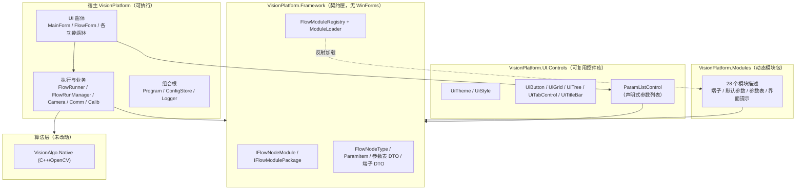

# VisionPlatform 解耦重构：模块化与可复用界面

> 本文是「视觉算法 / UI 界面 / 主框架」解耦改造的**唯一权威记录**：
> 重构前的耦合点、目标架构与依赖规则、实施内容、前后对比、逐文件修改记录、验证结果与扩展指南。
>
> - 改造日期：2026-11-07
> - 约束：**不改任何算法代码**（`VisionAlgo.Native` 的 C++ 与 `FlowRunner` 的算法执行体均未改动）
> - 验证：Debug / Release 双配置构建通过；`SmokeUi` 929 项、`SmokeAlgo` 334 项全部 PASS
> - 关联文档：[增量架构设计 §7 公共约定](增量架构设计.md)、[平台架构（改造前快照）](../平台架构.md)

---

## 0. 结论摘要

| 项 | 改造前 | 改造后 |
|---|---|---|
| 解决方案项目数 | 4 | 7（新增 Framework / Modules / UI.Controls） |
| 模块清单归属 | 宿主 `FlowModule.cs` 静态 `List` | 模块包 `VisionPlatform.Modules.dll`，运行时反射加载 |
| 新增一个算法节点要改的文件 | 6~8 个（跨 UI / 流程 / 参数 / 端子） | 1 个项目内 4 处（UI 代码 0 处） |
| 参数面板 | `NodeParamPanel` 1086 行，内含节点特判 | 通用控件 `ParamListControl` + 宿主适配器约 250 行 |
| 参数表 / 端子表 | 宿主 `Flow/` 内三个巨型 switch | 模块包内声明；宿主只保留查询门面 |
| 画布 / 流程窗体的节点类型分支 | 3 处 switch + 5 处 `if (type == ...)` | 0 处（由模块声明 `UiHints` 驱动） |
| 通用界面控件 | 与业务同程序集，无法复用 | `VisionPlatform.UI.Controls.dll`，仅依赖 Framework |
| 算法执行代码 | — | **未改动** |

一句话：**宿主不再认识"有哪些算法"，只认识"模块契约"**；界面不再认识"节点类型"，只认识"参数表 + 界面声明"。

---

## 1. 重构前的耦合点（含证据）

先说明已经做得好的部分，避免误伤：

- C++ 算法与 C# 之间只有 `Native/VisionAlgo.cs`、`Native/NativeCamera.cs` 一道 P/Invoke 边界；
- `Flow` / `Camera` / `Communication` / `Core` **没有反向引用** `VisionPlatform.UI`（仅有注释提及）；
- UI 对原生库的引用只有 `SplashForm` 打版本号，没有算法调用。

真正的耦合集中在**"节点类型"这一条信息被复制到了 8 个地方**，以及**界面与框架同处一个程序集**：

### 1.1 节点类型 switch 爆炸

`FlowNodeType` 在改造前被 16 个文件引用，其中 7 个是"按类型分支"的实现：

| 位置 | 形式 | 规模 | 后果 |
|---|---|---|---|
| `FlowModule.CreateDefaultParams` | `switch (Type)` | 覆盖 28 类节点，约 340 行 | 新增节点必须改宿主目录 |
| `NodeParamSchema.For` | `switch (type)` + 26 个私有方法 | 约 900 行 | 新增节点必须改宿主参数表 |
| `FlowPortSchema` 静态构造 | 30+ 次 `Register(...)` | 约 400 行 | 新增节点必须改宿主端子表 |
| `FlowCanvasControl.TypeStripeColor` | `switch (t)` | 28 个 case | 新增节点没有色条（灰块） |
| `FlowForm.RefreshNodeLayoutPreview` | 4 段 `if (type == ...)` | 约 90 行 | 卡尺类预览写死在窗体里 |
| `FlowForm.TemplateAlgorithmOf` / OCR 卡片 | `if (type == ShapeMatch/TemplateMatch/Ocr)` | 5 处 | 模板 / OCR 卡片与节点类型绑定 |
| `NodeParamPanel` | `type == CalibTransform`、按 Key 特判 | 2 处 | 参数面板认识具体节点 |

引用计数（改造前，`grep -c "FlowNodeType\."`）：

```
NodeParamSchema 54 | FlowModule 54 | FlowPortSchema 39 | FlowRunner 32
FlowCanvasControl 21 | NodeResultText 15 | FlowOrder 15 | FlowForm 12
FlowValidator 9 | NodeOutputSchema 8 | NodeParamPanel 3 | 其它 6
```

### 1.2 界面与框架同程序集

- `VisionPlatform` 单程序集 5 万余行，其中 `UI/` 约 2.3 万行、`Flow/` 约 1.8 万行；
- 通用控件（主题、按钮、表格、树、标题栏）放在 `UI/` 下，任何复用都要拖上整个业务程序集；
- 参数面板 1086 行，既是"通用渲染器"又是"节点特判 + 标定/通讯服务定位器"；
- `UiTheme` 通过 `using VisionPlatform.Core` 与日志/配置产生隐性依赖（`UiThemeManager` 直接 `ConfigStore.Save()`）。

### 1.3 模块目录是静态封闭集合

`FlowModule.All` 是 `static readonly List<FlowModuleInfo>`，28 个 `new FlowModuleInfo(...)` 写死在宿主里：

- 无法在不重新编译宿主的情况下增加模块；
- 无法按客户/产线裁剪模块（删一个模块要改代码）；
- 工具箱、节点创建、校验、参数面板全部依赖同一份静态表，改一处影响全局。

### 1.4 参数表认识业务服务

`NodeParamSchema.CommNameField()` 直接调用 `CommRegistry.Names()`；`NodeParamPanel.BuildCalibOptions()` 直接读 `ConfigStore.Current.Calibrations`：

- 参数表无法脱离宿主复用；
- 换一个宿主（例如配方编辑器）就要把通讯/标定一起搬过去；
- 新增动态下拉（配方、相机、用户）只能继续往 UI 里加 `if (key == ...)`。

---

## 2. 目标架构与依赖规则

### 2.1 分层



### 2.2 依赖方向（硬规则）

| 从 \ 到 | Framework | Modules | UI.Controls | 宿主 VisionPlatform | VisionSystem.Controls | 原生 DLL |
|---|---|---|---|---|---|---|
| **Framework** | — | ✗ | ✗ | ✗ | ✗ | ✗ |
| **Modules** | ✓ | — | ✗ | ✗ | ✗ | ✗ |
| **UI.Controls** | ✓ | ✗ | — | ✗ | ✗ | ✗ |
| **宿主** | ✓ | 仅构建顺序（`ReferenceOutputAssembly=false`） | ✓ | — | ✓ | P/Invoke |
| **VisionSystem.Controls** | ✗ | ✗ | ✗ | ✗ | — | 仅 `IntPtr` |

**三条禁令**：

1. 模块包**不得**引用任何窗体、执行器、原生算法；只实现 `IFlowNodeModule` / `IFlowModulePackage`。
2. 控件库**不得**引用业务（Core / Flow / Camera / Comm），只依赖 Framework 的数据类型与 `System.Windows.Forms`。
3. 宿主**不得**按节点类型写 UI 分支；节点差异一律通过模块声明（`NodeUiHints`、`NodeParamTable`、`OptionsSource`、`LiveSource`）表达。

### 2.3 模块契约

`VisionPlatform.Framework/Modules/FlowNodeModule.cs`：

```csharp
public interface IFlowNodeModule
{
    string Key { get; }                 // = FlowNode.Type 持久化字符串，发布后不得改名
    string DisplayName { get; }
    string CategoryKey { get; }
    int Order { get; }
    string Description { get; }

    List<FlowPortDef> Inputs { get; }
    List<FlowPortDef> Outputs { get; }
    List<ParamItem> CreateDefaults();
    NodeParamTable CreateParams();      // 声明式参数表，界面据此生成
    NodeUiHints Ui { get; }             // 色条 / 横幅 / 模板算法 / 布局预览
    Dictionary<string, string> CreateNewNodeOverrides();
}
```

`NodeUiHints` 把原先散在 UI 里的"节点长什么样"收敛为数据：

| 字段 | 替代的旧代码 |
|---|---|
| `StripeColor` | `FlowCanvasControl.TypeStripeColor` 的 28 分支 |
| `BannerKind`（`template` / `ocr`） | `FlowForm` 里 5 处节点类型判断 |
| `TemplateAlgorithm` | `FlowForm.TemplateAlgorithmOf` |
| `Previews`（`LineCaliper` / `CircleCaliper` + 参数前缀） | `FlowForm.RefreshNodeLayoutPreview` 的 4 段 if |

---

## 3. 实施内容

### 3.1 新增 `VisionPlatform.Framework`（1017 行，无 WinForms）

- `Modules/FlowNodeModule.cs`：`IFlowNodeModule`、`IFlowModulePackage`、`NodeUiHints`、`LayoutPreviewSpec`。
- `Modules/ModuleCategories.cs`：8 个分类的唯一真源 + 节点色条常量。
- `Modules/FlowModuleRegistry.cs`：注册 / 查询 / 稳定排序 / 首次访问自动扫描。
- `Modules/ModuleLoader.cs`：`Assembly.LoadFrom` + 反射创建包，**单包失败只记日志**。
- `Model/FlowNodeType.cs`、`Model/ParamItem.cs`、`Parameters/ParamTypes.cs`、`Ports/FlowPortTypes.cs`：
  从宿主下沉的纯数据类型，**命名空间保持 `VisionPlatform.Flow`**，因此所有调用点无需改 using。

### 3.2 新增 `VisionPlatform.Modules`（2077 行，仅依赖 Framework）

- `BuiltInModules.cs`：28 行清单（Key / 显示名 / 分类 / 顺序 / 色条 / 预览 / 横幅），顺序与原 `FlowModule.All` **逐项一致**。
- `BuiltInDefaults.cs`：原 `CreateDefaultParams` 的 switch（逐字迁入）。
- `BuiltInParamTables.cs`：原 `NodeParamSchema` 的 26 张参数表（逐字迁入）。
- `BuiltInPorts.cs`：原 `FlowPortSchema` 的 28 组端子（逐字迁入）。
- `BuiltInModulesPackage`：模块包入口，由 `ModuleLoader` 反射创建。

### 3.3 新增 `VisionPlatform.UI.Controls`（3289 行）

- 迁入通用控件：`UiTheme`、`UiStyle`、`UiButton`、`UiGrid`、`UiTree`、`UiTabControl`、`UiTitleBar`、`UiToolStripRenderer`；
- 新增 `ParamListControl`：从 `NodeParamPanel` 抽出的**声明式参数列表**（分组折叠 / 高级参数 / 枚举 / 文件 / 目录 / 动作行 / 横幅槽位）；
- 新增 `IParamValueStore`、`IParamOptionProvider`：控件不依赖 `FlowNode`，可被任意宿主复用；
- 解掉最后一处业务依赖：删除未被调用的 `UiTheme.LogLevelColor(LogLevel)`，控件库不再引用 Core。

### 3.4 宿主侧：门面 + 适配器（调用点不变）

| 宿主文件 | 改造方式 |
|---|---|
| `Flow/FlowModule.cs` | `FlowModuleInfo` 包装 `IFlowNodeModule`；`All`/`Categories` 由注册表生成；删除 28 行硬编码清单 |
| `Flow/NodeParamSchema.cs` | 保留 `For/HasSchema/DefaultOf` 门面，转发 `module.CreateParams()` |
| `Flow/FlowPortSchema.cs` | 保留查询 API 与兼容矩阵，端子来自 `module.Inputs/Outputs` |
| `UI/NodeParamPanel.cs` | 1086 行 → 244 行适配器：`FlowNode` → `IParamValueStore`，通讯/标定 → `IParamOptionProvider` |
| `UI/FlowCanvasControl.cs` | 删除 `TypeStripeColor` 的 28 分支，改读 `module.Ui.StripeColor` |
| `UI/FlowForm.cs` | 布局预览改为按 `LayoutPreviewSpec` 通用构建；模板/OCR 卡片改按 `BannerKind` 判断 |
| `Flow/ScriptEngine.cs` | 动态编译补引 `VisionPlatform.Framework`（类型下沉后的必要修复） |
| `Program.cs` | 启动时初始化模块注册表并把加载结果写日志 |

### 3.5 “按需加载”的两个层次（边界说明）

| 层次 | 做法 | 说明 |
|---|---|---|
| 控件按需实例化 | `ParamListControl` 在 `NodeParamPanel` 构造时创建，参数行在 `SetNode` 时按当前参数表重建 | 不预先为 28 个节点各建一套面板，内存与启动时间与节点数无关 |
| 模块声明按需加载 | 启动首次访问注册表时扫描 `Modules\*.dll` 并反射注册 | 宿主编译期不认识模块包；模块缺失只影响工具箱内容，不影响启动 |

**没有做**"每个窗体一个插件 DLL"：`MainForm` / `FlowForm` 与相机、配方、流程执行强绑定，
拆成插件只会把依赖藏进反射、把 Designer 与调试链路弄断，收益远小于风险。
真正需要插件化的是**算法模块的声明**，这部分已经完成。

### 3.6 动态加载的部署形态

```
bin\x64\Debug\
├── VisionPlatform.exe
├── VisionPlatform.Framework.dll
├── VisionPlatform.UI.Controls.dll
├── VisionSystem.Controls.dll
└── Modules\
    └── VisionPlatform.Modules.dll      ← 宿主编译期不引用，运行时反射加载
```

- 项目引用设置 `ReferenceOutputAssembly=false`：**只保证构建顺序，不产生编译期依赖**；
- 模块工程对自己的 Framework 引用设 `Private=false`：防止 `Modules\` 下出现第二份 Framework，
  否则 `LoadFrom` 会产生**类型标识不一致**，模块被静默忽略（本次真实踩到，见 §6.2）。

---

## 4. 前后框架对比

### 4.1 项目结构

```text
改造前（4 个项目）                       改造后（7 个项目）
─────────────────────────────           ──────────────────────────────────────────
VisionSystem.sln                        VisionSystem.sln
├─ VisionAlgo.Native      (C++)         ├─ VisionAlgo.Native        (C++，未改动)
├─ VisionSystem.Controls  (显示控件)     ├─ VisionSystem.Controls    (显示控件，未改动)
├─ VisionPlatform         (宿主+UI+流程) ├─ VisionPlatform.Framework (契约/注册表/数据类型)
└─ ...                                   ├─ VisionPlatform.Modules   (28 个算法模块声明)
                                         ├─ VisionPlatform.UI.Controls(主题/通用控件/参数列表)
                                         └─ VisionPlatform           (宿主：窗体+执行+业务)
```

### 4.2 各文件职责变化

| 文件 | 改造前 | 改造后 | 行数变化 |
|---|---|---|---|
| `Flow/FlowModule.cs` | 模块清单 + 默认参数 switch | 仅目录门面 | 778 → 356 |
| `Flow/NodeParamSchema.cs` | 26 张参数表 | 查询门面 | 1168 → 44 |
| `Flow/FlowPortSchema.cs` | 28 组端子 + 查询 | 查询门面 + 兼容矩阵 | 705 → 124 |
| `UI/NodeParamPanel.cs` | 参数渲染 + 节点特判 + 业务下拉 | 纯适配器 | 1086 → 244 |
| `UI/FlowCanvasControl.cs` | 28 分支色条 | 读模块声明 | 1927 → 1907 |
| `UI/FlowForm.cs` | 4 段布局预览 + 5 处类型判断 | 通用构建 + 声明判断 | 2864 → 2875（分支变通用构建） |

### 4.3 新增一个算法节点：操作步骤对比

**改造前（6~8 个文件，跨 3 个目录）**

1. `FlowModels.cs`：枚举末尾加成员；
2. `FlowModule.cs`：`All` 加一行 + `CreateDefaultParams` 加 case；
3. `NodeParamSchema.cs`：加 `For` 分支 + 写一张参数表；
4. `FlowPortSchema.cs`：静态构造里 `Register(...)`；
5. `FlowCanvasControl.cs`：`TypeStripeColor` 加 case；
6. `FlowForm.cs`：若有 ROI 预览 / 模板卡片，再加 if 分支；
7. `FlowRunner.cs`：实现执行体（算法代码，本来就要改）；
8. 重新编译整个宿主。

**改造后（1 个项目内 4 处 + 执行体）**

1. `VisionPlatform.Framework/Model/FlowNodeType.cs`：枚举末尾加成员（持久化字符串约束不变）；
2. `VisionPlatform.Modules/BuiltInModules.cs`：清单加一行（Key / 名称 / 分类 / 色条 / 预览）；
3. `VisionPlatform.Modules/BuiltInDefaults.cs` + `BuiltInParamTables.cs` + `BuiltInPorts.cs`：各补一段；
4. `VisionPlatform/Flow/FlowRunner.cs`：实现执行体（**算法代码，按约束不属于本次改造范围**）。

宿主 UI **零改动**：工具箱、画布、参数面板、校验器、结果区自动出现新节点。

### 4.4 界面复用能力

| 能力 | 改造前 | 改造后 |
|---|---|---|
| 在其它程序集复用主题/按钮/表格 | 需引用整个 `VisionPlatform.exe` | 引用 `VisionPlatform.UI.Controls.dll` |
| 参数列表用于非流程节点 | 不可能（绑定 `FlowNode`） | 实现 `IParamValueStore` 即可 |
| 动态下拉（通讯/标定） | 面板内 `if (key == ...)` | 参数表声明 `OptionsSource`，宿主提供 `IParamOptionProvider` |
| 运行时实时值（上游坐标） | 面板内 `if (type == CalibTransform)` | 参数表声明 `LiveSource`，`IParamValueStore.TryGetLive` |
| 参数控件类型扩展 | 改 `NodeParamPanel.CreateInput` | 改 `ParamListControl.CreateInput`（纯 UI 层，独立演进） |

---

## 5. 修改记录（逐文件）

### 5.1 新增

| 文件 | 说明 |
|---|---|
| `src/VisionPlatform.Framework/VisionPlatform.Framework.csproj` | 契约层工程（v4.8，AnyCPU，无 WinForms） |
| `Framework/Model/FlowNodeType.cs` | 从 `FlowModels.cs` 下沉 |
| `Framework/Model/ParamItem.cs` | 从 `FlowModels.cs` 下沉 |
| `Framework/Parameters/ParamTypes.cs` | 从 `NodeParamSchema.cs` 下沉；新增 `OptionsSource` / `LiveSource` |
| `Framework/Ports/FlowPortTypes.cs` | 从 `FlowPortSchema.cs` 下沉 |
| `Framework/Modules/FlowNodeModule.cs` | 模块契约 + `NodeUiHints` + `LayoutPreviewSpec` |
| `Framework/Modules/ModuleCategories.cs` | 分类与色条常量 |
| `Framework/Modules/FlowModuleRegistry.cs` | 注册表 + 自动加载 |
| `Framework/Modules/ModuleLoader.cs` | DLL 反射加载与错误隔离 |
| `src/VisionPlatform.Modules/*` | 28 个模块的声明、默认参数、参数表、端子 |
| `src/VisionPlatform.UI.Controls/ParamListControl.cs` | 声明式参数列表控件 |
| `src/VisionPlatform.UI.Controls/IParamValueStore.cs` | 值存储 / 动态选项契约 |
| `docs/架构/VisionPlatform解耦重构.md` | 本文 |

### 5.2 迁移（`git mv`，命名空间不变）

`UiTheme.cs`、`UiStyle.cs`、`UiButton.cs`、`UiGrid.cs`、`UiTree.cs`、`UiTabControl.cs`、`UiTitleBar.cs`、`UiToolStripRenderer.cs`
：`src/VisionPlatform/UI/` → `src/VisionPlatform.UI.Controls/`。

### 5.3 修改

| 文件 | 改动 |
|---|---|
| `VisionPlatform.csproj` | 增加 Framework / UI.Controls 引用；Modules 仅构建顺序；移除已迁移文件的 `Compile` 项 |
| `VisionSystem.sln` | 增加 3 个项目及配置映射 |
| `Flow/FlowModule.cs` | 清单/分类改为注册表生成；默认参数与"新节点覆盖值"转发模块 |
| `Flow/NodeParamSchema.cs` | 收敛为 3 个查询方法 |
| `Flow/FlowPortSchema.cs` | 收敛为查询门面（端子来自模块） |
| `Flow/ScriptEngine.cs` | 脚本编译补引 Framework（否则 `FlowPortKind` CS0012） |
| `UI/NodeParamPanel.cs` | 重写为适配器（参数渲染交给 `ParamListControl`）；实时坐标不再回写参数（旧实现会经 ValueChanged 把运行时值写进配置） |
| `UI/FlowCanvasControl.cs` | 类型色条改读模块声明 |
| `UI/FlowForm.cs` | 布局预览通用化；模板/OCR 卡片按 `BannerKind`；移除节点类型分支 |
| `Program.cs` | 启动初始化模块注册表并记录数量/失败数 |
| `README.md` | 项目数与分层更新 |
| `docs/README.md` | 新增本文索引 |
| `docs/平台架构.md` | 顶部标注"改造前快照" |

### 5.4 删除

| 文件 | 原因 |
|---|---|
| `src/VisionPlatform/UI/NodeParamPanel.Designer.cs` | 面板改为纯代码适配器，不再需要设计器资源 |

> 说明：`src/SmokeUi`、`src/SmokeAlgo` 为本地探针（`.gitignore` 已排除），
> 本次同步更新了它们对新控件结构的反射路径与工程引用，未纳入版本库。

### 5.5 算法代码零改动（核对清单）

以下文件**未做任何修改**：

- `src/VisionAlgo.Native/**`（C++ / OpenCV / OpenVINO 全部算法）
- `Flow/FlowRunner.cs`（节点执行体与原生调用）
- `Flow/FlowOrder.cs`（执行顺序推导）
- `Flow/FlowValidator.cs`（拓扑校验）
- `Flow/NodeResultText.cs`（结果文案，见 §8）
- `Flow/NodeOutputSchema.cs`（输出变量契约）
- `Camera/`、`Communication/`、`Calibration/`、`Recipe/`、`Data/`、`Native/`

---

## 6. 验证

### 6.1 结果

| 项 | Debug | Release |
|---|---|---|
| `build.bat` 全解决方案 | PASS | PASS |
| `SmokeUi`（650+ 项界面/流程/主题/权限/日志） | **929 / 0 FAIL** | **929 / 0 FAIL** |
| `SmokeAlgo`（算法回归 + 端口 + 脚本 + 并行） | **334 / 0 FAIL** | **334 / 0 FAIL** |

重点回归项：

- 28 类模块的端子总数为 **131**（与改造前 §4 清单逐条一致）；
- 模块分类归属（深度学习 3 项、测量类 5 项、标定转换仍在定位与匹配）全部不变；
- 参数面板的分组折叠、禁用态 tooltip、动作行、横幅卡片挂载全部通过；
- 脚本节点可正常引用 `FlowPortKind` 并读取带类型的端口值；
- 旋转中心下拉仍为「不使用 + N 条记录」，且带圆心/R/RMS 文案。

### 6.2 本次真实踩到的两个坑（已修）

1. **模块包目录里多了一份 `VisionPlatform.Framework.dll`**
   模块工程的 `ProjectReference` 默认 `Private=true`，会把 Framework 复制进 `Modules\`。
   `Assembly.LoadFrom` 再加载这份副本后，`IFlowModulePackage` 与宿主里的同名接口**类型标识不同**，
   `IsAssignableFrom` 返回 false → 模块被静默忽略（表现为"端子全空、工具箱 0 项"）。
   修复：模块工程对 Framework 引用设 `<Private>false</Private>`，并清理输出目录。
2. **脚本节点编译期缺 Framework 引用**
   `FlowPortKind` 等类型下沉后，`ScriptEngine` 的 `CompilerParameters.ReferencedAssemblies`
   只加了宿主程序集 → 用户脚本报 CS0012。修复：补加 `typeof(FlowPortKind).Assembly.Location`。

### 6.3 部署检查清单

1. `Modules\VisionPlatform.Modules.dll` 必须随程序发布；缺失时软件仍能启动，但工具箱为空，日志有明确记录；
2. 若现场替换模块 DLL，需**重启软件**（本期不做热重载）；
3. 新增第三方模块包时，目标框架必须是 .NET Framework 4.8，且只引用 `VisionPlatform.Framework.dll`；
4. 不要把 `VisionPlatform.Framework.dll` 复制进 `Modules\`（见 §6.2）。

---

## 7. 扩展指南

### 7.1 新增算法模块（不改宿主 UI）

1. 在 `FlowNodeType` **末尾**追加枚举成员（字符串持久化，不能插队/改名）；
2. 在 `BuiltInModules.RegisterAll()` 追加一行：Key、显示名、分类、色条、可选预览/横幅；
3. 在 `BuiltInDefaults.Create` 补默认参数；
4. 在 `BuiltInParamTables.Create` 补参数表（没有参数可返回 null）；
5. 在 `BuiltInPorts` 静态构造补 `Register(...)`；
6. 在 `FlowRunner` 实现执行体（算法代码）。

### 7.2 新增参数控件类型

1. `NodeParamKind` 末尾追加（枚举值持久化兼容）；
2. `ParamListControl.CreateInput` 加分支；
3. `ParamListControl.LoadValues` / 事件回写加对应分支；
4. 只影响控件库，宿主与模块包无需改动。

### 7.3 新增动态下拉来源

1. 模块参数表声明 `field.OptionsSource = "recipe"`；
2. 宿主 `NodeParamPanel`（或新的 `IParamOptionProvider` 实现）按来源返回 `List<NodeParamOption>`；
3. 控件零改动。

### 7.4 新增布局预览形状

1. `LayoutPreviewKind` 末尾追加；
2. `FlowForm` 的通用构建器加一个分支（唯一需要改 UI 的地方）；
3. 模块在 `NodeUiHints.Previews` 声明前缀与文案。

### 7.5 新增独立模块包（第三方）

```csharp
// 只引用 VisionPlatform.Framework.dll
public sealed class MyPackage : IFlowModulePackage
{
    public string Name { get { return "客户 A 专用模块"; } }
    public void Register() { FlowModuleRegistry.Register(new MyModule()); }
}
```

放到 `Modules\` 下，重启即可出现在工具箱；不需要重新编译宿主。

> **边界（必须明确）**：本期的执行器（`FlowRunner`）与 `FlowNodeType` 仍是编译期闭合集合，
> 因此第三方包**只能针对已定义的 Key 补充/覆盖声明**（例如调整默认参数、参数表、端子、界面提示），
> 不能凭空新增一个可执行节点类型。新增类型仍需同时扩展枚举与执行器（属于算法代码，按约束不在本次改动范围）。
> `FlowModuleRegistry.Register` 会拒绝未定义的 Key 并写日志，避免"画得出来、跑不了"的节点混进工具箱。
>
> **覆盖顺序**：模块目录按文件名排序加载，后注册的同 Key 覆盖先注册的；内置包名为
> `VisionPlatform.Modules.dll`，第三方包若需覆盖内置声明，文件名应排在其后（如 `Z-Customer.dll`）。

---

## 8. 本次未纳入的部分（边界与理由）

| 内容 | 现状 | 理由 / 后续 |
|---|---|---|
| `FlowRunner` 的节点执行 switch | 保留 | **算法代码**，按约束不改；新增算法仍需在此实现执行体 |
| `FlowOrder` 的依赖顺序表 | 保留 | 算法语义（谁依赖谁），与界面无关 |
| `NodeResultText` 的结果文案 | 保留 | 文案与 `FlowNodeMetrics` 强绑定；如需模块化，应先抽 `IResultMetrics` 视图（后续增量） |
| `NodeOutputSchema` 的输出变量契约 | 保留 | 脚本 API 的契约，属于执行层 |
| `VisionPlatform.UI` 的窗体（MainForm 等） | 保留在宿主 | 它们是"壳"，依赖具体业务；通用**控件**已抽出 |
| 模块热重载 / 卸载 | 未实现 | `Assembly.LoadFrom` 无法卸载；需要 AppDomain/进程隔离，收益低 |
| 第三方模块的签名/版本校验 | 未实现 | 现场为受控部署；后续可加清单文件与哈希校验 |

---

## 9. 维护约定（新增）

1. **模块包内可以出现节点类型 switch，宿主 UI 内不可以**。发现宿主 UI 里出现 `type == FlowNodeType.X`，
   就是一次耦合回潮，应改为模块声明。
2. 参数表新增字段必须同时改 `BuiltInDefaults`（默认值）与 `BuiltInParamTables`（界面），
   Key 必须逐字一致；`NodeParamSchema.DefaultOf` 会用它兜底。
3. 任何"只在某个节点上出现"的界面行为，优先扩展 `NodeUiHints` / `NodeParamField` 的声明字段，
   不要在窗体里加 if。
4. 修改 `VisionPlatform.UI.Controls` 后，必须同时跑 `SmokeUi`（它覆盖主题、参数面板、卡片挂载）。
5. 发布前检查 `Modules\` 目录只有模块 DLL，没有 Framework 副本（§6.2）。
